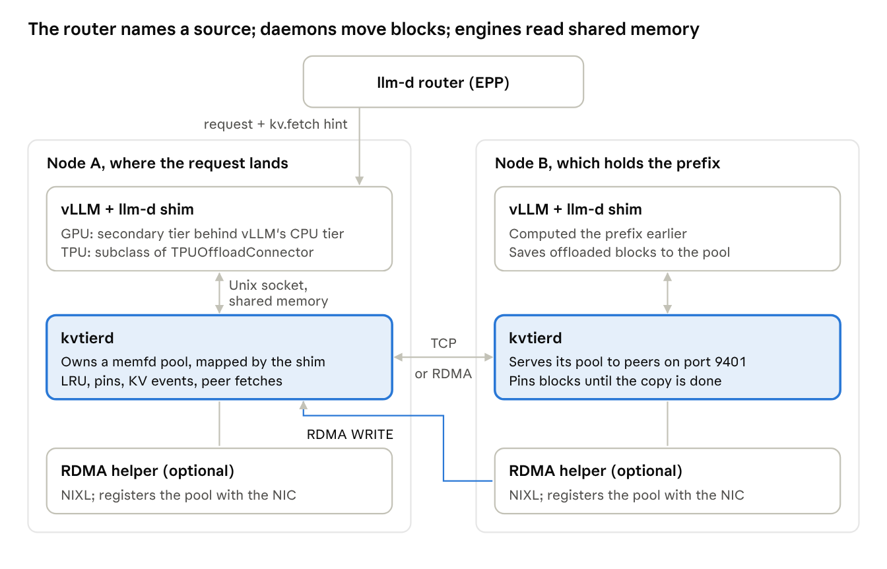
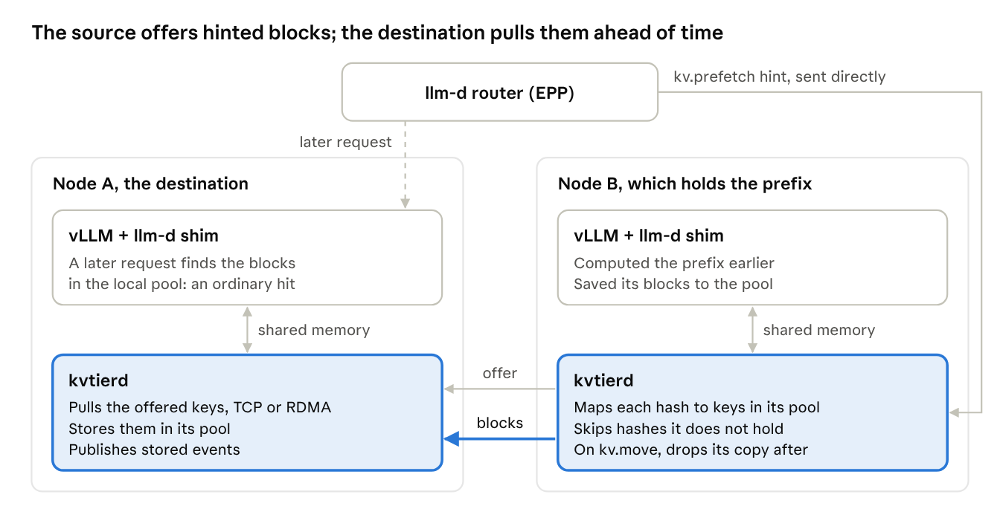
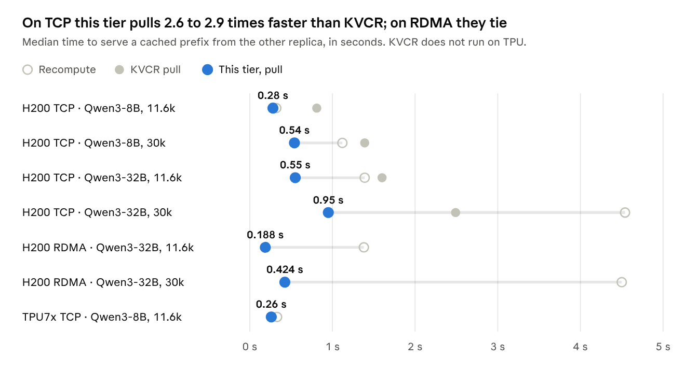

# RFC: Node-level KV tier (`kvtierd`)

- **Status:** RFC. Open for comment. No decision is made yet.
- **Date:** 2026-11-24
- **Tracking issue:** TBD
- **Target components:** `llm-d-router` (new `kvtierd` daemon, engine shims for vLLM, EPP hint plugins)

---

## Summary

We propose that llm-d own its KV tier. The tier has two parts:

- **A daemon on each node, `kvtierd`.** It owns a pool of KV blocks in shared memory. Every engine on the node can use it.
- **A shim in each engine.** A shim is a small Python adapter loaded inside vLLM. It connects the engine to the daemon.

On GPU the shim talks to the daemon. On TPU there is no daemon. vllm-torchtpu already talks to TPU Sync, and our shim sits on its connector.

Together they carry out router hints such as "pull this prefix from node X".

How the tier relates to other projects:

- **On GPU, the tier moves the data itself.** It uses TCP everywhere, and RDMA where the nodes have RDMA NICs.
- **On TPU, the engine side already exists.** TPU Sync moves and stores the data, and vllm-torchtpu drives it. llm-d adds a thin shim that turns router hints into vllm-torchtpu calls, and the router that sends the hints. A proof of concept runs `kv.fetch` this way.
- **Mooncake Store is an alternative on GPU.** An engine runs one or the other. Customers already on Mooncake Store should stay on it.

The code works. It is checked in on branches of a fork of [llm-d-router](https://github.com/llm-d/llm-d-router). No code PR is open yet. The TPU work does not block the GPU work. They share only the hint format.

## Why

The router needs a tier that carries out its KV hints on every accelerator llm-d serves. The matrix below compares the options against what the router needs.

| What the router needs | vLLM CPU offload | [KVCR](https://github.com/ai-dynamo/kvcr) | Mooncake Store | CPU sharing proposal ([llm-d#3047](https://github.com/llm-d/llm-d/issues/3047)) | vllm-torchtpu and TPU Sync | This proposal |
| --- | --- | --- | --- | --- | --- | --- |
| Hardware | GPU | GPU | GPU | GPU | TPU | GPU and TPU |
| Carries out router hints | No | Yes, all four actions | No | No | No | Yes on GPU. `kv.fetch` on TPU so far. |
| llm-d can add a hint on its own | No | No. Its policy interface covers placement and eviction, not hints. | No | No | No | Yes |

KVCR already covers most of the list on GPU. Three gaps remain:

- **No option covers both GPU and TPU.** KVCR runs the hints on GPU only. On TPU, vllm-torchtpu moves blocks between pods but does not read hints. The router would need a different path for each accelerator.
- **llm-d cannot add a hint on its own.** Examples are compression for cross-host transfer, pinning shared prefixes and retention priority. Each one waits on another project's design and release.
- **No hint-driven option has a per-node pool.** KVCR leaves it out by design. The CPU sharing proposal has the pool but no hints and no transfer between nodes.

This proposal closes the gaps with one rule. The hint policy lives in one layer that llm-d owns. Each accelerator supplies the mechanism that stores and copies blocks.

- **On GPU the mechanism is a per-node daemon.** It also provides the shared pool.
- **On TPU the mechanism is vllm-torchtpu and TPU Sync.** llm-d adds only a thin shim.

The router sends the same hints to both, and a new hint is defined once. The hints follow vLLM's KV hint format, which KVCR also uses. A router can drive either tier with the same messages.

### The tradeoff

This proposal has a cost. llm-d would maintain another KV tier on GPU: the daemon, its transfer code and a shim for each engine. SGLang support is in progress and needs a second shim and a way to receive hints.

The alternative is to build nothing on GPU:

- **On GPU, use KVCR as it is.** It already runs the four hints, has an SGLang preview and can keep its pool across an engine failure.
- **On TPU, put the effort into vllm-torchtpu and TPU Sync.** The asks at the end of Risks apply either way.
- **Keep a separate recipe for each accelerator.** The router sends the same hint format to both.

| | This proposal | KVCR on GPU, TPU Sync on TPU |
| --- | --- | --- |
| What llm-d maintains | The GPU daemon and a shim for each engine and accelerator | The router, the recipes, and at most a thin TPU shim |
| Hint behavior on GPU and TPU | Defined once, in llm-d's layer | Implemented twice, by KVCR and by vllm-torchtpu. It can drift. |
| Adding a hint | llm-d adds it on its own | Each one goes through KVCR for GPU and vllm-torchtpu for TPU |
| Per-node shared pool on GPU | Yes | No. The CPU sharing proposal could supply it, but it has no hints yet. |
| SGLang on GPU | In progress | In preview today |
| Deployment | One recipe shape | One recipe for each accelerator |

The alternative is less code for llm-d to own, and it works on GPU today. This proposal is worth its cost only if llm-d needs the flexibility to add hints on its own, or the per-node pool. A written hint contract that KVCR and vllm-torchtpu both follow would reduce the drift without a new tier. On GPU, KVCR already runs the four hints, so the case for the daemon rests on the three gaps above.

## Design

This section describes the GPU tier. The TPU path is under "TPU Sync and vllm-torchtpu" below. Each node runs one daemon, `kvtierd`, written in Go. It owns a shared-memory pool of fixed-size KV blocks. Each engine's shim copies blocks in and out of the pool. vLLM needs no change.

### Fetch: pull a prefix when the request arrives

A `kv.fetch` hint flows like this:

1. The router sends the request to node A. The hint names node B's daemon as the source.
2. Node A's shim asks its daemon to fetch the request's blocks from node B.
3. The blocks move. With RDMA, node B's helper writes them into node A's pool, or straight into vLLM's CPU tier on GPU. Without RDMA, they travel over 8 TCP streams into pool slots.
4. Node A's daemon publishes a stored event. The shim then loads the blocks as ordinary hits.

### Prefetch and move: push a prefix ahead of the request

`kv.prefetch` copies blocks to another node before a request needs them. `kv.move` does the same, and the source then drops its copy. The router chooses the blocks. Its call lists 64-bit block hashes. These are the block hashes in vLLM's KV events.

1. The router sends the hint straight to the source daemon. The hint lists the block hashes and names the destination daemon.
2. The source daemon maps each hash to the keys in its pool. It skips hashes it does not hold.
3. It offers those keys to the destination daemon. The destination pulls them into its pool over TCP or RDMA.
4. A later request on the destination finds the blocks in its local pool. It needs no hint.

Prefetch and move have four limits:

- Only blocks in the source daemon's pool can move. vLLM stores blocks to its tiers as soon as they are computed, so finished prefixes usually get there.
- The hashes must be exact. `kv.fetch` can fall back to the whole request. Prefetch cannot.
- The router's prefix index does not keep these hashes today. It stores a key that mixes each hash with the model name, and that key cannot be turned back into the hash. Before a router can send a prefetch, the index must keep the raw hash for each block, or the daemon must accept the index's key.
- No router sends prefetches yet. llm-d's router sends only `kv.fetch` ([#4303](https://github.com/llm-d/llm-d-router/pull/4303)). Deciding what to prefetch, and when, is new router work.

A later request does not wait for a prefetch:

- If the blocks have not arrived, the lookup misses and vLLM recomputes them.
- A fetch commits all its blocks together at the end. An early request gets no partial hit.
- The router should therefore send prefetches early, for example while a session waits on a tool call.
- The router can also add a `kv.fetch` hint to the later request. Blocks already delivered are skipped, and the rest are pulled.
- vLLM's tier interface has a `RETRY` lookup result for blocks still in transfer. It would let the request wait. The tier does not use it yet.

The router sends a prefetch or move straight to the source daemon's peer port. It does not attach it to an inference request.

- The message is vLLM's KV hint envelope with a `kv.prefetch` or `kv.move` action. It is the same hint a request could carry.
- The message also names the model. A request would normally supply that.
- A shared token guards the call. The call is off unless the daemon has a token.
- vLLM needs no change. Blocks that land in a pool reach vLLM through the existing stored events.

The router sends it directly because a hint on a request needs a request. A prefetch that rode on requests to the source could only move when the source had traffic.

Pinning and retention hints will be sent the same way.

Two pieces of work remain:

- The rest of the peer port needs authentication. It is plain TCP today. Any host that reaches it can pull blocks, or tell a daemon to pull blocks from another one.
- The router needs a plugin that decides what to prefetch and when. It can already build a daemon's endpoint from the pod's address when the daemon is a sidecar. A DaemonSet deployment needs a way to map an engine to its node's daemon.

### Memory

The daemon creates the pool with `memfd_create`. It touches every page at startup, so the memory is charged to the daemon's container. It passes the pool's file descriptor to each shim over a Unix socket. vLLM and the daemon then see the same pages. Only control messages cross the socket. The pool survives an engine restart. It does not survive a daemon restart.

### Trust

Every engine connected to a daemon maps the whole pool. A bug or stray write in one engine can corrupt blocks another engine uses. The design assumes the engines on a node trust each other. Namespaces prevent accidental sharing between models. They do not isolate untrusted tenants, and that is not a goal. Anyone who can open the daemon's socket can reach the pool. The socket is created with mode 0660. The deployment must limit who can open it.

### Transfers

All transfers go from host RAM to host RAM. GPU or TPU memory takes part only through each engine's own local copies. This tier does not move KV directly between GPUs. That is the job of prefill/decode disaggregation.

### Failure rules

- A client can still be copying when its connection drops. The daemon therefore holds that client's pins and half-written slots for a grace period, 10 s by default.
- A request that changes state and times out closes the connection. The daemon then cleans up.
- Pool changes, their events and their replies are sent in one order.
- The RDMA helper waits for every transfer it started. If it cannot confirm they stopped, it exits, which stops them.
- After such a failure, the destination keeps the affected slots out of use. The zero-copy path re-registers vLLM's memory, so a late write fails at the NIC.

### Namespaces

Engines share blocks only when their bytes are interchangeable. The namespace covers the model, KV dtype, KV cache groups and layers, memory layout, block size, parallelism and engine version. An optional salt covers anything else, such as the model revision.

### Eviction and events

- The pool evicts by LRU. It is the only policy today (`--policy lru`).
- The policy sits behind an interface. Future hint actions, such as pinning a shared prefix or setting retention priority, can change eviction without touching the rest of the daemon.
- A block is never evicted while an engine is copying it in or out.
- A store that finds no evictable slot gets no slot.
- Every stored or removed block becomes an event. Each engine connected in that namespace receives it, in the order the pool changed.
- The vLLM shim turns these into vLLM KV events (`BlockStored`, `BlockRemoved`, medium `CPU`). llm-d's prefix indexer already consumes those, so the router learns of evictions with no new channel.
- A shim that loses its daemon reports all its blocks as removed.

The router can lose sight of blocks that are still in a pool:

- When a shim reconnects, it announces the pool's blocks again. Those events carry hashes and no tokens.
- The router's index accepts such an event only if it already knows the hash from an earlier event that carried tokens.
- After the router's index restarts, it has no such record, and it drops these events. An engine restart also clears that engine's entries in the index. The blocks are then indexed again only where the record still exists.
- The node still serves those blocks to requests that land on it. The router cannot route or send hints for them until the prefixes are computed again.
- Rebuilding the index needs a replay of events that carry tokens. That is not designed yet.

## How it fits with KVCR, TPU Sync and Mooncake

These projects follow two architectures:

- **KVCR and this tier are peer to peer and hint-driven.** Each node holds its own blocks. The router directs moves through vLLM's KV hints.
- **Mooncake Store is centrally coordinated.** A master tracks every block, and engines pull on demand. It does not read router hints, so a router cannot ask it to prefetch or move.

KVCR is the closest comparison on GPU. On TPU, TPU Sync and vllm-torchtpu are the tier.

| Project | What it does | Overlap with this tier | Proposed fit |
| --- | --- | --- | --- |
| [KVCR](https://github.com/ai-dynamo/kvcr) (NVIDIA Dynamo) | Secondary tier for vLLM. Runs the four hint actions. Uses NIXL for transfers. GPU only. | Same hints, same vLLM hook | An alternative on GPU. Same hint format, so routers drive either. |
| [TPU Sync](https://github.com/google/tpu-sync) | C++ library. Copies between TPU memory and host memory. Host pool that survives restarts. Reads across hosts. Global registry. One secondary backend. | Host pool, restart survival, cross-host moves | The TPU data path, driven by vllm-torchtpu. Our shim adds the hint policy. |
| [Mooncake](https://github.com/kvcache-ai/Mooncake) | Store: cluster-wide DRAM and SSD pool with a central master, leases and pins. Transfer Engine: RDMA, TCP, NVLink. Conductor: KV event index. | Cross-node pool and lookup | An alternative to Mooncake Store on GPU. Transfer Engine could be our transport. |
| `llmd_fs_backend` (llm-d-kv-cache) | Replaces vLLM's offloading spec. Stores blocks as files. | None at the memory tier | Complementary. The planned SSD tier could reuse its file and GPUDirect Storage code. |

### TPU Sync and vllm-torchtpu

On TPU the data path already exists, in two layers:

- **TPU Sync** is a library that copies KV blocks between TPU memory and host memory, and between hosts. It keeps the host store and a registry of which pod holds which block. Its copies between TPU memory and host memory run at about 200 GB/s per host. Its transfers between hosts reach about 350 Gbit/s with two NICs.
- **vllm-torchtpu** is vLLM's PyTorch backend for TPU. Its offloading connector calls TPU Sync. It offloads blocks to the host store, reloads them, reads them from a peer on a miss, and reports evictions as KV events.

We add no daemon and no host pool on TPU. llm-d keeps a thin shim on vllm-torchtpu's connector (`llmd_kv_tiering.torchtpu_connector`, about 90 lines today). vllm-torchtpu and TPU Sync provide the mechanism: offload, peer read, push. The shim holds the policy: it parses the router's hints and decides which of those to call. Today it does one thing. It lets a peer read happen only when a `kv.fetch` hint names that peer. Without it, vllm-torchtpu reads from any peer on every miss, and the router cannot direct it.

The shim keeps hint behavior the same on GPU and TPU, and lets llm-d add a hint without waiting for an engine release. Today it wraps internal methods of vllm-torchtpu. We ask for supported hooks in their place. If vllm-torchtpu prefers to handle hints itself, the shim is not needed on TPU, and the router still gets what it needs.

llm-d's router does the rest. It tracks where blocks are, decides what to fetch or push, and sends the hints. Without those hints, nothing moves between pods.

Four limits today:

- vllm-torchtpu has no push to a peer, so `kv.prefetch` is not available yet. TPU Sync's store supports the push.
- TPU Sync has no caller-driven removal. `kv.move` cannot free the source copy.
- A peer read or a push into a full host store fails unless TPU Sync's evict sweep is on.
- Each engine's store has its own host pool. Two engines on one host do not share blocks through it.

### Mooncake

Mooncake Store and this tier are alternatives. vLLM takes one KV connector per engine. Mooncake Store uses `MooncakeStoreConnector`. This tier sits behind `OffloadingConnector`.

What Mooncake Store has that this tier lacks:

- Any engine can reach any block through the master, with no router hint.
- An SSD tier, replication, pins and an event indexer.
- It ships today, and llm-d already has a guide for it.

What this tier has that Mooncake Store lacks:

- No master. Each node runs one Go binary that owns its pool.
- The router directs moves, including ahead of a request. Mooncake's vLLM connector does not read router hints.
- Faster pulls over TCP, and at long prompts over RDMA (see Results).
- The same hints on TPU.

This tier depends on the router. It does nothing across nodes unless the router sends a hint. The llm-d router's hint support is still an open PR ([#4303](https://github.com/llm-d/llm-d-router/pull/4303)).

A customer already on Mooncake Store has little reason to add this tier. Mooncake could gain hint support through a Mooncake-backed tier for vLLM's tiering framework, which is where vLLM delivers hints. None exists today.

The two could combine in one place, transport. The tier's RDMA helper could call Mooncake's Transfer Engine directly. This is not built.

- Transfer Engine can register the pool (`register_memory`) and write to a peer's address (`transfer_sync_write`). That maps one to one onto the helper's write.
- Its `P2PHANDSHAKE` mode needs no etcd.
- NIXL's own Mooncake backend is not a shortcut. It is a preview, it is missing from the `nixl` pip wheel, and its CI test is disabled over a data corruption issue.

## Results so far

### Against KVCR

Each test pulls a cached prompt from the other replica with a `kv.fetch` hint. It compares that with recomputing the prompt there. On TCP this tier pulls 2.6 to 2.9 times faster than KVCR. On RDMA they tie.

| Hardware, transport | Model, prompt | Recompute | Pull, this tier | Pull, KVCR |
| --- | --- | --- | --- | --- |
| H200, TCP | Qwen3-8B, 11.6k tokens | 0.32 s | 0.28 s | 0.81 s |
| H200, TCP | Qwen3-8B, 30k tokens | 1.12 s | 0.54 s | 1.39 s |
| H200, TCP | Qwen3-32B, 11.6k tokens | 1.39 s | 0.55 s | 1.60 s |
| H200, TCP | Qwen3-32B, 30k tokens | 4.54 s | 0.95 s | 2.49 s |
| H200, RDMA | Qwen3-32B, 11.6k tokens | 1.38 s | 0.188 s | 0.185 s |
| H200, RDMA | Qwen3-32B, 30k tokens | 4.50 s | 0.424 s | 0.420 s |

The values are medians of 5, measured in November 2026 on two H200 nodes on GKE. Both tiers ran on the same nodes, vLLM image and router. The Qwen3-32B rows were measured on November 20 on the code in the branches below. The Qwen3-8B, TPU and KVCR numbers come from runs on an earlier revision.

- **TCP is faster because the tier spreads the work.** Each pull uses 8 TCP connections, about 100 Gbit/s, and copies into vLLM on 8 threads. With one connection and one thread, the Qwen3-8B 11.6k pull took 1.03 s, slower than KVCR.
- **RDMA ties because both tiers push.** The source's helper writes blocks straight into the destination vLLM's CPU tier with RDMA WRITE. A 30k-token pull moves 7.85 GB in about 218 ms. On these nodes RDMA READ reached 137 to 162 Gbit/s on 4 KiB-page memory. WRITE reached 293 to 307 Gbit/s.
- **The result holds through the router.** The router's endpoint picker (EPP) from [#4303](https://github.com/llm-d/llm-d-router/pull/4303) chose the sources. Repeat requests that landed on the other replica pulled an 11.6k-token prefix in 240 ms median with this tier and 555 ms with KVCR. Recompute took 331 ms.

### Against Mooncake Store

Both ran on the same nodes and vLLM image, with Qwen3-32B on one H200 per replica. Mooncake used vLLM's `MooncakeStoreConnector`, configured as in llm-d's tiered prefix cache guide (embedded mode, 80 GB per pod). It ran with two placements:

- **Random** is the guide's default.
- **Writer-local** (`local_first`) keeps each block on the node that stored it.

Each value is the median time for replica B to serve a prefix that replica A computed. Requests were 3 s apart.

| Transport, prompt | Recompute | This tier | Mooncake, random | Mooncake, writer-local |
| --- | --- | --- | --- | --- |
| TCP, 11.6k tokens | 1.4 to 1.5 s | 0.55 s | 0.88 s | 1.20 s |
| TCP, 30k tokens | 4.6 to 5.1 s | 0.95 s | 2.2 s with 6 s gaps. Partial or no hits at 3 s. | 3.07 s |
| RDMA, 11.6k tokens | 1.38 s | 0.188 s | 0.165 s | 0.171 s |
| RDMA, 30k tokens | 4.5 s | 0.424 s | 0.76 s | 0.753 s |

Over TCP, this tier is faster with either placement:

- With random placement, Mooncake stores in the background. About half of each store crosses the network as it is written. At 30k tokens with 3 s gaps, a backlog built. B then found only the first 8,192 tokens, or nothing.
- Writer-local placement removed the backlog, but pulls were slower. Prefill on the same hosts slowed too. A 30k recompute took 7.1 s, against 4.6 s with random placement.
- This tier stores to the local pool. It crosses the network only on a pull.

Over RDMA, each side wins once. Mooncake is about 10% faster at 11.6k tokens with either placement. This tier is about 1.8 times faster at 30k tokens.

### Shared pool

Two Qwen3-8B engines ran on one node and shared one daemon. Engine B served prefixes that engine A had stored, with all tokens cached. It took 0.13 s at 11.6k tokens, against 0.32 s to recompute. It took 0.24 s at 30k tokens, against 1.11 s.

### Prefetch

This test ran on the Qwen3-32B TCP pair. It read a prompt's block hashes straight from A's KV events, not from the router's index. It then sent a `kv.prefetch` hint naming B. In the first run, the hint rode on a small inference request to A's engine. A later request to B found the blocks in B's pool.

| Prompt | Prefetch lands after | Later request on B | Same prefix by `kv.fetch` | Recompute |
| --- | --- | --- | --- | --- |
| 11.6k tokens | 0.1 to 0.25 s | 0.17 to 0.18 s | 0.55 s | 1.39 s |
| 30k tokens | about 0.43 s | 0.40 to 0.50 s | 0.95 s | 4.5 s |

The 30k transfer ran at about 145 Gbit/s. A request that arrived before the prefetch landed got no partial hit and recomputed.

A second run sent the same hint straight to A's daemon, with no request to A's engine. It gave the same result. The call returned in 4 ms, against 27 ms for the request that carried the hint in the first run. The later request on B took 0.21 to 0.26 s at 11.6k tokens and 0.39 to 0.43 s at 30k tokens.

### Failures

- **Killing the source daemon during a run of pulls caused no errors.** The request in flight recomputed. Both engines stayed up.
- **Killing the destination daemon in the middle of a fetch failed cleanly.** That request recomputed, and so did requests during the downtime. After the daemon came back, 16 of 16 pulls were full hits.

### Earlier TPU prototype on the daemon

These were measured with the daemon on TPU7x hosts. That path is not proposed. They are kept for the record.

- **A pull beat recompute.** Qwen3-8B at 11.6k tokens took 0.26 s to pull over TCP, against 0.33 s to recompute.
- **Pulled KV was correct.** Greedy outputs with pulled KV matched the source's own cached output in 8 of 8 prompts.
- **The pool survived restarts.** After an engine restart, old prompts loaded from the pool in about 0.1 s, against 0.3 s to recompute. After a daemon restart under a running vLLM, the worker reconnected in 14 s and pulls resumed.

### On TPU

Two replicas ran on TPU7x, one host each, on the vllm-torchtpu nightly image with its TPU Sync connector and our shim. No daemon. The values are time to first token, medians of 5, with one request at a time.

| Request on B | Qwen3-8B, 11.6k | Qwen3-8B, 30k | Qwen3-32B, 11.6k | Qwen3-32B, 30k |
| --- | --- | --- | --- | --- |
| Recompute, fresh prompt | 0.209 s | 0.561 s | 0.479 s | 1.515 s |
| Same prompt as A, no hint | 0.211 s | 0.576 s | 0.482 s | 1.520 s |
| Same prompt as A, `kv.fetch` hint naming A | 0.329 s | 0.460 s | 0.286 s | 0.654 s |
| A's own cache hit | 0.173 s | 0.073 s | 0.059 s | 0.087 s |

- **The hint decides.** With no hint, B read nothing from A in 20 of 20 runs. With a hint, B read every full block in 20 of 20 runs. Outputs were correct.
- **Fetch pays off on the larger model.** On Qwen3-32B it is 1.7 times faster than recompute at 11.6k tokens and 2.3 times faster at 30k. On Qwen3-8B it helps only at 30k.
- **Hinted fetches came in at two speeds.** On Qwen3-8B at 11.6k, three runs took about 0.34 s and two took 0.20 s. vllm-torchtpu's own peer read, with no shim, took a steady 0.196 s. We have not found the cause.
- **A full host store needs two settings.** With a 3,840-block store that had filled, every peer read failed, and by vLLM's default each request returned an error. With `kv_load_failure_policy` set to `recompute`, the requests recomputed and succeeded, about 0.22 s slower than with no hint at 30k tokens. With TPU Sync's store monitor and evict sweep also on, no read failed, and the 30k fetch took 0.645 s. The sweep dropped cold blocks locally. It sends them to another store only when the pool has a dedicated store node on a higher tier.

Prefetch is not in vllm-torchtpu yet. We measured what it is worth with an earlier standalone connector on the JAX backend. After a prefetch, B served a 30k-token prompt on Qwen3-32B in 0.165 s, against 1.363 s to recompute. At 11.6k tokens it took 0.091 s against 0.461 s. A push into a full store was refused 5 of 5 times. With TPU Sync's evict sweep on, 5 of 5 landed.

Not tested yet: concurrent traffic, and replicas that span several hosts.

## Risks and open questions

The biggest open question was how the TPU path should work with TPU Sync. Three of the six questions are answered, and three are partly answered:

1. ✅ **Hints in.** Can an engine connector ask TPU Sync to pull given blocks from a given peer? Yes. The store provides Load and RemoteRead, and vllm-torchtpu already uses them for peer reads. Our shim makes that read wait for a `kv.fetch` hint.
2. ✅ **Connector version.** Which connector should we build on? vllm-torchtpu's `TPURaidenOffloadingConnector`. The TPU Sync team confirmed that the `RaidenOffloadConnector` in tpu-inference is deprecated.
3. ✅ **Sharing.** Can several engines on one host share a TPU Sync host pool? Not between engines. Two engines on one host get separate memory segments. A helper process can reach one store's host memory. See question 6.
4. **Events.** Does the router learn which blocks a pod holds in host memory? Partly. vllm-torchtpu reports host evictions as `BlockRemoved` KV events. We did not find a matching `BlockStored` when a save completes. So the router learns that a block left host memory, but not that it arrived.
5. **Secondary backend.** Is it pluggable from outside? Partly. vllm-torchtpu uses it for a POSIX storage tier. Whether other backends can plug in is open.
6. **Extension hooks.** Can outside code add transforms on host blocks, such as compression, or new hint actions? Partly. The TPU Sync team says another process on the host can share the store's host memory and operate on the blocks. It must restore the original format before a block is copied back to the TPU. There is no hook API for this, and we have not tried it. New hint actions are not answered.

The TPU path is a thin shim on vllm-torchtpu. What is missing, we will file as issues on vllm-torchtpu and tpu-sync:

- vllm-torchtpu: a supported way for an outside policy to allow or deny a peer read per request ([#3704](https://github.com/vllm-project/vllm-torchtpu/issues/3704)).
- vllm-torchtpu: a manager call to push given blocks to a given peer ([#3705](https://github.com/vllm-project/vllm-torchtpu/issues/3705)).
- vllm-torchtpu: a `BlockStored` event for the host tier ([#3706](https://github.com/vllm-project/vllm-torchtpu/issues/3706)).
- tpu-sync: caller-driven removal of a block, for `kv.move`.
- tpu-sync: a way to trigger a push from outside the engine.

Other risks:

- **The Mooncake comparison is narrow.** It covers one model and two replicas, with random and writer-local placement. Larger clusters and load from many sessions are not measured yet.
- **RDMA failure handling is tested against a fake NIXL agent,** not real NIC failures. The logic is covered. Real completion and failure behavior is not.
- **Some numbers come from an earlier revision.** The Qwen3-8B and KVCR numbers were measured before later fixes. The Qwen3-32B ones were measured on the code in the branches below.
- **The router's index is not ready for this tier.** It does not keep the raw block hashes that prefetch and move need. After it restarts, it cannot rediscover blocks that are already in a pool. The Design section describes both.
- **Hint names need agreement.** New actions should be agreed with the vLLM hint RFC authors before release. Routers then do not need two vocabularies.
- **A restarted daemon is unavailable for about 14 s.** It creates its 32 GiB pool only when the first engine connects, and touching every page takes that long. Stores in that window are lost. Starting the daemon with `--slot-bytes` creates the pool at startup. The deployment examples should set it.

## Plan

The code targets [llm-d-router](https://github.com/llm-d/llm-d-router):

- the daemon in `cmd/kvtierd`
- its packages in `pkg/kvtier`
- the engine shims in `kv_connectors/llmd_kv_tiering`

It is split into six stacked branches on a fork. Each branch is one commit that passes `make lint` and its tests. No code PR is open yet. Each will open after the one before it is reviewed.

| # | Branch | Contents |
| --- | --- | --- |
| 1 | [`kvtier-1-daemon`](https://github.com/kaushikmitr/llm-d-inference-scheduler/tree/kvtier-1-daemon) | Daemon and vLLM GPU tier: store, load, KV events, restart survival |
| 2 | [`kvtier-2-hints`](https://github.com/kaushikmitr/llm-d-inference-scheduler/tree/kvtier-2-hints) | Router hints, peer transfer over TCP |
| 3 | [`kvtier-3-tpu`](https://github.com/kaushikmitr/llm-d-inference-scheduler/tree/kvtier-3-tpu) | Early TPU prototype on the daemon. Replaced by branch 6. Not proposed for merge. |
| 4 | [`kvtier-4-rdma`](https://github.com/kaushikmitr/llm-d-inference-scheduler/tree/kvtier-4-rdma) | RDMA through a NIXL helper. It pushes into the pool, or into vLLM's CPU tier on GPU. |
| 5 | [`kvtier-5-direct-prefetch`](https://github.com/kaushikmitr/llm-d-inference-scheduler/tree/kvtier-5-direct-prefetch) | Direct router-to-daemon call for prefetch and move, guarded by a token |
| 6 | [`kvtier-6-tpusync`](https://github.com/kaushikmitr/llm-d-inference-scheduler/tree/kvtier-6-tpusync) | TPU shim on vllm-torchtpu's TPU Sync connector. Also holds an earlier standalone JAX connector, now retired. |

Next steps:

- [x] Show that router hints can drive TPU Sync, with a shim on vllm-torchtpu (`kvtier-6-tpusync`).
- [x] Benchmark hinted fetch on vllm-torchtpu with Qwen3-8B and Qwen3-32B.
- [ ] File the asks on vllm-torchtpu and tpu-sync, and agree on them with their teams.
- [ ] Test hinted fetch on vllm-torchtpu under concurrent traffic and on replicas that span several hosts.
- [ ] Agree names for new hint actions with the vLLM hint RFC authors.
- [ ] Add authentication to the rest of the daemon's peer port. Add a router plugin that sends prefetch and move through the direct call.
- [ ] Compare against Mooncake Store on larger clusters and under load from many sessions.
