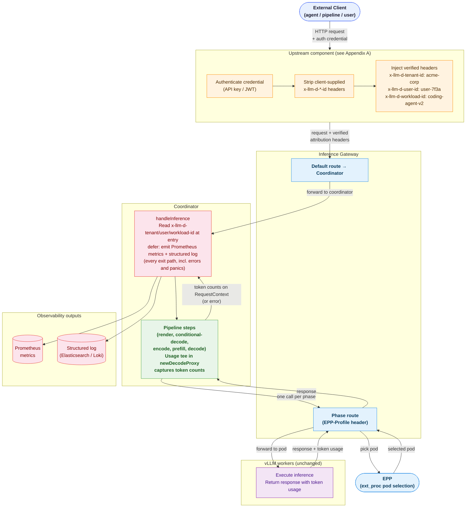

# Request Attribution Metrics — Coordinator Implementation

**Authors**: Sima Nadler (_IBM_)

**Related Issue**: [llm-d/llm-d-router#2741](https://github.com/llm-d/llm-d-router/issues/2741)

## Summary

llm-d tracks token usage and infrastructure cost per model today but has no mechanism to
attribute those costs to the **business entities** that generate them: tenants, users, and
workloads. Without this, multi-tenant platform teams cannot do chargeback, enforce
per-tenant budgets, or identify which workloads are cost-inefficient.

This proposal introduces request attribution implemented by the [coordinator](../../README.coord.md) — tagging every
inference request with a `tenant_id`, `user_id`, and `workload_id` carried in request
headers and propagating those identities through the coordinator's observability stack.

A [separate proposal](./open-cost-new-dimensions-plan-coordinator.md) describes the enhancements to OpenCost for generating inference costs per tenant, workload and user based on the new metrics described in this proposal.


## Motivation

The existing cost tracking stack ([OpenCost](https://github.com/opencost/opencost/blob/develop/docs/inference-cost-tracking.md) + vLLM metrics) answers "what does it cost to
serve model X?" It cannot answer:

- Which team or customer is responsible for that cost?
- Which application, agent, or pipeline is driving GPU spend?
- Is a specific user consuming a disproportionate share of shared infrastructure?

### Goals

The primary goal of this proposal is for llm-d to generate the metrics needed to calculate inference costs
attributed by tenant, workload, and user — enabling chargeback, per-team budget
enforcement, and cost anomaly detection without changes to vLLM, the EPP, or the
Inference Gateway.

Supporting goals:

- **Aggregate attribution** — Prometheus counters carry `tenant_id`, `workload_id`, and
  `model_name` labels (and optionally `user_id`) so dashboards, alerts, and OpenCost
  billing queries work without a log aggregation backend.
- **Per-request audit** — a structured JSON log record is emitted for every request that
  reaches `handleInference`, including requests that fail or are rejected before or
  during the pipeline. It always includes `tenant_id` and `workload_id`, the outcome, and
  the token counts known at exit, and includes the end-user identity (raw or keyed hash)
  only when the operator opts in via `log_user_id`, as an audit aid for deployments where
  Prometheus `user_id` cardinality is disabled.
- **Zero footprint on the critical path** — attribution is opt-in, degrades gracefully
  when headers are absent, and adds no latency visible to the client.

### Non-Goals

- Replacing or deprecating `x-llm-d-inference-fairness-id`. That header governs
  flow-control scheduling in the EPP and is unchanged.
- Forwarding attribution headers to vLLM or the EPP beyond what they already carry
  through normal header forwarding.
- Implementing or specifying client authentication or authorization.
- Per-request payload inspection or body-based routing.
- Real-time budget enforcement or request admission based on spend.
- Log aggregation infrastructure. The structured log record is written to the
  coordinator's standard logger; shipping it to a log backend is the operator's
  responsibility.

### Example Use Cases

- **Workload cost comparison** — an engineering team compares two agent versions
  side-by-side to see which costs less per million tokens, directly in dollars.
- **Platform team chargeback** — a platform team bills internal product teams by querying
  per-tenant cost breakdowns at the end of each month.
- **Per-user billing with unbounded users** — a SaaS platform serves thousands of end
  users and produces per-user invoices by querying the coordinator's structured log stream
  when Prometheus label cardinality makes per-user metrics impractical.
- **Cost governance and anomaly detection** — a platform team configures alerts on
  per-tenant token consumption; when a tenant exceeds its expected monthly budget
  mid-cycle, an alert fires before the bill arrives.
- **A/B model rollout cost comparison** _(blocked — see [Known Limitations](#known-limitations))_ — comparing costs
  across a model-rewrite canary is not reliable with the current implementation because
  `model_name` reports the requested model, not the served one, for rewritten traffic.

## Why the Coordinator

The coordinator is the single entry point for every client request in the llm-d
coordinator deployment model. It owns the full request lifecycle — from the inbound
OpenAI request through each disaggregated phase (encode → prefill → decode) to streaming
the final response — giving it natural access to attribution headers, token counts,
serving model, and end-to-end timing without any additional instrumentation hooks. It
also already has `pkg/coordinator/metrics`, a structured logger, and a `RequestContext`
that threads per-request state through the pipeline, so attribution slots in as a
first-class extension.

For a discussion of alternative components that were considered (IPP, EPP, gateway
filter, sidecar), see [Alternatives Considered](#alternatives-considered).

## Proposal

### Two Output Tiers

Attribution data is produced at two granularities:

| Tier | Mechanism | Granularity | `user_id` | Primary use case |
|---|---|---|---|---|
| **Tier 1** | Prometheus metric labels | Aggregate | Configurable (`prometheus_user_id_label`) | Real-time dashboards, alerting, chargeback |
| **Tier 2** | structured JSON log | Per-request, every request reaching `handleInference` (success, error, panic) | Configurable (`log_user_id`: `none`, `hashed`, `plain`) | Audit aid, per-user attribution |

**Tier 1 — Prometheus metric labels** are the right tool for questions like "how many
tokens did `acme-corp` consume this hour?" They feed directly into Grafana dashboards
and OpenCost billing queries. Adding `user_id` as a label on high-cardinality deployments
causes Prometheus time-series explosion, so it is controlled by a configuration gate.

**Tier 2 — Structured JSON log** is an audit aid emitted for every request that reaches
`handleInference`, whatever its outcome. It always includes `tenant_id` and
`workload_id`, the outcome, and the token counts known at exit; the end-user identity is
included only as the operator configures via `log_user_id` (default: omitted). For
deployments where Prometheus `user_id` cardinality is disabled and `log_user_id` is
`hashed` or `plain`, it serves as the per-user attribution record. It is
**not** an authoritative billing record: logs are subject to sampling, rotation, and
backpressure drops and are not a reliable transport for billing data. Where tracing is
enabled, per-request attribution fields (tenant, user, workload, token counts) should be
recorded as span attributes on the request trace span.

### Attribution Headers

Three request headers, all in the `x-llm-d-*` namespace:

| Header | Description | Example value |
|---|---|---|
| `x-llm-d-tenant-id` | Organizational unit responsible for the request | `acme-corp` |
| `x-llm-d-user-id` | Individual end user within the tenant | `user-7f3a` |
| `x-llm-d-workload-id` | Application, agent, or pipeline submitting the request | `coding-agent-v2` |

All three are optional. Omitted (or empty) headers result in the literal value `unknown`
in metric labels and log fields. `unknown` means "no value was supplied"; it is distinct
from the `other` overflow value described under
[Effect of the cap on the bill](#effect-of-the-cap-on-the-bill).

> [!WARNING]
> **Trust Boundary**: In a production deployment, end-users must never be permitted to
> self-assert these values. These headers must be stripped from external requests and
> injected by a trusted upstream component (API gateway, identity proxy, or service mesh
> policy) based on verified credential data. See [Appendix A](#appendix-a-populating-attribution-headers-in-production).

### Coordinator Metric Labels (Aggregate Attribution)

Two new **counter** metric families are added under `llm_d_coordinator`:

| Metric | Type | Labels (always) | Labels (conditional) | Description |
|---|---|---|---|---|
| `llm_d_coordinator_request_input_tokens_attributed_total` | Counter | `model_name`, `tenant_id`, `workload_id` | `user_id` | Prompt tokens accumulated per attribution dimensions |
| `llm_d_coordinator_request_output_tokens_attributed_total` | Counter | `model_name`, `tenant_id`, `workload_id` | `user_id` | Completion tokens accumulated per attribution dimensions |

`model_name` is the requested model from the request body (same as the existing
`requestInputTokens` histogram). It is the OpenCost join key: `model_name:namespace`
identifies the per-model cost rates used to price the attributed token counts.

These counters do **not** emit a `namespace` label from the coordinator process. Like every
other coordinator metric, `namespace` is attached at scrape time (for example by the
Prometheus Operator `ServiceMonitor` from `__meta_kubernetes_namespace`). This is
deliberate: a label emitted by the process that collides with a scrape-attached target
label is renamed `exported_namespace` unless `honorLabels: true` is set (the chart's
ServiceMonitor does not set it), which would make the result depend on scrape
configuration. Relying on the scrape-attached label also means the numerator
(these counters) and the denominator (`llm_d_coordinator_request_input_tokens`) of the
OpenCost coverage check source the `model_name:namespace` join key from the same place.
This enables the composite join key used by OpenCost to partition dimension-token data
per deployment when multiple coordinators run in different namespaces on a shared
cluster. The structured log record (below) is not scraped, so it does carry `namespace`
explicitly.

`tenant_id` and `workload_id` are always present as labels. Both are header-driven with
no closed set; they **must** be routed through the coordinator's existing
[`BoundedLabel`](../../pkg/coordinator/metrics/cardinality.go) mechanism, exactly as
`model_name` is today. That includes the ordering `boundModel` uses: an empty header value
is resolved to the `unknown` sentinel **first**, and only then passed to `Bound`.
`BoundedLabel.Bound("")` returns `""` without consulting the cap, so bounding first would
emit an empty label value (which Prometheus treats as the label being absent) and
bypass the cap. Resolving the sentinel first also means a client that never sends the
headers occupies a single `unknown` slot rather than being able to exhaust the cap on
its own. Each attribution label therefore gets a `boundTenant` / `boundWorkload` wrapper
equivalent to `boundModel`.

**How `BoundedLabel` works.** Each label dimension gets its own
[`BoundedLabel`](../../pkg/coordinator/metrics/cardinality.go) instance (a
thread-safe, in-memory admitted set) initialised once at process startup. When a
request arrives:

1. If the value has been seen before, it passes through unchanged.
2. If the value is new and the admitted set has fewer than 1 000 entries, it is
   admitted and passes through unchanged.
3. If the admitted set is already at 1 000 entries, the value is folded to the
   sentinel `"other"` (`metricsutil.OverflowValue`) — the request is still recorded;
   only its label value changes.

The admitted set **never evicts**: there is no TTL and no shrink, and a value once
admitted always returns itself. The cap is therefore not "the 1 000 most recent
values"; it is the **first 1 000 distinct values observed since process start**.

#### Effect of the cap on the bill

The fold is a cardinality control, but for a chargeback feature its consequence for
the bill is what an operator needs to understand:

- **Tenant 1 001 onward is billed as `other` for the lifetime of the process.** This
  holds even after some or all of the original 1 000 tenants have gone idle, because
  admitted values are never released.
- **A restart re-rolls which values are admitted.** The first 1 000 distinct values seen
  after the restart win the slots, so a tenant that had its own series before the
  restart may land in `other` after it (and the reverse). Series for the same tenant can
  therefore differ in label value across a restart boundary.
- **Folded cost cannot be split back out.** Past the cap, tokens (and hence cost) from
  every folded tenant accumulate into one `other` series shared by an unbounded number of
  tenants. Neither Prometheus nor OpenCost can recover the per-tenant split afterwards;
  the structured log record is the only per-request source (and, per the Tier 2 caveats
  above, is not authoritative for billing).
- **The only signal is the `other` row.** There is no dedicated overflow counter or
  alert; the presence of `tenant_id="other"` (or `workload_id="other"`) in the output is
  the indication that the cap has been reached.

`other` and `unknown` are different things and both appear as values of the same label:

| Value | Meaning | Operator action |
|---|---|---|
| `unknown` | The request carried no value for this header (absent or empty). | Fix the upstream header injection; see [Appendix A](#appendix-a-populating-attribution-headers-in-production). |
| `other` | The per-dimension cap was already full: *too many distinct values*. Cost belongs to an unbounded set of tenants/workloads. | Treat the affected billing period as non-attributable for those tenants. See the guidance below. |

The OpenCost side sees both values (`tenant_id="unknown"` and `tenant_id="other"`) and
must not merge them: `unknown` is a header-injection gap, `other` is a capacity limit.

**What to do on seeing an `other` row.** The cap is not configurable, so the options are
limited. First confirm the header source is trusted and not letting clients mint arbitrary
values (an untrusted or buggy upstream is the usual way to reach 1 000). If the tenant
population is genuinely larger than 1 000, per-tenant chargeback from these metrics is
not possible for this coordinator; the only lever is `request_attribution.enabled: false`,
and per-tenant attribution must come from another source. Restarting the coordinator
clears the admitted set but does not fix the underlying cause, and re-rolls which
tenants are admitted.

`BoundedLabel` caps the number of distinct values admitted **per label
dimension** at 1 000. It does **not** cap the total number of time series, which
is the cross-product of distinct values across all dimensions. With three
independently bounded dimensions (`model_name`, `tenant_id`, `workload_id`)
the worst-case series count on
`llm_d_coordinator_request_input_tokens_attributed_total` is on the order of
1 000³. All three dimensions are influenced by client-supplied input (two
headers plus the request body), so a single client can drive the product upward
without any individual per-dimension cap ever being reached.

The per-dimension caps therefore guard against noise and unbounded *distinct
value* growth, not against cross-dimensional series explosion. The same cap
(`maxModelLabelValues = 1 000`) is already in use for `model_name` and for the
EPP's `fairness_id` label.

`user_id` is **conditionally** included, controlled by coordinator configuration:

```yaml
request_attribution:
  enabled: true
  prometheus_user_id_label: false  # default: false (safe by default)
                                   # set true only for deployments with a bounded,
                                   # known requestor population (service accounts,
                                   # teams, named integrations)
```

> [!WARNING]
> **Cardinality**: `tenant_id` and `workload_id` are header-sourced with no closed set.
> Both are bounded per dimension by `BoundedLabel` (cap 1 000 each), which limits the
> number of distinct values admitted for each label individually. The cap admits the
> first 1 000 distinct values since process start and never evicts: further values are
> billed as `other`, irrecoverably, for the life of the process (see
> [Effect of the cap on the bill](#effect-of-the-cap-on-the-bill)). It does **not** limit
> the total number of time series: Prometheus series count is the product across
> co-occurring label values. With three client-influenced dimensions (`model_name`,
> `tenant_id`, `workload_id`) the worst-case series count is on the order of 1 000³ — a
> single client with arbitrary header values can exhaust memory without any individual cap
> being exceeded. The per-dimension cap is a package-level constant
> (`maxModelLabelValues` in `pkg/coordinator/metrics/cardinality.go`), not
> configuration, and `RequestAttributionConfig` has no knob to lower it or to disable the
> attributed metric families separately. The only lever is `request_attribution.enabled:
> false`, which turns off the entire feature (attributed metrics, the structured log
> record, and `stream_options` injection). Deployments that do not enforce attribution
> headers from a trusted upstream (e.g. a gateway or service mesh that injects them)
> should leave it disabled. `user_id` is **not** passed through `BoundedLabel`: when
> `prometheus_user_id_label: false` (the default) the label is absent entirely, and when
> `true` the operator has asserted a bounded, known requestor population. Do **not**
> enable `prometheus_user_id_label` for public-facing deployments with unbounded end-user
> populations. Per-user attribution is available via the structured log when the operator
> opts in with `log_user_id: hashed` or `plain` (see
> [Data protection for `user_id`](#data-protection-for-user_id)).
>
> **Restart required**: because the metric label set is fixed at registration time,
> flipping `prometheus_user_id_label` takes effect only after a coordinator restart.

The existing `llm_d_coordinator_request_input_tokens` (model-only label,
measured after render) is **not changed**. The new attributed counters are additive.
OpenCost queries the new counters using a delta (`last_over_time` end minus start) pattern described in
[`open-cost-new-dimensions-plan-coordinator.md`](open-cost-new-dimensions-plan-coordinator.md).

### Structured Log Record (Per-Request Audit)

A structured JSON record is emitted by the coordinator at request completion for **every
request handled by `handleInference`** (successful, failed, rejected, or panicked),
regardless of Prometheus label configuration. Requests that are served by the
[passthrough handler](../../pkg/coordinator/server/passthrough.go) (unregistered paths
such as `/v1/models` or `/v1/messages`) never parse their body and are out of scope. This
record is an **audit aid**,
not an authoritative billing record: logs are subject to sampling, rotation, and
backpressure drops and are not a reliable transport for billing data. Where tracing is
enabled, per-request attribution fields should be recorded as span attributes on the
request trace span instead of (or in addition to) the log record.

Example with `log_user_id: plain`. With `hashed`, `"user_id"` is replaced by
`"user_id_hash": "9b1c4e07a2d35f68c0e1b7a4d92f3e51"`; with `none` the field is absent.

```json
{
  "level": "info",
  "ts": "2025-07-01T14:23:01.123Z",
  "logger": "coordinator.attribution",
  "msg": "request.complete",
  "tenant_id": "acme-corp",
  "user_id": "user-7f3a",
  "workload_id": "coding-agent-v2",
  "model_name": "Qwen3-32B",
  "namespace": "llm-d",
  "prompt_tokens": 128,
  "completion_tokens": 512,
  "usage_captured": true,
  "outcome": "success",
  "request_id": "req-abc123"
}
```

A request that fails after render but before decode produces, for example,
`"prompt_tokens": 128, "completion_tokens": 0, "usage_captured": false, "outcome": "error", "error_code": "upstream_error"`.

- **User identity is gated by `log_user_id`**, independently of `prometheus_user_id_label`
  (default `none`):
  - `none` — no user identity field is written.
  - `hashed` — `user_id_hash` is written: a keyed HMAC-SHA256 of the header value,
    truncated to 128 bits. Records remain groupable per user without exposing the raw
    identifier.
  - `plain` — `user_id` is written verbatim.

  The record is emitted at `INFO` for every request, so operators choosing `hashed` or
  `plain` should apply retention and access controls to it. See
  [Data protection for `user_id`](#data-protection-for-user_id), including the fact that
  the raw header is still forwarded to EPP and vLLM.
- **`model_name`** is the value from the request body (`RequestContext.Model`).
- **`namespace`** is the Kubernetes namespace of the coordinator pod, populated from the
  `COORDINATOR_NAMESPACE` environment variable (defaults to `default` when absent).
- **`prompt_tokens`** and **`completion_tokens`** are the counts known at the point the
  request exits. `usage_captured` is `true` only when the `usage` object was read from
  the decode response; otherwise `completion_tokens` is `0` because it is *unknown*, not
  because the model produced nothing (for example a truncated stream, a client
  disconnect, or a failure before decode). Billing consumers must not treat
  `usage_captured: false` as a zero-cost request.
- **`outcome`** is `success` or `error`. `error_code` uses the same values as the
  existing `request_errors_total` metric and is present only when `outcome` is `error`.
- Is emitted at `INFO` level on the `coordinator.attribution` logger.
- Does **not** include request or response body content — metadata only.

## Design Details

### Architecture



> Metrics and the log record are generated synchronously, once per request, from the `handleInference` defer **after the response has been written to the client**. The reasons for this approach are described in
> [Appendix B: Synchronous vs. Asynchronous Emission](#appendix-b-synchronous-vs-asynchronous-emission).

### Where Attribution Data Lives

The three identity dimensions (`tenant_id`, `user_id`, `workload_id`) are read from the
inbound `x-llm-d-*-id` headers at the top of `handleInference` into a small
handler-local value, **before** the body is read. They are deliberately not stored only
on `RequestContext`: `RequestContext` is constructed after body parsing, so a request
rejected by the body-read, size-limit, or JSON-parse branches has no `RequestContext`,
yet must still be attributable. The same applies to the request ID, which is resolved at
entry (moved up from its current position after parsing) so early rejections log a
sanitized ID.

Three fields are added to [`pkg/coordinator/pipeline/context.go`](../../pkg/coordinator/pipeline/context.go).
They are populated by the usage tee in `newDecodeProxy` when the decode response is
received:

```go
// CompletionTokens is the completion token count from the decode response body.
// Populated by the usage tee from the vLLM "usage.completion_tokens" field.
// Zero when the decode response body was unavailable or unparseable; check
// UsageCaptured to distinguish "zero" from "unknown".
CompletionTokens int

// PromptTokensFromBody is the prompt token count read from the decode response body's
// usage.prompt_tokens field. Used when the render step is not in the pipeline and
// len(TokenIDs) is zero. Populated by the usage tee.
PromptTokensFromBody int

// UsageCaptured is true only when a usage object was successfully parsed from the
// decode response. False for failures before decode, truncated streams, client
// disconnects, and unparseable bodies.
UsageCaptured bool
```

### `handleInference`

#### Header extraction

In [`pkg/coordinator/server/handlers.go`](../../pkg/coordinator/server/handlers.go),
the three attribution identity fields are extracted at the top of `handleInference`,
before the `defer` is registered and before the body is read, inside the `Enabled` gate.
They live in a handler-local value so that the `defer` can read them on every exit path,
including the early body-read, size-limit, and JSON-parse rejections that return before
the `RequestContext` exists:

```go
var attr attributionIdentity // zero value: all fields "" (attribution disabled)
if s.attributionCfg.Enabled {
    attr = attributionIdentity{
        TenantID:   attributionHeader(r.Header, "x-llm-d-tenant-id"),
        UserID:     attributionHeader(r.Header, "x-llm-d-user-id"),
        WorkloadID: attributionHeader(r.Header, "x-llm-d-workload-id"),
    }
}
```

Where `attributionHeader` is a small helper that returns the header value or
`coordmetrics.AttributionUnknown` (declared in `pkg/coordinator/metrics/metrics.go`; the
handler does not hardcode the literal):

```go
func attributionHeader(h http.Header, key string) string {
    if v := h.Get(key); v != "" {
        return v
    }
    return coordmetrics.AttributionUnknown
}
```

Attribution headers are **not** added to the `internalForwardingHeaders` block-list in
`ForwardedHeaders()` — they should be forwarded to upstream services so that any step
that calls the gateway carries them through (consistent with how other x-llm-d-* headers
are handled). Consequence: `x-llm-d-user-id` reaches the EPP and vLLM and is outside the
control of `log_user_id`; see
[Data protection for `user_id`](#data-protection-for-user_id).

#### `stream_options.include_usage` injection

When `stream == true` and `request_attribution.enabled == true`, inject
`stream_options.include_usage = true` into the parsed body before the pipeline runs.
This ensures the upstream model returns a usage object in the final SSE chunk, which
the usage tee installed in `newDecodeProxy` reads (see [Usage Capture](#usage-capture)):

```go
if stream && s.attributionCfg.Enabled {
    injectStreamOptions(parsed)
}
```

```go
func injectStreamOptions(body map[string]any) {
    opts, _ := body["stream_options"].(map[string]any)
    if opts == nil {
        opts = map[string]any{}
        body["stream_options"] = opts
    }
    if alreadySet, _ := opts["include_usage"].(bool); !alreadySet {
        opts["include_usage"] = true
    }
}
```

This is gated on `request_attribution.enabled: true` so operators without attribution
are unaffected. It is idempotent: clients that already send `include_usage: true` are
not changed.

### Usage Capture

Token counts from the decode response are captured by a **usage tee installed inside
`newDecodeProxy`** ([`decode_proxy.go`](../../pkg/coordinator/steps/decode_proxy.go)),
the single constructor shared by `DecodeStep` and `ConditionalDecodeStep`. The tee only
*populates* `RequestContext`; it never emits metrics or logs. Emission is the
responsibility of the `handleInference` defer (see
[Metric and log emission](#metric-and-log-emission)).

`newDecodeProxy` gains one optional parameter, `onUsage func(promptTokens, completionTokens int)`.
Inside the proxy's existing `ModifyResponse`, after the caller's `modifyResponse` has run
and returned `nil`, and only when `onUsage != nil`, `resp.Body` is replaced in place with
a reader that tees bytes to a side buffer as the proxy reads them. Because the tee is
installed *after* the caller's closure returns, the existing 412 / `errCacheMiss`
handling in `ConditionalDecodeStep` is untouched: a cache-miss response short-circuits
before the tee is installed, and neither step's `modifyResponse` closure changes. Each
step's only change is passing `onUsage` (a closure that stores into `reqCtx`) at its
existing `newDecodeProxy` call; with attribution disabled it passes `nil`.

#### Decode response body capture

Because decode uses a streaming reverse proxy (`httputil.ReverseProxy`), the body
cannot be read directly inside `ModifyResponse` without consuming it and leaving nothing
for the proxy to forward to the client. Instead, `resp.Body` is wrapped so that bytes
are copied to a side buffer as the proxy reads them:

- For **non-streaming** responses: vLLM always includes a `usage` object in non-streaming
  responses. The tee accumulates a full copy in a `bytes.Buffer`. When the wrapped body
  reaches EOF or is closed, parse `usage.prompt_tokens` and `usage.completion_tokens`
  from the buffer and invoke `onUsage`, which stores them on `RequestContext` as
  `CompletionTokens` and `PromptTokensFromBody` and sets `UsageCaptured = true`.
- For **streaming** responses (SSE): the tee copies bytes to a `lastChunkTracker` — a
  writer that keeps only the last non-empty `data:` line it has seen. The final `data:`
  chunk before `data: [DONE]` carries a `usage` object when
  `stream_options.include_usage: true` is set. When the wrapped body reaches EOF or is
  closed, the tracker's captured line is parsed and `onUsage` is invoked. The full
  stream is **never** buffered.

If the body ends without a parseable `usage` object (truncated stream, client
disconnect, malformed JSON), `onUsage` is not invoked and `UsageCaptured` stays `false`.

Parsing at body EOF/close rather than "after `ServeHTTP` returns" means the counts are
already on `RequestContext` by the time `Pipeline.Execute` returns on any path,
including the `conditional-decode` cache hit (`ErrPipelineDone`), where `decode` never
runs. Both cache-hit and cache-miss paths are therefore covered by the single change in
`newDecodeProxy`.

#### Metric and log emission

Emission happens **once per request, from the `handleInference` defer**
([`handlers.go`](../../pkg/coordinator/server/handlers.go)), next to the existing
`IncRequestTotal` / `RecordRequestDuration` / `RecordRequestSize` calls. That defer is
registered before the body is read and already runs after `recover()`, so a single
emission site covers every exit path: body-read failure, 413, invalid JSON, render /
encode / prefill / decode failure, `UpstreamStreamedError`, `ErrPipelineDone` success,
normal success, and the panic-recovery branch. Neither decode step nor the pipeline
needs to know about emission.

```go
defer func() {
    r := recover()
    if r != nil {
        coordmetrics.IncRequestErrorTotal(model, coordmetrics.ErrorCodeInternal)
    }
    coordmetrics.IncRequestTotal(model)
    coordmetrics.RecordRequestDuration(model, time.Since(receivedAt))
    coordmetrics.RecordRequestSize(model, len(body))
    coordmetrics.DecRequestRunning(inflightModel)
    if s.attributionCfg.Enabled {
        // reqCtx is hoisted above the defer and is nil for requests rejected
        // before it is constructed. emitAttribution must not panic: it is
        // called before the re-panic and a failure here would mask the
        // original panic.
        s.emitAttribution(attr, reqCtx, requestID, model, outcome, errCode)
    }
    if r != nil {
        panic(r)
    }
}()
```

`reqCtx`, `requestID`, `outcome`, and `errCode` are hoisted above the `defer` (as `body`
and `model` already are) and assigned by the existing branches. `emitAttribution` must be
panic-safe (internal `recover()` that logs and swallows) so that it can never replace
the original panic or skip the re-panic.

**What each exit path records:**

| Exit path | Prompt tokens | Completion tokens | `usage_captured` | Attributed counters | Log record |
|---|---|---|---|---|---|
| Body-read failure / 413 / invalid JSON | 0 | 0 | `false` | not incremented (no GPU consumed) | yes, `outcome=error` |
| Render fails | 0 | 0 | `false` | not incremented | yes, `outcome=error` |
| Encode / prefill fails (after render) | `len(TokenIDs)` | 0 | `false` | input tokens incremented; output not | yes, `outcome=error` |
| Decode fails or stream truncated | `len(TokenIDs)` | 0 | `false` | input tokens incremented; output not | yes |
| Success | `len(TokenIDs)` or `PromptTokensFromBody` | from `usage` | `true` | both incremented | yes, `outcome=success` |
| Panic in any step | as known at panic | 0 | `false` | as known at panic | yes, `outcome=error`, `error_code=internal` |

Requests that failed after render consumed encode and prefill GPU time, so their input
tokens *are* added to the attributed input counter; that is the point of emitting from
the defer. Requests rejected before any upstream call (body read, size, JSON, render)
consumed no GPU and are recorded only in the log, so they do not create zero-valued
counter series or add label cardinality.

**Prometheus** (in [`pkg/coordinator/metrics/record.go`](../../pkg/coordinator/metrics/record.go)):

```go
RecordAttributedInputTokens(modelName, tenantID, workloadID, userID, promptTokens)
RecordAttributedOutputTokens(modelName, tenantID, workloadID, userID, completionTokens)
```

Each is called only when its token count is greater than zero. Where `userID` is passed
only when `prometheus_user_id_label: true`; otherwise the label dimension is omitted (the
metric is registered without it when the config gate is `false`, avoiding any label
cardinality from the start).

**Structured log record** (on `coordinator.attribution` logger). The user identity field
is governed by `log_user_id`: omitted for `none`, `user_id_hash` for `hashed`, `user_id`
for `plain`:

```go
logger.Info("request.complete",
    "tenant_id",         attr.TenantID,
    // user identity: appended per log_user_id (none | user_id_hash | user_id)
    "workload_id",       attr.WorkloadID,
    "model_name",        model,
    "namespace",         cfg.Namespace,
    "prompt_tokens",     promptTokens, // len(reqCtx.TokenIDs) if render ran, else PromptTokensFromBody, else 0
    "completion_tokens", completionTokens,
    "usage_captured",    usageCaptured,
    "outcome",           outcome,       // "success" | "error"
    "error_code",        errCode,       // only when outcome == "error"
    "request_id",        requestID,
)
```

**Scope and guarantees.** "Every request" means every request that reaches
`handleInference`. It does not include requests served by the passthrough handler, and
it remains best-effort against process crash (`SIGKILL`, OOM) and log-pipeline loss, in
line with the audit-aid framing above.

### Token Count Sources

| Token type | Source | Notes |
|---|---|---|
| Prompt tokens | `len(reqCtx.TokenIDs)` after the render step, or `reqCtx.PromptTokensFromBody` parsed by the usage tee | When `render` is not in the pipeline, the tee reads `usage.prompt_tokens` from the decode response body and stores it in `PromptTokensFromBody`. For a request that fails after render, `len(TokenIDs)` is still available to the defer. |
| Completion tokens | `usage.completion_tokens` from the decode response body | Parsed by the usage tee; not available before decode. `0` with `usage_captured: false` when decode did not complete. |

For streaming responses, vLLM emits a final SSE chunk containing only `usage` when
`stream_options.include_usage: true` is set:

```
data: {"id":"...","object":"chat.completion.chunk","model":"Qwen3-32B","usage":{"prompt_tokens":128,"completion_tokens":512,"total_tokens":640},"choices":[]}

data: [DONE]
```

The `lastChunkTracker` in the `TeeReader` side-path watches for this pattern and retains
it for parsing after `ServeHTTP` returns.

### Prompt Token Count — Interaction with Existing Metric

The coordinator already records `llm_d_coordinator_request_input_tokens` (a histogram
with only the `model_name` label) from the render step. The new
`llm_d_coordinator_request_input_tokens_attributed_total` counter is a separate metric
that adds attribution labels. Both are emitted independently. The existing metric is not
changed.

When the `render` step is not in the pipeline (text-only OpenAI-format requests where
tokenization happens on the worker), `len(reqCtx.TokenIDs)` is zero. In that case, the
usage tee reads `usage.prompt_tokens` from the decode response body and stores it in
`reqCtx.PromptTokensFromBody`, which the `handleInference` defer uses for both the
attributed counter and the log record. The un-attributed `request_input_tokens` metric
is also zero in this case (it is populated only by the render step). If such a request
fails before decode returns a `usage` object, its prompt token count is unknown and is
logged as `0` with `usage_captured: false`.

### Configuration

A new top-level `request_attribution` block is added to the coordinator config
([`pkg/coordinator/config/config.go`](../../pkg/coordinator/config/config.go)):

```go
type RequestAttributionConfig struct {
    Enabled               bool   `mapstructure:"enabled"`
    PrometheusUserIDLabel bool   `mapstructure:"prometheus_user_id_label"`
    LogUserID             string `mapstructure:"log_user_id"` // "none" | "hashed" | "plain"
    // UserIDHashKey is read only from the environment, never from the YAML file.
    UserIDHashKey         string `mapstructure:"user_id_hash_key" json:"-"`
}
```

In the YAML config:

```yaml
request_attribution:
  enabled: false                  # default: false (opt-in)
  prometheus_user_id_label: false # default: false (safe by default); set true only for
                                  # deployments with a bounded, known requestor population
  log_user_id: none               # default: none (safe by default)
                                  #   none   - no user identity in the log record
                                  #   hashed - log HMAC-SHA256(key, user_id) as user_id_hash
                                  #   plain  - log the raw value as user_id
                                  # See "Data protection for user_id" under Security.
```

Environment overrides (via viper `AutomaticEnv`):
- `COORDINATOR_REQUEST_ATTRIBUTION_ENABLED`
- `COORDINATOR_REQUEST_ATTRIBUTION_PROMETHEUS_USER_ID_LABEL`
- `COORDINATOR_REQUEST_ATTRIBUTION_LOG_USER_ID`
- `COORDINATOR_REQUEST_ATTRIBUTION_USER_ID_HASH_KEY` — required when
  `log_user_id: hashed`; inject from a Kubernetes Secret. Startup fails if `hashed` is
  selected and the key is empty, or if `log_user_id` is not one of the three values.

The `namespace` field of the structured log record is read from the `COORDINATOR_NAMESPACE`
environment variable; it is not in the YAML config because it is typically injected by
Kubernetes via the Downward API. It is not used for Prometheus labels (see above).

`prometheus_user_id_label` (like `enabled`) is read once at startup: the metric label set
is fixed when the `Vec`s are registered, so changing it requires a coordinator restart.
The per-dimension `BoundedLabel` cap is a compile-time constant and is not configurable.

When `enabled: false`, no header extraction, no metric emission, no log record, and no
`stream_options` injection are performed. The `onUsage` callback passed to
`newDecodeProxy` is `nil`, so no tee is installed and both decode steps behave
identically to their pre-attribution state.

### Output Tiers Summary

| Tier | Mechanism | Granularity | `user_id` | Use case |
|---|---|---|---|---|
| **Tier 1** | Prometheus metric labels | Aggregate | Configurable | Dashboards, alerting, chargeback |
| **Tier 2** | Structured JSON log | Per-request, every request reaching `handleInference` (success, error, panic) | Configurable (`log_user_id`: `none`, `hashed`, `plain`) | Audit aid, per-user attribution at scale |

### OpenCost Billing Queries

The attribution labels on `llm_d_coordinator_request_input_tokens_attributed_total` and
`llm_d_coordinator_request_output_tokens_attributed_total` are consumed by OpenCost to
produce per-`tenant_id`, per-`workload_id`, and per-`user_id` cost breakdowns alongside
the existing per-model cost tracking. See
[`open-cost-new-dimensions-plan-coordinator.md`](open-cost-new-dimensions-plan-coordinator.md)
for the full OpenCost implementation plan.

```promql
-- input tokens consumed by tenant in a billing window
  sum by (tenant_id, model_name, namespace) (
    last_over_time(llm_d_coordinator_request_input_tokens_attributed_total[<window>m] @ <end_unix>)
  )
- sum by (tenant_id, model_name, namespace) (
    last_over_time(llm_d_coordinator_request_input_tokens_attributed_total[2m] @ <start_unix>)
  )
```

`last_over_time` returns the raw counter value at a timestamp, so end minus start is the
exact windowed delta. Do not use `increase()` here: it is already a windowed delta (so
subtracting a second one under-counts), it extrapolates to range boundaries, and it
returns fractional token counts that cannot be reconciled against raw samples.

### Fallback Behaviour

If an attribution header is absent (e.g. internal health-check traffic, or a deployment
that has not yet configured header injection):

- Metric labels default to `AttributionUnknown` (`unknown`).
- Structured log fields default to `AttributionUnknown` (`unknown`).
- No request is rejected; attribution is best-effort and degrades gracefully.

If the request fails at any stage (body read, size limit, JSON parse, render, encode,
prefill, decode, or a pipeline panic), if the decode response body is unparseable, or if
a stream is truncated before its `usage` chunk arrives:

- `CompletionTokens` defaults to `0` and `UsageCaptured` is `false`, so the log record
  distinguishes "zero tokens" from "usage unknown".
- The structured log record is still emitted from the `handleInference` defer, with
  `outcome: error` and an `error_code` where applicable, so the request is not silently
  dropped from the audit trail. See [Metric and log emission](#metric-and-log-emission)
  for exactly what each exit path records.

### Security

The three headers follow the same trust model as the existing
`x-llm-d-inference-fairness-id` header. The coordinator reads them as trusted input; it
does not validate or re-derive them. Operators are responsible for ensuring that only
trusted upstream components can set these headers before requests reach the coordinator.
The trust boundary requirement and recommended mitigations are documented in Appendix A.

#### Data protection for `user_id`

`x-llm-d-user-id` identifies an individual end user and may be personal data under the
operator's privacy regime. Whether that identifier may be written to logs, and for how
long, is an operator decision; the coordinator therefore does not make it implicitly.
The `user_id` value can leave the coordinator through three paths:

| Path | Control |
|---|---|
| Prometheus label | `prometheus_user_id_label` (default `false`) |
| Coordinator structured log (`coordinator.attribution`) | `log_user_id` (default `none`): `none` omits the identity, `hashed` logs a keyed hash as `user_id_hash`, `plain` logs the raw value as `user_id` |
| Forwarded request header seen by EPP and vLLM | Not controlled by the coordinator — see below |

**Hashing.** When `log_user_id: hashed`, the coordinator logs
`hex(HMAC-SHA256(key, user_id))` truncated to 128 bits. The key is supplied through the
`COORDINATOR_REQUEST_ATTRIBUTION_USER_ID_HASH_KEY` environment variable (injected from a
Kubernetes Secret; it must not appear in the YAML config or in logs). The coordinator
fails to start if `hashed` is selected and the key is empty. A keyed hash (rather than a
bare or salted hash) is used because user identifiers are typically low-entropy and
guessable, which makes an unkeyed hash trivially reversible by enumeration. The hash is
stable for a given key, so records can still be grouped and summed per user. Rotating
the key breaks continuity of `user_id_hash` across the rotation boundary; operators who
bill on it must plan rotation around billing periods. A hashed identifier remains
pseudonymous, not anonymous, personal data for most privacy regimes.

**Retention.** Records at `INFO` on the `coordinator.attribution` logger are emitted for
every request and, with `log_user_id` other than `none`, contain a per-user identifier.
Operators enabling `hashed` or `plain` should apply a retention period to the log index
holding `coordinator.attribution` that matches their billing-dispute window and
data-protection obligations (for example, a dedicated index with its own retention
policy, rather than the general application-log index), and should restrict read access
to it. The coordinator does not enforce retention; this is the log backend's
responsibility (see Non-Goals).

**Downstream header exposure.** The attribution headers are deliberately not added to the
`internalForwardingHeaders` block-list (see [Header extraction](#header-extraction)), so
`x-llm-d-user-id` is forwarded to the EPP and vLLM. The `log_user_id` setting governs
only the coordinator's own log and has no effect on those components. If either logs
request headers, the raw user identifier lands in their logs regardless of `log_user_id`.
Operators who use `none` or `hashed` for data-protection reasons must therefore also
ensure that EPP and vLLM do not log request header values (or that those logs are
subject to the same retention and access controls). Stripping `x-llm-d-user-id` before
forwarding to the model server is a possible follow-up if the EPP does not need it; it is
not specified here.

### Known Limitations

**EPP model-name rewrites**: when the EPP rewrites a request's model to a different
deployed model (an `InferenceModelRewrite`), the `model_name` label in the attributed
counters reflects the *requested* model name, not the served one. This means:

- For unambiguous requests (no rewrite in effect) — the majority of traffic — the
  `model_name` label is accurate and OpenCost cost rates apply correctly.
- For rewritten traffic, the per-request cost may be priced at the requested model's
  rate rather than the served model's rate, if those rates differ. The gap is limited to
  deployments that use `InferenceModelRewrite`.
- A/B canary cost comparisons that rely on distinguishing costs by the *served* model
  during a rewrite rollout are not reliable with this implementation. That use case
  requires the EPP to publish the rewrite target on the response so the coordinator can
  read it — out of scope for this proposal.

Resolving this gap for rewritten traffic requires EPP changes (publishing the resolved
model name on the response) and is deferred to a future iteration.

### Changes by Repository

| Repository | Change |
|---|---|
| `llm-d/llm-d-router` | `RequestContext`: add `CompletionTokens`, `PromptTokensFromBody`, `UsageCaptured` fields. `handleInference`: read the three attribution headers and resolve the request ID at entry; inject `stream_options.include_usage` on streaming requests when attribution enabled; emit metrics and the log record from the existing `defer` so every exit path is covered. `config.go`: add `RequestAttributionConfig`. New file `pkg/coordinator/server/attribution.go`: header helper and `emitAttribution`. New file `pkg/coordinator/steps/usage_capture.go`: response-body tee and usage parsing. Modify `pkg/coordinator/steps/decode_proxy.go`: `newDecodeProxy` accepts an optional `onUsage` callback and installs the tee after the caller's `modifyResponse` returns nil. `decode.go` and `conditional_decode.go`: pass the callback at their `newDecodeProxy` call (signature change only; no attribution logic and no change to the 412 handling). `pkg/coordinator/metrics/`: two new attributed counter families (`_total`) + recording functions, `tenant_id`/`workload_id` routed through `BoundedLabel`. `pkg/coordinator/pipeline/builder/builder.go`: pass the attribution-enabled flag to the decode steps. |
| `llm-d/llm-d` | New doc `docs/operations/observability/attribution.md`; update `docs/api-reference/coordinator-http-headers.md` to list the three attribution headers; update metrics docs; add example PromQL queries. |
| `opencost/opencost` | Update metric names from `llm_d_epp_*` to `llm_d_coordinator_*` in `QueryInferenceDimensionTokens` — see [`open-cost-new-dimensions-plan-coordinator.md`](open-cost-new-dimensions-plan-coordinator.md) |

### Example User Stories — Implementation Approaches

#### Story 1: Workload cost comparison

An engineering team runs two coding agents (`coding-agent-v1` and `coding-agent-v2`) and
wants to compare their inference costs. The coordinator labels all token metrics with
`workload_id`; OpenCost aggregates these into per-workload costs. The team calls the
OpenCost inference cost API
(`GET /inferencecost?aggregate=workload_id&filter=workload_id:"coding-agent-v1",workload_id:"coding-agent-v2"&window=week`)
and sees that `coding-agent-v2` costs 30% less per million tokens.

#### Story 2: Platform team chargeback

A platform team runs a shared coordinator deployment serving three internal product
teams. An upstream API gateway injects `x-llm-d-tenant-id` for every request based on
the caller's credential. The coordinator emits attributed token counters; OpenCost
aggregates into per-tenant allocation and usage costs. At the end of the month, the
platform team calls
(`GET /inferencecost?aggregate=tenant_id&window=month`) to retrieve a per-tenant cost
breakdown.

#### Story 3: Per-user billing audit with unbounded users

A SaaS platform serves thousands of individual end users. The operator has set
`prometheus_user_id_label: false` and `log_user_id: hashed` (the operator's data-protection
review does not permit raw end-user identifiers in the log pipeline). For per-user invoice
breakdown, the billing team queries the coordinator's structured log stream (shipped to
Elasticsearch) for all records with `tenant_id = "acme-corp"`, groups by `user_id_hash`,
and sums `prompt_tokens` and `completion_tokens`. The billing system maps `user_id_hash`
back to an invoice line by computing the same keyed hash over its own user list. Operators
whose policy permits raw identifiers in logs may set `log_user_id: plain` and group by
`user_id` directly.

## Alternatives Considered

### IPP (Inference Pipeline Proxy) — deprecated

IPP was an earlier llm-d component that sat between the client and the Inference
Gateway, acting as a request proxy before the coordinator architecture existed.
Attribution was initially considered for IPP because it occupied the same logical
position as the coordinator: the single entry point that saw every client request before
it reached the gateway.

IPP was removed from the llm-d stack and replaced by the coordinator. No attribution
implementation was built in IPP. This plan targets the coordinator — IPP's successor —
which provides the same architectural position (full request/response lifecycle
visibility) along with the structured pipeline extension model (`Step` interface,
`RequestContext`) that makes attribution a clean addition rather than a standalone proxy
concern.

### EPP (Endpoint Picker) — considered and abandoned

In the EPP model, attribution metrics would be emitted from the EPP (the scheduling
component that selects vLLM pods per request via the Gateway's ext-proc protocol). The
EPP sees every scheduling call and has access to request headers, making it a plausible
attribution point.

**Why this was abandoned for the coordinator deployment model:**

The EPP participates only in the ext-proc side-channel to pod selection — one scheduling
call per disaggregation phase — and returns before the inference response is produced.
It does not hold the complete request/response cycle. This means:

- `completion_tokens` — required for accurate per-request billing — comes from the vLLM
  response body. The EPP never sees the response body on the critical path; it would need
  to be wired into a separate response interception hook (`ResponseBodyProcessor`) that is
  architecturally awkward compared to the coordinator's natural ownership of the decode
  response.
- The EPP emits metrics under a different binary and Prometheus subsystem (`llm_d_epp_*`).
  OpenCost would need to reconcile two metric origins — unnecessary complexity when the
  coordinator already owns the full lifecycle.
- The EPP-based approach would source `prompt_tokens` from the ext-proc request headers
  (a tokenization estimate), whereas the coordinator can use the render step's authoritative
  token count or the response body's `usage.prompt_tokens` — more accurate in both cases.

The EPP-based design remains valid for the **sidecar deployment model** (llm-d without
the coordinator), where there is no coordinator entry point and the EPP is the most
natural attribution boundary. The two approaches are complementary. This plan targets
only the coordinator deployment model.

### Implement as a gateway-level filter (Envoy / Istio)

Attribution could be captured at the Inference Gateway level via an Envoy filter or
Lua plugin, before the request reaches the coordinator.

**Rejected**: The coordinator is the only component that accumulates `CompletionTokens`
from the decode response body. A gateway filter would need to parse the vLLM response
and correlate it with the inbound request identity — a stateful cross-request correlation
problem that the coordinator solves naturally by holding `RequestContext` for the full
request lifetime.

### Use a separate telemetry sidecar

A separate sidecar could intercept traffic between the client and the coordinator
to record attribution.

**Rejected**: The coordinator model explicitly removes sidecars. Adding a telemetry
sidecar re-introduces the sidecar complexity the coordinator model eliminates.

### Add attribution labels to the existing `request_input_tokens` metric

Rather than two new counters, the three attribution dimensions could be added as
labels on the existing `llm_d_coordinator_request_input_tokens` histogram, and a
`request_output_tokens` metric added alongside it with the same label set.

**Rejected** for three independent reasons:

1. **Different lifecycle, different values.** [`request_input_tokens`](../../pkg/coordinator/metrics/llm_d_coordinator_metrics.go:68)
   is recorded in the pipeline `defer` in [`pipeline.go`](../../pkg/coordinator/pipeline/pipeline.go:122)
   after the render step and before decode runs. `completion_tokens` — a required
   attribution dimension — comes from the decode response body and does not exist at that
   point in the pipeline. It cannot be added to a metric that is recorded before decode
   has completed.

2. **`Vec` label sets are fixed at registration time.** The `prometheus_user_id_label`
   configuration gate requires the `user_id` label dimension to be present in some
   deployments and absent in others. In `client_golang`, a metric `Vec` is registered
   once at process startup with a fixed label set; label dimensions cannot be added or
   removed at runtime. Two separate metrics — each registered with the appropriate fixed
   label set based on the startup config — is the only way to implement the gate cleanly.

3. **Adding labels to a deployed metric is a breaking change for existing consumers.**
   `request_input_tokens` is already scraped by dashboards, alert rules, and OpenCost
   queries that select it by name. Adding new label dimensions silently multiplies its
   cardinality and changes the meaning of any `sum()` or `rate()` expression that does
   not enumerate the new labels explicitly. Existing consumers break without any change
   on their end. Separate metrics preserve full backward compatibility: existing consumers
   continue to work unchanged, and new consumers opt in by querying the `_attributed`
   variants.

---

## Appendix A: Populating Attribution Headers in Production

Three deployment options are supported: JWT from an identity provider (recommended), Kong
API key, and LiteLLM virtual key. In every case the destination is the coordinator
endpoint, and the same trust-boundary rule applies: strip any client-supplied
`x-llm-d-*-id` headers before they reach the coordinator and replace them with values
derived from the verified credential.

### Common pattern

Regardless of the credential type or upstream component chosen, the injection pattern is:

```mermaid
flowchart LR
    classDef client   fill:#e8f0fe,stroke:#4a6cf7,color:#1a1a2e,font-weight:bold
    classDef cred     fill:#fff3e0,stroke:#fb8c00,color:#4e2b00
    classDef action   fill:#e8f5e9,stroke:#43a047,color:#1b5e20
    classDef header   fill:#fce4ec,stroke:#e53935,color:#7f0000,font-weight:bold
    classDef gw       fill:#e3f2fd,stroke:#1e88e5,color:#0b3c5d,font-weight:bold

    Client(["Client\n(agent / user / pipeline)"]):::client
    Cred(["Credential\n(API key or JWT)"]):::cred

    subgraph upstream["Upstream component  (Kong / LiteLLM / Istio / Envoy AuthZ)"]
        Validate["1. Validate credential"]:::action
        Lookup["2. Resolve identity\ntenant_id, user_id, workload_id"]:::action
        StripH["3. Strip client-supplied\nx-llm-d-*-id headers"]:::action
        InjectH["4. Inject verified headers"]:::action
        Validate --> Lookup --> StripH --> InjectH
    end

    Headers["x-llm-d-tenant-id: acme-corp\nx-llm-d-user-id: user-7f3a\nx-llm-d-workload-id: coding-agent-v2"]:::header

    Coord(["Coordinator\n(Inference Gateway → EPP → vLLM)"]):::gw

    Client -->|"request + credential"| upstream
    Cred -. "bound to credential store\nor JWT claims" .-> Lookup
    InjectH --> Headers
    Headers -->|"trusted request"| Coord
```




## Appendix B: Synchronous vs. Asynchronous Emission

### How the existing coordinator metrics work

Every existing metric emission in the coordinator is **synchronous and on the request
goroutine**. The evidence from the code:

- [`pipeline.go` `runStep`](../../pkg/coordinator/pipeline/pipeline.go) calls
  `coordmetrics.IncStepRunning`, `RecordStepDuration`, and `IncStepErrorTotal` directly
  in the defer — no goroutine, no channel.
- [`handlers.go` `handleInference`](../../pkg/coordinator/server/handlers.go)
  calls `IncRequestTotal`, `RecordRequestDuration`, `RecordRequestSize`, and
  `DecRequestRunning` in its defer — same pattern.
- The render step calls `coordmetrics.StartUpstreamCall(...).Done()` inline after the
  HTTP round-trip returns.

This is the universal pattern for Prometheus client_golang metrics: `histogram.Observe`
and `counter.Inc` are mutex-protected in-process writes to a float64 or atomic counter.
They complete in microseconds and carry no I/O. There is no meaningful latency benefit to
offloading them to a goroutine.

### Attribution emission is also synchronous — and correctly so

The attribution metric and log calls happen **on the request goroutine, in the
`handleInference` defer**, after `pipeline.Execute` has returned. On a successful
request that is after the decode proxy has written the last response byte to the client;
on a failed request the error response has already been written. The sequence on the
request goroutine is:

```
1. s.pipeline.Execute(ctx, reqCtx)
   └── decode proxy streams full response to client; the usage tee fills
       reqCtx.CompletionTokens / PromptTokensFromBody when the body closes
2. handleInference defer runs
   ├── existing metrics (IncRequestTotal, RecordRequestDuration, etc.)
   ├── counter.Add(promptTokens)            ← microseconds; in-process memory write
   ├── counter.Add(completionTokens)        ← microseconds; in-process memory write
   └── logger.Info("request.complete", ...)  ← synchronous write to the logger's sink
3. request goroutine exits
```

The client is fully served before step 2 runs. The **client-perceived latency is
zero** — it has already received its complete response. The request goroutine is held for
a few microseconds longer (step 2) before being returned to the Go runtime. At any
reasonable request rate this is negligible.

### Asynchronous emission — considered and not recommended

An async approach would fire a goroutine (or write to a buffered channel) at step 1's
return, releasing the request goroutine immediately:

```go
// async option
go func() {
    histogram.Observe(promptTokens)
    histogram.Observe(completionTokens)
    logger.Info("request.complete", ...)
}()
```

**Why this is not the right choice here:**

| Concern | Synchronous (proposed) | Asynchronous |
|---|---|---|
| Client latency impact | None — client is already done | None — same timing from client's view |
| Request goroutine held | ~microseconds extra | Released immediately |
| Metric ordering guarantee | Metrics are recorded before the next scrape for this request | Possible (rare) scrape-before-record race under very high load |
| Log ordering | Completion record follows request log entries in order | Log record may appear out-of-order relative to other request logs |
| Goroutine accounting | One goroutine per request lifecycle, cleanly bounded | Spawns an unbounded background goroutine per request; can accumulate under load |
| Back-pressure | Natural — goroutine pool of chi's server bounds concurrency | None — goroutines pile up if the logger sink is slow (e.g. disk flush under load) |
| Shutdown correctness | All records written before server exits (pipeline drain is synchronous) | Requires a WaitGroup or drain channel at shutdown to avoid losing the last N records |

The practical cost of synchronous emission is negligible (microseconds, no I/O), and the
back-pressure and shutdown-correctness properties are free. Asynchronous emission is only
warranted when the emission path itself is slow — for example, if attribution were
writing directly to a remote sink (a Kafka topic, a remote logging agent over TCP). That
is not the case here: Prometheus metrics are in-process writes, and the logger writes to
its configured sink (typically `stderr` or a buffered file writer), which is fast.

> [!NOTE]
> If a future iteration adds direct write to a remote sink (e.g. a billing event stream),
> that path should be async with an explicit bounded buffer and a drop-or-block policy
> under backpressure — but that change should be scoped to that sink, not retrofitted
> onto the Prometheus and log paths.

---

## Appendix C: Wrapper Step — Considered and Rejected

An earlier iteration of this design implemented attribution as a **wrapper pipeline
step** (`AttributionStep`) that sat in the step slice and delegated to the decode step
as its inner step. This approach was rejected after review.

### What the wrapper step did

`AttributionStep.Execute` would:

1. Replace `reqCtx.ResponseWriter` with an intercepting writer that teed bytes through
   to the original while capturing data for attribution parsing.
2. Delegate to `innerStep.Execute` (the decode or conditional-decode step), which ran
   the proxy and streamed the response through the intercepting writer.
3. Read `CompletionTokens` from the captured data after the inner step returned.
4. Emit metrics and the log record.

### Why it was rejected

**Problem 1 — `execution_path_total` and step metrics break silently.**
`pipeline.Execute` tracks which steps ran in `started[step.Name()]` and
`executed[step.Name()]` maps. `classifyExecutionPath` checks for the literal strings
`"decode"` and `"conditional-decode"` to classify the request's execution path. A wrapper
step whose `Name()` returns `"attribution"` means `started["decode"]` and
`started["conditional-decode"]` are never set. `execution_path_total` stops recording
for all requests, and `step_running`/`step_duration_seconds` metrics are recorded under
`"attribution"` instead of the actual decode step name. This is a silent regression in
observability.

**Problem 2 — `conditional-decode` cache-miss path is broken.**
`ConditionalDecodeStep.Execute` returns `nil` on a 412 cache miss, allowing the pipeline
to continue to `decode`. A wrapper around only `conditional-decode` would fire attribution
on the cache-miss `nil` return — before the actual response has been produced. A wrapper
around only `decode` would miss cache-hit responses entirely (since on a cache hit the
pipeline exits via `ErrPipelineDone` before `decode` runs). A dual-wrapper solution —
wrapping both steps — requires coordination state on `RequestContext`, still has the
`Name()` problem, and doubles the complexity.

### Why a response-body tee in `newDecodeProxy`, emitted from the handler, is the right answer

Capturing usage with a tee installed in `newDecodeProxy` (see [Usage Capture](#usage-capture))
and emitting from the `handleInference` defer (see [Metric and log emission](#metric-and-log-emission))
avoids both problems:

- Neither decode step changes its `Name()`. All existing pipeline observability is
  unaffected.
- The tee is installed inside the proxy response path for whichever step actually served
  the request. Cache-hit and cache-miss paths are both handled correctly with no
  coordination required: a 412 short-circuits before the tee is installed.
- The `io.TeeReader` approach (wrapping `resp.Body`) is cleaner than the
  `ResponseWriter` swap: it operates at the HTTP response layer rather than the writer
  layer, and the proxy already owns the body-copy loop.
- Emission is not tied to any pipeline step, so it also covers requests that never reach
  decode. A wrapper (or any step-local emitter) cannot do this: a request that fails in
  render, encode or prefill, or is rejected at body parse, never runs the step that
  would have emitted.
