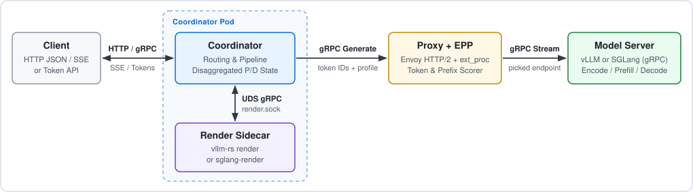
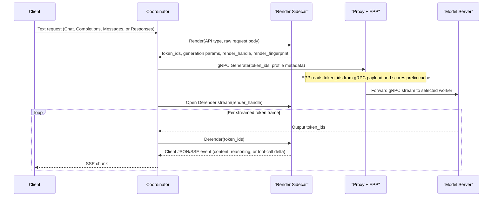

# Tokenize Once at Ingress

- **Status:** Proposal
- **Date:** 2026-11-04
- **Tracking issue:** [llm-d-router#3991](https://github.com/llm-d/llm-d-router/issues/3991)
- **Primary issues:** [llm-d-router#4111](https://github.com/llm-d/llm-d-router/issues/4111), [llm-d-router#4124](https://github.com/llm-d/llm-d-router/issues/4124), [llm-d-router#3758](https://github.com/llm-d/llm-d-router/issues/3758), [llm-d-router#3993](https://github.com/llm-d/llm-d-router/issues/3993), [llm-d-router#3901](https://github.com/llm-d/llm-d-router/issues/3901), [llm-d-router#3617](https://github.com/llm-d/llm-d-router/issues/3617)
- **Target components:** `llm-d-router` (Coordinator, Endpoint Picker [EPP], prefill/decode [P/D] sidecar), upstream `vllm-project/vllm`, upstream `sgl-project/sglang`

---

## 1. Summary

Today, `llm-d` renders and tokenizes every text prompt twice. On ingress, EPP's `token-producer` plugin or Coordinator's `render` step tokenizes the prompt to score prefix-cache affinity. Before inference, the GPU worker renders and tokenizes the same prompt again. Duplicate tokenization wastes CPU, adds time-to-first-token (TTFT) latency on long multi-turn contexts, and lets router and worker token IDs drift.

This proposal tokenizes every prompt **at most once, at ingress**, across **vLLM** and **SGLang** over **`Tokens -> Tokens` model servers**:

1. **Coordinator + EPP (default deployment):** In `Coord-Text-Tok` (text client, token-out worker), Coordinator renders prompts once in a local Rust sidecar over a Unix domain socket (UDS: `vllm-rs render` or `sglang-render`). Coordinator calls worker stages (`conditional-decode`, `encode`, `prefill`, `decode`) over gRPC (`vllm.Inference` or `sglang.api.v1.SglangService`) with token IDs, and the sidecar derenders streamed output tokens. In `Coord-Tok-Tok` (token client, token-out worker), Coordinator forwards client token IDs over gRPC without sidecar calls. EPP reads token IDs from the gRPC payload and skips its tokenizer.
2. **EPP alone (`EPP-Tok-Tok`, token passthrough):** For pre-tokenized client requests on vLLM and SGLang, EPP scores prefix-cache affinity from client token IDs and forwards the request unchanged. Single tokenization for text clients in `EPP alone` mode stays out of the initial scope ([Section 3.2](#32-decision-focus-on-tokens---tokens-model-servers)).

---

## 2. Goals and Non-Goals

### 2.1 Goals

- **Single tokenization:** Ingress renders and tokenizes each text request once in `Coordinator + EPP`. Pre-tokenized client requests run zero tokenizers in `llm-d` and workers.
- **Zero router-worker skew:** Prefill, decode, and EPP cache affinity use one token-ID array. A render fingerprint and prompt-token parity metrics verify alignment.
- **Full API parity:** Support Chat (`/v1/chat/completions`), Completions (`/v1/completions`), Messages (`/v1/messages`), stateless Responses (`/v1/responses`), and token APIs (`/inference/v1/generate`, `/generate`, `vllm.Inference`, `sglang.api.v1`). Cover non-streaming and SSE (aka streaming) responses, tool calls, reasoning parsers, structured outputs, `logprobs`, LoRA adapters, and multimodal inputs.
- **Sub-millisecond sidecar IPC:** Keep local UDS overhead below `< 0.5 ms` per request and `< 50 us` per token chunk, with no external `/derender` round-trips.
- **No default pixel tensors on gateway links:** Send token placeholders, content hashes (`mm_hashes`), and compressed media (or encoder-cache keys) instead of pixel tensors. Use inline tensors only when a request overrides media processor parameters.

### 2.2 Non-Goals

- **Protocol translation in standalone EPP:** Without Coordinator, EPP never rewrites paths, translates HTTP to gRPC, or modifies responses.
- **`Tokens -> Text` server modes in the Northstar:** Worker-derendered text modes (`Coord-Text-Text` and `EPP-Text-Text`) stay out of the initial focus ([Section 3.2](#32-decision-focus-on-tokens---tokens-model-servers)). Tactical HTTP token forwarding ([#3656](https://github.com/llm-d/llm-d-router/issues/3656)) proceeds independently as a near-term bridge.
- **Stateful Responses or Conversations in `llm-d`:** The upstream [agentic-api](https://github.com/vllm-project/agentic-api) gateway owns conversation history and `previous_response_id` state in front of `llm-d` ([`docs/api-routing.md`](api-routing.md)). Coordinator and render sidecars stay stateless.
- **Non-LLM media endpoints:** Audio and image routes (`/v1/audio/*`, `/v1/images/*`) pass through over HTTP and use EPP's `estimate` backend for load estimates.

---

## 3. Design Space and Architectural Modes

### 3.1 Dimensions and Design Principles

Four binary dimensions define sixteen combinations (`2^4 = 16`) under six design principles:

| Dimension | Options | Principles |
| :--- | :--- | :--- |
| **Engine** | `vLLM`, `SGLang` | **P1 (Upstream first):** Use upstream vLLM and SGLang capabilities, and close engine gaps upstream. |
| **Deployment** | `Coordinator + EPP`, `EPP alone` | **P2 (Coordinator gRPC):** Coordinator calls workers over gRPC only. **P3 (Coordinator sidecars):** Coordinator can use local render/derender sidecars. **P4 (No EPP translation):** Standalone EPP mutates request fields only. **P5 (EPP advises Envoy):** EPP never proxies worker traffic, though it can call a render service. |
| **Server** | `Tokens -> Tokens`, `Tokens -> Text` | **P6 (Token client rule):** `Tokens -> Tokens` clients target `Tokens -> Tokens` servers only. |
| **Client** | `Text -> Text`, `Tokens -> Tokens` | Applies across HTTP and gRPC ingress routes (`Input -> Output`). |

### 3.2 Decision: Focus on `Tokens -> Tokens` Model Servers

As `llm-d` shifts toward `Coordinator + EPP` as its default deployment, this proposal scopes the Northstar to **`Tokens -> Tokens` model servers** on both engines. That choice defers all eight `Tokens -> Text` combinations, including worker-derendered Coordinator mode (`Coord-Text-Text`) and standalone EPP token injection (`EPP-Text-Text`). Near-term HTTP prompt-token forwarding ([#3656](https://github.com/llm-d/llm-d-router/issues/3656), PRs [#3706](https://github.com/llm-d/llm-d-router/pull/3706), [#3741](https://github.com/llm-d/llm-d-router/pull/3741)) remains an independent tactical bridge for HTTP pools.

**Pros:**

- **One architecture across vLLM and SGLang:** Both engines share one `Tokens -> Tokens` gRPC worker boundary, aligned with upstream SGLang's server boundary ([llm-d-router#3617](https://github.com/llm-d/llm-d-router/issues/3617)). GPU workers run inference only, while CPU sidecars own chat templates, tokenizers, and output parsers.
- **No response-envelope state machines in Go:** Engine Rust sidecars (`vllm.Render` and `SglangRender`) emit client JSON and SSE events for Chat, Completions, Messages, and Responses. Coordinator does not maintain four separate response schemas in Go.
- **Smaller security and feature surface:** Drops HTTP text token injection (`--enable-prompt-token-ids`), `pd-sidecar` `kv_transfer_params.prompt_token_ids` merges, multimodal injection gates, and worker `output_mode: derender` from the Northstar.

**Cons:**

- **No single tokenization in `EPP alone` text deployments:** Standalone EPP text pools continue to render prompts on the worker (unless they use the tactical HTTP path in [#3656](https://github.com/llm-d/llm-d-router/issues/3656)).
- **One local UDS hop per streamed token chunk:** In `Coord-Text-Tok`, each output token frame crosses the pod-local UDS stream (`Coordinator <-> Render Sidecar`) rather than an inline worker parser. [llm-d-router#3990](https://github.com/llm-d/llm-d-router/issues/3990) benchmarks this IPC path under high concurrency.
- **Sidecar `Derender` dependency:** All four text APIs require streamed `Derender` and client envelopes in `vllm.Render` ([vllm#65503](https://github.com/vllm-project/vllm/issues/65503)) and `SglangRender` ([sglang#48232](https://github.com/sgl-project/sglang/issues/48232)), plus Coordinator stop-string stream cancellation.

### 3.3 Pruning Remaining Combinations

Of the eight `Tokens -> Tokens` combinations, Principles **P4** and **P5** exclude two (`Text -> Text` client with `EPP alone` and `Tokens -> Tokens` server). Raw token IDs cannot satisfy an OpenAI, Messages, or Responses client without response translation, which standalone EPP never performs.

### 3.4 Valid Architectural Matrix

The remaining six combinations form three `<Router>-<Client>-<ServerOut>` modes across both engines. Here, `Coord` denotes `Coordinator + EPP`, `EPP` denotes `EPP alone`, `Text` denotes text API, and `Tok` denotes token API. Each badge links to its subsection ( full support across formats,  partial format or stage support,  no end-to-end support).

| Mode | Deployment | Client | Server | vLLM | SGLang |
| :--- | :--- | :--- | :--- | :--- | :--- |
| [**`Coord-Text-Tok`**](#611-coord-text-tok-on-vllm-tokens---tokens-server) | [`Coordinator + EPP`](#41-coordinator--epp) | `Text -> Text` | `Tokens -> Tokens` |  |  |
| [**`Coord-Tok-Tok`**](#613-coord-tok-tok-passthrough-on-vllm-tokens---tokens-server) *(passthrough)* | [`Coordinator + EPP`](#41-coordinator--epp) | `Tokens -> Tokens` | `Tokens -> Tokens` |  |  |
| [**`EPP-Tok-Tok`**](#621-epp-tok-tok-passthrough-on-vllm-tokens---tokens-server) *(passthrough)* | [`EPP alone`](#42-epp-alone) | `Tokens -> Tokens` | `Tokens -> Tokens` |  |  |

- **`Coord-Text-Tok`:** Coordinator renders prompts and derenders token responses in a local sidecar while workers stay in token space.
- **`Coord-Tok-Tok` and `EPP-Tok-Tok` (passthrough):** Coordinator or EPP scores prefix-cache affinity from client token IDs and forwards requests without a tokenizer call.

Frontend policy across these six combinations:

- **`Coord-*` (`vLLM` and `SGLang`):** Rust-only end-to-end (`vllm-rs render` and `vllm.Inference` on vLLM, and the Rust render service and `sglang-server` on SGLang). Coordinator also passes Python `VllmEngine` and `SglangScheduler` token gRPC streams through.
- **`EPP-Tok-Tok` (`vLLM` and `SGLang`):** Supports Rust and Python token endpoints (`/inference/v1/generate`, `/generate`, Completions token arrays, `vllm.Inference`, `VllmEngine`, `sglang.api.v1`, and `SglangScheduler`).
- **External HTTP `/v1/*/derender`:** Never used in any mode.

---

## 4. Topology and Runtime Sequence

### 4.1 Coordinator + EPP

In `Coordinator + EPP` deployments, each Coordinator pod runs a Rust render sidecar over UDS (`/var/run/llm-d/render.sock`). Coordinator sends all worker calls through Envoy and EPP as HTTP/2 (`h2c` or TLS `h2`) gRPC streams. Each stream carries `x-llm-d-epp-profile` (`encode`, `prefill`, or `decode`) in gRPC metadata. Each sidecar loads one tokenizer and chat template, so one Coordinator deployment serves one model. Gateways that front several models run one Coordinator deployment per model.

This split matches how each component scales. EPP tracks pool-wide cache blocks and endpoint load, which bounds EPP replica count or requires state sync across replicas. Coordinator pods hold state only for active requests, so Coordinator and its render sidecar scale horizontally without cross-replica coordination.

A text request in `Coord-Text-Tok` executes three stages (`Render`, `Generate`, and `Derender`):

- **Disaggregated P/D:** Coordinator reuses the rendered `token_ids` slice across stages. When `conditional-decode` misses the prefix cache, the worker returns gRPC `FAILED_PRECONDITION`, and Coordinator runs `encode -> prefill -> decode`. vLLM runs prefill (`max_new_tokens=1`) before decode via `GenerateRequest.kv`, whereas SGLang runs prefill and decode concurrently with `bootstrap_*` fields.
- **Client disconnect:** Coordinator cancels active worker gRPC streams and closes any open local UDS sidecar stream.
- **Token passthrough (`Coord-Tok-Tok`):** Coordinator skips `Render` and `Derender` and streams `Generate(token_ids)` directly.
- **Parameter lowering:** `Render` returns the generation parameters that token-space workers need. Those include a `structural_tag` or JSON schema for `response_format` and `tool_choice`, and `engine_reasoning_gate` with `chat_template_kwargs`. They also include `bad_words_token_ids` and `stop_token_ids` for single-token stop strings. Coordinator copies them into `GenerateRequest` or `SamplingParams`. Multi-token stop strings match in the sidecar `Derender` stream, and Coordinator cancels the worker stream on a match.
- **Length validation:** The render sidecar enforces `max_model_len` and applies `truncate_prompt_tokens`. On oversize prompts, Coordinator returns the worker's `400` body before EPP or worker calls. Coordinator forwards the pre-truncated `token_ids` without `truncate_prompt_tokens` on `GenerateRequest`.
- **Ingress tokenizer routes (low priority):** Coordinator proxies `/tokenize`, `/detokenize`, and `/v1/messages/count_tokens` to decode pods today (`passthroughHandler`). As a low-priority follow-up for gRPC-only or `--skip-tokenizer-init` pools, Coordinator can serve them from the local sidecar.

### 4.2 EPP Alone

Without Coordinator, Envoy routes pre-tokenized client traffic directly to the `InferencePool` (aggregated workers or decode pods with `pd-sidecar`) and calls EPP over `ext_proc`. Under Principles P4 and P5, EPP never changes the request path or wire protocol and never proxies worker calls:

- **Token passthrough (`EPP-Tok-Tok`):** EPP extracts client token IDs and `mm_hashes`, skips `token-producer`, scores prefix-cache affinity, and forwards the body unchanged.
- **Disaggregated P/D (`pd-sidecar`):** When EPP selects a prefill endpoint, Envoy sends the token request to `pd-sidecar` with `x-llm-d-prefiller-host-port`. `pd-sidecar` then runs prefill and decode in token space.

---

## 5. Gap Summary

The tables below list every gap across **vLLM**, **SGLang**, and **llm-d** (`Coord-Tok-Tok` and `EPP-Tok-Tok` are passthrough, and `All` means all three modes). [Section 6](#6-detailed-gap-analysis) and [Section 7](#7-cross-cutting-design-and-operations) cover per-mode and operational details.

The critical path per mode, in delivery order:

1. **`EPP-Tok-Tok` and `Coord-Tok-Tok`:** [#3805](https://github.com/llm-d/llm-d-router/issues/3805), [#3982](https://github.com/llm-d/llm-d-router/issues/3982), and the upstream gRPC parsers, sidecar P/D, and Coordinator token routes in [#3993](https://github.com/llm-d/llm-d-router/issues/3993), [#3901](https://github.com/llm-d/llm-d-router/issues/3901), and [#3981](https://github.com/llm-d/llm-d-router/issues/3981).
2. **`Coord-Text-Tok` on both engines:** [vllm#64685](https://github.com/vllm-project/vllm/pull/64685), [vllm#65503](https://github.com/vllm-project/vllm/issues/65503), [sglang#48232](https://github.com/sgl-project/sglang/issues/48232), [sglang#40920](https://github.com/sgl-project/sglang/issues/40920) items 3-4, [#4111](https://github.com/llm-d/llm-d-router/issues/4111), [#4124](https://github.com/llm-d/llm-d-router/issues/4124), [#3985](https://github.com/llm-d/llm-d-router/issues/3985), and [#3758](https://github.com/llm-d/llm-d-router/issues/3758), benchmarked in [#3990](https://github.com/llm-d/llm-d-router/issues/3990).

### 5.1 vLLM Gaps

| # | Gap | Frontend | Stage | Modes | Issue / PR |
| ---: | :--- | :--- | :--- | :--- | :--- |
| 1 | Merge `vllm.Render/Tokenize` and add raw JSON input, Completions, Messages, Harmony Responses, [`render_fingerprint`](#74-skew-detection-parity-and-pool-topology), and `--uds`. | Rust | `Render` | `Coord-Text-Tok` | [vllm#64685](https://github.com/vllm-project/vllm/pull/64685), [vllm#65503](https://github.com/vllm-project/vllm/issues/65503) |
| 2 | Merge `vllm.Render/DetokenizeStream` and add Completions, Messages, Responses, and client JSON/SSE envelopes. | Rust | `Derender` | `Coord-Text-Tok` | [vllm#64685](https://github.com/vllm-project/vllm/pull/64685), [vllm#65503](https://github.com/vllm-project/vllm/issues/65503) |
| 3 | Decode `logprobs` candidate tokens in `vllm.Render/Detokenize` and `DetokenizeStream`. | Rust | `Derender` | `Coord-Text-Tok` | [vllm#64685](https://github.com/vllm-project/vllm/pull/64685), [vllm#65503](https://github.com/vllm-project/vllm/issues/65503) |
| 4 | Expose [`grpc.health.v1`](#75-sidecar-health-and-failure-modes) on `vllm-rs render`. | Rust | `Render`, `Derender` | `Coord-Text-Tok` | [vllm#65503](https://github.com/vllm-project/vllm/issues/65503) |
| 5 | When render omits media tensors, retain [`mm_metadata`](#71-multimodal-requests) in the response (and accept metadata-only `MediaItem` on `vllm.Inference`). | Both | `Render`, `Generate` | `Coord-Text-Tok` | [vllm#64997](https://github.com/vllm-project/vllm/issues/64997) |
| 6 | Support [`mm_processor_kwargs`](#71-multimodal-requests) and [`media_io_kwargs`](#71-multimodal-requests) on `vllm.Inference.GenerateRequest`. | Rust | `Generate` | `All` | [vllm#66426](https://github.com/vllm-project/vllm/issues/66426) |
| 7 | Support `n>1` in `vllm.Inference`. | Rust | `Generate` | `All` | [vllm#65841](https://github.com/vllm-project/vllm/issues/65841) |
| 8 | Accept [`prompt_render_fingerprint`](#74-skew-detection-parity-and-pool-topology) on `vllm.Inference.GenerateRequest` and enforce `--on-fingerprint-mismatch` on gRPC. | Rust | `Generate` | `Coord-Text-Tok` | [vllm#65503](https://github.com/vllm-project/vllm/issues/65503) |

### 5.2 SGLang Gaps

| # | Gap | Frontend | Stage | Modes | Issue / PR |
| ---: | :--- | :--- | :--- | :--- | :--- |
| 1 | Expose SGLang `Lower` and `Respond` over gRPC and UDS (standalone `sglang-render` or decoupled from `sgl-router`) with [`render_fingerprint`](#74-skew-detection-parity-and-pool-topology) and [`grpc.health.v1`](#75-sidecar-health-and-failure-modes). | Rust | `Render`, `Derender` | `Coord-Text-Tok` | [sglang#48232](https://github.com/sgl-project/sglang/issues/48232) |
| 2 | Add Messages, Responses, and [multimodal support](#71-multimodal-requests) in `sglang-processor`. | Rust | `Render`, `Derender` | `Coord-Text-Tok` | [sglang#48232](https://github.com/sgl-project/sglang/issues/48232), [sglang#46291](https://github.com/sgl-project/sglang/pull/46291) |
| 3 | Support `DecodeStream` and stop strings on `output_ids` in the SGLang render service. | Rust | `Derender` | `Coord-Text-Tok` | [sglang#40920](https://github.com/sgl-project/sglang/issues/40920), [sglang#40956](https://github.com/sgl-project/sglang/issues/40956) |
| 4 | Decode `logprobs` candidate text in `DecodeStream` on `--skip-tokenizer-init` pools. | Rust | `Derender` | `Coord-Text-Tok` | [sglang#40920](https://github.com/sgl-project/sglang/issues/40920), [sglang#48232](https://github.com/sgl-project/sglang/issues/48232) |
| 5 | Expose [`grpc.health.v1`](#75-sidecar-health-and-failure-modes) on `sglang-server`. | Rust | `Generate` | `All` | [sglang#38075](https://github.com/sgl-project/sglang/issues/38075) |
| 6 | **Optional:** Add per-request [`skip_detokenize`](#74-skew-detection-parity-and-pool-topology) on `sglang.api.v1.GenerateRequest` for mixed pools without `--skip-tokenizer-init`. | Rust | `Generate` | `All` | [sglang#48580](https://github.com/sgl-project/sglang/issues/48580) |
| 7 | Accept `render_fingerprint` on `sglang.api.v1.GenerateRequest` and enforce [`--on-fingerprint-mismatch`](#74-skew-detection-parity-and-pool-topology) on gRPC. | Rust | `Generate` | `Coord-Text-Tok` | [sglang#48232](https://github.com/sgl-project/sglang/issues/48232) |

### 5.3 llm-d Gaps

| # | Gap | Engine | Stage | Modes | Issue / PR |
| ---: | :--- | :--- | :--- | :--- | :--- |
| 1 | **Coordinator:** Add UDS gRPC clients for prompt `Render` and sidecar `Derender`. | Both | `Render`, `Derender` | `Coord-Text-Tok` | [#4111](https://github.com/llm-d/llm-d-router/issues/4111), [#4124](https://github.com/llm-d/llm-d-router/issues/4124), [#3758](https://github.com/llm-d/llm-d-router/issues/3758) |
| 2 | **Coordinator:** Add a `vllm.Inference` client and port `conditional-decode`, `KVConnector`, `ECConnector`, and error responses. | vLLM | `Generate` | `Coord-Text-Tok`, `Coord-Tok-Tok` | [#3993](https://github.com/llm-d/llm-d-router/issues/3993), [#3758](https://github.com/llm-d/llm-d-router/issues/3758) |
| 3 | **Coordinator:** Add a `sglang.api.v1` client with concurrent P/D, `Abort` on disconnect, and error responses. | SGLang | `Generate` | `Coord-Text-Tok`, `Coord-Tok-Tok` | [#3872](https://github.com/llm-d/llm-d-router/issues/3872), [#3901](https://github.com/llm-d/llm-d-router/issues/3901) |
| 4 | **Coordinator:** Copy `response_format`, `tool_choice`, `bad_words`, and single-token `stop` from `Render` output into gRPC `Generate` requests. | Both | `Generate` | `Coord-Text-Tok` | [#4111](https://github.com/llm-d/llm-d-router/issues/4111), [#4124](https://github.com/llm-d/llm-d-router/issues/4124), [#3758](https://github.com/llm-d/llm-d-router/issues/3758) |
| 5 | **Coordinator:** When `Render` rejects prompts past `max_model_len`, return `400`. Forward pre-truncated token IDs without `truncate_prompt_tokens`. | Both | `Render`, `Generate` | `Coord-Text-Tok` | [#4111](https://github.com/llm-d/llm-d-router/issues/4111), [#4124](https://github.com/llm-d/llm-d-router/issues/4124), [#3758](https://github.com/llm-d/llm-d-router/issues/3758) |
| 6 | **Coordinator:** When a buffered multi-token stop string matches, cancel the worker gRPC stream. | Both | `Generate`, `Derender` | `Coord-Text-Tok` | [#4111](https://github.com/llm-d/llm-d-router/issues/4111), [#4124](https://github.com/llm-d/llm-d-router/issues/4124), [#3758](https://github.com/llm-d/llm-d-router/issues/3758) |
| 7 | **Coordinator:** Map HTTP `/inference/v1/generate` and `/generate` plus `VllmEngine` and `SglangScheduler` gRPC to worker gRPC. | Both | `Generate` | `Coord-Tok-Tok` | [#3993](https://github.com/llm-d/llm-d-router/issues/3993), [#3901](https://github.com/llm-d/llm-d-router/issues/3901), [#3981](https://github.com/llm-d/llm-d-router/issues/3981) |
| 8 | **Coordinator:** [Strip client](#72-security-and-trust-boundaries) `prompt_token_ids`, `prompt_render_fingerprint`, `kv_transfer_params`, and `input_ids` on text routes. | Both | `Render` | `Coord-Text-Tok` | [#3979](https://github.com/llm-d/llm-d-router/issues/3979) |
| 9 | **Coordinator:** [Fetch media once](#71-multimodal-requests) in the render sidecar (domain allowlist, size caps) and forward bytes to `encode`. | Both | `Render`, `Generate` | `Coord-Text-Tok` | [#3988](https://github.com/llm-d/llm-d-router/issues/3988) |
| 10 | **Coordinator:** Support `/v1/completions` batch `prompt` arrays (`[]string` and `[][]int`) via sub-request fan-out. | Both | `Render`, `Generate` | `Coord-Text-Tok`, `Coord-Tok-Tok` | [#4088](https://github.com/llm-d/llm-d-router/issues/4088) |
| 11 | **Coordinator (low priority):** Serve `/tokenize`, `/detokenize`, and `/v1/messages/count_tokens` from the local render sidecar instead of decode passthrough. | Both | `Render`, `Derender` | `Coord-Text-Tok` | [#4111](https://github.com/llm-d/llm-d-router/issues/4111), [#4124](https://github.com/llm-d/llm-d-router/issues/4124) |
| 12 | **EPP:** Add a `vllm.Inference` parser. | vLLM | `Generate` | `All` | [#3993](https://github.com/llm-d/llm-d-router/issues/3993), [#3758](https://github.com/llm-d/llm-d-router/issues/3758) |
| 13 | **EPP:** Merge `sglanggrpc-parser` for `sglang.api.v1`. | SGLang | `Generate` | `All` | [#3901](https://github.com/llm-d/llm-d-router/issues/3901), PR [#3904](https://github.com/llm-d/llm-d-router/pull/3904) |
| 14 | **EPP:** Enable `sglanghttp-parser` by default and extract [`mm_hashes`](#71-multimodal-requests). | SGLang | `Generate` | `EPP-Tok-Tok` | [#3901](https://github.com/llm-d/llm-d-router/issues/3901), [#3983](https://github.com/llm-d/llm-d-router/issues/3983) |
| 15 | **EPP:** Add a parser for legacy `SglangScheduler` gRPC. | SGLang | `Generate` | `EPP-Tok-Tok` | [#3981](https://github.com/llm-d/llm-d-router/issues/3981) |
| 16 | **EPP:** Reassemble gRPC chunks across frames. | Both | `Generate` | `All` | [#3644](https://github.com/llm-d/llm-d-router/issues/3644) |
| 17 | **EPP:** Pass DP rank metadata over gRPC. | Both | `Generate` | `All` | [#3757](https://github.com/llm-d/llm-d-router/issues/3757) |
| 18 | **EPP:** When requests carry token IDs or `prompt: []int`, skip `token-producer`. | Both | `Generate` | `All` | [#3805](https://github.com/llm-d/llm-d-router/issues/3805), PR [#3806](https://github.com/llm-d/llm-d-router/pull/3806) |
| 19 | **EPP:** Decouple `precise-prefix-cache-producer` from `backend: vllm`. | Both | `Generate` | `All` | [#3982](https://github.com/llm-d/llm-d-router/issues/3982) |
| 20 | **EPP:** Add [LoRA extra keys](#74-skew-detection-parity-and-pool-topology) (`lora_name`, adapter path) to `precise-prefix-cache-producer` and the gRPC parsers. | Both | `Generate` | `All` | [#3989](https://github.com/llm-d/llm-d-router/issues/3989) |
| 21 | **P/D sidecar:** Add `vllm.Inference` gRPC P/D support. | vLLM | `Generate` | `EPP-Tok-Tok` | [#3993](https://github.com/llm-d/llm-d-router/issues/3993) |
| 22 | **P/D sidecar:** Merge SGLang gRPC P/D support. | SGLang | `Generate` | `EPP-Tok-Tok` | [#3901](https://github.com/llm-d/llm-d-router/issues/3901), PRs [#3905](https://github.com/llm-d/llm-d-router/pull/3905), [#3908](https://github.com/llm-d/llm-d-router/pull/3908) |
| 23 | **Coordinator:** Merge `conditional-decode` parity checks and extend [`prompt_token_mismatch_total`](#74-skew-detection-parity-and-pool-topology) to gRPC legs. | Both | `Generate` | `Coord-Text-Tok`, `Coord-Tok-Tok` | PR [#3889](https://github.com/llm-d/llm-d-router/pull/3889), [#3984](https://github.com/llm-d/llm-d-router/issues/3984) |
| 24 | **Coordinator, EPP:** [Screen endpoints](#74-skew-detection-parity-and-pool-topology) by `render_fingerprint` per request during rollouts (sidecar fingerprint in gRPC metadata). | Both | `Generate` | `Coord-Text-Tok` | [#3984](https://github.com/llm-d/llm-d-router/issues/3984) |
| 25 | **Coordinator, Helm:** Run the render container as a native sidecar (`emptyDir` UDS) and gate [`/readyz`](#75-sidecar-health-and-failure-modes) on [`grpc.health.v1`](#75-sidecar-health-and-failure-modes). | Both | `Render`, `Derender` | `Coord-Text-Tok` | [#3985](https://github.com/llm-d/llm-d-router/issues/3985) |
| 26 | **Coordinator:** [Bound in-flight renders](#75-sidecar-health-and-failure-modes) per sidecar and shed with `503` and `Retry-After`. | Both | `Render` | `Coord-Text-Tok` | [#3985](https://github.com/llm-d/llm-d-router/issues/3985) |
| 27 | **Helm:** Derive worker and renderer CLI flags and pinned image tags from [one values block](#76-helm-capacity-and-rollout). | Both | `Render`, `Generate`, `Derender` | `Coord-Text-Tok` | [#3986](https://github.com/llm-d/llm-d-router/issues/3986) |
| 28 | **Helm:** Define CPU and memory requests and [`ContainerResource` HPA targets](#76-helm-capacity-and-rollout) for Coordinator and render sidecar containers. | Both | `Render`, `Derender` | `Coord-Text-Tok` | [#3986](https://github.com/llm-d/llm-d-router/issues/3986) |
| 29 | **CI:** Run a [render-parity corpus](#76-helm-capacity-and-rollout) and UDS IPC benchmarks against the sidecar and worker images from one Helm values file. | Both | `Render`, `Derender` | `Coord-Text-Tok` | [#3990](https://github.com/llm-d/llm-d-router/issues/3990) |
| 30 | **Coordinator:** Add a [`protocol: grpc`](#76-helm-capacity-and-rollout) config flag for rollback to HTTP worker routes. | Both | `Generate` | `Coord-Text-Tok`, `Coord-Tok-Tok` | [#3993](https://github.com/llm-d/llm-d-router/issues/3993), [#3758](https://github.com/llm-d/llm-d-router/issues/3758), [#3901](https://github.com/llm-d/llm-d-router/issues/3901) |

---

## 6. Detailed Gap Analysis

This section evaluates stage support (`Render`, `Generate`, `Derender`) and tracks engine and `llm-d` gaps for all six valid combinations.

### 6.1 Coordinator + EPP

On both engines, `Coord-Text-Tok` keeps GPU workers in token space and runs `Render` and `Derender` in the local sidecar (one UDS frame per token chunk). That boundary matches upstream SGLang's tokens-in/tokens-out server model, offloads tokenizer and output-parser CPU from GPU pods, and keeps response envelope schemas inside the engine sidecars. `Coord-Tok-Tok` forwards client token IDs to `Tokens -> Tokens` servers without `Render` or `Derender` (Principle P6).

#### 6.1.1 `Coord-Text-Tok` on vLLM (`Tokens -> Tokens` Server)

- **Status:** 
- **Stages**
  - **Render:** Partial. Coordinator targets `vllm-rs render` over UDS gRPC (never Python HTTP `/v1/*/render`). Draft `vllm.Render` supports typed Chat only and lacks `--uds`.
  - **Generate:** Partial. `vllm.Inference/GenerateStream` supports `token_ids` with `output_text=false`, KV/EC parameters, and media for `n=1`. Coordinator lacks a gRPC client.
  - **Derender:** Partial. Draft `vllm.Render` streams Chat deltas only. It lacks Completions, Messages, Responses, client JSON/SSE envelopes, and `logprobs` candidate decoding.
- **Engine gaps**
  - Merge Chat render and streaming derender in `vllm.Render` ([vllm#64685](https://github.com/vllm-project/vllm/pull/64685)).
  - Add raw JSON input, Completions, Messages, Responses (with Harmony), client JSON/SSE envelopes, `render_fingerprint`, and `--uds` ([vllm#65503](https://github.com/vllm-project/vllm/issues/65503)).
  - Decode `logprobs` candidate tokens in `vllm.Render/DetokenizeStream` ([vllm#64685](https://github.com/vllm-project/vllm/pull/64685), [vllm#65503](https://github.com/vllm-project/vllm/issues/65503)).
  - When render omits media tensors, retain `mm_metadata` in the response ([vllm#64997](https://github.com/vllm-project/vllm/issues/64997)).
  - Support `mm_processor_kwargs` and `media_io_kwargs` on `vllm.Inference.GenerateRequest` ([vllm#66426](https://github.com/vllm-project/vllm/issues/66426)).
  - Support `n>1` in `vllm.Inference` ([vllm#65841](https://github.com/vllm-project/vllm/issues/65841)).
  - Accept `prompt_render_fingerprint` on `vllm.Inference.GenerateRequest` and enforce `--on-fingerprint-mismatch` on gRPC ([vllm#65503](https://github.com/vllm-project/vllm/issues/65503)).
- **llm-d gaps**
  - **Coordinator**
    - Add gRPC clients for `vllm.Inference` and UDS `vllm.Render` ([llm-d-router#3993](https://github.com/llm-d/llm-d-router/issues/3993), [#4111](https://github.com/llm-d/llm-d-router/issues/4111), [#3758](https://github.com/llm-d/llm-d-router/issues/3758)).
    - Port `conditional-decode`, `KVConnector`, `ECConnector`, and error responses to `vllm.Inference` ([llm-d-router#3993](https://github.com/llm-d/llm-d-router/issues/3993), [#3758](https://github.com/llm-d/llm-d-router/issues/3758)).
    - Copy `response_format`, `tool_choice`, `bad_words`, and single-token `stop` from `Render` output into `GenerateRequest` ([llm-d-router#4111](https://github.com/llm-d/llm-d-router/issues/4111), [#3758](https://github.com/llm-d/llm-d-router/issues/3758)).
    - When `Render` rejects prompts past `max_model_len`, return `400`. Forward pre-truncated `token_ids` without `truncate_prompt_tokens` ([llm-d-router#4111](https://github.com/llm-d/llm-d-router/issues/4111), [#3758](https://github.com/llm-d/llm-d-router/issues/3758)).
    - When a buffered multi-token stop string matches, cancel `GenerateStream` ([llm-d-router#4111](https://github.com/llm-d/llm-d-router/issues/4111), [#3758](https://github.com/llm-d/llm-d-router/issues/3758)).
    - Strip client `prompt_token_ids`, `prompt_render_fingerprint`, and `kv_transfer_params` on text routes ([llm-d-router#3979](https://github.com/llm-d/llm-d-router/issues/3979)).
    - Fetch media once in the render sidecar and forward bytes to `encode` ([llm-d-router#3988](https://github.com/llm-d/llm-d-router/issues/3988)).
    - Support `/v1/completions` batch `prompt` arrays via sub-request fan-out ([llm-d-router#4088](https://github.com/llm-d/llm-d-router/issues/4088)).
    - Serve `/tokenize`, `/detokenize`, and `/v1/messages/count_tokens` from the render sidecar as a low-priority follow-up ([llm-d-router#4111](https://github.com/llm-d/llm-d-router/issues/4111)).
  - **EPP**
    - Add a `vllm.Inference` parser ([llm-d-router#3993](https://github.com/llm-d/llm-d-router/issues/3993), [#3758](https://github.com/llm-d/llm-d-router/issues/3758)).
    - Reassemble gRPC chunks across frames ([llm-d-router#3644](https://github.com/llm-d/llm-d-router/issues/3644)).
    - Pass DP rank metadata over gRPC ([llm-d-router#3757](https://github.com/llm-d/llm-d-router/issues/3757)).
    - When requests carry token IDs, skip `token-producer` ([llm-d-router#3805](https://github.com/llm-d/llm-d-router/issues/3805), PR [#3806](https://github.com/llm-d/llm-d-router/pull/3806)).
    - Decouple `precise-prefix-cache-producer` from `backend: vllm` ([llm-d-router#3982](https://github.com/llm-d/llm-d-router/issues/3982)).

#### 6.1.2 `Coord-Text-Tok` on SGLang (`Tokens -> Tokens` Server)

- **Status:** 
- **Stages**
  - **Render:** Unsupported. Library `sglang-processor` lowers Chat and Completions only and lacks Messages and Responses. Upstream `sgl-router` bundles API preprocessing with its own P/D and KV-cache routing rather than as a standalone sidecar.
  - **Generate:** Partial. `sglang.api.v1.SglangService/Generate` emits `output_ids` only on `--skip-tokenizer-init` pools and rejects string `stop` and `stop_regex`.
  - **Derender:** Unsupported. Responders in `sglang-processor` require server `text` rather than `output_ids` (except on DeepSeek-V4/V4.1). Logprob text decodes on the server detok shard only.
- **Engine gaps**
  - Expose `Lower`, `Respond`, `render_fingerprint`, and `grpc.health.v1` over UDS, via standalone `sglang-render` or decoupled `sgl-router` ([sglang#48232](https://github.com/sgl-project/sglang/issues/48232)).
  - Add Messages, Responses, and multimodal support in `sglang-processor` ([sglang#48232](https://github.com/sgl-project/sglang/issues/48232), [sglang#46291](https://github.com/sgl-project/sglang/pull/46291)).
  - Support `DecodeStream` and stop strings on `output_ids` in the SGLang render service ([sglang#40920](https://github.com/sgl-project/sglang/issues/40920) items 3-4, [sglang#40956](https://github.com/sgl-project/sglang/issues/40956)).
  - Decode `logprobs` candidate text in `DecodeStream` ([sglang#40920](https://github.com/sgl-project/sglang/issues/40920) items 3-4, [sglang#48232](https://github.com/sgl-project/sglang/issues/48232)).
  - Expose `grpc.health.v1` on `sglang-server` ([sglang#38075](https://github.com/sgl-project/sglang/issues/38075)).
  - Optional: add per-request `skip_detokenize` on `sglang.api.v1.GenerateRequest` for mixed pools ([sglang#48580](https://github.com/sgl-project/sglang/issues/48580)).
  - Accept `render_fingerprint` on `sglang.api.v1.GenerateRequest` and enforce `--on-fingerprint-mismatch` on gRPC ([sglang#48232](https://github.com/sgl-project/sglang/issues/48232)).
- **llm-d gaps**
  - **Coordinator**
    - Add gRPC clients for `sglang.api.v1` and UDS `SglangRender` ([llm-d-router#3901](https://github.com/llm-d/llm-d-router/issues/3901), [#4124](https://github.com/llm-d/llm-d-router/issues/4124)).
    - Support concurrent SGLang P/D, `Abort` on disconnect, and gRPC error responses ([llm-d-router#3872](https://github.com/llm-d/llm-d-router/issues/3872), [#3901](https://github.com/llm-d/llm-d-router/issues/3901)).
    - Copy `response_format`, `tool_choice`, and single-token `stop` from `Render` output into `SamplingParams` ([llm-d-router#4124](https://github.com/llm-d/llm-d-router/issues/4124)).
    - When `Render` rejects prompts past `max_model_len`, return `400`. Forward pre-truncated `input_ids` without truncation flags ([llm-d-router#4124](https://github.com/llm-d/llm-d-router/issues/4124)).
    - When a buffered multi-token stop string matches, cancel `Generate` ([llm-d-router#4124](https://github.com/llm-d/llm-d-router/issues/4124)).
    - Strip client `input_ids` and `render_fingerprint` on text routes ([llm-d-router#3979](https://github.com/llm-d/llm-d-router/issues/3979)).
    - Fetch media once in the render sidecar and forward bytes to `encode` ([llm-d-router#3988](https://github.com/llm-d/llm-d-router/issues/3988)).
    - Support `/v1/completions` batch `prompt` arrays via sub-request fan-out ([llm-d-router#4088](https://github.com/llm-d/llm-d-router/issues/4088)).
    - Serve `/tokenize`, `/detokenize`, and `/v1/messages/count_tokens` from the render sidecar as a low-priority follow-up ([llm-d-router#4124](https://github.com/llm-d/llm-d-router/issues/4124)).
  - **EPP**
    - Merge `sglanggrpc-parser` ([llm-d-router#3901](https://github.com/llm-d/llm-d-router/issues/3901), PR [#3904](https://github.com/llm-d/llm-d-router/pull/3904)).
    - Reassemble gRPC chunks across frames ([llm-d-router#3644](https://github.com/llm-d/llm-d-router/issues/3644)).
    - Pass DP rank metadata over gRPC ([llm-d-router#3757](https://github.com/llm-d/llm-d-router/issues/3757)).
    - When requests carry `input_ids`, skip `token-producer` ([llm-d-router#3805](https://github.com/llm-d/llm-d-router/issues/3805), PR [#3806](https://github.com/llm-d/llm-d-router/pull/3806)).
    - Decouple `precise-prefix-cache-producer` from `backend: vllm` ([llm-d-router#3982](https://github.com/llm-d/llm-d-router/issues/3982)).

#### 6.1.3 `Coord-Tok-Tok` (Passthrough) on vLLM (`Tokens -> Tokens` Server)

- **Status:** 
- **Stages**
  - **Render / Derender:** Not applicable (token passthrough).
  - **Generate:** Partial. `vllm.Inference/GenerateStream` supports `token_ids` with `output_text=false` for `n=1`. Coordinator lacks a gRPC client and does not map HTTP `/inference/v1/generate` to gRPC.
- **Engine gaps (deltas from [Section 6.1.1](#611-coord-text-tok-on-vllm-tokens---tokens-server))**
  - Only the `vllm.Inference` worker gaps in [Section 6.1.1](#611-coord-text-tok-on-vllm-tokens---tokens-server) apply (`n>1` in [vllm#65841](https://github.com/vllm-project/vllm/issues/65841) and `mm_processor_kwargs` / `media_io_kwargs` in [vllm#66426](https://github.com/vllm-project/vllm/issues/66426)).
  - Sidecar `vllm.Render` gaps do not apply.
- **llm-d gaps (deltas from [Section 6.1.1](#611-coord-text-tok-on-vllm-tokens---tokens-server))**
  - Map HTTP `/inference/v1/generate` to `vllm.Inference` in Coordinator ([llm-d-router#3993](https://github.com/llm-d/llm-d-router/issues/3993)).
  - Route `VllmEngine` (`vllm.grpc.engine`) clients through Coordinator ([llm-d-router#3981](https://github.com/llm-d/llm-d-router/issues/3981)).
  - All EPP gaps, batch token-array fan-out ([#4088](https://github.com/llm-d/llm-d-router/issues/4088)), and the Coordinator `vllm.Inference` client and P/D connector updates in [Section 6.1.1](#611-coord-text-tok-on-vllm-tokens---tokens-server) apply. Sidecar, stop-cancel, lowering, length-validation, media-fetch, and sanitization items do not apply.

#### 6.1.4 `Coord-Tok-Tok` (Passthrough) on SGLang (`Tokens -> Tokens` Server)

- **Status:** 
- **Stages**
  - **Render / Derender:** Not applicable (token passthrough).
  - **Generate:** Partial. `sglang.api.v1.SglangService/Generate` maps `input_ids` to `output_ids` on `--skip-tokenizer-init` pools and matches HTTP `/generate` JSON.
- **Engine gaps (deltas from [Section 6.1.2](#612-coord-text-tok-on-sglang-tokens---tokens-server))**
  - Only the `sglang-server` worker gaps in [Section 6.1.2](#612-coord-text-tok-on-sglang-tokens---tokens-server) apply (`grpc.health.v1` in [sglang#38075](https://github.com/sgl-project/sglang/issues/38075) and optional `skip_detokenize` in [sglang#48580](https://github.com/sgl-project/sglang/issues/48580)).
  - Sidecar `sglang-render` gaps do not apply.
- **llm-d gaps (deltas from [Section 6.1.2](#612-coord-text-tok-on-sglang-tokens---tokens-server))**
  - Map HTTP `/generate` to `sglang.api.v1` in Coordinator ([llm-d-router#3901](https://github.com/llm-d/llm-d-router/issues/3901)).
  - Route legacy `SglangScheduler` clients over gRPC in Coordinator ([llm-d-router#3981](https://github.com/llm-d/llm-d-router/issues/3981)).
  - All EPP gaps, batch token-array fan-out ([#4088](https://github.com/llm-d/llm-d-router/issues/4088)), and the Coordinator `sglang.api.v1` client and concurrent P/D updates in [Section 6.1.2](#612-coord-text-tok-on-sglang-tokens---tokens-server) apply. Sidecar, stop-cancel, lowering, length-validation, media-fetch, and sanitization items do not apply.

### 6.2 EPP Alone

In standalone EPP deployments, `EPP-Tok-Tok` forwards client token IDs to vLLM and SGLang `Tokens -> Tokens` servers without `Render` or `Derender` (Principle P6). Text clients use `Coordinator + EPP` (`Coord-Text-Tok`) for single tokenization ([Section 3.2](#32-decision-focus-on-tokens---tokens-model-servers)).

#### 6.2.1 `EPP-Tok-Tok` (Passthrough) on vLLM (`Tokens -> Tokens` Server)

- **Status:** 
- **Stages**
  - **Render / Derender:** Not applicable. EPP scores prefix cache from client token IDs.
  - **Generate:** Partial. EPP and vLLM support HTTP `/inference/v1/generate` (`vllmhttp-parser`) and gRPC `VllmEngine` (`vllmgrpc-parser`) end-to-end. vLLM also supports Completions token arrays and gRPC `vllm.Inference`.
- **Engine gaps**
  - Support `n>1` in `vllm.Inference` ([vllm#65841](https://github.com/vllm-project/vllm/issues/65841)).
  - Support `mm_processor_kwargs` and `media_io_kwargs` on `vllm.Inference.GenerateRequest` ([vllm#66426](https://github.com/vllm-project/vllm/issues/66426)).
- **llm-d gaps**
  - **EPP**
    - Add a `vllm.Inference` parser ([llm-d-router#3993](https://github.com/llm-d/llm-d-router/issues/3993), [#3758](https://github.com/llm-d/llm-d-router/issues/3758)).
    - When requests carry token IDs or `prompt: []int`, skip `token-producer` ([llm-d-router#3805](https://github.com/llm-d/llm-d-router/issues/3805), PR [#3806](https://github.com/llm-d/llm-d-router/pull/3806)).
    - Decouple `precise-prefix-cache-producer` from `backend: vllm` ([llm-d-router#3982](https://github.com/llm-d/llm-d-router/issues/3982)).
    - Pass DP rank metadata over gRPC ([llm-d-router#3757](https://github.com/llm-d/llm-d-router/issues/3757)).
    - Reassemble gRPC chunks across frames ([llm-d-router#3644](https://github.com/llm-d/llm-d-router/issues/3644)).
  - **P/D sidecar**
    - Add `vllm.Inference` gRPC P/D support ([llm-d-router#3993](https://github.com/llm-d/llm-d-router/issues/3993)).

#### 6.2.2 `EPP-Tok-Tok` (Passthrough) on SGLang (`Tokens -> Tokens` Server)

- **Status:** 
- **Stages**
  - **Render / Derender:** Not applicable. EPP scores prefix cache from client `input_ids`.
  - **Generate:** Partial. EPP and SGLang support HTTP `/generate` with `input_ids` (`sglanghttp-parser`) end-to-end. SGLang also supports gRPC `sglang.api.v1` and `SglangScheduler` on `--skip-tokenizer-init` pools.
- **Engine gaps**
  - Expose `grpc.health.v1` on `sglang-server` ([sglang#38075](https://github.com/sgl-project/sglang/issues/38075)).
  - Optional: add per-request `skip_detokenize` on `sglang.api.v1.GenerateRequest` for mixed pools ([sglang#48580](https://github.com/sgl-project/sglang/issues/48580)).
- **llm-d gaps**
  - **EPP**
    - Merge `sglanggrpc-parser` for `sglang.api.v1` ([llm-d-router#3901](https://github.com/llm-d/llm-d-router/issues/3901), PR [#3904](https://github.com/llm-d/llm-d-router/pull/3904)).
    - Enable `sglanghttp-parser` by default and extract `mm_hashes` ([llm-d-router#3901](https://github.com/llm-d/llm-d-router/issues/3901), [#3983](https://github.com/llm-d/llm-d-router/issues/3983)).
    - Decouple `precise-prefix-cache-producer` from `backend: vllm` ([llm-d-router#3982](https://github.com/llm-d/llm-d-router/issues/3982)).
    - When requests carry `input_ids` or `prompt: []int`, skip `token-producer` ([llm-d-router#3805](https://github.com/llm-d/llm-d-router/issues/3805), PR [#3806](https://github.com/llm-d/llm-d-router/pull/3806)).
    - Add a parser for legacy `SglangScheduler` gRPC ([llm-d-router#3981](https://github.com/llm-d/llm-d-router/issues/3981)).
    - Pass DP rank metadata over gRPC ([llm-d-router#3757](https://github.com/llm-d/llm-d-router/issues/3757)).
    - Reassemble gRPC chunks across frames ([llm-d-router#3644](https://github.com/llm-d/llm-d-router/issues/3644)).
  - **P/D sidecar**
    - Merge gRPC P/D support ([llm-d-router#3901](https://github.com/llm-d/llm-d-router/issues/3901), PRs [#3905](https://github.com/llm-d/llm-d-router/pull/3905), [#3908](https://github.com/llm-d/llm-d-router/pull/3908)).

---

## 7. Cross-Cutting Design and Operations

Sections 7.1-7.3 cover request, security, and state rules whose gaps appear per mode in [Section 6](#6-detailed-gap-analysis). Sections 7.4-7.6 cover shared operational controls and track their gaps.

### 7.1 Multimodal Requests

Multimodal requests preserve single tokenization without 2-38 MB pixel tensors (`kwargs_data`) on gateway links:

- **Coordinator + EPP (`gRPC`):** Coordinator calls the render sidecar with tensor omission (`omit_media_kwargs = true` on `vllm.Render/Tokenize` and hash-and-placeholder mode on `SglangRender/Lower`). The sidecar computes `mm_hashes`, retains per-item `mm_metadata` (`image_grid_thw` / `video_grid_thw`), and expands multimodal placeholders in `token_ids` to match the worker layout. Coordinator sends compressed media (`MediaItem` bytes/URLs on `vllm.Inference`, or `MediaInput` and `mm_hashes` on `sglang.api.v1`) only to `encode` (or `prefill` without `encode`). Prefill with `ECConnector` and decode workers receive `mm_metadata` and KV blocks without decoding pixels.
  - *Processor overrides:* When a vLLM request sets `mm_processor_kwargs` or `media_io_kwargs`, placeholder lengths depend on those fields, which `vllm.Inference.GenerateRequest` lacks today. For those requests, Coordinator requests inline `PreprocessedMediaFeatures` from `Tokenize` until `GenerateRequest` adds those fields ([vllm#66426](https://github.com/vllm-project/vllm/issues/66426)).
- **Media fetch policy:** The render sidecar fetches each media URL once, under `--allowed-media-domains`, size caps, and timeouts. Coordinator forwards the fetched bytes (`MediaItem.raw_bytes` on `vllm.Inference`, `MediaInput` on `sglang.api.v1`) to `encode`, so workers never refetch URLs. Coordinator also sends `mm_hashes` in gRPC metadata, so EPP routes `encode` requests without a buffered media body. Pools that forbid fetches at ingress set `mediaHashing: url`, and EPP hashes the URL string with approximate affinity on media blocks.

### 7.2 Security and Trust Boundaries

Untrusted token IDs on Chat, Messages, or Responses let callers bypass system prompts, chat templates, and safety rules ([vllm#62307](https://github.com/vllm-project/vllm/issues/62307)):

- **Ingress sanitization (`Coord-Text-Tok`):** On text routes (`/v1/chat/completions`, string `/v1/completions`, `/v1/messages`, `/v1/responses`), Coordinator strips client `prompt_token_ids`, `prompt_render_fingerprint`, `kv_transfer_params`, and `input_ids` before calling `Render` ([llm-d-router#3979](https://github.com/llm-d/llm-d-router/issues/3979)). Dedicated token routes (`/inference/v1/generate`, `/generate`, token-array `/v1/completions`, and token gRPC services) accept client token IDs.
- **Cluster-internal worker gRPC:** NetworkPolicy or mTLS restricts worker gRPC ports (`vllm.Inference` and `sglang.api.v1`) to Envoy, EPP, and Coordinator. External text clients cannot reach `Tokens -> Tokens` worker listeners directly.

### 7.3 Stateful Responses and Conversations

Coordinator and engine render sidecars hold no cross-request or persisted state:

- When [vllm-project/agentic-api](https://github.com/vllm-project/agentic-api) sits in front of `llm-d`, it terminates `/v1/conversations` and stateful `/v1/responses` (`previous_response_id`, `store: true`, `background: true`). It expands prior turns into a stateless `/v1/responses` input, forwards that request to `llm-d`, and stores the output ([`docs/api-routing.md`](api-routing.md)).
- Without `agentic-api`, Coordinator and `pd-sidecar` reject unsupported stateful `/v1/responses` fields with `400 Bad Request` (`RejectStatefulResponsesFields`) and avoid router database state.

Within one streamed response in `Coord-Text-Tok`, the sidecar holds detokenizer and output-parser state in memory for its open `DetokenizeStream` or `Respond` call. Coordinator holds only the client connection, and GPU workers hold no output-parser state.

### 7.4 Skew Detection, Parity, and Pool Topology

`vllm.Render` and `SglangRender` compute `render_fingerprint`, a SHA-256 digest over the render inputs. The digest covers tokenizer files (`tokenizer.json`, `tokenizer_config.json`, `special_tokens_map.json`, `*.tiktoken`), chat templates, and `--default-chat-template-kwargs`. It also covers `--tokenizer-mode`, model `config.json` multimodal tokens, and the engine render schema version. Because workers run in token space and never execute output parsers, parser flags (`--tool-call-parser`, `--reasoning-parser`) do not affect worker execution. Coordinator attaches `render_fingerprint` on `vllm.Inference` and `sglang.api.v1` requests and in gRPC metadata.

On mismatch, workers return gRPC `FAILED_PRECONDITION` (`409 Conflict`) under `--on-fingerprint-mismatch=reject`. During a worker rolling update, one pool holds two fingerprints. EPP screens endpoints per request against the sidecar fingerprint in gRPC metadata, in the pattern of `disaggregatedset-rollout-screener`. Both versions keep serving while Coordinators roll to the matching sidecar image.

On vLLM, `vllm.Inference` selects token-only output per request via `ResponseOptions.output_text = false`. Dedicated SGLang pools run `--skip-tokenizer-init`, whereas optional per-request `skip_detokenize` ([sglang#48580](https://github.com/sgl-project/sglang/issues/48580)) enables mixed pools and no-restart HTTP rollback.

Precise prefix-cache keys need the same extra keys as the worker. vLLM folds LoRA name and path, `mm_hashes`, and `cache_salt` into block hashes. EPP folds `cache_salt` and `mm_hashes` today, so LoRA requests miss precise affinity.

- **Status:** 
- **Current support**
  - Coordinator tracks `prompt_token_mismatch_total` (render token count vs decode worker `prompt_tokens`) on HTTP and `conditional-decode` legs ([llm-d-router#3751](https://github.com/llm-d/llm-d-router/pull/3751), [#3889](https://github.com/llm-d/llm-d-router/pull/3889)).
  - `precise-prefix-cache-producer` folds `cache_salt` and `mm_hashes` but not LoRA keys.
  - gRPC pipelines and rolling updates lack parity and fingerprint checks.
- **Engine gaps**
  - Accept `render_fingerprint` on gRPC `GenerateRequest` and enforce `--on-fingerprint-mismatch` on gRPC routes ([vllm#65503](https://github.com/vllm-project/vllm/issues/65503), [sglang#48232](https://github.com/sgl-project/sglang/issues/48232)).
- **llm-d gaps**
  - Extend `prompt_token_mismatch_total` to Coordinator gRPC legs ([llm-d-router#3984](https://github.com/llm-d/llm-d-router/issues/3984)).
  - Screen endpoints by `render_fingerprint` per request during rollouts, with the sidecar fingerprint in gRPC metadata ([llm-d-router#3984](https://github.com/llm-d/llm-d-router/issues/3984)).
  - Add LoRA extra keys (`lora_name`, adapter path) to `precise-prefix-cache-producer` and the gRPC parsers ([llm-d-router#3989](https://github.com/llm-d/llm-d-router/issues/3989)).

### 7.5 Sidecar Health and Failure Modes

In `Coord-Text-Tok`, worker calls use token-only gRPC, so the local sidecar handles both `Render` and `Derender`. When the UDS sidecar returns `INVALID_ARGUMENT`, Coordinator returns `400 Bad Request`. When the sidecar crashes mid-stream, Coordinator aborts open `Coord-Text-Tok` streams, cancels their upstream gRPC generation, and fails `/readyz` until kubelet restarts the sidecar. Coordinator bounds in-flight renders per sidecar and sheds excess with `503` and `Retry-After`. One long-context burst then adds no TTFT tail latency to other requests.

- **Status:** 
- **Current support**
  - Coordinator has no UDS render sidecar, sidecar health gate on `/readyz`, or render admission control.
- **Engine gaps**
  - Expose `grpc.health.v1` on `vllm-rs render` and `sglang-render` ([vllm#65503](https://github.com/vllm-project/vllm/issues/65503), [sglang#48232](https://github.com/sgl-project/sglang/issues/48232)).
- **llm-d gaps**
  - Run the render sidecar as a Kubernetes native sidecar (`restartPolicy: Always`) on a memory-backed `emptyDir` UDS ([llm-d-router#3985](https://github.com/llm-d/llm-d-router/issues/3985)).
  - Gate Coordinator `/readyz` on `grpc.health.v1` status from the local sidecar ([llm-d-router#3985](https://github.com/llm-d/llm-d-router/issues/3985)).
  - Bound in-flight renders per sidecar, shed with `503` and `Retry-After`, and export `render_inflight` and `render_queue_depth` ([llm-d-router#3985](https://github.com/llm-d/llm-d-router/issues/3985)).

### 7.6 Helm, Capacity, and Rollout

Go Coordinator is network I/O bound (~1-2 vCPU per replica). The Rust render sidecar runs Jinja, BPE, multimodal preprocessing, UTF-8 decode, and output parsers in `Coord-Text-Tok` (~2-8 vCPU). It also needs memory for tokenizer files, templates, and multimodal processors (hundreds of MiB to a few GiB). A shared pod lets one HorizontalPodAutoscaler scale Coordinator and render capacity together without cross-pod session affinity. The HPA targets the `render` container through a `ContainerResource` metric, because pod-average CPU hides sidecar saturation.

- **Status:** 
- **Current support**
  - Helm charts do not share render flags or image tags across workers and renderers.
  - No CI job compares sidecar and worker render output, and no benchmark covers the UDS IPC targets in [Section 2.1](#21-goals).
- **Engine gaps**
  - None.
- **llm-d gaps**
  - Derive render CLI flags and pinned image tags for workers and renderers from one Helm values block ([llm-d-router#3986](https://github.com/llm-d/llm-d-router/issues/3986)).
  - Define CPU and memory requests and `ContainerResource` HPA targets for Coordinator and render sidecar containers in Helm ([llm-d-router#3986](https://github.com/llm-d/llm-d-router/issues/3986)).
  - Run a CI render-parity corpus and UDS IPC benchmarks against sidecar and worker images from one Helm values file ([llm-d-router#3990](https://github.com/llm-d/llm-d-router/issues/3990)).
  - Add a `protocol: grpc` config flag for sub-minute rollback to HTTP worker routes ([llm-d-router#3993](https://github.com/llm-d/llm-d-router/issues/3993), [#3758](https://github.com/llm-d/llm-d-router/issues/3758), [#3901](https://github.com/llm-d/llm-d-router/issues/3901)).
