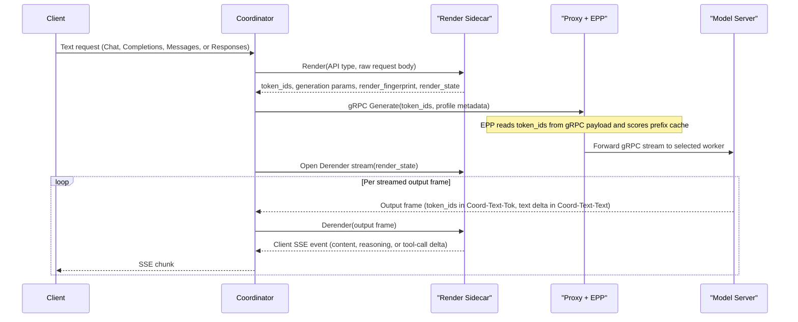
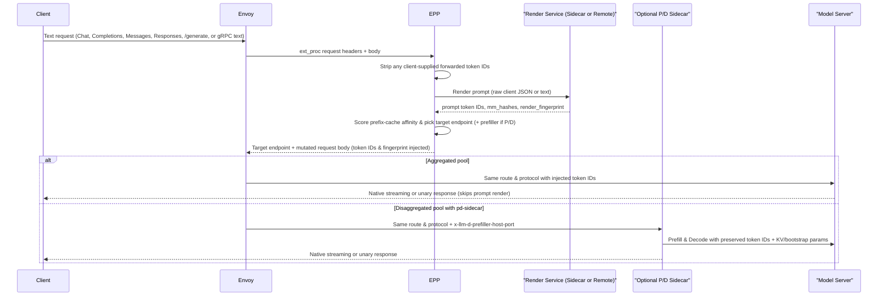

# Tokenize Once at Ingress

- **Status:** Proposal
- **Date:** 2026-11-04
- **Tracking issue:** [llm-d-router#3991](https://github.com/llm-d/llm-d-router/issues/3991)
- **Primary issues:** [llm-d-router#3656](https://github.com/llm-d/llm-d-router/issues/3656), [llm-d-router#3758](https://github.com/llm-d/llm-d-router/issues/3758), [llm-d-router#3901](https://github.com/llm-d/llm-d-router/issues/3901), [llm-d-router#3617](https://github.com/llm-d/llm-d-router/issues/3617)
- **Target components:** `llm-d-router` (Coordinator, Endpoint Picker [EPP], prefill/decode [P/D] sidecar), upstream `vllm-project/vllm`, upstream `sgl-project/sglang`

---

## 1. Summary

Today, `llm-d` renders and tokenizes every text prompt twice. On ingress, EPP's `token-producer` plugin or Coordinator's `render` step tokenizes the prompt to score prefix-cache affinity. Before inference, the GPU worker renders and tokenizes the same prompt again. Duplicate tokenization wastes CPU, adds time-to-first-token (TTFT) latency on long multi-turn contexts, and lets router and worker token IDs drift.

This proposal tokenizes every prompt **at most once, at ingress**, across **vLLM** and **SGLang** in two deployment topologies:

1. **Coordinator + EPP:** Coordinator delegates prompt render and response derender to a local Rust sidecar over a Unix domain socket (UDS: `vllm-rs render` or `sglang-render`). Coordinator then calls worker stages (`conditional-decode`, `encode`, `prefill`, `decode`) over gRPC (`vllm.Inference` or `sglang.api.v1.SglangService`) with token IDs. EPP reads those token IDs from the gRPC payload and skips its tokenizer.
2. **EPP alone:** For text clients, EPP renders the prompt once, scores prefix-cache affinity, and injects token IDs and a render fingerprint. Envoy forwards the request on the client's original route and protocol, and the worker skips prompt render. For token clients, EPP scores client token IDs directly and forwards the request unchanged.

---

## 2. Goals and Non-Goals

### 2.1 Goals

- **Single tokenization:** Ingress renders and tokenizes each text request once. Pre-tokenized client requests run zero tokenizers in `llm-d` and workers.
- **Zero router-worker skew:** Prefill, decode, and EPP cache affinity use one token-ID array. A render fingerprint and prompt-token parity metrics verify alignment.
- **Full API parity:** Support Chat (`/v1/chat/completions`), Completions (`/v1/completions`), Messages (`/v1/messages`), stateless Responses (`/v1/responses`), and token APIs (`/inference/v1/generate`, `/generate`, `vllm.Inference`, `sglang.api.v1`). Cover unary and SSE responses, tool calls, reasoning parsers, structured outputs, `logprobs`, LoRA adapters, and multimodal inputs.
- **Sub-millisecond sidecar IPC:** Keep local UDS overhead below `< 0.5 ms` per request and `< 50 us` per token chunk, with no external `/derender` round-trips.
- **No default pixel tensors on gateway links:** Send token placeholders, content hashes (`mm_hashes`), and compressed media (or encoder-cache keys) instead of pixel tensors. Use inline tensors only when a request overrides media processor parameters.

### 2.2 Non-Goals

- **Protocol translation in standalone EPP:** Without Coordinator, EPP mutates fields inside the client request format only. EPP never rewrites paths, translates HTTP to gRPC, or modifies responses.
- **Token clients on text-out pools:** `Tokens -> Tokens` clients always target `Tokens -> Tokens` server pools (or per-request token-output mode).
- **Stateful Responses or Conversations in `llm-d`:** The upstream [agentic-api](https://github.com/vllm-project/agentic-api) gateway owns conversation history and `previous_response_id` state in front of `llm-d` ([`docs/api-routing.md`](api-routing.md)). Coordinator and render sidecars stay stateless.
- **Non-LLM media endpoints:** Audio and image routes (`/v1/audio/*`, `/v1/images/*`) pass through over HTTP and use EPP's `estimate` backend for load estimates.
- **Completions batch prompts:** In `Coord-*` modes, Coordinator rejects `prompt` arrays with more than one prompt (`400 Bad Request`). `EPP-*` modes forward them without token injection.

---

## 3. Design Space and Architectural Modes

### 3.1 Dimensions and Design Principles

Four binary dimensions define sixteen combinations (`2^4 = 16`) under six design principles:

| Dimension | Options | Principles |
| :--- | :--- | :--- |
| **Engine** | `vLLM`, `SGLang` | **P1 (Upstream first):** Use upstream vLLM and SGLang capabilities, and close engine gaps upstream. |
| **Deployment** | `Coordinator + EPP`, `EPP alone` | **P2 (Coordinator gRPC):** Coordinator calls workers over gRPC only. **P3 (Coordinator sidecars):** Coordinator can use local render/derender sidecars. **P4 (No EPP translation):** Standalone EPP mutates request fields only. **P5 (EPP advises Envoy):** EPP never proxies worker traffic, though it can call a render service. |
| **Server** | `Tokens -> Tokens`, `Tokens -> Text` | **P6 (Token client rule):** `Tokens -> Tokens` clients target `Tokens -> Tokens` servers only. |
| **Client** | `Text -> Text`, `Tokens -> Tokens` | Applies across HTTP and gRPC ingress routes (`Input -> Output`). |

### 3.2 Pruning Invalid Combinations

Principles P4, P5, and P6 exclude six of the sixteen combinations:

- **`Tokens -> Tokens` client with `Tokens -> Text` server (4 combinations):** Excluded by **P6**. Token clients (such as RL rollout workers or external frontends) consume token IDs directly and skip server detokenization.
- **`Text -> Text` client with `EPP alone` and `Tokens -> Tokens` server (2 combinations):** Excluded by **P4** and **P5**. Raw token IDs cannot satisfy an OpenAI, Messages, or Responses client without response translation, which standalone EPP never performs.

### 3.3 Valid Architectural Matrix

The ten valid combinations form five modes named `<Router>-<Client>-<ServerOut>` (`Coord` = `Coordinator + EPP`, `EPP` = `EPP alone`, `Text` = text API, `Tok` = token API). Each badge links to its subsection ( full support across formats,  partial format or stage support,  no end-to-end support).

| Mode | Deployment | Client | Server | vLLM | SGLang |
| :--- | :--- | :--- | :--- | :--- | :--- |
| [**`Coord-Text-Tok`**](#611-coord-text-tok-on-vllm-tokens---tokens-server) | [`Coordinator + EPP`](#41-coordinator--epp) | `Text -> Text` | `Tokens -> Tokens` |  |  |
| [**`Coord-Text-Text`**](#613-coord-text-text-on-vllm-tokens---text-server) | [`Coordinator + EPP`](#41-coordinator--epp) | `Text -> Text` | `Tokens -> Text` |  |  |
| [**`Coord-Tok-Tok`**](#615-coord-tok-tok-passthrough-on-vllm-tokens---tokens-server) *(passthrough)* | [`Coordinator + EPP`](#41-coordinator--epp) | `Tokens -> Tokens` | `Tokens -> Tokens` |  |  |
| [**`EPP-Text-Text`**](#621-epp-text-text-on-vllm-tokens---text-server) | [`EPP alone`](#42-epp-alone) | `Text -> Text` | `Tokens -> Text` |  |  |
| [**`EPP-Tok-Tok`**](#623-epp-tok-tok-passthrough-on-vllm-tokens---tokens-server) *(passthrough)* | [`EPP alone`](#42-epp-alone) | `Tokens -> Tokens` | `Tokens -> Tokens` |  |  |

- **`Coord-Text-Tok` and `Coord-Text-Text`:** Coordinator renders and derenders in a local sidecar (`Coord-Text-Tok` keeps workers in token space, whereas `Coord-Text-Text` uses worker text output).
- **`EPP-Text-Text`:** EPP renders once and injects token IDs into the forwarded client request.
- **`Coord-Tok-Tok` and `EPP-Tok-Tok` (passthrough):** Coordinator or EPP forwards client token IDs without a tokenizer call.

---

## 4. Topology and Runtime Sequence

### 4.1 Coordinator + EPP

In `Coordinator + EPP` deployments, each Coordinator pod runs a Rust render sidecar over UDS (`/var/run/llm-d/render.sock`). Coordinator sends all worker calls through Envoy and EPP as HTTP/2 (`h2c` or TLS `h2`) gRPC streams. Each stream carries `x-llm-d-epp-profile` (`conditional-decode`, `encode`, `prefill`, or `decode`) in gRPC metadata. Each sidecar loads one tokenizer and chat template, so one Coordinator deployment serves one model. Gateways that front several models run one Coordinator deployment per model.

This split matches how each component scales. EPP tracks pool-wide cache blocks and endpoint load, which bounds EPP replica count or requires state sync across replicas. Coordinator pods hold state only for active requests, so Coordinator and its render sidecar scale horizontally without cross-replica coordination.

A text request executes three stages (`Render`, `Generate`, and `Derender`):

- **Disaggregated P/D:** Coordinator reuses the rendered `token_ids` slice across stages. When `conditional-decode` misses the prefix cache, the worker returns gRPC `FAILED_PRECONDITION`, and Coordinator runs `encode -> prefill -> decode`. vLLM runs prefill (`max_new_tokens=1`) before decode via `GenerateRequest.kv`, whereas SGLang runs prefill and decode concurrently with `bootstrap_*` fields.
- **Client disconnect:** Coordinator cancels active worker gRPC streams and closes the local UDS sidecar stream.
- **Token passthrough (`Coord-Tok-Tok`):** Coordinator skips `Render` and `Derender` and streams `Generate(token_ids)` directly.
- **Parameter lowering:** `Render` returns the generation parameters that token-space workers need. Those include a `structural_tag` or JSON schema for `response_format` and `tool_choice`, and `engine_reasoning_gate` with `chat_template_kwargs`. They also include `bad_words_token_ids` and `stop_token_ids` for single-token stop strings. Coordinator copies them into `GenerateRequest`.
- **Length validation:** `Render` enforces `max_model_len` and applies `truncate_prompt_tokens` before routing. Oversize prompts receive the worker's `400` body without a routing decision or a worker slot.
- **Ingress tokenizer routes:** Coordinator serves `/tokenize`, `/detokenize`, and `/v1/messages/count_tokens` from the sidecar without a worker call.

### 4.2 EPP Alone

Without Coordinator, Envoy routes client traffic directly to the `InferencePool` (aggregated workers or decode pods with `pd-sidecar`) and calls EPP over `ext_proc`. Under Principles P4 and P5, EPP never changes the request path or wire protocol and never proxies worker calls.

For text requests (`EPP-Text-Text`), EPP's `token-producer` calls an engine-matched render service over local UDS or loopback (sidecar mode) or over cluster HTTP/gRPC. Sidecar mode minimizes latency on single-model pools, whereas a shared render Deployment scales on CPU across EPP replicas.

A text request in `EPP-Text-Text` executes as follows:

- **Per-route parameter mutation (`EPP-Text-Text`):** On HTTP routes, EPP sets `prompt: []int` on `/v1/completions` and replaces `text` with `input_ids` on `/generate`. On Chat, Messages, and Responses, EPP injects prompt token IDs and a render fingerprint. On gRPC text routes, EPP rewrites `text` to token IDs in `GenerateRequest` and re-frames the 5-byte gRPC prefix (`PayloadProto.Marshal`).
- **Disaggregated P/D (`pd-sidecar`):** When `pd-sidecar` attaches KV or `bootstrap_*` transfer fields across prefill and decode, it preserves the injected token IDs.
- **Token passthrough (`EPP-Tok-Tok`):** EPP reads client token IDs to score prefix-cache affinity, skips `token-producer`, and forwards the body unchanged.

---

## 5. Gap Summary

The tables below consolidate every gap across **vLLM**, **SGLang**, and **llm-d** (`Coord-Tok-Tok` and `EPP-Tok-Tok` are passthrough modes, and `All` denotes all five modes). [Section 6](#6-detailed-gap-analysis) and [Section 7](#7-cross-cutting-design-and-operations) cover per-mode and operational details.

The critical path per mode, in delivery order:

1. **`EPP-Tok-Tok` and `Coord-Tok-Tok`:** [#3805](https://github.com/llm-d/llm-d-router/issues/3805), [#3982](https://github.com/llm-d/llm-d-router/issues/3982), and the token routes in [#3758](https://github.com/llm-d/llm-d-router/issues/3758) and [#3901](https://github.com/llm-d/llm-d-router/issues/3901).
2. **`EPP-Text-Text` on vLLM:** [vllm#65502](https://github.com/vllm-project/vllm/issues/65502), PR [#3706](https://github.com/llm-d/llm-d-router/pull/3706), [#3979](https://github.com/llm-d/llm-d-router/issues/3979), [#3980](https://github.com/llm-d/llm-d-router/issues/3980), [#3984](https://github.com/llm-d/llm-d-router/issues/3984).
3. **`Coord-Text-Text` on vLLM:** [vllm#65503](https://github.com/vllm-project/vllm/issues/65503), [#3758](https://github.com/llm-d/llm-d-router/issues/3758), [#3985](https://github.com/llm-d/llm-d-router/issues/3985).
4. **`Coord-Text-Text` on SGLang:** the `sglang-render` host in [sglang#48232](https://github.com/sgl-project/sglang/issues/48232), [#3901](https://github.com/llm-d/llm-d-router/issues/3901).
5. **`EPP-Text-Text` on SGLang:** `--trust-input-ids` in [sglang#48232](https://github.com/sgl-project/sglang/issues/48232), [sglang#48581](https://github.com/sgl-project/sglang/issues/48581), [#3656](https://github.com/llm-d/llm-d-router/issues/3656).
6. **`Coord-Text-Tok` on both engines:** [vllm#64685](https://github.com/vllm-project/vllm/pull/64685), [sglang#40920](https://github.com/sgl-project/sglang/issues/40920) items 3-4, [sglang#48580](https://github.com/sgl-project/sglang/issues/48580), and the stop-string cancel in [#3758](https://github.com/llm-d/llm-d-router/issues/3758) and [#3901](https://github.com/llm-d/llm-d-router/issues/3901), after the benchmark in [Section 6.1](#61-coordinator--epp).

### 5.1 vLLM Gaps

| Gap | Stage | Modes | Issue / PR |
| :--- | :--- | :--- | :--- |
| Merge `vllm.Render/Tokenize` and add raw JSON input, Completions, Messages, Harmony Responses, [`render_fingerprint`](#74-skew-detection-parity-and-pool-topology), and `--uds`. | `Render` | `Coord-Text-Tok`, `Coord-Text-Text`, `EPP-Text-Text` | [vllm#64685](https://github.com/vllm-project/vllm/pull/64685), [vllm#65503](https://github.com/vllm-project/vllm/issues/65503) |
| Merge `vllm.Render/DetokenizeStream` and add Completions, Messages, Responses, and `CLIENT_EVENTS` envelopes. | `Derender` | `Coord-Text-Tok`, `Coord-Text-Text` | [vllm#64685](https://github.com/vllm-project/vllm/pull/64685), [vllm#65503](https://github.com/vllm-project/vllm/issues/65503) |
| Accept server `text` deltas directly in `vllm.Render/DetokenizeStream`. | `Derender` | `Coord-Text-Text` | [vllm#65503](https://github.com/vllm-project/vllm/issues/65503) |
| Decode `logprobs` candidate tokens in `vllm.Render/Detokenize` and `DetokenizeStream`, including the `text_delta` path. | `Derender` | `Coord-Text-Tok`, `Coord-Text-Text` | [vllm#64685](https://github.com/vllm-project/vllm/pull/64685), [vllm#65503](https://github.com/vllm-project/vllm/issues/65503) |
| Unify the `vllm.Render` proto across `vllm-rs` and Python `vllm launch render`. | `Render`, `Derender` | `Coord-Text-Tok`, `Coord-Text-Text`, `EPP-Text-Text` | [vllm#65503](https://github.com/vllm-project/vllm/issues/65503), [vllm#36102](https://github.com/vllm-project/vllm/pull/36102) |
| Expose [`grpc.health.v1`](#75-sidecar-health-and-failure-modes) on `vllm-rs render`. | `Render`, `Derender` | `Coord-Text-Tok`, `Coord-Text-Text`, `EPP-Text-Text` | [vllm#65503](https://github.com/vllm-project/vllm/issues/65503) |
| When render omits media tensors, retain [`mm_metadata`](#71-multimodal-requests) in the response. | `Render` | `Coord-Text-Tok`, `Coord-Text-Text` | [vllm#64997](https://github.com/vllm-project/vllm/pull/64997) |
| Support [`mm_processor_kwargs`](#71-multimodal-requests) and [`media_io_kwargs`](#71-multimodal-requests) on `vllm.Inference.GenerateRequest`. | `Generate` | `Coord-Text-Tok`, `Coord-Text-Text`, `Coord-Tok-Tok`, `EPP-Tok-Tok` | [vllm#65841](https://github.com/vllm-project/vllm/issues/65841) |
| Support `n>1` in `vllm.Inference`. | `Generate` | `Coord-Text-Tok`, `Coord-Text-Text`, `Coord-Tok-Tok`, `EPP-Tok-Tok` | [vllm#65841](https://github.com/vllm-project/vllm/issues/65841) |
| Add trusted [`prompt_token_ids`](#72-security-and-trust-boundaries) and [`prompt_render_fingerprint`](#74-skew-detection-parity-and-pool-topology) on Chat, Messages, and Responses without a KV-connector gate. | `Generate` | `EPP-Text-Text` | [vllm#65502](https://github.com/vllm-project/vllm/issues/65502), [vllm#62333](https://github.com/vllm-project/vllm/pull/62333) |
| Add [`--on-fingerprint-mismatch`](#74-skew-detection-parity-and-pool-topology) (`reject` or `rerender`) on model servers. | `Generate` | `EPP-Text-Text` | [vllm#65502](https://github.com/vllm-project/vllm/issues/65502) |
| Accept `prompt_render_fingerprint` on `vllm.Inference.GenerateRequest` and enforce `--on-fingerprint-mismatch` on gRPC. | `Generate` | `Coord-Text-Tok`, `Coord-Text-Text` | [vllm#65502](https://github.com/vllm-project/vllm/issues/65502) |
| Scope `render_fingerprint` to render inputs and report parser flags in [`derender_fingerprint`](#74-skew-detection-parity-and-pool-topology). | `Render`, `Generate` | `EPP-Text-Text` | [vllm#65502](https://github.com/vllm-project/vllm/issues/65502) |
| Return `X-Prompt-Tokens` and `X-Render-Fingerprint` response headers on text routes. | `Generate` | `EPP-Text-Text` | [vllm#65502](https://github.com/vllm-project/vllm/issues/65502) |
| Reuse forwarded `prompt_token_ids` on [multimodal requests](#71-multimodal-requests). | `Generate` | `EPP-Text-Text` | [vllm#64721](https://github.com/vllm-project/vllm/pull/64721) |

### 5.2 SGLang Gaps

| Gap | Stage | Modes | Issue / PR |
| :--- | :--- | :--- | :--- |
| Ship a standalone `sglang-render` host over gRPC and UDS with [`render_fingerprint`](#74-skew-detection-parity-and-pool-topology) and [`grpc.health.v1`](#75-sidecar-health-and-failure-modes). | `Render`, `Derender` | `Coord-Text-Tok`, `Coord-Text-Text`, `EPP-Text-Text` | [sglang#48232](https://github.com/sgl-project/sglang/issues/48232) |
| Add Messages, Responses, and [multimodal support](#71-multimodal-requests) in `sglang-processor`. | `Render`, `Derender` | `Coord-Text-Tok`, `Coord-Text-Text`, `EPP-Text-Text` | [sglang#48232](https://github.com/sgl-project/sglang/issues/48232), [sglang#46291](https://github.com/sgl-project/sglang/pull/46291) |
| Support `DecodeStream` and stop strings on `output_ids` in `sglang-render`. | `Derender` | `Coord-Text-Tok` | [sglang#40920](https://github.com/sgl-project/sglang/issues/40920), [sglang#40956](https://github.com/sgl-project/sglang/issues/40956) |
| Decode `logprobs` candidate text in `sglang-render` `DecodeStream` on `--skip-tokenizer-init` pools. | `Derender` | `Coord-Text-Tok` | [sglang#40920](https://github.com/sgl-project/sglang/issues/40920), [sglang#48232](https://github.com/sgl-project/sglang/issues/48232) |
| Expose [`grpc.health.v1`](#75-sidecar-health-and-failure-modes) on `sglang-server`. | `Generate` | `Coord-Text-Tok`, `Coord-Text-Text`, `Coord-Tok-Tok`, `EPP-Tok-Tok` | [sglang#38075](https://github.com/sgl-project/sglang/issues/38075) |
| Add per-request [`skip_detokenize`](#74-skew-detection-parity-and-pool-topology) on `sglang.api.v1.GenerateRequest`. | `Generate` | `Coord-Text-Tok`, `Coord-Tok-Tok`, `EPP-Tok-Tok` | [sglang#48580](https://github.com/sgl-project/sglang/issues/48580) |
| Support `input_ids` and [`--trust-input-ids`](#72-security-and-trust-boundaries) on Rust Chat, Messages, and Responses. | `Generate` | `EPP-Text-Text` | [sglang#48232](https://github.com/sgl-project/sglang/issues/48232) |
| Add [`--on-fingerprint-mismatch`](#74-skew-detection-parity-and-pool-topology) (`reject` or `rerender`) on model servers. | `Generate` | `EPP-Text-Text` | [sglang#48232](https://github.com/sgl-project/sglang/issues/48232) |
| Accept `render_fingerprint` on `sglang.api.v1.GenerateRequest` and enforce `--on-fingerprint-mismatch` on gRPC. | `Generate` | `Coord-Text-Tok`, `Coord-Text-Text` | [sglang#48232](https://github.com/sgl-project/sglang/issues/48232) |
| Scope `render_fingerprint` to render inputs and report parser flags in [`derender_fingerprint`](#74-skew-detection-parity-and-pool-topology). | `Render`, `Generate` | `EPP-Text-Text` | [sglang#48232](https://github.com/sgl-project/sglang/issues/48232) |
| Return `X-Prompt-Tokens` and `X-Render-Fingerprint` response headers on text routes. | `Generate` | `EPP-Text-Text` | [sglang#48232](https://github.com/sgl-project/sglang/issues/48232) |
| When Chat requests carry `input_ids`, preserve [multimodal images](#71-multimodal-requests). | `Generate` | `EPP-Text-Text` | [sglang#47400](https://github.com/sgl-project/sglang/pull/47400), [sglang#47402](https://github.com/sgl-project/sglang/pull/47402) |
| When Chat requests carry `input_ids`, honor template stop strings. | `Generate` | `EPP-Text-Text` | [sglang#48581](https://github.com/sgl-project/sglang/issues/48581) |

### 5.3 llm-d Gaps

| Gap | Engine | Stage | Modes | Issue / PR |
| :--- | :--- | :--- | :--- | :--- |
| **Coordinator:** Add UDS gRPC clients for `vllm.Render` and `SglangRender`. | Both | `Render`, `Derender` | `Coord-Text-Tok`, `Coord-Text-Text` | [#3758](https://github.com/llm-d/llm-d-router/issues/3758), [#3901](https://github.com/llm-d/llm-d-router/issues/3901), PR [#3906](https://github.com/llm-d/llm-d-router/pull/3906) |
| **Coordinator:** Add an interim builder for Chat envelopes until `vllm.Render` emits `CLIENT_EVENTS`. | vLLM | `Derender` | `Coord-Text-Tok`, `Coord-Text-Text` | PR [#3708](https://github.com/llm-d/llm-d-router/pull/3708) |
| **Coordinator:** Add a `vllm.Inference` client and port `conditional-decode`, `KVConnector`, `ECConnector`, and error responses. | vLLM | `Generate` | `Coord-Text-Tok`, `Coord-Text-Text`, `Coord-Tok-Tok` | [#3758](https://github.com/llm-d/llm-d-router/issues/3758) |
| **Coordinator:** Add a `sglang.api.v1` client with concurrent P/D, `Abort` on disconnect, and error responses. | SGLang | `Generate` | `Coord-Text-Tok`, `Coord-Text-Text`, `Coord-Tok-Tok` | [#3872](https://github.com/llm-d/llm-d-router/issues/3872), [#3901](https://github.com/llm-d/llm-d-router/issues/3901), PR [#3906](https://github.com/llm-d/llm-d-router/pull/3906) |
| **Coordinator:** Lower `response_format`, `tool_choice`, `bad_words`, and single-token `stop` from `Render` output into gRPC sampling fields. | Both | `Render`, `Generate` | `Coord-Text-Tok`, `Coord-Text-Text` | [#3758](https://github.com/llm-d/llm-d-router/issues/3758), [#3901](https://github.com/llm-d/llm-d-router/issues/3901) |
| **Coordinator:** Enforce `max_model_len` and `truncate_prompt_tokens` at `Render` before routing. | Both | `Render` | `Coord-Text-Tok`, `Coord-Text-Text` | [#3758](https://github.com/llm-d/llm-d-router/issues/3758), [#3901](https://github.com/llm-d/llm-d-router/issues/3901) |
| **Coordinator:** When a buffered multi-token stop string matches, cancel the worker gRPC stream. | Both | `Generate`, `Derender` | `Coord-Text-Tok` | [#3758](https://github.com/llm-d/llm-d-router/issues/3758), [#3901](https://github.com/llm-d/llm-d-router/issues/3901) |
| **Coordinator:** Map HTTP `/inference/v1/generate` and `/generate` plus `VllmEngine` and `SglangScheduler` gRPC to worker gRPC. | Both | `Generate` | `Coord-Tok-Tok` | [#3758](https://github.com/llm-d/llm-d-router/issues/3758), [#3901](https://github.com/llm-d/llm-d-router/issues/3901), [#3981](https://github.com/llm-d/llm-d-router/issues/3981) |
| **Coordinator, EPP:** [Strip client](#72-security-and-trust-boundaries) `prompt_token_ids`, `prompt_render_fingerprint`, `kv_transfer_params`, and `input_ids` on text routes. | Both | `Render` | `Coord-Text-Tok`, `Coord-Text-Text`, `EPP-Text-Text` | [#3979](https://github.com/llm-d/llm-d-router/issues/3979) |
| **Coordinator:** [Fetch media once](#71-multimodal-requests) in the render sidecar (domain allowlist, size caps) and forward bytes to `encode`. | Both | `Render`, `Generate` | `Coord-Text-Tok`, `Coord-Text-Text` | [#3988](https://github.com/llm-d/llm-d-router/issues/3988) |
| **EPP:** Add an SGLang render backend and retire the cross-engine vLLM render pool. | SGLang | `Render` | `EPP-Text-Text` | [#3656](https://github.com/llm-d/llm-d-router/issues/3656) |
| **EPP:** Inject `prompt_token_ids`, `input_ids`, `prompt: []int`, and [`render_fingerprint`](#74-skew-detection-parity-and-pool-topology) into forwarded text requests. | Both | `Render`, `Generate` | `EPP-Text-Text` | [#3656](https://github.com/llm-d/llm-d-router/issues/3656), PR [#3706](https://github.com/llm-d/llm-d-router/pull/3706) |
| **EPP:** Add a [`multimodalTokenInjection`](#71-multimodal-requests) gate for media requests. | Both | `Render`, `Generate` | `EPP-Text-Text` | PR [#3706](https://github.com/llm-d/llm-d-router/pull/3706), [#3980](https://github.com/llm-d/llm-d-router/issues/3980) |
| **EPP:** Add a `vllm.Inference` parser (with body mutation on text routes). | vLLM | `Generate` | `All` | [#3758](https://github.com/llm-d/llm-d-router/issues/3758) |
| **EPP:** Merge `sglanggrpc-parser` for `sglang.api.v1`. | SGLang | `Generate` | `All` | [#3901](https://github.com/llm-d/llm-d-router/issues/3901), PR [#3904](https://github.com/llm-d/llm-d-router/pull/3904) |
| **EPP:** Enable `sglanghttp-parser` by default and extract [`mm_hashes`](#71-multimodal-requests). | SGLang | `Generate` | `EPP-Text-Text`, `EPP-Tok-Tok` | [#3901](https://github.com/llm-d/llm-d-router/issues/3901), [#3983](https://github.com/llm-d/llm-d-router/issues/3983) |
| **EPP:** Add a parser for legacy `SglangScheduler` gRPC. | SGLang | `Generate` | `EPP-Tok-Tok` | [#3981](https://github.com/llm-d/llm-d-router/issues/3981) |
| **EPP:** Reassemble gRPC chunks across frames. | Both | `Generate` | `All` | [#3644](https://github.com/llm-d/llm-d-router/issues/3644) |
| **EPP:** Pass DP rank metadata over gRPC. | Both | `Generate` | `Coord-Text-Tok`, `Coord-Text-Text`, `Coord-Tok-Tok`, `EPP-Tok-Tok` | [#3757](https://github.com/llm-d/llm-d-router/issues/3757) |
| **EPP:** When requests carry token IDs or `prompt: []int`, skip `token-producer`. | Both | `Generate` | `Coord-Text-Tok`, `Coord-Text-Text`, `Coord-Tok-Tok`, `EPP-Tok-Tok` | [#3805](https://github.com/llm-d/llm-d-router/issues/3805), PR [#3806](https://github.com/llm-d/llm-d-router/pull/3806) |
| **EPP:** Decouple `precise-prefix-cache-producer` from `backend: vllm`. | Both | `Generate` | `All` | [#3982](https://github.com/llm-d/llm-d-router/issues/3982) |
| **EPP:** Add [LoRA extra keys](#74-skew-detection-parity-and-pool-topology) (`lora_name`, adapter path) to `precise-prefix-cache-producer` and the gRPC parsers. | Both | `Generate` | `All` | [#3989](https://github.com/llm-d/llm-d-router/issues/3989) |
| **P/D sidecar:** Preserve `prompt_token_ids` in `kv_transfer_params` across connector merges. | vLLM | `Generate` | `EPP-Text-Text` | PR [#3706](https://github.com/llm-d/llm-d-router/pull/3706) |
| **P/D sidecar:** Merge SGLang gRPC P/D support. | SGLang | `Generate` | `EPP-Text-Text`, `EPP-Tok-Tok` | [#3901](https://github.com/llm-d/llm-d-router/issues/3901), PRs [#3905](https://github.com/llm-d/llm-d-router/pull/3905), [#3908](https://github.com/llm-d/llm-d-router/pull/3908) |
| **Coordinator, EPP:** Merge `conditional-decode` parity checks and extend [`prompt_token_mismatch_total`](#74-skew-detection-parity-and-pool-topology) to gRPC and `EPP-Text-Text` (read worker response headers). | Both | `Generate` | `Coord-Text-Tok`, `Coord-Text-Text`, `Coord-Tok-Tok`, `EPP-Text-Text` | PR [#3889](https://github.com/llm-d/llm-d-router/pull/3889), [#3984](https://github.com/llm-d/llm-d-router/issues/3984) |
| **Coordinator, EPP:** [Screen endpoints](#74-skew-detection-parity-and-pool-topology) by `render_fingerprint` per request during rollouts (sidecar fingerprint in gRPC metadata). | Both | `Generate` | `Coord-Text-Tok`, `Coord-Text-Text`, `EPP-Text-Text` | [#3984](https://github.com/llm-d/llm-d-router/issues/3984) |
| **Coordinator, Helm:** Run the render container as a native sidecar (`emptyDir` UDS) and gate [`/readyz`](#75-sidecar-health-and-failure-modes) on [`grpc.health.v1`](#75-sidecar-health-and-failure-modes). | Both | `Render`, `Derender` | `Coord-Text-Tok`, `Coord-Text-Text` | [#3985](https://github.com/llm-d/llm-d-router/issues/3985) |
| **Coordinator:** [Bound in-flight renders](#75-sidecar-health-and-failure-modes) per sidecar and shed with `503` and `Retry-After`. | Both | `Render` | `Coord-Text-Tok`, `Coord-Text-Text` | [#3985](https://github.com/llm-d/llm-d-router/issues/3985) |
| **EPP:** When the render service times out in `EPP-Text-Text`, score with [`estimate`](#75-sidecar-health-and-failure-modes) and forward unmutated text. | Both | `Render` | `EPP-Text-Text` | [#2025](https://github.com/llm-d/llm-d-router/issues/2025), [#3980](https://github.com/llm-d/llm-d-router/issues/3980) |
| **Helm:** Derive worker and renderer CLI flags and pinned image tags from [one values block](#76-helm-capacity-and-rollout). | Both | `Render`, `Generate`, `Derender` | `Coord-Text-Tok`, `Coord-Text-Text`, `EPP-Text-Text` | [#3986](https://github.com/llm-d/llm-d-router/issues/3986) |
| **Helm:** Define CPU and memory requests and [`ContainerResource` HPA targets](#76-helm-capacity-and-rollout) for Coordinator and render sidecar containers. | Both | `Render`, `Derender` | `Coord-Text-Tok`, `Coord-Text-Text` | [#3986](https://github.com/llm-d/llm-d-router/issues/3986) |
| **CI:** Run a [render-parity corpus](#76-helm-capacity-and-rollout) and IPC benchmarks against the sidecar and worker images from one Helm values file. | Both | `Render`, `Derender` | `Coord-Text-Tok`, `Coord-Text-Text`, `EPP-Text-Text` | [#3990](https://github.com/llm-d/llm-d-router/issues/3990) |
| **Coordinator, EPP:** Add [`injectTokenIDs`](#76-helm-capacity-and-rollout) and [`protocol: grpc`](#76-helm-capacity-and-rollout) rollback flags (plus optional HTTP decode bridge). | Both | `Render`, `Generate` | `Coord-Text-Tok`, `Coord-Text-Text`, `Coord-Tok-Tok`, `EPP-Text-Text` | [#3656](https://github.com/llm-d/llm-d-router/issues/3656), PRs [#3706](https://github.com/llm-d/llm-d-router/pull/3706), [#3741](https://github.com/llm-d/llm-d-router/pull/3741), [#3758](https://github.com/llm-d/llm-d-router/issues/3758), [#3901](https://github.com/llm-d/llm-d-router/issues/3901) |

---

## 6. Detailed Gap Analysis

This section evaluates stage support (`Render`, `Generate`, `Derender`) and tracks engine and `llm-d` gaps for all ten valid combinations.

### 6.1 Coordinator + EPP

`Coord-Text-Text` (`Tokens -> Text` server) is the first delivery target on both engines. The worker detokenizes once, the sidecar parses text deltas, and no stop-string cancel path exists. `Coord-Text-Tok` (`Tokens -> Tokens` server) keeps workers in token space and moves per-token detokenization into the sidecar, at the cost of one UDS frame per token. It wins when the worker frontend is the CPU bottleneck. A long-context, high-concurrency benchmark decides the default mode. `Coord-Tok-Tok` forwards client token IDs to `Tokens -> Tokens` servers without `Render` or `Derender` (Principle P6).

#### 6.1.1 `Coord-Text-Tok` on vLLM (`Tokens -> Tokens` Server)

- **Status:** 
- **Stages**
  - **Render:** Partial. HTTP `/v1/*/render` supports Chat, Completions, Messages, and non-Harmony Responses. Draft gRPC `Tokenize` in `vllm.Render` supports typed Chat only.
  - **Generate:** Partial. `vllm.Inference/GenerateStream` supports `token_ids` with `output_text=false`, KV/EC parameters, and media for `n=1`. Coordinator lacks a gRPC client.
  - **Derender:** Partial. Draft `vllm.Render/DetokenizeStream` streams Chat deltas only. It lacks Completions, Messages, Responses, client envelopes, and `logprobs` candidate decoding.
- **Engine gaps**
  - Merge Chat `Tokenize` and `DetokenizeStream` in `vllm.Render` ([vllm#64685](https://github.com/vllm-project/vllm/pull/64685)).
  - Add raw JSON input, Completions, Messages, Responses (with Harmony), `CLIENT_EVENTS`, `render_fingerprint`, and `--uds` ([vllm#65503](https://github.com/vllm-project/vllm/issues/65503)).
  - Decode `logprobs` candidate tokens in `vllm.Render/DetokenizeStream` ([vllm#64685](https://github.com/vllm-project/vllm/pull/64685), [vllm#65503](https://github.com/vllm-project/vllm/issues/65503)).
  - Unify the render proto across `vllm-rs` and Python `vllm launch render` ([vllm#65503](https://github.com/vllm-project/vllm/issues/65503), [vllm#36102](https://github.com/vllm-project/vllm/pull/36102)).
  - When render omits media tensors, retain `mm_metadata` in the response ([vllm#64997](https://github.com/vllm-project/vllm/issues/64997)).
  - Support `mm_processor_kwargs` and `media_io_kwargs` on `vllm.Inference.GenerateRequest` ([vllm#65841](https://github.com/vllm-project/vllm/issues/65841)).
  - Support `n>1` in `vllm.Inference` ([vllm#65841](https://github.com/vllm-project/vllm/issues/65841)).
  - Accept `prompt_render_fingerprint` on `vllm.Inference.GenerateRequest` and enforce `--on-fingerprint-mismatch` on gRPC ([vllm#65502](https://github.com/vllm-project/vllm/issues/65502)).
- **llm-d gaps**
  - **Coordinator**
    - Add gRPC clients for `vllm.Inference` and `vllm.Render` ([llm-d-router#3758](https://github.com/llm-d/llm-d-router/issues/3758)).
    - Port `conditional-decode`, `KVConnector`, `ECConnector`, and error responses to `vllm.Inference` ([llm-d-router#3758](https://github.com/llm-d/llm-d-router/issues/3758)).
    - Lower `response_format`, `tool_choice`, `bad_words`, and single-token `stop` from `Render` output into `GenerateRequest` ([llm-d-router#3758](https://github.com/llm-d/llm-d-router/issues/3758)).
    - Enforce `max_model_len` and `truncate_prompt_tokens` at `Render` before routing ([llm-d-router#3758](https://github.com/llm-d/llm-d-router/issues/3758)).
    - When a buffered multi-token stop string matches, cancel `GenerateStream` ([llm-d-router#3758](https://github.com/llm-d/llm-d-router/issues/3758)).
    - Add an interim builder for Chat envelopes ([llm-d-router#3708](https://github.com/llm-d/llm-d-router/pull/3708)).
    - Strip client `prompt_token_ids`, `prompt_render_fingerprint`, and `kv_transfer_params` on text routes ([llm-d-router#3979](https://github.com/llm-d/llm-d-router/issues/3979)).
    - Fetch media once in the render sidecar and forward bytes to `encode` ([llm-d-router#3988](https://github.com/llm-d/llm-d-router/issues/3988)).
  - **EPP**
    - Add a `vllm.Inference` parser ([llm-d-router#3758](https://github.com/llm-d/llm-d-router/issues/3758)).
    - Reassemble gRPC chunks across frames ([llm-d-router#3644](https://github.com/llm-d/llm-d-router/issues/3644)).
    - Pass DP rank metadata over gRPC ([llm-d-router#3757](https://github.com/llm-d/llm-d-router/issues/3757)).
    - When requests carry token IDs, skip `token-producer` ([llm-d-router#3805](https://github.com/llm-d/llm-d-router/issues/3805)).
    - Decouple `precise-prefix-cache-producer` from `backend: vllm` ([llm-d-router#3982](https://github.com/llm-d/llm-d-router/issues/3982)).

#### 6.1.2 `Coord-Text-Tok` on SGLang (`Tokens -> Tokens` Server)

- **Status:** 
- **Stages**
  - **Render:** Unsupported. No standalone service exists. Library `sglang-processor` lowers Chat and Completions only. It lacks Messages and Responses.
  - **Generate:** Partial. `sglang.api.v1.SglangService/Generate` emits `output_ids` only on `--skip-tokenizer-init` pools and rejects string `stop` and `stop_regex`.
  - **Derender:** Unsupported. Responders in `sglang-processor` require server `text` rather than `output_ids` (except on DeepSeek-V4/V4.1). Logprob text decodes on the server detok shard only.
- **Engine gaps**
  - Ship a standalone `sglang-render` host over gRPC and UDS with `render_fingerprint` ([sglang#48232](https://github.com/sgl-project/sglang/issues/48232)).
  - Add Messages, Responses, and multimodal support in `sglang-processor` ([sglang#48232](https://github.com/sgl-project/sglang/issues/48232), [sglang#46291](https://github.com/sgl-project/sglang/pull/46291)).
  - Support `DecodeStream` and stop strings on `output_ids` in `sglang-render` ([sglang#40920](https://github.com/sgl-project/sglang/issues/40920) items 3-4, [sglang#40956](https://github.com/sgl-project/sglang/issues/40956)).
  - Decode `logprobs` candidate text in `sglang-render` `DecodeStream` ([sglang#40920](https://github.com/sgl-project/sglang/issues/40920) items 3-4, [sglang#48232](https://github.com/sgl-project/sglang/issues/48232)).
  - Expose `grpc.health.v1` on `sglang-server` ([sglang#38075](https://github.com/sgl-project/sglang/issues/38075)).
  - Add per-request `skip_detokenize` on `sglang.api.v1.GenerateRequest` ([sglang#48580](https://github.com/sgl-project/sglang/issues/48580)).
  - Accept `render_fingerprint` on `sglang.api.v1.GenerateRequest` and enforce `--on-fingerprint-mismatch` on gRPC ([sglang#48232](https://github.com/sgl-project/sglang/issues/48232)).
- **llm-d gaps**
  - **Coordinator**
    - Add gRPC clients for `sglang.api.v1` and `SglangRender` ([llm-d-router#3901](https://github.com/llm-d/llm-d-router/issues/3901), PR [#3906](https://github.com/llm-d/llm-d-router/pull/3906)).
    - Support concurrent SGLang P/D, `Abort` on disconnect, and gRPC error responses ([llm-d-router#3872](https://github.com/llm-d/llm-d-router/issues/3872), [#3901](https://github.com/llm-d/llm-d-router/issues/3901), PR [#3906](https://github.com/llm-d/llm-d-router/pull/3906)).
    - Lower `response_format`, `tool_choice`, and single-token `stop` from `Render` output into `SamplingParams` ([llm-d-router#3901](https://github.com/llm-d/llm-d-router/issues/3901)).
    - Enforce `max_model_len` and `truncate_prompt_tokens` at `Render` before routing ([llm-d-router#3901](https://github.com/llm-d/llm-d-router/issues/3901)).
    - When a buffered multi-token stop string matches, cancel `Generate` ([llm-d-router#3901](https://github.com/llm-d/llm-d-router/issues/3901)).
    - Strip client `input_ids` and `render_fingerprint` on text routes ([llm-d-router#3979](https://github.com/llm-d/llm-d-router/issues/3979)).
    - Fetch media once in the render sidecar and forward bytes to `encode` ([llm-d-router#3988](https://github.com/llm-d/llm-d-router/issues/3988)).
  - **EPP**
    - Merge `sglanggrpc-parser` ([llm-d-router#3901](https://github.com/llm-d/llm-d-router/issues/3901), PR [#3904](https://github.com/llm-d/llm-d-router/pull/3904)).
    - When requests carry `input_ids`, skip `token-producer` ([llm-d-router#3805](https://github.com/llm-d/llm-d-router/issues/3805)).
    - Decouple `precise-prefix-cache-producer` from `backend: vllm` ([llm-d-router#3982](https://github.com/llm-d/llm-d-router/issues/3982)).

#### 6.1.3 `Coord-Text-Text` on vLLM (`Tokens -> Text` Server)

- **Status:** 
- **Stages**
  - **Render:** Same as [Section 6.1.1](#611-coord-text-tok-on-vllm-tokens---tokens-server).
  - **Generate:** Partial. `vllm.Inference/GenerateStream` sets `output_text=true` for `n=1`. The server enforces `stop_strings` and emits raw `text`.
  - **Derender:** Partial. Draft `vllm.Render/DetokenizeStream` decodes `output_token_ids` instead of server `text` and lacks non-Chat APIs.
- **Engine gaps (deltas from [Section 6.1.1](#611-coord-text-tok-on-vllm-tokens---tokens-server))**
  - Accept server `text` deltas directly in `vllm.Render/DetokenizeStream`, with `logprobs` candidate decoding ([vllm#65503](https://github.com/vllm-project/vllm/issues/65503)).
  - All other Engine gaps in [Section 6.1.1](#611-coord-text-tok-on-vllm-tokens---tokens-server) also apply.
- **llm-d gaps (deltas from [Section 6.1.1](#611-coord-text-tok-on-vllm-tokens---tokens-server))**
  - All Coordinator and EPP gaps in [Section 6.1.1](#611-coord-text-tok-on-vllm-tokens---tokens-server) apply except Coordinator stop-string stream cancel, because the server enforces `stop_strings`.

#### 6.1.4 `Coord-Text-Text` on SGLang (`Tokens -> Text` Server)

- **Status:** 
- **Stages**
  - **Render:** Partial. Library `sglang-processor` provides `lower_chat` and `lower_completion`. It lacks a standalone host, Messages, and Responses.
  - **Generate:** Supported. `sglang.api.v1.SglangService/Generate` accepts `input_ids`, enforces stops, and streams `text` for `n>=1` and media. Router gRPC PRs are open.
  - **Derender:** Partial. `ChatResponder` and `CompletionResponder` emit OpenAI JSON/SSE from server `text`. They lack a standalone host, Messages, and Responses.
- **Engine gaps (deltas from [Section 6.1.2](#612-coord-text-tok-on-sglang-tokens---tokens-server))**
  - This mode requires the `sglang-render` host (`Lower` and `Respond`), `sglang-processor` API/multimodal, and `grpc.health.v1` updates in [Section 6.1.2](#612-coord-text-tok-on-sglang-tokens---tokens-server) ([sglang#48232](https://github.com/sgl-project/sglang/issues/48232), [#46291](https://github.com/sgl-project/sglang/pull/46291), [#38075](https://github.com/sgl-project/sglang/issues/38075)).
  - This mode does not require sidecar `DecodeStream` on `output_ids` ([sglang#40920](https://github.com/sgl-project/sglang/issues/40920) items 3-4) or per-request `skip_detokenize`.
- **llm-d gaps (deltas from [Section 6.1.2](#612-coord-text-tok-on-sglang-tokens---tokens-server))**
  - All Coordinator and EPP gaps in [Section 6.1.2](#612-coord-text-tok-on-sglang-tokens---tokens-server) apply except Coordinator stop-string stream cancel, because the server enforces stops on `text`.

#### 6.1.5 `Coord-Tok-Tok` (Passthrough) on vLLM (`Tokens -> Tokens` Server)

- **Status:** 
- **Stages**
  - **Render / Derender:** Not applicable (token passthrough).
  - **Generate:** Partial. `vllm.Inference/GenerateStream` supports `token_ids` with `output_text=false` for `n=1`. Coordinator lacks a gRPC client and does not map HTTP `/inference/v1/generate` to gRPC.
- **Engine gaps (deltas from [Section 6.1.1](#611-coord-text-tok-on-vllm-tokens---tokens-server))**
  - Only the `vllm.Inference` worker gaps in [Section 6.1.1](#611-coord-text-tok-on-vllm-tokens---tokens-server) apply (`n>1` and `mm_processor_kwargs` / `media_io_kwargs` in [vllm#65841](https://github.com/vllm-project/vllm/issues/65841)).
  - Sidecar `vllm.Render` gaps do not apply.
- **llm-d gaps (deltas from [Section 6.1.1](#611-coord-text-tok-on-vllm-tokens---tokens-server))**
  - Map HTTP `/inference/v1/generate` to `vllm.Inference` in Coordinator ([llm-d-router#3758](https://github.com/llm-d/llm-d-router/issues/3758)).
  - Route `VllmEngine` (`vllm.grpc.engine`) clients through Coordinator ([llm-d-router#3981](https://github.com/llm-d/llm-d-router/issues/3981)).
  - All EPP gaps plus the Coordinator `vllm.Inference` client and P/D connector updates in [Section 6.1.1](#611-coord-text-tok-on-vllm-tokens---tokens-server) apply. Sidecar, stop-cancel, lowering, length-validation, media-fetch, and sanitization items do not apply.

#### 6.1.6 `Coord-Tok-Tok` (Passthrough) on SGLang (`Tokens -> Tokens` Server)

- **Status:** 
- **Stages**
  - **Render / Derender:** Not applicable (token passthrough).
  - **Generate:** Partial. `sglang.api.v1.SglangService/Generate` maps `input_ids` to `output_ids` on `--skip-tokenizer-init` pools and matches HTTP `/generate` JSON. Router gRPC PRs are open.
- **Engine gaps (deltas from [Section 6.1.2](#612-coord-text-tok-on-sglang-tokens---tokens-server))**
  - Only the `sglang-server` worker gaps in [Section 6.1.2](#612-coord-text-tok-on-sglang-tokens---tokens-server) apply (`grpc.health.v1` in [sglang#38075](https://github.com/sgl-project/sglang/issues/38075) and per-request `skip_detokenize` in [sglang#48580](https://github.com/sgl-project/sglang/issues/48580)).
  - Sidecar `sglang-render` gaps do not apply.
- **llm-d gaps (deltas from [Section 6.1.2](#612-coord-text-tok-on-sglang-tokens---tokens-server))**
  - Map HTTP `/generate` to `sglang.api.v1` in Coordinator ([llm-d-router#3901](https://github.com/llm-d/llm-d-router/issues/3901)).
  - Route legacy `SglangScheduler` clients over gRPC in Coordinator ([llm-d-router#3981](https://github.com/llm-d/llm-d-router/issues/3981)).
  - All EPP gaps plus the Coordinator `sglang.api.v1` client and concurrent P/D updates in [Section 6.1.2](#612-coord-text-tok-on-sglang-tokens---tokens-server) apply. Sidecar, stop-cancel, lowering, length-validation, media-fetch, and sanitization items do not apply.

### 6.2 EPP Alone

`EPP-Text-Text` targets `Tokens -> Text` servers because standalone EPP never translates responses (Principles P4 and P5). `EPP-Tok-Tok` forwards client token IDs to `Tokens -> Tokens` servers without `Render` or `Derender` (Principle P6).

#### 6.2.1 `EPP-Text-Text` on vLLM (`Tokens -> Text` Server)

- **Status:** 
- **Stages**
  - **Render:** Partial. HTTP `/v1/*/render` supports Chat, Completions, Messages, and non-Harmony Responses. Draft gRPC `vllm.Render` supports Chat only. Harmony Responses lacks render support.
  - **Generate:** Partial. The server reuses `prompt: []int` (Completions), `prompt_token_ids` (`/inference/v1/generate`, `vllm.Inference`), and interim `kv_transfer_params.prompt_token_ids` ([vllm#48145](https://github.com/vllm-project/vllm/pull/48145)). The server re-renders Harmony and media prompts.
  - **Derender:** Supported. The server formats responses natively across all HTTP text routes. gRPC `vllm.Inference` emits raw text.
- **Engine gaps**
  - Add trusted `prompt_token_ids` and `prompt_render_fingerprint` on Chat, Messages, and Responses without a KV-connector gate ([vllm#65502](https://github.com/vllm-project/vllm/issues/65502), [vllm#62333](https://github.com/vllm-project/vllm/pull/62333)).
  - Extend `vllm.Render` to Completions, Messages, and Harmony Responses ([vllm#64685](https://github.com/vllm-project/vllm/pull/64685), [vllm#65503](https://github.com/vllm-project/vllm/issues/65503)).
  - Unify the render proto across `vllm-rs` and Python `vllm launch render` ([vllm#65503](https://github.com/vllm-project/vllm/issues/65503), [vllm#36102](https://github.com/vllm-project/vllm/pull/36102)).
  - Reuse forwarded `prompt_token_ids` on multimodal requests ([vllm#64721](https://github.com/vllm-project/vllm/pull/64721)).
  - Scope `render_fingerprint` to render inputs and report parser flags in `derender_fingerprint` ([vllm#65502](https://github.com/vllm-project/vllm/issues/65502)).
  - Return `X-Prompt-Tokens` and `X-Render-Fingerprint` response headers on text routes ([vllm#65502](https://github.com/vllm-project/vllm/issues/65502)).
- **llm-d gaps**
  - **EPP**
    - Inject `prompt_token_ids` into forwarded requests ([llm-d-router#3656](https://github.com/llm-d/llm-d-router/issues/3656), PR [#3706](https://github.com/llm-d/llm-d-router/pull/3706)).
    - Strip client `prompt_token_ids`, `prompt_render_fingerprint`, and `kv_transfer_params` on text routes ([llm-d-router#3979](https://github.com/llm-d/llm-d-router/issues/3979)).
    - Add a `multimodalTokenInjection` gate for media requests ([llm-d-router#3980](https://github.com/llm-d/llm-d-router/issues/3980), PR [#3706](https://github.com/llm-d/llm-d-router/pull/3706)).
    - Parse and mutate `vllm.Inference` requests ([llm-d-router#3758](https://github.com/llm-d/llm-d-router/issues/3758)).
    - Reassemble gRPC chunks across frames ([llm-d-router#3644](https://github.com/llm-d/llm-d-router/issues/3644)).
  - **P/D sidecar**
    - Preserve `prompt_token_ids` in `kv_transfer_params` across connector merges ([llm-d-router#3706](https://github.com/llm-d/llm-d-router/pull/3706)).

#### 6.2.2 `EPP-Text-Text` on SGLang (`Tokens -> Text` Server)

- **Status:** 
- **Stages**
  - **Render:** Partial. Pod `/v1/tokenize` renders Chat `messages` and plain text (guides today use a vLLM pool). It lacks a standalone `sglang-render` host, Messages, and Responses.
  - **Generate:** Partial. SGLang accepts `input_ids` on Python Chat, HTTP `/generate`, and gRPC `sglang.api.v1`, plus `prompt: []int` on Completions. Messages, Responses, and Rust Chat lack `input_ids`. Python Chat with `input_ids` drops media and template stops.
  - **Derender:** Supported. The server formats responses natively across all HTTP text routes. gRPC `sglang.api.v1` emits raw text.
- **Engine gaps**
  - Ship a standalone `sglang-render` host with `render_fingerprint` and `--trust-input-ids` ([sglang#48232](https://github.com/sgl-project/sglang/issues/48232)).
  - Support `input_ids` on Rust Chat, Messages, and Responses ([sglang#48232](https://github.com/sgl-project/sglang/issues/48232)).
  - When Chat requests carry `input_ids`, preserve multimodal images ([sglang#47400](https://github.com/sgl-project/sglang/pull/47400), [sglang#47402](https://github.com/sgl-project/sglang/pull/47402)).
  - When Chat requests carry `input_ids`, honor template stop strings ([sglang#48581](https://github.com/sgl-project/sglang/issues/48581)).
  - Scope `render_fingerprint` to render inputs and report parser flags in `derender_fingerprint` ([sglang#48232](https://github.com/sgl-project/sglang/issues/48232)).
  - Return `X-Prompt-Tokens` and `X-Render-Fingerprint` response headers on text routes ([sglang#48232](https://github.com/sgl-project/sglang/issues/48232)).
- **llm-d gaps**
  - **EPP**
    - Add an SGLang render backend ([llm-d-router#3656](https://github.com/llm-d/llm-d-router/issues/3656)).
    - Retire the vLLM render pool for SGLang deployments ([llm-d-router#3656](https://github.com/llm-d/llm-d-router/issues/3656)).
    - Decouple `precise-prefix-cache-producer` from `backend: vllm` ([llm-d-router#3982](https://github.com/llm-d/llm-d-router/issues/3982)).
    - Inject `input_ids` on HTTP and gRPC routes and `prompt: []int` on Completions ([llm-d-router#3656](https://github.com/llm-d/llm-d-router/issues/3656)).
    - Strip client `input_ids` and `render_fingerprint` on text routes ([llm-d-router#3979](https://github.com/llm-d/llm-d-router/issues/3979)).
    - Add a `multimodalTokenInjection` gate for media requests ([llm-d-router#3980](https://github.com/llm-d/llm-d-router/issues/3980)).
    - Extract `mm_hashes` in `sglanghttp-parser` ([llm-d-router#3983](https://github.com/llm-d/llm-d-router/issues/3983)).
  - **P/D sidecar**
    - Merge gRPC P/D support ([llm-d-router#3901](https://github.com/llm-d/llm-d-router/issues/3901), PRs [#3905](https://github.com/llm-d/llm-d-router/pull/3905), [#3908](https://github.com/llm-d/llm-d-router/pull/3908)).

#### 6.2.3 `EPP-Tok-Tok` (Passthrough) on vLLM (`Tokens -> Tokens` Server)

- **Status:** 
- **Stages**
  - **Render / Derender:** Not applicable. EPP scores prefix cache from client token IDs.
  - **Generate:** Partial. EPP and vLLM support HTTP `/inference/v1/generate` (`vllmhttp-parser`) and gRPC `VllmEngine` (`vllmgrpc-parser`) end-to-end. vLLM also supports Completions token arrays and gRPC `vllm.Inference`.
- **Engine gaps**
  - Support `n>1` in `vllm.Inference` ([vllm#65841](https://github.com/vllm-project/vllm/issues/65841)).
  - Support `mm_processor_kwargs` and `media_io_kwargs` on `vllm.Inference.GenerateRequest` ([vllm#65841](https://github.com/vllm-project/vllm/issues/65841)).
- **llm-d gaps**
  - **EPP**
    - When requests carry token IDs or `prompt: []int`, skip `token-producer` ([llm-d-router#3805](https://github.com/llm-d/llm-d-router/issues/3805), PR [#3806](https://github.com/llm-d/llm-d-router/pull/3806)).
    - Decouple `precise-prefix-cache-producer` from `backend: vllm` ([llm-d-router#3982](https://github.com/llm-d/llm-d-router/issues/3982)).
    - Pass DP rank metadata over gRPC ([llm-d-router#3757](https://github.com/llm-d/llm-d-router/issues/3757)).
    - This mode also requires the `vllm.Inference` parser and gRPC frame reassembly updates in [Section 6.2.1](#621-epp-text-text-on-vllm-tokens---text-server) ([llm-d-router#3758](https://github.com/llm-d/llm-d-router/issues/3758), [#3644](https://github.com/llm-d/llm-d-router/issues/3644)).

#### 6.2.4 `EPP-Tok-Tok` (Passthrough) on SGLang (`Tokens -> Tokens` Server)

- **Status:** 
- **Stages**
  - **Render / Derender:** Not applicable. EPP scores prefix cache from client `input_ids`.
  - **Generate:** Partial. EPP and SGLang support HTTP `/generate` with `input_ids` (`sglanghttp-parser`) end-to-end. SGLang also supports gRPC `sglang.api.v1` and `SglangScheduler` on `--skip-tokenizer-init` pools.
- **Engine gaps**
  - Expose `grpc.health.v1` on `sglang-server` ([sglang#38075](https://github.com/sgl-project/sglang/issues/38075)).
  - Add per-request `skip_detokenize` on `sglang.api.v1.GenerateRequest` ([sglang#48580](https://github.com/sgl-project/sglang/issues/48580)).
- **llm-d gaps**
  - **EPP**
    - Merge `sglanggrpc-parser` for `sglang.api.v1` ([llm-d-router#3901](https://github.com/llm-d/llm-d-router/issues/3901), PR [#3904](https://github.com/llm-d/llm-d-router/pull/3904)).
    - Enable `sglanghttp-parser` by default ([llm-d-router#3901](https://github.com/llm-d/llm-d-router/issues/3901), [#3983](https://github.com/llm-d/llm-d-router/issues/3983)).
    - When requests carry `input_ids` or `prompt: []int`, skip `token-producer` ([llm-d-router#3805](https://github.com/llm-d/llm-d-router/issues/3805), PR [#3806](https://github.com/llm-d/llm-d-router/pull/3806)).
    - Add a parser for legacy `SglangScheduler` gRPC ([llm-d-router#3981](https://github.com/llm-d/llm-d-router/issues/3981)).
    - Pass DP rank metadata over gRPC ([llm-d-router#3757](https://github.com/llm-d/llm-d-router/issues/3757)).
    - This mode also requires the `sglanghttp-parser` `mm_hashes` and `precise-prefix-cache-producer` updates in [Section 6.2.2](#622-epp-text-text-on-sglang-tokens---text-server) ([llm-d-router#3982](https://github.com/llm-d/llm-d-router/issues/3982), [#3983](https://github.com/llm-d/llm-d-router/issues/3983)).

---

## 7. Cross-Cutting Design and Operations

Sections 7.1-7.3 cover request, security, and state rules whose gaps appear per mode in [Section 6](#6-detailed-gap-analysis). Sections 7.4-7.6 cover shared operational controls and track their gaps.

### 7.1 Multimodal Requests

Multimodal requests preserve single tokenization without 2-16 MB pixel tensors (`kwargs_data`) on gateway links:

- **Coordinator + EPP (`gRPC`):** Coordinator calls the render sidecar with tensor omission (`omit_media_kwargs = true` on `vllm.Render/Tokenize` and hash-and-placeholder mode on `SglangRender/Lower`). The sidecar computes `mm_hashes` and expands multimodal placeholders in `token_ids` to match the worker layout for prefix-cache keys and token positions. Coordinator sends compressed media (`MediaItem` bytes/URLs on `vllm.Inference`, or `MediaInput` and `mm_hashes` on `sglang.api.v1`) only to `encode` (or `prefill` without `encode`). Decode workers receive KV blocks from prefill and never decode pixels.
  - *Processor overrides:* When a vLLM request sets `mm_processor_kwargs` or `media_io_kwargs`, placeholder lengths depend on those fields, which `vllm.Inference.GenerateRequest` lacks today. For those requests, Coordinator requests inline `PreprocessedMediaFeatures` from `Tokenize` until `GenerateRequest` adds those fields ([vllm#65841](https://github.com/vllm-project/vllm/issues/65841)).
- **EPP alone (`EPP-Text-Text` gate):** On upstream `main`, vLLM Chat ignores `prompt_token_ids` on media messages (until [vllm#64721](https://github.com/vllm-project/vllm/pull/64721)). SGLang Python Chat drops `image_data` when `input_ids` is set (fixed in [sglang#47400](https://github.com/sgl-project/sglang/pull/47400) and [#47402](https://github.com/sgl-project/sglang/pull/47402)). When a request contains media and `multimodalTokenInjection` is false, EPP calls render with `mm_payload: "none"` for cache-affinity `TokenIDs` and `MultiModalFeatures`, and forwards unmutated text ([llm-d-router#3980](https://github.com/llm-d/llm-d-router/issues/3980)).
- **Media fetch policy:** The render service fetches each media URL once, under `--allowed-media-domains`, size caps, and timeouts. In `Coord-*` modes, Coordinator forwards the fetched bytes (`MediaItem.raw_bytes` on `vllm.Inference`, `MediaInput` on `sglang.api.v1`) to `encode`, and workers never refetch URLs. Coordinator also sends `mm_hashes` in gRPC metadata, so EPP routes `encode` requests without a buffered media body. In `EPP-Text-Text`, the render service fetches bytes to compute exact `mm_hashes`. Pools that forbid fetches at ingress set `mediaHashing: url`, and EPP then hashes the URL string with approximate affinity on media blocks.

### 7.2 Security and Trust Boundaries

Untrusted token IDs on Chat, Messages, or Responses let callers bypass system prompts, chat templates, and safety rules ([vllm#62307](https://github.com/vllm-project/vllm/issues/62307)). Two layers enforce the trust boundary:

1. **Ingress sanitization:** On text routes (`/v1/chat/completions`, string `/v1/completions`, `/v1/messages`, `/v1/responses`), Coordinator and EPP strip client `prompt_token_ids`, `prompt_render_fingerprint`, `kv_transfer_params`, and `input_ids` ([llm-d-router#3979](https://github.com/llm-d/llm-d-router/issues/3979)). Dedicated token routes (`/inference/v1/generate`, `/generate`, and token gRPC services) accept client token IDs.
2. **Server trust flag:** Workers honor forwarded token IDs on text routes only when `--trust-forwarded-prompt-token-ids` ([vllm#65502](https://github.com/vllm-project/vllm/issues/65502)) or `--trust-input-ids` ([sglang#48232](https://github.com/sgl-project/sglang/issues/48232)) is set on cluster-internal listeners. Otherwise, workers return `400 Bad Request`. A dedicated trust flag replaces the `--kv-transfer-config` gate ([vllm#62333](https://github.com/vllm-project/vllm/pull/62333)) so aggregated pools support `EPP-Text-Text` while public listeners reject injected tokens.
   - *Prerequisites:* The trust flag accepts token IDs from any caller that reaches the listener. A NetworkPolicy or mTLS therefore restricts the listener to Envoy, EPP, and Coordinator. An optional HMAC over the token IDs (`prompt_render_signature`, keyed per pool) makes injection verifiable without reliance on network position.

### 7.3 Stateful Responses and Conversations

Coordinator and engine render sidecars remain stateless:

- When [vllm-project/agentic-api](https://github.com/vllm-project/agentic-api) sits in front of `llm-d`, it terminates `/v1/conversations` and stateful `/v1/responses` (`previous_response_id`, `store: true`, `background: true`). It expands prior turns into a stateless `/v1/responses` input, forwards that request to `llm-d`, and stores the output ([`docs/api-routing.md`](api-routing.md)).
- Without `agentic-api`, Coordinator and `pd-sidecar` reject stateful `/v1/responses` fields with `400 Bad Request` (`RejectStatefulResponsesFields`) and avoid router database state.

### 7.4 Skew Detection, Parity, and Pool Topology

`vllm.Render` and `SglangRender` compute `render_fingerprint`, a SHA-256 digest over the render inputs. The digest covers tokenizer files (`tokenizer.json`, `tokenizer_config.json`, `special_tokens_map.json`, `*.tiktoken`), chat templates, and `--default-chat-template-kwargs`. It also covers `--tokenizer-mode`, model `config.json` multimodal tokens, and the engine render schema version. Parser flags (`--tool-call-parser`, `--reasoning-parser`) go into a separate `derender_fingerprint`, because `EPP-Text-Text` workers run their own parsers. In `EPP-Text-Text`, EPP attaches `prompt_render_fingerprint` to mutated requests. In `Coord-*` modes, Coordinator sends it on `vllm.Inference` and `sglang.api.v1` requests.

On mismatch, workers return `409 Conflict` by default, or re-render locally and increment a mismatch counter under `--on-fingerprint-mismatch=rerender`. During a worker rolling update, one pool holds two fingerprints. EPP screens endpoints per request against the fingerprint in gRPC metadata or the injected field, in the pattern of `disaggregatedset-rollout-screener`. Both versions keep serving while Coordinators roll to the matching sidecar image.

One vLLM pool serves both text and token clients because `ResponseOptions.output_text` is per-request. In `sglang-server`, `--skip-tokenizer-init` is startup-only (`DetokenizerBackend::Skip` vs `Dynamo`), so text and token pools stay separate until `sglang.api.v1.GenerateRequest` adds `skip_detokenize`.

Precise prefix-cache keys need the same extra keys as the worker. vLLM folds LoRA name and path, `mm_hashes`, and `cache_salt` into block hashes. EPP folds `cache_salt` and `mm_hashes` today, so LoRA requests miss precise affinity.

- **Status:** 
- **Current support**
  - Coordinator tracks `prompt_token_mismatch_total` (ingress token count vs worker `num_prompt_tokens` / `prompt_tokens`) between HTTP prefill and decode ([llm-d-router#3751](https://github.com/llm-d/llm-d-router/pull/3751)).
  - `precise-prefix-cache-producer` folds `cache_salt` and `mm_hashes` but not LoRA keys.
  - gRPC pipelines, `EPP-Text-Text`, and rolling updates lack parity and fingerprint checks.
- **Engine gaps**
  - Add `--on-fingerprint-mismatch` (`reject` or `rerender`) on model servers ([vllm#65502](https://github.com/vllm-project/vllm/issues/65502), [sglang#48232](https://github.com/sgl-project/sglang/issues/48232)).
  - Accept the fingerprint on gRPC `GenerateRequest` and enforce `--on-fingerprint-mismatch` on gRPC routes ([vllm#65502](https://github.com/vllm-project/vllm/issues/65502), [sglang#48232](https://github.com/sgl-project/sglang/issues/48232)).
  - Scope `render_fingerprint` to render inputs and report parser flags in `derender_fingerprint` ([vllm#65502](https://github.com/vllm-project/vllm/issues/65502), [sglang#48232](https://github.com/sgl-project/sglang/issues/48232)).
  - Return `X-Prompt-Tokens` and `X-Render-Fingerprint` response headers on text routes ([vllm#65502](https://github.com/vllm-project/vllm/issues/65502), [sglang#48232](https://github.com/sgl-project/sglang/issues/48232)).
- **llm-d gaps**
  - Merge prompt-token parity checks on `conditional-decode` hits ([llm-d-router#3889](https://github.com/llm-d/llm-d-router/pull/3889)).
  - Extend `prompt_token_mismatch_total` to Coordinator gRPC and `EPP-Text-Text`. Read worker response headers where present ([llm-d-router#3984](https://github.com/llm-d/llm-d-router/issues/3984)).
  - Screen endpoints by `render_fingerprint` per request during rollouts, with the sidecar fingerprint in gRPC metadata ([llm-d-router#3984](https://github.com/llm-d/llm-d-router/issues/3984)).
  - Add LoRA extra keys (`lora_name`, adapter path) to `precise-prefix-cache-producer` and the gRPC parsers ([llm-d-router#3989](https://github.com/llm-d/llm-d-router/issues/3989)).

### 7.5 Sidecar Health and Failure Modes

In `Coordinator + EPP`, worker calls use token-only gRPC, so prompt tokenization is mandatory. When the UDS sidecar returns `INVALID_ARGUMENT`, Coordinator returns `400 Bad Request`. When the sidecar crashes mid-stream, Coordinator aborts the client stream, cancels upstream gRPC generation, and fails `/readyz` until kubelet restarts the sidecar. Coordinator bounds in-flight renders per sidecar and sheds excess with `503` and `Retry-After`. One long-context burst then adds no TTFT tail latency to other requests.

In `EPP alone` (`EPP-Text-Text`), validation errors (`400`) from the render service propagate to the client or worker. On render timeouts (`DEADLINE_EXCEEDED` or `UNAVAILABLE`), EPP scores with `estimate` and forwards the unmutated text request so the worker renders locally.

- **Status:** 
- **Current support**
  - Coordinator has no UDS render sidecar, sidecar health gate on `/readyz`, or render admission control.
  - When the render service times out, EPP does not switch to `estimate`.
- **Engine gaps**
  - Expose `grpc.health.v1` on `vllm-rs render` and `sglang-render` ([vllm#65503](https://github.com/vllm-project/vllm/issues/65503), [sglang#48232](https://github.com/sgl-project/sglang/issues/48232)).
- **llm-d gaps**
  - Run the render sidecar as a Kubernetes native sidecar (`restartPolicy: Always`) on a memory-backed `emptyDir` UDS ([llm-d-router#3985](https://github.com/llm-d/llm-d-router/issues/3985)).
  - Gate Coordinator `/readyz` on `grpc.health.v1` status from the local sidecar ([llm-d-router#3985](https://github.com/llm-d/llm-d-router/issues/3985)).
  - Bound in-flight renders per sidecar, shed with `503` and `Retry-After`, and export `render_inflight` and `render_queue_depth` ([llm-d-router#3985](https://github.com/llm-d/llm-d-router/issues/3985)).
  - In `EPP-Text-Text`, when the render service times out, score with `estimate` and forward unmutated text ([llm-d-router#2025](https://github.com/llm-d/llm-d-router/issues/2025), [#3980](https://github.com/llm-d/llm-d-router/issues/3980)).

### 7.6 Helm, Capacity, and Rollout

Go Coordinator is network I/O bound (~1-2 vCPU per replica). The Rust render sidecar uses ~4-8 vCPU per replica for Jinja, BPE, UTF-8 decode, and incremental parsers, plus image decoding on multimodal pools. It also needs memory for tokenizer files, templates, and multimodal processors (hundreds of MiB to a few GiB). A shared pod lets one HorizontalPodAutoscaler scale Coordinator and render capacity together without cross-pod session affinity. The HPA targets the `render` container through a `ContainerResource` metric, because pod-average CPU hides sidecar saturation.

- **Status:** 
- **Current support**
  - PR [llm-d-router#3706](https://github.com/llm-d/llm-d-router/pull/3706) gates vLLM token injection by plugin config, and PR [#3741](https://github.com/llm-d/llm-d-router/pull/3741) prototypes an HTTP decode bridge in Coordinator.
  - Helm charts do not share render flags or image tags across workers and renderers.
  - No CI job compares sidecar and worker render output, and no benchmark covers the IPC targets in [Section 2.1](#21-goals).
- **Engine gaps**
  - None.
- **llm-d gaps**
  - Derive render CLI flags and pinned image tags for workers and renderers from one Helm values block ([llm-d-router#3986](https://github.com/llm-d/llm-d-router/issues/3986)).
  - Define CPU and memory requests and `ContainerResource` HPA targets for Coordinator and render sidecar containers in Helm ([llm-d-router#3986](https://github.com/llm-d/llm-d-router/issues/3986)).
  - Run a CI render-parity corpus and IPC benchmarks against sidecar and worker images from one Helm values file ([llm-d-router#3990](https://github.com/llm-d/llm-d-router/issues/3990)).
  - Add `injectTokenIDs` and `protocol: grpc` config flags for sub-minute rollback ([llm-d-router#3706](https://github.com/llm-d/llm-d-router/pull/3706), [#3758](https://github.com/llm-d/llm-d-router/issues/3758), [#3901](https://github.com/llm-d/llm-d-router/issues/3901)).
  - If HTTP Coordinator pools ship before gRPC, merge the interim decode bridge ([llm-d-router#3656](https://github.com/llm-d/llm-d-router/issues/3656), PR [#3741](https://github.com/llm-d/llm-d-router/pull/3741)).
