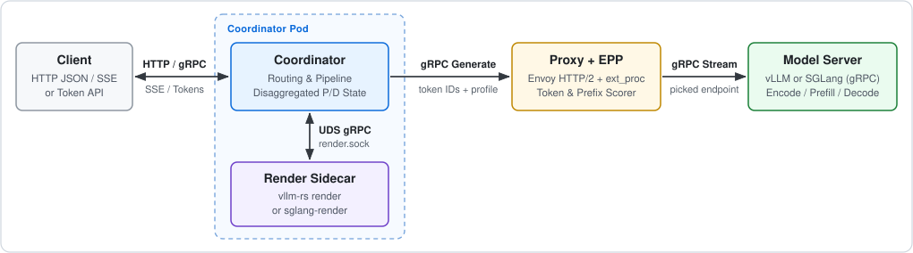
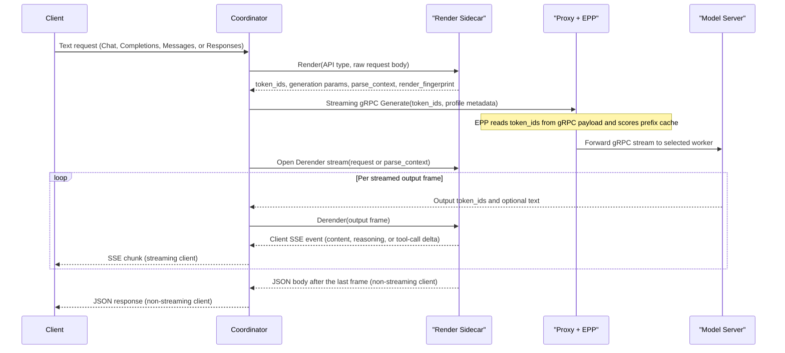
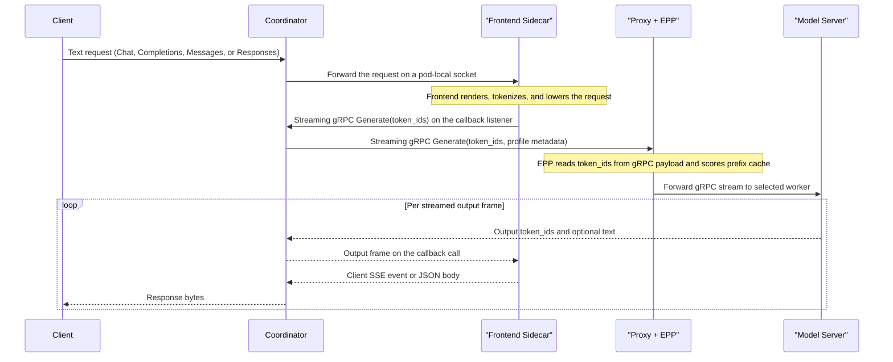

# Tokenize Once at Ingress

- **Status:** Proposal
- **Date:** 2026-11-04
- **Tracking issue:** [llm-d-router#3991](https://github.com/llm-d/llm-d-router/issues/3991)
- **Primary issues:** [llm-d-router#4111](https://github.com/llm-d/llm-d-router/issues/4111), [llm-d-router#4124](https://github.com/llm-d/llm-d-router/issues/4124), [llm-d-router#3993](https://github.com/llm-d/llm-d-router/issues/3993), [llm-d-router#3901](https://github.com/llm-d/llm-d-router/issues/3901), [llm-d-router#3617](https://github.com/llm-d/llm-d-router/issues/3617)
- **Target components:** `llm-d-router` (Coordinator, Endpoint Picker [EPP], prefill/decode [P/D] sidecar), upstream `vllm-project/vllm`, upstream `sgl-project/sglang`

---

## 1. Summary

By default today, `llm-d` renders and tokenizes every text prompt twice. On ingress, EPP's `token-producer` plugin or Coordinator's `render` step tokenizes the prompt to score prefix-cache affinity. Before inference, the GPU worker renders and tokenizes the same prompt again. Duplicate tokenization wastes CPU, adds time-to-first-token (TTFT) latency on long multi-turn contexts, and lets router and worker token IDs drift.

This proposal tokenizes every prompt **at most once, at ingress**, across **vLLM** and **SGLang** over **`Tokens -> Tokens` model servers**:

1. **Coordinator + EPP (default deployment):** In `Coord-Text-Tok` (text client, token-out worker), a Rust sidecar of the engine in the Coordinator pod renders each prompt once. It is a render sidecar over a Unix domain socket (UDS) in `StageRPC` mode, or the engine frontend in `Loopback` mode ([Section 3.5](#35-sidecar-modes-for-coord-text-tok)). Coordinator calls worker stages (`conditional-decode` on vLLM, `encode`, `prefill`, `decode`) over gRPC (`vllm.Inference` or `sglang.api.v1.SglangService`) with token IDs. Workers return output token IDs, and the sidecar parses that output into the client response. In `Coord-Tok-Tok` (token client, token-out worker), Coordinator forwards client token IDs over gRPC without sidecar calls. EPP reads token IDs from the gRPC payload and skips its tokenizer.
2. **EPP alone (`EPP-Tok-Tok`, token passthrough):** For pre-tokenized client requests on vLLM and SGLang, EPP scores prefix-cache affinity from client token IDs and forwards the request unchanged. Single tokenization for text clients in `EPP alone` mode stays out of the initial scope ([Section 3.2](#32-decision-focus-on-tokens---tokens-model-servers)).

---

## 2. Goals and Non-Goals

### 2.1 Goals

- **Single tokenization:** Ingress renders and tokenizes each text request once in `Coordinator + EPP`. Pre-tokenized client requests run zero tokenizers in `llm-d` and workers.
- **Zero router-worker skew:** Prefill, decode, and EPP cache affinity use one token-ID array. A render fingerprint and prompt-token parity metrics verify alignment.
- **Full API parity:** Support Chat (`/v1/chat/completions`), Completions (`/v1/completions`), Messages (`/v1/messages`), stateless Responses (`/v1/responses`), and token APIs (`/inference/v1/generate`, `/generate`, `vllm.Inference`, `sglang.api.v1`). Cover non-streaming and SSE (aka streaming) responses, tool calls, reasoning parsers, structured outputs, `logprobs`, vLLM LoRA adapters, and multimodal inputs. Parity means the feature set of the engine's Rust frontend. vLLM tracks the remaining gaps to its Python frontend in [vllm#44280](https://github.com/vllm-project/vllm/issues/44280) (for example beam search, [vllm#64862](https://github.com/vllm-project/vllm/pull/64862)).
- **Sub-millisecond sidecar IPC:** Keep local sidecar overhead below `< 0.5 ms` per request and `< 50 us` per token chunk, with no external `/derender` round-trips. The sidecar link is a UDS in `StageRPC`, and a UDS or a loopback port in `Loopback`.
- **No pixel tensors on gateway links:** Send token placeholders, content hashes (`mm_hashes`), grid metadata, and compressed media (or encoder-cache keys) instead of pixel tensors.

### 2.2 Non-Goals

- **Protocol translation in standalone EPP:** Without Coordinator, EPP never rewrites paths, translates HTTP to gRPC, or modifies responses.
- **`Tokens -> Text` server modes in the Northstar:** Worker-derendered text modes (`Coord-Text-Text` and `EPP-Text-Text`) stay out of the initial focus ([Section 3.2](#32-decision-focus-on-tokens---tokens-model-servers)). Tactical HTTP token forwarding ([#3656](https://github.com/llm-d/llm-d-router/issues/3656)) proceeds independently as a near-term bridge.
- **Stateful Responses or Conversations in `llm-d`:** The upstream [agentic-api](https://github.com/vllm-project/agentic-api) gateway owns conversation history and `previous_response_id` state in front of `llm-d` ([`docs/api-routing.md`](api-routing.md)). Coordinator and its sidecars stay stateless.
- **Non-LLM media endpoints:** Audio and image routes (`/v1/audio/*`, `/v1/images/*`) pass through over HTTP and use EPP's `estimate` backend for load estimates.

---

## 3. Design Space and Architectural Modes

### 3.1 Dimensions and Design Principles

Four binary dimensions define sixteen combinations (`2^4 = 16`) under six design principles:

| Dimension | Options | Principles |
| :--- | :--- | :--- |
| **Engine** | `vLLM`, `SGLang` | **P1 (Upstream first):** Use upstream vLLM and SGLang capabilities, and close engine gaps upstream. |
| **Deployment** | `Coordinator + EPP`, `EPP alone` | **P2 (Coordinator gRPC):** Coordinator calls workers over gRPC only. **P3 (Coordinator sidecars):** Coordinator can use local render/derender sidecars. **P4 (No EPP translation):** Standalone EPP mutates request fields only. **P5 (EPP advises Envoy):** EPP never proxies worker traffic, though it can call a render service. |
| **Server** | `Tokens -> Tokens`, `Tokens -> Text` | **P6 (Token client rule):** `Tokens -> Tokens` clients target `Tokens -> Tokens` servers only. |
| **Client** | `Text -> Text`, `Tokens -> Tokens` | No principle of its own. Both options apply across HTTP and gRPC ingress routes (`Input -> Output`). |

### 3.2 Decision: Focus on `Tokens -> Tokens` Model Servers

As `llm-d` shifts toward `Coordinator + EPP` as its default deployment, this proposal scopes the Northstar to **`Tokens -> Tokens` model servers** on both engines. A `Tokens -> Tokens` server is the token API of an engine (`vllm.Inference`, or the `Generate` RPC of `sglang.api.v1`). It takes token IDs, and it returns output token IDs with or without the decoded text. It runs no chat template and no output parser. That choice defers all eight `Tokens -> Text` combinations, including worker-derendered Coordinator mode (`Coord-Text-Text`) and standalone EPP token injection (`EPP-Text-Text`). Near-term HTTP prompt-token forwarding ([#3656](https://github.com/llm-d/llm-d-router/issues/3656), PRs [#3706](https://github.com/llm-d/llm-d-router/pull/3706), [#3741](https://github.com/llm-d/llm-d-router/pull/3741)) remains an independent tactical bridge for HTTP pools.

**Pros:**

- **One architecture across vLLM and SGLang:** Both engines share one `Tokens -> Tokens` gRPC worker boundary ([llm-d-router#3617](https://github.com/llm-d/llm-d-router/issues/3617)). GPU workers run inference and match stop strings, while CPU sidecars own chat templates, prompt tokenization, and output parsers.
- **No response-envelope state machines in Go:** Engine Rust sidecars emit client JSON and SSE events for Chat, Completions, Messages, and Responses. They are `vllm.Render` and `SglangRender` in `StageRPC`, and the engine frontend in `Loopback`. Coordinator does not maintain four separate response schemas in Go.
- **Smaller security and feature surface:** Drops HTTP text token injection (`--enable-prompt-token-ids`), `pd-sidecar` `kv_transfer_params.prompt_token_ids` merges, multimodal injection gates, and worker `output_mode: derender` from the Northstar.

**Cons:**

- **No single tokenization in `EPP alone` text deployments:** Standalone EPP text pools continue to render prompts on the worker (unless they use the tactical HTTP path in [#3656](https://github.com/llm-d/llm-d-router/issues/3656)).
- **Sidecar round trip per token chunk:** In `Coord-Text-Tok`, each output frame takes a round trip to the pod-local sidecar rather than an inline worker parser. `StageRPC` uses one stream for that round trip (`Coordinator <-> Render Sidecar`), and `Loopback` uses two streams (callback call and client response). Non-streaming requests take the same path, and EPP handles each of their response chunks, because every `decode` call streams ([Section 4.1](#41-coordinator--epp)). [llm-d-router#3990](https://github.com/llm-d/llm-d-router/issues/3990) benchmarks this IPC path under high concurrency.
- **New upstream surface:** In `StageRPC`, `Render` and `Derender` need engine RPCs for four client APIs ([vllm#65503](https://github.com/vllm-project/vllm/issues/65503), [vllm#67652](https://github.com/vllm-project/vllm/issues/67652), [sglang#48232](https://github.com/sgl-project/sglang/issues/48232)). They cover multimodal metadata, grammar lowering, and client SSE envelopes. In `Loopback`, the engine frontend needs a client for a remote token endpoint ([vllm#64729](https://github.com/vllm-project/vllm/pull/64729), and gaps without an issue yet in [Section 5](#5-gap-summary)). This surface is the largest upstream cost of either sidecar mode.
- **Output decode on workers:** Workers match stop strings on their decoded output, which keeps stop strings in the engine. SGLang workers decode every output stream and send the text next to the token IDs. On vLLM, the sidecar decodes the token IDs itself, because its parsers read token-attributed text ([Section 4.1.3](#413-derender-stage-rpc-requirements-vllmrender-sglangrenderrespond-over-uds)). A vLLM worker therefore decodes only a request with stop strings, which limits the worker CPU and the frame size to those requests.

**Sidecar modes:** `Coord-Text-Tok` supports two sidecar modes ([Section 3.5](#35-sidecar-modes-for-coord-text-tok)). In `StageRPC`, Coordinator calls `Render` and `Derender` on a render sidecar. In `Loopback`, the upstream frontend of the engine serves the text APIs and sends token requests through Coordinator ([llm-d-router#3617](https://github.com/llm-d/llm-d-router/issues/3617), [#4347](https://github.com/llm-d/llm-d-router/pull/4347)). The gap tables name the sidecar mode of each gap ([Section 5](#5-gap-summary)).

**Worker derender alternative:** On vLLM, the decode worker can also parse its own output under `output_mode: derender` with a `parse_context` from `Render`. That path removes the sidecar round trip per output frame. Python HTTP `/inference/v1/generate` has that mode, and `vllm.Inference` lacks it ([vllm#66427](https://github.com/vllm-project/vllm/issues/66427)). This proposal keeps the sidecar `Derender` ([vllm#67652](https://github.com/vllm-project/vllm/issues/67652), [vllm#68943](https://github.com/vllm-project/vllm/pull/68943)), because worker derender returns Chat deltas without the client envelopes of each API. On SGLang, `sglang.api.v1` has no such mode. Worker derender on vLLM stays an option for the `Derender` half of `StageRPC`.

**Fallback:** The delivery order limits the risk when upstream items stall. Passthrough modes need no `Render` or `Derender`, and an API whose stage items stay open keeps its HTTP route. On SGLang, the worker renders the prompt on that route, as it does today. On vLLM, Coordinator forwards the rendered `prompt_token_ids` on that route, and the worker builds the response ([#3656](https://github.com/llm-d/llm-d-router/issues/3656), [#3706](https://github.com/llm-d/llm-d-router/pull/3706), [#3741](https://github.com/llm-d/llm-d-router/pull/3741)). Python workers reuse those IDs without a KV connector today ([vllm#62307](https://github.com/vllm-project/vllm/issues/62307)), and open PR [vllm#62333](https://github.com/vllm-project/vllm/pull/62333) proposes the `--enable-prompt-token-ids` gate. Rust workers render the prompt again until [vllm#65502](https://github.com/vllm-project/vllm/issues/65502) ([vllm#68230](https://github.com/vllm-project/vllm/pull/68230)) lands.

### 3.3 Pruning Remaining Combinations

Of the eight `Tokens -> Tokens` combinations, Principles **P4** and **P5** exclude two (`Text -> Text` client with `EPP alone` and `Tokens -> Tokens` server). Raw token IDs cannot satisfy an OpenAI, Messages, or Responses client without response translation, which standalone EPP never performs.

### 3.4 Valid Architectural Matrix

The remaining six combinations form three `<Router>-<Client>-<ServerOut>` modes across both engines. Here, `Coord` denotes `Coordinator + EPP`, `EPP` denotes `EPP alone`, `Text` denotes text API, and `Tok` denotes token API. Each badge links to its gap table in [Section 5](#5-gap-summary) ( full support across formats,  partial format or stage support,  no end-to-end support). [Section 6](#6-current-support) lists current support.

| Mode | Deployment | Client | Server | vLLM | SGLang |
| :--- | :--- | :--- | :--- | :--- | :--- |
| [**`Coord-Text-Tok`**](#6-current-support) | [`Coordinator + EPP`](#41-coordinator--epp) | `Text -> Text` | `Tokens -> Tokens` |  |  |
| [**`Coord-Tok-Tok`**](#6-current-support) *(passthrough)* | [`Coordinator + EPP`](#41-coordinator--epp) | `Tokens -> Tokens` | `Tokens -> Tokens` |  |  |
| [**`EPP-Tok-Tok`**](#6-current-support) *(passthrough)* | [`EPP alone`](#42-epp-alone) | `Tokens -> Tokens` | `Tokens -> Tokens` |  |  |

- **`Coord-Text-Tok`:** A local sidecar renders prompts, and Coordinator sends token IDs to workers. Workers return output token IDs, and the sidecar parses that output into the client response. [Section 3.5](#35-sidecar-modes-for-coord-text-tok) defines its two sidecar modes, `StageRPC` and `Loopback`.
- **`Coord-Tok-Tok` and `EPP-Tok-Tok` (passthrough):** Coordinator or EPP scores prefix-cache affinity from client token IDs and forwards requests without a tokenizer call.

Frontend policy across these six combinations:

- **`Coord-*` (`vLLM` and `SGLang`):** Rust-only end-to-end (`vllm.Inference` workers on vLLM and `sglang-server` workers on SGLang). The sidecar is `vllm-rs render` or `sglang-render` in `StageRPC`, and the vLLM Rust server or `sgl-router` in `Loopback`. Coordinator also passes Python `VllmEngine` token gRPC streams through.
- **`EPP-Tok-Tok` (`vLLM` and `SGLang`):** Supports Rust and Python token endpoints (`/inference/v1/generate`, `/generate`, Completions token arrays, `vllm.Inference`, `VllmEngine`, and `sglang.api.v1`).
- **External HTTP `/v1/*/derender`:** Never used in any mode.

### 3.5 Sidecar Modes for `Coord-Text-Tok`

`Coord-Text-Tok` has two sidecar modes. Both run an engine sidecar in the Coordinator pod, and both send token IDs to workers through EPP. They differ in the component that owns the client request:

- **`StageRPC`:** Coordinator owns the request. It calls a render sidecar for `Render` before `Generate` and for `Derender` on the worker frames ([Section 4.1](#41-coordinator--epp)).
- **`Loopback`:** The engine frontend owns the request. Coordinator forwards the client request to a frontend sidecar. The frontend sends token requests back to a Coordinator listener and builds the client response ([Section 4.1.6](#416-frontend-loopback-loopback)).

The table below shows what exists upstream today for each sidecar mode. The surface columns name the interface between the sidecar and Coordinator. That interface is `Render` and `Derender` in `StageRPC`, and the token call of the frontend in `Loopback`. [Section 6](#6-current-support) lists current support by stage, with the `llm-d` side.

| Sidecar mode and engine | Logic upstream | HTTP surface | gRPC surface | Published image |
| :--- | :--- | :--- | :--- | :--- |
| **`StageRPC`, vLLM** (`vllm-rs render`) | The Rust renderer covers Chat and Completions. The output parsers have no entry point outside the Rust server. | `/v1/*/render` for Chat and Completions. `/v1/*/derender` exists in the Python server only. | `RenderChat` for typed Chat. Raw-JSON `Render` is in [vllm#67700](https://github.com/vllm-project/vllm/pull/67700). `DerenderStream` for Chat is in [vllm#68943](https://github.com/vllm-project/vllm/pull/68943). | Yes. The vLLM images ship `vllm-rs`. |
| **`StageRPC`, SGLang** (`sglang-render`, proposed) | `sglang-processor` lowers Chat and Completions and builds the responses. It is a library inside `sgl-router` and `sglang-server`. | No render sidecar route. Workers serve `/v1/tokenize` for Chat messages, and `/parse_function_call` and `/separate_reasoning` for a finished text. | No `Lower` or `Respond` ([sglang#48232](https://github.com/sgl-project/sglang/issues/48232)). Workers serve `ParseFunctionCall` and `SeparateReasoning` for a finished text. | None. |
| **`Loopback`, vLLM** (Rust server) | The Rust server serves Chat, Completions, and Responses over a local engine. | A client for remote generation is a draft ([vllm#64736](https://github.com/vllm-project/vllm/pull/64736)). | None. [vllm#64729](https://github.com/vllm-project/vllm/pull/64729) lets the server run over a caller-built `Llm`. | The vLLM images ship `vllm-rs`. A frontend-only image is in [vllm#68707](https://github.com/vllm-project/vllm/pull/68707). |
| **`Loopback`, SGLang** (`sgl-router`) | `sgl-router` serves Chat, Completions, Messages, and Responses. It lowers Completions, and Chat for verified model families. | Yes. The router calls workers over `/generate`. | None for HTTP clients ([sglang#45816](https://github.com/sgl-project/sglang/issues/45816)). For a gRPC client, the router sends `sglang.api.v1` `Generate` to workers ([sglang#45808](https://github.com/sgl-project/sglang/pull/45808)). | Yes (`lmsysorg/sgl-router`). |

The comparison below assumes that every gap of [Section 5](#5-gap-summary) is closed:

| Aspect | `StageRPC` | `Loopback` |
| :--- | :--- | :--- |
| **Client protocol code** | The engines serve `Render` and `Derender` RPCs and four client envelopes next to their main serving path. A new API or field needs RPC support first. | The frontend runs the main serving code of the engine for parsing, templates, output parsers, error bodies, and envelopes. A new API or field needs no new RPC. |
| **Coordinator code** | Coordinator copies each lowered generation parameter from the `Render` response into the `Generate` request. A new engine feature can need a change in Go. | Coordinator serves one token `Generate` contract and maps no lowered parameters. |
| **Upstream fit** | The engines maintain a second RPC surface for gateways. | The mode builds on the split between frontend and engine that both engines ship (`vllm_llm::Llm`, `sgl-router`). |
| **Request state** | Output parsing needs facts of the request, for example the tools and the reasoning settings. `Render` and `Derender` are separate calls, so `Derender` gets these facts again, from a `parse_context` or from the request body. | One frontend task renders the request and parses the output. The request facts stay in its memory, and no `parse_context` crosses an RPC. |
| **Request context** | One Coordinator request owns ingress checks, media fetch, routing headers, tracing, admission, and stage orchestration. | The client request runs the ingress steps, and the callback call runs the stages. Gateway metadata (fairness, priority, session, `Prefer`, trace) reaches the stages in two ways. The frontend forwards configured headers, or Coordinator joins the two requests by request ID. |
| **Sidecar contract** | The sidecar is a passive helper that Coordinator calls. | Coordinator acts as an engine backend. Its callback listener follows the worker contract of each frontend (health, aborts, errors) and tracks upstream changes. |
| **Data path** | The request and each output frame take one sidecar round trip. Coordinator makes these round trips as calls inside one request: `Render`, then one `Derender` stream. | The request and each output frame also take one sidecar round trip. The round trips belong to separate Coordinator requests: the forwarded client request and the callback call. |
| **Cancellation** | Coordinator sees a client disconnect and cancels the worker stream itself. | The cancel passes the frontend before it reaches the callback call, and its timing depends on the frontend. The request join lets Coordinator cancel the worker stream directly. |
| **Stage inputs** | `Render` returns `token_ids`, `mm_hashes`, metadata-only media, `render_fingerprint`, and lowered parameters before `Generate`. Coordinator plans `encode`, `prefill`, and `decode` from them. | Coordinator sees what the token request of the frontend carries. Media split, stop-string placement, and skew data depend on frontend hooks. |

**Bottom line:** `Loopback` lets the engine frontend own the client protocol, which gives the most reuse of upstream code and API parity. Its cost is a split request context and a Coordinator that acts as an engine backend for the frontend. `StageRPC` keeps the request in Coordinator, which gives direct control of headers, multimodal stages, skew screening, and cancellation. Its cost is a second RPC surface in both engines and parameter mapping in Go.

---

## 4. Topology and Runtime Sequence

EPP placement is the same in every mode. Envoy calls EPP over `ext_proc` for each request to the `InferencePool`. Of the three stages, EPP sees `Generate` only, because `Render` and `Derender` stay inside the Coordinator pod.

### 4.1 Coordinator + EPP

In `Coordinator + EPP` deployments, each Coordinator pod runs one Rust sidecar of the engine. It is a render sidecar over UDS (`/var/run/llm-d/render.sock`) in `StageRPC`, and the engine frontend on pod-local sockets in `Loopback` ([Section 4.1.6](#416-frontend-loopback-loopback)). Coordinator sends all worker calls through Envoy and EPP as HTTP/2 (`h2c` or TLS `h2`) gRPC streams. Each stream carries `x-llm-d-epp-profile` (`encode`, `prefill`, or `decode`) in gRPC metadata. Each sidecar loads one tokenizer and chat template, so one Coordinator deployment serves one model. Gateways that front several models run one Coordinator deployment per model.

This split matches how each component scales. EPP tracks pool-wide cache blocks and endpoint load, which bounds EPP replica count or requires state sync across replicas. Coordinator pods hold state only for active requests, so Coordinator and its sidecar scale horizontally without cross-replica coordination. The figure below shows the pod in `StageRPC`.

In `StageRPC`, a text request in `Coord-Text-Tok` executes three stages (`Render`, `Generate`, and `Derender`):

- **Disaggregated P/D:** Coordinator reuses the rendered `token_ids` slice across stages. On vLLM, EPP returns gRPC `FAILED_PRECONDITION` ([#4341](https://github.com/llm-d/llm-d-router/pull/4341)) before any worker call when `conditional-decode` (`Prefer: if-available`) misses the prefix cache. Coordinator then runs vLLM `encode -> prefill -> decode` via `GenerateRequest.kv`. SGLang decode servers require `bootstrap_*` fields today ([sglang#45416](https://github.com/sgl-project/sglang/issues/45416) proposes local prefill on decode). Coordinator therefore skips `conditional-decode` on SGLang and runs `prefill` and `decode` concurrently (`prefill` calls `--encoder-urls` in EPD once [sglang#48705](https://github.com/sgl-project/sglang/issues/48705) lands).
- **Stop strings:** Workers match stop strings on their decoded output and end the stream themselves ([Section 4.1.2](#412-generate-stage-rpc-requirements-vllminference-sglangapiv1-on-workers)).
- **Worker stream:** Coordinator calls the streaming `Generate` RPC on `conditional-decode` and `decode` for every request (`vllm.Inference/GenerateStream`, or `stream = true` on `sglang.api.v1`). For a non-streaming client (`stream: false`), the sidecar returns one JSON body after the last frame. EPP then reads the first output frame of every request. By default, `inflight-load-producer` releases the tokens of the request on that frame. `latency-observer-producer-hub` and the TTFT and TPOT metrics take their samples from it. Coordinator bounds the buffered bytes of such a response, per request and in total, as the opt-in `force_stream` parameter does on HTTP pools ([#3122](https://github.com/llm-d/llm-d-router/pull/3122)).
- **Stream cancellation:** When a client disconnects, Coordinator cancels active worker gRPC streams and closes the sidecar stream. [Section 4.1.4](#414-stream-cancellation) lists every trigger.
- **Batch Completions (`StageRPC`):** Coordinator normalizes single-element `/v1/completions` prompt arrays and fans out multi-prompt batches across independent `Render -> Generate -> Derender` sub-requests (low priority, [#4088](https://github.com/llm-d/llm-d-router/issues/4088)).
- **Token passthrough (`Coord-Tok-Tok`):** Coordinator skips `Render` and `Derender` and streams `Generate(token_ids)` directly. For a token client that asks for one response, the worker call keeps the client mode today. A low-priority follow-up streams that call and merges the frames in Coordinator ([#4363](https://github.com/llm-d/llm-d-router/issues/4363)).
- **One stage implementation per engine:** Coordinator has an HTTP and a gRPC implementation of the worker stages today. In the modes of this proposal, each client route becomes a token request before the stages run. Text routes pass the sidecar, HTTP token routes map to gRPC under `worker_protocol: grpc` ([#4013](https://github.com/llm-d/llm-d-router/pull/4013), [#4253](https://github.com/llm-d/llm-d-router/issues/4253)), and gRPC token routes arrive in that form. `encode`, `prefill`, and `decode` then run the gRPC implementation of the engine for every route. The HTTP implementation serves HTTP pools and the fallback of [Section 3.2](#32-decision-focus-on-tokens---tokens-model-servers).
- **Ingress tokenizer routes (low priority):** Coordinator proxies `/tokenize`, `/detokenize`, and `/v1/messages/count_tokens` to decode pods today (`passthroughHandler`), and can serve them from the local sidecar on token-only pools. [Section 4.1.5](#415-ingress-routes) lists every client route.

The tables below define the stage RPC contracts for **Chat** (`/v1/chat/completions`), **Completions** (`/v1/completions`), **Messages** (`/v1/messages`), and **stateless Responses** (`/v1/responses`). `All 4` denotes all four text APIs, and subset notes mark API-specific rules. Sections 4.1.1 and 4.1.3 apply to `StageRPC`. Section 4.1.2 applies to both sidecar modes, and [Section 4.1.6](#416-frontend-loopback-loopback) defines the `Loopback` contracts.

#### 4.1.1 `Render` Stage RPC Requirements (`vllm.Render`, `SglangRender/Lower` over UDS)

| Area | APIs | RPC Service Requirements |
| :--- | :--- | :--- |
| **UDS transport & health** | All 4 | Serve unary `Render` and `grpc.health.v1` over a pod-local UDS without GPU workers or external network calls. |
| **Prompt formatting & tokenization** | All 4 *(subset rules)* | Accept `(api, raw_body)`. Apply chat templates, system instructions, and reasoning controls on Chat, Messages (`system`, `thinking`), and Responses (`instructions`). Tokenize string `prompt` directly with `add_special_tokens` on Completions. |
| **Length check & truncation** | All 4 *(subset flags)* | When prompt plus reserved output exceeds `max_model_len`, return `INVALID_ARGUMENT` with a `400` client error body. Apply `truncate_prompt_tokens` (Chat, Completions) or `truncation: "auto"` (Responses), and return pre-truncated `token_ids`. |
| **Sampling & grammar lowering** | All 4 *(tools on 3)* | Resolve `generation_config.json` defaults, token budgets (`max_tokens` or Responses `max_output_tokens`), stop strings, `stop_token_ids`, decode options (`skip_special_tokens`), and vLLM `bad_words_token_ids`. Lower tools, `tool_choice`, `strict` schemas (Chat, Messages, Responses), and structured-output formats into one grammar and reasoning gate. Reject request fields that the `Generate` request cannot carry. |
| **Multimodal metadata** | Chat, Messages, Responses | Accept Coordinator-fetched media bytes in metadata mode, plus `mm_processor_kwargs` and `media_io_kwargs` (Chat, Responses). Return `mm_hashes`, grid metadata (`image_grid_thw`, `video_grid_thw`), and expanded placeholder spans without pixel tensors. |
| **LoRA, skew & stream state** | All 4 | Resolve runtime-loaded vLLM `lora_name` from `model`, compute `render_fingerprint`, and return `parse_context` for `Derender`. As a low-priority follow-up, expose `tokenize`, `detokenize` (All 4), and `count_tokens` (Messages). |

#### 4.1.2 `Generate` Stage RPC Requirements (`vllm.Inference`, `sglang.api.v1` on Workers)

| Area | APIs | RPC Service Requirements |
| :--- | :--- | :--- |
| **Token input, token and text output** | All 4 | Accept `token_ids`, and stream delta `output_ids` (`output_token_ids = true` on vLLM, `--incremental-streaming-output` on SGLang). Add the decoded text when the request asks for it (`output_text = true` on vLLM, the default on SGLang). Run zero chat templates or output parsers on workers. |
| **Sampling, stops & `n > 1`** | All 4 *(stop strings on 3, `n > 1` on 2, logprobs on 3)* | Apply lowered sampling params, `stop_token_ids`, model/tokenizer EOS IDs, and vLLM `bad_words_token_ids`. Match stop strings (`stop` on Chat and Completions, `stop_sequences` on Messages) on the decoded output. Hold back partial matches, and cut the matched string from the text unless `include_stop_str_in_output` (vLLM) or `no_stop_trim` (SGLang) is set. End the stream at a match, and report the matched string in the finish frame. Emit candidate logprob IDs (Chat, Completions, Responses) and indexed `n > 1` streams from one prefill (Chat, Completions). |
| **Grammars & reasoning gate** | All 4 *(gate on 3)* | Enforce `json_schema`, `regex`, `ebnf`, or `structural_tag` logit masks on workers. Gate grammar masks behind `--reasoning-parser` until reasoning ends (Chat, Messages, Responses). SGLang applies that gate to requests that set `require_reasoning`. |
| **Disaggregated P/D & media** | All 4 *(media on 3)* | Support KV transfer (`KVConnector`, `bootstrap_*`) across all APIs. Support EC transfer, metadata-only and mixed `raw_bytes` media, media kwargs, `mm_routing_labels` KV events, and `UNAVAILABLE` load errors (Chat, Messages, Responses). |
| **Routing, skew & cancel** | All 4 | Honor vLLM `lora_name` and DP rank metadata, and reject skewed `render_fingerprint` with `FAILED_PRECONDITION` (`RENDER_FINGERPRINT_MISMATCH`). Abort generation on stream cancel, report prompt/cached/output token counts, and serve `grpc.health.v1`. |

#### 4.1.3 `Derender` Stage RPC Requirements (`vllm.Render`, `SglangRender/Respond` over UDS)

| Area | APIs | RPC Service Requirements |
| :--- | :--- | :--- |
| **Worker frames** | All 4 | Open from `parse_context`, or from `RenderRequest` and `prompt_token_ids` (vLLM first cut), and read each worker frame. On vLLM, decode the token IDs, because the parsers read token-attributed text. Use the request `stop` list to hold back partial stop prefixes before the cut at the reported stop. On SGLang, read the worker text. End the response with the stop reason that the worker reports. |
| **Reasoning & tool parsing** | Chat, Messages, Responses | Run incremental `--reasoning-parser` and `--tool-call-parser` on that text. On vLLM, run Harmony channel parsers on the token IDs. Emit `reasoning_content` and `tool_calls` deltas (Chat), `thinking` / `text` / `tool_use` blocks (Messages), or item delta events (Responses). |
| **Echo** | Completions | When `echo` is `true`, prepend prompt text and prompt logprobs. |
| **Logprob decoding** | Chat, Completions, Responses | Decode output and `top_logprobs` candidate token IDs into token strings and UTF-8 bytes (Messages has no `logprobs` field). |
| **Client JSON & SSE envelopes** | All 4 *(per-API wire format, `n > 1` on 2)* | Serialize API-native SSE frames directly. For a non-streaming client, build the unary JSON body from the same streamed worker frames. Emit `data: <chunk>\n\n` frames with optional `include_usage` and `[DONE]` on Chat and Completions. Merge indexed `n > 1` sequences into one response (Chat, Completions). Emit `event: message_start`, `content_block_*`, `message_delta`, and `message_stop` on Messages. Emit sequenced `event: response.*` frames through `response.completed` or `response.incomplete` on Responses. |

#### 4.1.4 Stream Cancellation

The table below lists each trigger that ends a worker gRPC stream early in `Coord-Text-Tok`:

| Trigger | Coordinator Action | Client Result |
| :--- | :--- | :--- |
| **Client disconnect** | Cancel every open worker gRPC stream of the request (`encode`, `prefill`, `decode`) and close the sidecar stream. | None. |
| **Sidecar crash mid-stream** | Cancel the worker gRPC streams of every open `Coord-Text-Tok` request, and fail `/readyz` until kubelet restarts the sidecar ([Section 7.5](#75-sidecar-health-and-failure-modes)). | The response ends with an error. |
| **Retryable KV or EC load failure before the first output token** (vLLM `UNAVAILABLE`, or an SGLang stream error with `retryable = true`) | Re-run that stage and the stage before it (or both P/D legs on SGLang), with bounded attempts ([Section 7.1](#71-multimodal-requests)). After the last attempt, apply the next row. | None when a re-run succeeds. |
| **Other worker error or abort** | Cancel the other open worker gRPC streams of the request and close the sidecar stream. Do not re-run a stage. | The response ends with the error or the abort finish reason. |

Workers abort generation when Coordinator cancels their gRPC stream ([Section 4.1.2](#412-generate-stage-rpc-requirements-vllminference-sglangapiv1-on-workers)). Coordinator sends each cancel on the event that reports the trigger, with no timer and no wait for the next token frame. A late cancel costs output tokens that the worker generates after the trigger. The e2e tests in [llm-d-router#3990](https://github.com/llm-d/llm-d-router/issues/3990) cover each row and measure the time from each trigger to the end of generation on the workers. `Coord-Tok-Tok` follows the same rows without the sidecar steps. In `Loopback`, the first row applies when the frontend sidecar ends the callback call or when the joined client request ends.

A stop string is not a cancel trigger. The worker matches it and ends the stream with a finish frame that names the stop string. EPP then reads the token counts of a complete response. Workers without a tokenizer reject stop strings and serve the passthrough modes only. A low-priority follow-up serves text routes on such workers ([#4336](https://github.com/llm-d/llm-d-router/issues/4336)). `Derender` then decodes the token IDs and matches stop strings, and Coordinator cancels the stream on a match.

#### 4.1.5 Ingress Routes

The table below names the owner of each client route in `Coordinator + EPP`. [`docs/api-routing.md`](api-routing.md) lists the outcome per HTTP method and path on HTTP pools.

| Route | Owner | Behavior |
| :--- | :--- | :--- |
| `POST /v1/chat/completions`, `/v1/completions`, `/v1/messages`, `/v1/responses` | Coordinator | Run `Render -> Generate -> Derender` in `StageRPC`, or forward the request to the frontend sidecar in `Loopback` (`Coord-Text-Tok`). Reject stateful Responses fields with `400` ([Section 7.3](#73-stateful-responses-and-conversations)). |
| `POST /inference/v1/generate`, `/generate`, and the gRPC `Generate` methods | Coordinator | Run `Generate` only (`Coord-Tok-Tok`). |
| Other gRPC methods | Gateway route, EPP, Coordinator | Allow the health methods. Reject the rest unless the deployment allows a method by name ([Section 7.2](#72-security-and-trust-boundaries)). |
| `POST /tokenize`, `/detokenize`, `/v1/messages/count_tokens` | Coordinator | Answer from the local sidecar as a low-priority follow-up ([#4252](https://github.com/llm-d/llm-d-router/issues/4252)). Until then, these routes follow the last row. |
| `GET /healthz`, `/readyz` | Coordinator | Answer without a worker call. `/readyz` fails while the sidecar is unhealthy ([Section 7.5](#75-sidecar-health-and-failure-modes)). |
| Stateful routes (`/v1/conversations`, `/v1/responses/{id}`) | `agentic-api` | Terminate in `agentic-api` ([Section 7.3](#73-stateful-responses-and-conversations)). Without `agentic-api`, `llm-d` does not support them. |
| Every other path (for example `/v1/models`, `/health`, `/metrics`, `/v1/embeddings`, `/v1/audio/*`) | Worker HTTP port | Coordinator proxies the request unread to a decode pod. The path needs a worker HTTP port, so an `InferencePool` that targets only worker gRPC ports does not serve it. A low-priority follow-up serves these paths through a route to the worker HTTP port or through gRPC methods from Coordinator ([#4319](https://github.com/llm-d/llm-d-router/issues/4319)). |

Coordinator serves its own Prometheus metrics on a separate port (`--metrics-port`). In `EPP alone`, Envoy sends every path to the `InferencePool`, where `pd-sidecar` or the worker applies its own routes. The limit of the last row applies there too.

#### 4.1.6 Frontend Loopback (`Loopback`)

In `Loopback`, the sidecar is the engine frontend: the vLLM Rust server over a remote `Llm`, or `sgl-router`. Coordinator forwards each text request to the frontend on a pod-local socket. The frontend renders and lowers the request, and it sends a token `Generate` call to a Coordinator callback listener. Coordinator runs that call through the stages of `Coord-Tok-Tok` and returns the worker frames. The frontend then builds the client response ([llm-d-router#3617](https://github.com/llm-d/llm-d-router/issues/3617), [#4347](https://github.com/llm-d/llm-d-router/pull/4347)).

The link between Coordinator and the frontend is pod-local. It uses Unix sockets on a shared volume where the frontend supports them, as in [#4347](https://github.com/llm-d/llm-d-router/pull/4347). `sgl-router` needs loopback ports, because it binds TCP ports and dials `http` and `https` worker URLs only.

The table below defines the contract of each side. Each requirement that an engine or `llm-d` does not meet today is a `Loopback` gap in [Section 5](#5-gap-summary):

| Area | Side | Requirements |
| :--- | :--- | :--- |
| **Client APIs** | Frontend | Serve Chat, Completions, Messages, and stateless Responses on a pod-local socket. Return validation errors in the client error format of the engine, before any `Generate` call. |
| **Token request** | Frontend | Send the token `Generate` calls of each request to the callback listener as streams (`vllm.Inference/GenerateStream`, or `sglang.api.v1` with `stream = true`). Carry every lowered parameter of the client APIs. Reject a request that needs a text route on the worker. |
| **Stop strings & output** | Frontend | Send stop strings with the token request, so that the worker matches them ([Section 4.1.2](#412-generate-stage-rpc-requirements-vllminference-sglangapiv1-on-workers)). Build the response from the worker frames, and end it at the stop that the worker reports. |
| **Media** | Frontend | Read media from the data URIs of the forwarded request. Send each item with its `mm_hash` and placeholder span, as a metadata-only item or with its raw bytes. Send no pixel tensors. |
| **Request context** | Frontend | Send the request ID and the trace headers of the client request with each callback call. Optionally, forward a configured list of client headers as call metadata. End the callback call when the client disconnects. |
| **Skew & LoRA** | Frontend | Send `render_fingerprint` as `x-render-fingerprint` metadata. Accept vLLM adapter names without a local engine. |
| **Ingress steps** | Coordinator | Before the forward, strip client token fields ([Section 7.2](#72-security-and-trust-boundaries)) and inline media URLs as data URIs ([Section 7.1](#71-multimodal-requests)). |
| **Callback listener** | Coordinator | Serve the worker contract of the frontend on a pod-local socket: the token `Generate` methods, health, aborts, and the model facts that the frontend reads. Run each call through `conditional-decode`, `encode`, `prefill`, and `decode`. |
| **Request join** | Coordinator | Join each callback call to its client request by request ID. Send the client headers of that request to EPP, keep one trace, and cancel the worker streams when that request ends. |

The request context reaches the callback call in two ways. The frontend can forward a configured list of client headers as call metadata, as the prototype in [#4347](https://github.com/llm-d/llm-d-router/pull/4347) does. That way needs no state in Coordinator, and it covers the listed headers only. Upstream, the vLLM frontend has no such list, and `sgl-router` forwards a fixed list. The request join needs only the request ID from the frontend. It covers every client header, and it lets Coordinator cancel the worker streams itself.

Token clients do not use the frontend sidecar. Coordinator serves the `Coord-Tok-Tok` routes directly ([Section 4.1.5](#415-ingress-routes)).

### 4.2 EPP Alone

Without Coordinator, Envoy routes pre-tokenized client traffic directly to the `InferencePool` (aggregated workers or decode pods with `pd-sidecar`) and calls EPP over `ext_proc`. Under Principles P4 and P5, EPP never changes the request path or wire protocol and never proxies worker calls:

- **Token passthrough (`EPP-Tok-Tok`):** EPP extracts client token IDs and `mm_hashes`, skips `token-producer`, scores prefix-cache affinity, and forwards the body unchanged.
- **Disaggregated P/D (`pd-sidecar`):** When EPP selects a prefill endpoint, Envoy sends the token request to `pd-sidecar` with `x-llm-d-prefiller-host-port`. `pd-sidecar` then runs prefill and decode in token space.

---

## 5. Gap Summary

The tables below list every gap across **vLLM**, **SGLang**, and **llm-d** (`Coord-Tok-Tok` and `EPP-Tok-Tok` are passthrough, and `All` means all three modes). The `Sidecar` column names the sidecar mode of `Coord-Text-Tok` that needs the gap: `StageRPC`, `Loopback`, or `Both` ([Section 3.5](#35-sidecar-modes-for-coord-text-tok)). A dash marks a gap outside `Coord-Text-Tok`. The last column reads `No issue yet` for a gap without a tracking issue. [Section 6](#6-current-support) lists current support, and [Section 7](#7-cross-cutting-design-and-operations) covers cross-cutting design and operations.

In Table 5.3, `Blockers` lists upstream or earlier `llm-d` gaps that must land first (`None` means ready now). A note in parentheses names the part of the gap that an entry applies to.

The critical path, in delivery order:

1. **`EPP-Tok-Tok` and `Coord-Tok-Tok`:** The gRPC method allowlist in [#3979](https://github.com/llm-d/llm-d-router/issues/3979), [vllm#67430](https://github.com/vllm-project/vllm/issues/67430), and SGLang `grpc.health.v1` ([sglang#38075](https://github.com/sgl-project/sglang/issues/38075)).
2. **`Coord-Text-Tok` for Chat and Completions:** In both sidecar modes: [vllm#66093](https://github.com/vllm-project/vllm/issues/66093), [vllm#67653](https://github.com/vllm-project/vllm/issues/67653), [sglang#48232](https://github.com/sgl-project/sglang/issues/48232), [sglang#51316](https://github.com/sgl-project/sglang/issues/51316), [sglang#51315](https://github.com/sgl-project/sglang/issues/51315), [#3985](https://github.com/llm-d/llm-d-router/issues/3985), [#3986](https://github.com/llm-d/llm-d-router/issues/3986), [#3988](https://github.com/llm-d/llm-d-router/issues/3988), and [#3984](https://github.com/llm-d/llm-d-router/issues/3984), benchmarked in [#3990](https://github.com/llm-d/llm-d-router/issues/3990). In `StageRPC`: [vllm#65503](https://github.com/vllm-project/vllm/issues/65503), [vllm#67652](https://github.com/vllm-project/vllm/issues/67652), [#4111](https://github.com/llm-d/llm-d-router/issues/4111), and [#4124](https://github.com/llm-d/llm-d-router/issues/4124). In `Loopback`: [vllm#64729](https://github.com/vllm-project/vllm/pull/64729), [#3617](https://github.com/llm-d/llm-d-router/issues/3617), and four gaps that have no issue yet (5.1 row 5, 5.2 row 3, and 5.3 rows 4 and 5).
3. **`Coord-Text-Tok` for Responses and Messages:** In `StageRPC`: the Responses and Messages items of [vllm#65503](https://github.com/vllm-project/vllm/issues/65503), [vllm#67652](https://github.com/vllm-project/vllm/issues/67652), and [sglang#48232](https://github.com/sgl-project/sglang/issues/48232). In both sidecar modes: the Rust Messages API ([vllm#47753](https://github.com/vllm-project/vllm/issues/47753)) and Responses output logprobs ([vllm#66395](https://github.com/vllm-project/vllm/pull/66395)).

### 5.1 vLLM Gaps

| # | Gap | Frontend | Stage | Modes | Sidecar | Issue / PR |
| ---: | :--- | :--- | :--- | :--- | :--- | :--- |
| 1 | When a worker cannot load [KV cache or encoder embeddings](#71-multimodal-requests), return retryable gRPC `UNAVAILABLE` (not `INTERNAL`) on `vllm.Inference`. Today `INTERNAL` looks like an engine error, so the router cannot tell when to retry `encode` or `prefill`. | Both | `Generate` | `All` | `Both` | [vllm#67430](https://github.com/vllm-project/vllm/issues/67430), [vllm#67604](https://github.com/vllm-project/vllm/pull/67604) |
| 2 | Add raw JSON input, Completions, stateless Responses, and Messages to `vllm.Render`. Accept dynamic LoRA names, return lowered generation params, metadata-only media (`mm_payload = METADATA`), and [`render_fingerprint`](#74-skew-detection-parity-and-pool-topology), and serve gRPC on `--uds`. | Rust | `Render` | `Coord-Text-Tok` | `StageRPC` | [vllm#65503](https://github.com/vllm-project/vllm/issues/65503), [vllm#67700](https://github.com/vllm-project/vllm/pull/67700), [vllm#68940](https://github.com/vllm-project/vllm/pull/68940) |
| 3 | Merge `vllm.Render/DerenderStream` for Chat and add Completions, Responses, Messages, multi-choice `n>1` indexing, `logprobs` candidate decoding, and client JSON/SSE envelopes. | Rust | `Derender` | `Coord-Text-Tok` | `StageRPC` | [vllm#67652](https://github.com/vllm-project/vllm/issues/67652), [vllm#68943](https://github.com/vllm-project/vllm/pull/68943) |
| 4 | Run the Rust server over a caller-built `Llm`, without an engine-core client. Serve the generation routes, `vllm.Inference`, and health over that `Llm`, and map its `Unavailable` errors to `503`. | Rust | `Render`, `Derender` | `Coord-Text-Tok` | `Loopback` | [vllm#64729](https://github.com/vllm-project/vllm/pull/64729), [vllm#66850](https://github.com/vllm-project/vllm/pull/66850) |
| 5 | Ship a remote `Llm` that calls `vllm.Inference/GenerateStream` on a gateway, in `vllm-rs` and in its image. Send stop strings, media without tensors, the client request ID, adapter names, and [`render_fingerprint`](#74-skew-detection-parity-and-pool-topology) with each call. | Rust | `Generate` | `Coord-Text-Tok` | `Loopback` | No issue yet, [vllm#68707](https://github.com/vllm-project/vllm/pull/68707) |
| 6 | Accept [metadata-only `MediaItem` entries](#71-multimodal-requests), alone or next to raw items (`marker_offset`), on `vllm.Inference`. | Both | `Generate` | `Coord-Text-Tok` | `Both` | [vllm#66093](https://github.com/vllm-project/vllm/issues/66093), [vllm#66094](https://github.com/vllm-project/vllm/pull/66094) |
| 7 | Check `x-render-fingerprint` gRPC metadata against the worker's [`render_fingerprint`](#74-skew-detection-parity-and-pool-topology) on `vllm.Inference` (`--on-fingerprint-mismatch`). Report the worker's digest in an info metric. | Rust | `Generate` | `Coord-Text-Tok` | `Both` | [vllm#67653](https://github.com/vllm-project/vllm/issues/67653) |
| 8 | Implement the Rust Anthropic Messages API (`/v1/messages`, `count_tokens`, SSE envelopes). | Rust | `Render`, `Derender` | `Coord-Text-Tok` | `Both` | [vllm#47753](https://github.com/vllm-project/vllm/issues/47753), [vllm#52896](https://github.com/vllm-project/vllm/pull/52896), [vllm#64998](https://github.com/vllm-project/vllm/pull/64998) |
| 9 | Accept Responses output logprobs (`top_logprobs`, `include`) in the Rust frontend. | Rust | `Derender` | `Coord-Text-Tok` | `Both` | [vllm#66395](https://github.com/vllm-project/vllm/pull/66395) |
| 10 | **Low priority:** Mount gRPC services per caller (`--grpc-services`) so worker data ports omit [`vllm.Control`](#72-security-and-trust-boundaries) admin RPCs. | Rust | `Generate` | `All` | `Both` | [vllm#56364](https://github.com/vllm-project/vllm/pull/56364) |
| 11 | **Low priority:** Keep `NixlConnector` KV blocks on `prefill` until every `n>1` `decode` sequence reads them. Without it, `prefill` releases the blocks after the first read, and later sequences can decode from reused blocks. | Both | `Generate` | `All` | `Both` | [vllm#67065](https://github.com/vllm-project/vllm/issues/67065), [vllm#67077](https://github.com/vllm-project/vllm/pull/67077) |
| 12 | **Low priority:** Support `n>1` in `vllm.Inference`. | Rust | `Generate` | `All` | `Both` | [vllm#65841](https://github.com/vllm-project/vllm/issues/65841), [vllm#66078](https://github.com/vllm-project/vllm/pull/66078) |
| 13 | **Low priority:** Carry `repetition_detection` and `extra_args` on `vllm.Inference.GenerateRequest`, and report `repetition` stops. | Rust | `Generate` | `All` | `Both` | [vllm#67552](https://github.com/vllm-project/vllm/issues/67552) |
| 14 | **Low priority:** Support [`mm_processor_kwargs`](#71-multimodal-requests) and [`media_io_kwargs`](#71-multimodal-requests) across `vllm.Render` and `vllm.Inference` (beyond URL `video.fps` in [vllm#66187](https://github.com/vllm-project/vllm/pull/66187)). | Rust | `Render`, `Generate` | `All` | `Both` | [vllm#66426](https://github.com/vllm-project/vllm/issues/66426), [vllm#66150](https://github.com/vllm-project/vllm/pull/66150) |

### 5.2 SGLang Gaps

| # | Gap | Frontend | Stage | Modes | Sidecar | Issue / PR |
| ---: | :--- | :--- | :--- | :--- | :--- | :--- |
| 1 | Expose [`grpc.health.v1`](#75-sidecar-health-and-failure-modes) on `sglang-server`. | Rust | `Generate` | `All` | `Both` | [sglang#38075](https://github.com/sgl-project/sglang/issues/38075), [sglang#46665](https://github.com/sgl-project/sglang/pull/46665) |
| 2 | Expose SGLang `Lower` and `Respond` over gRPC and UDS (standalone `sglang-render` or decoupled from `sgl-router`) with `parse_context`, [`render_fingerprint`](#74-skew-detection-parity-and-pool-topology), and [`grpc.health.v1`](#75-sidecar-health-and-failure-modes). Add Completions tokenization, `required` and named `tool_choice`, strict tools, the remaining parsers, Messages, Responses, and [metadata-only media](#71-multimodal-requests) (hashes and grid metadata without pixel tensors). `Loopback` needs the `tool_choice`, strict tools, parser, and media items in `sgl-router`. | Rust | `Render`, `Derender` | `Coord-Text-Tok` | `Both` | [sglang#48232](https://github.com/sgl-project/sglang/issues/48232) |
| 3 | Run `sgl-router` as the frontend of a gateway. Call `sglang.api.v1` for HTTP clients with `stream = true`. Reject requests that the router cannot lower. Send the client request ID and [`render_fingerprint`](#74-skew-detection-parity-and-pool-topology) with each call. | Rust | `Render`, `Generate`, `Derender` | `Coord-Text-Tok` | `Loopback` | No issue yet, [sglang#45816](https://github.com/sgl-project/sglang/issues/45816) |
| 4 | Accept [metadata-only `MediaRef` entries](#71-multimodal-requests) (`image_grid_thw` without `url`), or transfer the grid from `prefill`, on disaggregated `decode`. Decode workers then skip media fetch and preprocessing. | Rust | `Generate` | `Coord-Text-Tok` | `Both` | [sglang#51316](https://github.com/sgl-project/sglang/issues/51316), [sglang#51560](https://github.com/sgl-project/sglang/pull/51560) |
| 5 | Check `x-render-fingerprint` gRPC metadata against the worker's [`render_fingerprint`](#74-skew-detection-parity-and-pool-topology) on `sglang.api.v1` (`--on-fingerprint-mismatch`). Report the worker's digest in an info metric. `Generate` reads no gRPC metadata today. | Rust | `Generate` | `Coord-Text-Tok` | `Both` | [sglang#51315](https://github.com/sgl-project/sglang/issues/51315) |
| 6 | Add [multimodal parity](#71-multimodal-requests) to the Rust frontend (non-Qwen-VL, video/audio, `--encoder-urls` EPD), and accept caller routing labels (`mm_routing_labels`) on `sglang.api.v1` for KV events. | Rust | `Generate` | `All` | `Both` | [sglang#48705](https://github.com/sgl-project/sglang/issues/48705) |
| 7 | **Low priority:** Add per-request [`skip_detokenize`](#74-skew-detection-parity-and-pool-topology) on `sglang.api.v1.GenerateRequest` so token clients get token-only output on tokenizer-enabled pools. | Rust | `Generate` | `Coord-Tok-Tok`, `EPP-Tok-Tok` | - | [sglang#48580](https://github.com/sgl-project/sglang/issues/48580), [sglang#49297](https://github.com/sgl-project/sglang/pull/49297) |
| 8 | **Low priority:** Support `n>1` parallel sampling in `sglang.api.v1` on `sglang-server`. | Rust | `Generate` | `All` | `Both` | [sglang#37202](https://github.com/sgl-project/sglang/pull/37202) |
| 9 | **Low priority:** Decode `output_ids`, match stop strings, and decode `logprobs` candidate text in the SGLang render service, for workers without a tokenizer. | Rust | `Derender` | `Coord-Text-Tok` | `StageRPC` | [sglang#40920](https://github.com/sgl-project/sglang/issues/40920) |

### 5.3 llm-d Gaps

| # | Gap | Engine | Stage | Modes | Sidecar | Blockers | Issue / PR |
| ---: | :--- | :--- | :--- | :--- | :--- | :--- | :--- |
| 1 | **Coordinator, EPP, Helm:** [Strip client](#72-security-and-trust-boundaries) `prompt_token_ids`, `prompt_render_fingerprint`, `render_fingerprint`, and `input_ids` on text routes, and ship a worker gRPC `NetworkPolicy`. Allow only generate and health methods (`vllm.Inference/Generate`, `GenerateStream`, `sglang.api.v1.SglangService/Generate`, `HealthCheck`, and `grpc.health.v1`) on [client gRPC routes](#72-security-and-trust-boundaries). | Both | `Render`, `Generate` | `All` | `Both` | None | [#3979](https://github.com/llm-d/llm-d-router/issues/3979), [#4583](https://github.com/llm-d/llm-d-router/pull/4583) |
| 2 | **Coordinator:** Add UDS gRPC clients for prompt `Render` and sidecar `Derender`. Copy lowered sampling params, structured-output constraints, stop strings, explicit `stop_token_ids`, and vLLM `bad_words_token_ids` / `lora_name` from `Render` into gRPC `Generate`. When `Render` rejects prompts past `max_model_len`, return `400`. Forward pre-truncated token IDs without `truncate_prompt_tokens`. Request the output token IDs, and on vLLM request the decoded text only for a request with stop strings. Forward each worker frame to `Derender`. Call the streaming `Generate` RPC for non-streaming clients too, and bound the buffered bytes of their responses. | Both | `Render`, `Generate`, `Derender` | `Coord-Text-Tok` | `StageRPC` | [vllm#65503](https://github.com/vllm-project/vllm/issues/65503), [vllm#67652](https://github.com/vllm-project/vllm/issues/67652) ([#4111](https://github.com/llm-d/llm-d-router/issues/4111)). [sglang#48232](https://github.com/sgl-project/sglang/issues/48232) ([#4124](https://github.com/llm-d/llm-d-router/issues/4124)). | [#4111](https://github.com/llm-d/llm-d-router/issues/4111), [#4124](https://github.com/llm-d/llm-d-router/issues/4124) |
| 3 | **Coordinator:** Forward text routes to the frontend sidecar, and serve the `vllm.Inference` callback listener on a pod-local socket ([Section 4.1.6](#416-frontend-loopback-loopback)). | vLLM | `Render`, `Generate`, `Derender` | `Coord-Text-Tok` | `Loopback` | None (Coordinator code), [vllm#64729](https://github.com/vllm-project/vllm/pull/64729), 5.1 row 5 (frontend image, e2e) | [#3617](https://github.com/llm-d/llm-d-router/issues/3617), [#4347](https://github.com/llm-d/llm-d-router/pull/4347) |
| 4 | **Coordinator:** Forward text routes to `sgl-router`, and serve its worker contract on a loopback callback listener. The contract is HTTP today (`/generate`, `/server_info`, `/model_info`, `/abort_request`), and `sglang.api.v1` when the router calls it. | SGLang | `Generate` | `Coord-Text-Tok` | `Loopback` | None (HTTP), 5.2 row 3 (gRPC) | No issue yet |
| 5 | **Coordinator:** Join each callback call to its client request by request ID. Send the client headers of that request to EPP, keep one trace, and cancel the worker streams when that request ends. | Both | `Generate` | `Coord-Text-Tok` | `Loopback` | 5.3 row 3 or 4 (callback listener), 5.1 row 5 (vLLM request ID) | No issue yet |
| 6 | **Coordinator, Helm:** Add Coordinator chart templates (`router.coordinator.*`) with a native sidecar of either mode and gate [`/readyz`](#75-sidecar-health-and-failure-modes) on the [health of that sidecar](#75-sidecar-health-and-failure-modes). [Bound in-flight renders](#75-sidecar-health-and-failure-modes) per sidecar and shed with `503` and `Retry-After`. Cancel the worker streams when the sidecar fails mid-stream. | Both | `Render`, `Derender` | `Coord-Text-Tok` | `Both` | None (chart/code), [vllm#65503](https://github.com/vllm-project/vllm/issues/65503), [sglang#48232](https://github.com/sgl-project/sglang/issues/48232) (UDS sidecars) | [#3985](https://github.com/llm-d/llm-d-router/issues/3985) |
| 7 | **Helm:** Pass one [shared `model` values block](#76-helm-capacity-and-rollout) into worker releases and `router.coordinator.*` for matching flags and image digests. Define CPU and memory requests and [`ContainerResource` HPA targets](#76-helm-capacity-and-rollout) for Coordinator and sidecar containers. | Both | `Render`, `Generate`, `Derender` | `Coord-Text-Tok` | `Both` | [#3985](https://github.com/llm-d/llm-d-router/issues/3985) | [#3986](https://github.com/llm-d/llm-d-router/issues/3986) |
| 8 | **Coordinator, EPP:** [Forward media bytes](#71-multimodal-requests) from `replace-media-urls` to the sidecar and vLLM `encode` (or SGLang `prefill`), and route via `mm_hashes` gRPC metadata in EPP. | Both | `Render`, `Generate` | `Coord-Text-Tok` | `Both` | None (EPP), [#4111](https://github.com/llm-d/llm-d-router/issues/4111), [#4124](https://github.com/llm-d/llm-d-router/issues/4124) (`StageRPC`), [#3617](https://github.com/llm-d/llm-d-router/issues/3617) (`Loopback`) | [#3988](https://github.com/llm-d/llm-d-router/issues/3988) |
| 9 | **EPP:** Decode SGLang [`mm_routing_labels`](#71-multimodal-requests) in `sglang_adapter`, and extract `mm_hashes` in `sglanghttp-parser` (HTTP `/generate` follow-up). | SGLang | `Generate` | `All` | `Both` | None ([sglang#48705](https://github.com/sgl-project/sglang/issues/48705) for Rust `api.v1`) | [#3983](https://github.com/llm-d/llm-d-router/issues/3983) |
| 10 | **Coordinator, EPP:** Compare the ingress token count with worker prompt token counts ([`prompt_token_mismatch_total`](#74-skew-detection-parity-and-pool-topology)) on gRPC routes. [Screen endpoints](#74-skew-detection-parity-and-pool-topology) by `render_fingerprint` per request during rollouts (`x-render-fingerprint` gRPC metadata against each worker's info metric). | Both | `Generate` | `Coord-Text-Tok`, `Coord-Tok-Tok` | `Both` | None (parity), [vllm#67653](https://github.com/vllm-project/vllm/issues/67653), [sglang#51315](https://github.com/sgl-project/sglang/issues/51315) (fingerprint) | [#3984](https://github.com/llm-d/llm-d-router/issues/3984) |
| 11 | **EPP, P/D sidecar:** Pass vLLM `x-data-parallel-rank` metadata behind one port. Coordinator needs no change because each stage is its own EPP request. | vLLM | `Generate` | `All` | `Both` | None | [#3757](https://github.com/llm-d/llm-d-router/issues/3757), [#3818](https://github.com/llm-d/llm-d-router/pull/3818), [#3819](https://github.com/llm-d/llm-d-router/pull/3819), [#3820](https://github.com/llm-d/llm-d-router/pull/3820), [#3821](https://github.com/llm-d/llm-d-router/pull/3821) |
| 12 | **EPP, P/D sidecar, Coordinator:** Support SGLang cross-rank `disagg_prefill_dp_rank` as a follow-up. Today `sglang-server` binds one gRPC port per DP rank. | SGLang | `Generate` | `All` | `Both` | [#3757](https://github.com/llm-d/llm-d-router/issues/3757) | [#2598](https://github.com/llm-d/llm-d-router/issues/2598), [#4533](https://github.com/llm-d/llm-d-router/pull/4533) |
| 13 | **CI:** Run a [render-parity corpus](#76-helm-capacity-and-rollout), sidecar IPC benchmarks, and gRPC P/D e2e tests from one Helm values file. | Both | `Render`, `Generate`, `Derender` | `All` | `Both` | [#4111](https://github.com/llm-d/llm-d-router/issues/4111), [#4124](https://github.com/llm-d/llm-d-router/issues/4124), [#3985](https://github.com/llm-d/llm-d-router/issues/3985), [#3986](https://github.com/llm-d/llm-d-router/issues/3986), [#3617](https://github.com/llm-d/llm-d-router/issues/3617) | [#3990](https://github.com/llm-d/llm-d-router/issues/3990) |
| 14 | **Coordinator, Helm (low priority):** [Serve](#415-ingress-routes) `/v1/models`, `/health`, and other HTTP paths without a handler when the pool targets gRPC ports. | Both | `Generate` | `All` | `Both` | None | [#4319](https://github.com/llm-d/llm-d-router/issues/4319) |
| 15 | **Coordinator (low priority):** Serve `/tokenize`, `/detokenize`, and `/v1/messages/count_tokens` from the local sidecar instead of decode passthrough. | Both | `Render`, `Derender` | `Coord-Text-Tok` | `Both` | [#4111](https://github.com/llm-d/llm-d-router/issues/4111), [#4124](https://github.com/llm-d/llm-d-router/issues/4124), [vllm#65503](https://github.com/vllm-project/vllm/issues/65503), [sglang#48232](https://github.com/sgl-project/sglang/issues/48232) | [#4252](https://github.com/llm-d/llm-d-router/issues/4252) |
| 16 | **Coordinator (low priority):** Support `/v1/completions` batch `prompt` arrays (`[]string` and `[][]int`) via sub-request fan-out. | Both | `Render`, `Generate`, `Derender` | `Coord-Text-Tok`, `Coord-Tok-Tok` | `StageRPC` | None (`[][]int`), [#4111](https://github.com/llm-d/llm-d-router/issues/4111), [#4124](https://github.com/llm-d/llm-d-router/issues/4124) (`[]string`) | [#4088](https://github.com/llm-d/llm-d-router/issues/4088) |
| 17 | **EPP, Coordinator, P/D sidecar (low priority):** Accept `num_sequences>1` on `vllm.Inference` routes. Sum output tokens across sequences in `vllminference-parser`. Send one sequence on encode and prefill legs. | vLLM | `Generate` | `All` | `Both` | [vllm#67065](https://github.com/vllm-project/vllm/issues/67065), [vllm#65841](https://github.com/vllm-project/vllm/issues/65841) | [#4269](https://github.com/llm-d/llm-d-router/issues/4269) |
| 18 | **Coordinator (low priority):** [Serve text routes](#414-stream-cancellation) on workers without a tokenizer. Decode and match stop strings in `Derender`, and cancel the worker stream on a match. | Both | `Generate`, `Derender` | `Coord-Text-Tok` | `StageRPC` | [#4111](https://github.com/llm-d/llm-d-router/issues/4111), [#4124](https://github.com/llm-d/llm-d-router/issues/4124), [vllm#67652](https://github.com/vllm-project/vllm/issues/67652), [sglang#40920](https://github.com/sgl-project/sglang/issues/40920) | [#4336](https://github.com/llm-d/llm-d-router/issues/4336) |
| 19 | **Coordinator (low priority):** [Call the streaming `Generate` RPC](#41-coordinator--epp) for token clients that ask for one response, and merge the frames into that response. | Both | `Generate` | `Coord-Tok-Tok` | - | None | [#4363](https://github.com/llm-d/llm-d-router/issues/4363) |
| 20 | **Coordinator (low priority):** Map HTTP `/generate` to `sglang.api.v1` gRPC behind `worker_protocol: grpc`. | SGLang | `Generate` | `Coord-Tok-Tok` | - | None | [#4253](https://github.com/llm-d/llm-d-router/issues/4253) |
| 21 | **Coordinator (low priority):** Forward Python `VllmEngine` gRPC streams across P/D stages in Coordinator. | vLLM | `Generate` | `Coord-Tok-Tok` | - | None | [#3981](https://github.com/llm-d/llm-d-router/issues/3981) |
| 22 | **EPP (low priority):** Read all gRPC frames per response chunk in Python `vllmgrpc-parser`. | vLLM | `Generate` | `Coord-Tok-Tok`, `EPP-Tok-Tok` | - | None | [#3644](https://github.com/llm-d/llm-d-router/issues/3644), [#4189](https://github.com/llm-d/llm-d-router/pull/4189) |
| 23 | **EPP (low priority):** [Map LoRA adapter fields](#74-skew-detection-parity-and-pool-topology) (`lora_name` on `vllmhttp-parser`) to `TargetModel`. | vLLM | `Generate` | `EPP-Tok-Tok` | - | None | [#3989](https://github.com/llm-d/llm-d-router/issues/3989) |

---

## 6. Current Support

The table below lists what **vLLM**, **SGLang**, and **llm-d** support today for each stage and mode. [Section 5](#5-gap-summary) lists the gaps.

On both engines, `Coord-Text-Tok` sends token IDs to GPU workers and runs render and output parsing in the local sidecar. Workers match stop strings on their decoded output. That boundary offloads render and output-parser CPU from GPU pods, and it keeps response envelope schemas inside the engine sidecars.

| Stage or mode | vLLM | SGLang | llm-d |
| :--- | :--- | :--- | :--- |
| `Render` (`StageRPC`) | `vllm-rs render` renders Chat (with multimodal input) and Completions over HTTP and accepts static `--lora-modules` names ([vllm#65993](https://github.com/vllm-project/vllm/pull/65993)). `vllm.Render/RenderChat` renders typed Chat on `--grpc-port` with `grpc.health.v1` ([vllm#65994](https://github.com/vllm-project/vllm/pull/65994)) and lacks `--uds`. Python HTTP `/v1/*/render` supports `mm_payload = METADATA` ([vllm#65018](https://github.com/vllm-project/vllm/pull/65018)). | `sglang-processor` lowers text Chat and leaves string Completions as `text`. It returns `Unsupported` on media parts, strict tools, `required` and named `tool_choice`, and most parsers. `sgl-router` runs that code inside its routing process, tokenizes Completions prompts, and converts Messages to Chat. | Coordinator calls TCP HTTP `/v1/*/render` today and has no UDS sidecar client. |
| `Generate` (`Coord-Text-Tok`) | `vllm.Inference/GenerateStream` supports `token_ids`, KV/EC parameters, and URL `media_io_kwargs.video.fps` ([vllm#66187](https://github.com/vllm-project/vllm/pull/66187)) for `n=1`. With `output_text = true`, it returns the decoded text with the token IDs and matches stop strings. The scheduler fails any metadata-only item that no EC or KV transfer covers ([vllm#66928](https://github.com/vllm-project/vllm/pull/66928)). | `sglang.api.v1` streams `input_ids -> output_ids` with decoded `text` for `n=1`, in delta frames under `--incremental-streaming-output`. Pools with a tokenizer match stop strings. `--skip-tokenizer-init` disables grammars, `min_new_tokens`, string `stop`, and tokenizer EOS tokens. The Rust frontend serves Qwen-VL images ([sglang#46291](https://github.com/sgl-project/sglang/pull/46291)), and Python workers report caller routing labels in KV events of the `dynamo` format ([sglang#45737](https://github.com/sgl-project/sglang/pull/45737)). | EPP parses `vllm.Inference` ([#4008](https://github.com/llm-d/llm-d-router/pull/4008)) and `sglang.api.v1` ([#3904](https://github.com/llm-d/llm-d-router/pull/3904)). Coordinator disaggregates `sglang.api.v1` ([#3906](https://github.com/llm-d/llm-d-router/pull/3906)) and `vllm.Inference` ([#4013](https://github.com/llm-d/llm-d-router/pull/4013)). The vLLM legs cover `conditional-decode`, `encode`, `prefill`, and `decode` with KV and EC connectors. Before the first output token, Coordinator re-runs failed stages on vLLM `UNAVAILABLE` ([#4492](https://github.com/llm-d/llm-d-router/pull/4492)) and on an SGLang retryable stream error ([#4582](https://github.com/llm-d/llm-d-router/pull/4582)). `vllminference-parser` rejects `num_sequences>1` with `400`. |
| `Derender` (`StageRPC`) | `vllm.Render` has no merged derender RPC yet. Open PR [vllm#68943](https://github.com/vllm-project/vllm/pull/68943) adds `DerenderStream` for Chat with client JSON and SSE envelopes. | Responders in `sglang-processor` read the worker `text` (and `output_ids` on DeepSeek-V4/V4.1), index `n>1` choices, and take logprob token text from the worker frames. They run in the process that lowers the request. | Coordinator has no `Derender` step or UDS streaming client. On HTTP pools, the opt-in `force_stream` parameter streams the `decode` call of a non-streaming request and reassembles text-only responses ([#3122](https://github.com/llm-d/llm-d-router/pull/3122)). |
| Frontend loopback (`Loopback`) | The Rust server generates through the `Llm` trait ([vllm#64695](https://github.com/vllm-project/vllm/pull/64695)), and the engine-core client is its only implementation. It consumes a stream for every request, and it serves Chat, Completions, and stateless Responses. The `Llm` request carries no stop strings, so the frontend matches them and cancels the worker stream. The frontend sends full media tensors, and a worker accepts 16 MiB of them per request. | `sgl-router` lowers Chat for a verified set of model families, tokenizes Completions prompts, converts Messages to Chat, and serves the tokenizer routes. It serves `/v1/responses` through the same Chat path ([sglang#42314](https://github.com/sgl-project/sglang/pull/42314)). It takes static workers from `--worker-urls`, calls them over HTTP `/generate`, and reads `/server_info` and `/model_info`. For gRPC clients, its `--grpc-port` serves `sglang.api.v1.SglangService/Generate` for one text prompt or one token sequence ([sglang#45808](https://github.com/sgl-project/sglang/pull/45808)). It sends that call to the `api.v1` port of the worker. The worker matches stop strings. The router forwards the `x-request-id` and trace headers of the client. It sends each request that it cannot lower to the OpenAI routes of the worker, and it adds rendered `input_ids` to eligible Chat bodies. | None. [#4347](https://github.com/llm-d/llm-d-router/pull/4347) adds the vLLM path behind `server.vllm_frontend`, with a frontend image that it does not build. Its frontend forwards a configured list of request headers as call metadata. |
| Token passthrough (`Coord-Tok-Tok`, `EPP-Tok-Tok`) | `vllm.Inference/GenerateStream` supports `token_ids` with `output_text = false` for `n=1` when `stop_strings` is empty. In `EPP-Tok-Tok`, vLLM also serves HTTP `/inference/v1/generate` (`--enable-scale-out`), Completions token arrays, and Python `VllmEngine` gRPC. | `sglang.api.v1.SglangService/Generate` streams `input_ids -> output_ids` for `n=1`, and `--skip-tokenizer-init` works for unconstrained passthrough pools today. In `EPP-Tok-Tok`, SGLang also serves HTTP `/generate` with `input_ids` and Completions token arrays. | EPP parses HTTP token routes (`vllmhttp-parser`, `sglanghttp-parser`, Completions token arrays in [#3806](https://github.com/llm-d/llm-d-router/pull/3806)) and aggregated gRPC (`vllminference-parser` in [#4008](https://github.com/llm-d/llm-d-router/pull/4008), `vllmgrpc-parser`, `sglanggrpc-parser` in [#3904](https://github.com/llm-d/llm-d-router/pull/3904)). `precise-prefix-cache-producer` accepts every `token-producer` backend with exact tokens, and the `passthrough` backend needs no render endpoint ([#4563](https://github.com/llm-d/llm-d-router/pull/4563)). In `Coord-Tok-Tok`, Coordinator serves and disaggregates `sglang.api.v1` ([#3906](https://github.com/llm-d/llm-d-router/pull/3906)) and `vllm.Inference` ([#4013](https://github.com/llm-d/llm-d-router/pull/4013)). With `worker_protocol: grpc`, Coordinator maps HTTP `/inference/v1/generate` to `vllm.Inference` ([#4013](https://github.com/llm-d/llm-d-router/pull/4013)). In `EPP-Tok-Tok`, the P/D sidecar disaggregates `vllm.Inference` ([#4011](https://github.com/llm-d/llm-d-router/pull/4011)) and `sglang.api.v1` ([#3908](https://github.com/llm-d/llm-d-router/pull/3908)). |

---

## 7. Cross-Cutting Design and Operations

Sections 7.1-7.3 cover request, security, and state rules whose gaps appear in [Section 5](#5-gap-summary). Sections 7.4-7.6 cover shared operational controls and track their gaps.

### 7.1 Multimodal Requests

Multimodal requests preserve single tokenization without 2-38 MB pixel tensors (`kwargs_data`) on gateway links:

- **Coordinator + EPP (`gRPC`):** In `StageRPC`, Coordinator calls the render sidecar in metadata mode (`mm_payload = METADATA` on `vllm.Render` and hash-and-placeholder mode on `SglangRender/Lower`). The sidecar computes `mm_hashes`, retains per-item grid metadata (`image_grid_thw` / `video_grid_thw`), and expands multimodal placeholders in token IDs for EPP cache affinity. On SGLang, caller hashes do not set the cache identity ([sglang#47120](https://github.com/sgl-project/sglang/pull/47120)). Coordinator sends each hash as a routing label (`mm_routing_labels`). Python workers report the labels as block spans in KV events of the `dynamo` format ([sglang#45737](https://github.com/sgl-project/sglang/pull/45737)), and `sglang_adapter` indexes them in EPP ([llm-d-router#3983](https://github.com/llm-d/llm-d-router/issues/3983)). SGLang scopes the prefix cache of a multimodal request to its ordered media set, so requests with different media share no prefix.
  - *Encode and prefill inputs:* On vLLM, Coordinator sends `MediaItem.raw_bytes` per item to `encode`. When every item has an EC descriptor, `prefill` receives expanded `token_ids`, metadata-only `MediaItem` entries, and `ec_transfer_params` ([vllm#65503](https://github.com/vllm-project/vllm/issues/65503), [vllm#66093](https://github.com/vllm-project/vllm/issues/66093)). Without `encode` or on a partial EC miss, each item without an EC descriptor travels as `MediaItem.raw_bytes` (`uuid = mm_hash`). Coordinator collapses that item's uniform placeholder span to one marker, sets `MediaItem.marker_offset` next to metadata-only entries, and the worker expands the item in place ([vllm#66094](https://github.com/vllm-project/vllm/pull/66094)). Until that PR lands, `vllm.Inference` rejects mixed sources, so Coordinator sends every item raw with any `ec_transfer_params`. On SGLang, `prefill` receives `data:` URIs in `MediaInput`, `mm_routing_labels`, and one placeholder per item in `input_ids`, and encodes inline until [sglang#48705](https://github.com/sgl-project/sglang/issues/48705) adds `--encoder-urls` dispatch.
  - *Decode inputs:* Decode workers receive KV blocks without pixel bytes. vLLM sends metadata-only `MediaItem` entries ([vllm#66093](https://github.com/vllm-project/vllm/issues/66093)), and SGLang uses metadata-only `MediaRef` entries or a grid transfer from `prefill` ([sglang#51316](https://github.com/sgl-project/sglang/issues/51316), [sglang#51560](https://github.com/sgl-project/sglang/pull/51560)). Until that item lands, SGLang `decode` needs the same media items as `prefill`.
  - *KV and EC failures:* SGLang `decode` aborts on KV-transfer errors. It reports the abort as an error item on the stream (`retryable = true`), and the gRPC status stays `OK`. vLLM multimodal decode pools keep the default `kv_load_failure_policy: fail`, and workers surface KV and EC load failures as gRPC `UNAVAILABLE` ([vllm#67430](https://github.com/vllm-project/vllm/issues/67430)). A metadata-only item that no EC or KV transfer covers fails its request and leaves the worker alive ([vllm#66928](https://github.com/vllm-project/vllm/pull/66928)). Before the first output token, Coordinator re-runs failed stages with bounded attempts. It retries on vLLM `UNAVAILABLE` ([llm-d-router#4492](https://github.com/llm-d/llm-d-router/pull/4492)), and on an SGLang retryable stream error ([llm-d-router#4582](https://github.com/llm-d/llm-d-router/pull/4582)).
  - *Processor overrides:* `sglang.api.v1` has per-item resize and frame fields on `MediaRef`, and the Rust server ignores them today. On vLLM, `GenerateRequest` supports `media_io_kwargs.video.fps` on URLs ([vllm#66187](https://github.com/vllm-project/vllm/pull/66187)). Rust Chat/Responses, `vllm.Render`, and `GenerateRequest` still need `mm_processor_kwargs` and raw-bytes `media_io_kwargs` ([vllm#66426](https://github.com/vllm-project/vllm/issues/66426)), and open PR [vllm#66150](https://github.com/vllm-project/vllm/pull/66150) covers `GenerateRequest` only. Once supported, `vllm.Render` applies overrides in metadata mode and Coordinator forwards them to `encode` and `prefill` without pixel tensors. vLLM rejects these overrides by default, because they raise preprocessing cost, and accepts them only under `--trust-request-mm-kwargs`. In `Coord-Text-Tok`, `vllm.Render` applies that gate, because workers see Coordinator as a trusted gRPC caller.
- **Media fetch policy:** Coordinator's `replace-media-urls` step fetches each media URL once under domain allowlists, private-network guards, size caps, and timeouts. Coordinator passes the fetched bytes to `Render` over UDS and to vLLM `encode` (`MediaItem.raw_bytes`) or SGLang `prefill` (`data:` URIs in `MediaInput`), without worker refetches. Coordinator also sends `mm_hashes` in gRPC metadata, so EPP routes `encode` and `prefill` requests without buffered media bodies.
- **`Loopback`:** Coordinator runs `replace-media-urls` before the forward, so the frontend sidecar reads data URIs and fetches no URL. The token request of the frontend must carry each item with its `mm_hash` and placeholder span, without pixel tensors. Coordinator then sends the items to `encode`, `prefill`, and `decode` as in `StageRPC` ([Section 4.1.6](#416-frontend-loopback-loopback)). Today, the vLLM frontend sends full tensors, and `sgl-router` sends each media chat to the chat route of the worker.

### 7.2 Security and Trust Boundaries

Untrusted token IDs on Chat, Messages, or Responses let callers bypass system prompts, chat templates, and safety rules ([vllm#62307](https://github.com/vllm-project/vllm/issues/62307)):

- **Ingress sanitization (`Coord-Text-Tok`):** Coordinator drops client `kv_transfer_params` on HTTP ingress ([#3522](https://github.com/llm-d/llm-d-router/pull/3522)). On text routes (`/v1/chat/completions`, string `/v1/completions`, `/v1/messages`, `/v1/responses`), Coordinator also strips client `prompt_token_ids`, `prompt_render_fingerprint`, `render_fingerprint`, and `input_ids` before `Render` ([llm-d-router#3979](https://github.com/llm-d/llm-d-router/issues/3979)). In `Loopback`, Coordinator strips them before the forward to the frontend sidecar. Dedicated token routes (`/inference/v1/generate`, `/generate`, token-array `/v1/completions`, and token gRPC services) accept client token IDs.
- **Cluster-internal worker gRPC:** Kubernetes `NetworkPolicy` or service-mesh mTLS restricts worker gRPC ports (`vllm.Inference` and `sglang.api.v1`) to Envoy, Coordinator, and `pd-sidecar` ([llm-d-router#3979](https://github.com/llm-d/llm-d-router/issues/3979)). Because `sglang-server` refuses native TLS flags and `--api-key` on `--grpc-port`, network isolation blocks direct external access and unauthenticated `Abort` calls.
- **Client gRPC routes:** Worker gRPC ports check no API key and serve admin RPCs next to generation. vLLM serves `vllm.Control` (`Shutdown`, `PauseGeneration`, `LoadLora`, `UnloadLora`) on the `vllm.Inference` port. `sglang.api.v1.SglangService` also serves admin RPCs (for example `Abort` with `abort_all`, weight updates, and `SetInternalState`) and text RPCs (`AnthropicMessages`, `OllamaChat`). Gateway routes, EPP, and Coordinator passthrough therefore allow only generate and health methods (`vllm.Inference/Generate`, `GenerateStream`, `sglang.api.v1.SglangService/Generate`, `HealthCheck`, and `grpc.health.v1`) ([llm-d-router#3979](https://github.com/llm-d/llm-d-router/issues/3979)). Deployments that need discovery add read-only RPCs such as `GetServerInfo` and `GetModelInfo` by name. Proposed `--grpc-services` ([vllm#56364](https://github.com/vllm-project/vllm/pull/56364)) lets vLLM data ports omit `vllm.Control`.
- **Media URLs on token routes:** `replace-media-urls` does not apply in `Coord-Tok-Tok` and `EPP-Tok-Tok`, so workers fetch client media URLs themselves. The vLLM Rust frontend refuses non-public addresses by default, and a domain allowlist needs [vllm#66929](https://github.com/vllm-project/vllm/pull/66929). The SGLang Rust server has no domain allowlist, because Rust mode refuses `--allowed-media-domains`.
- **Callback listener (`Loopback`):** The callback listener is pod-local. A Unix socket admits only the containers that mount its volume, and a loopback port admits every container of the pod. With the request join, Coordinator rejects a callback call that matches no forwarded client request (no issue yet).

### 7.3 Stateful Responses and Conversations

Coordinator and engine sidecars hold no cross-request or persisted state:

- When [vllm-project/agentic-api](https://github.com/vllm-project/agentic-api) sits in front of `llm-d`, it terminates `/v1/conversations` and stateful `/v1/responses` (`previous_response_id`, `store: true`, `background: true`). It expands prior turns into a stateless `/v1/responses` input, forwards that request to `llm-d`, and stores the output ([`docs/api-routing.md`](api-routing.md)).
- Without `agentic-api`, Coordinator and `pd-sidecar` reject `previous_response_id`, `conversation`, `background`, and `file_id` with `400 Bad Request` (`RejectStatefulResponsesFields`). They allow `store: true` without persistence (as vLLM does when response storage is disabled) and avoid router database state.

Within one streamed response in `Coord-Text-Tok`, the sidecar holds output-parser state in memory for its open `vllm.Render` or `SglangRender` stream. In `Loopback`, the frontend sidecar holds the same state for its client request. The worker holds the detokenizer state of the request, and the vLLM sidecar holds a second one. For a non-streaming client, the sidecar also holds the response until the last frame. Coordinator holds only the client connection, and GPU workers hold no output-parser state.

### 7.4 Skew Detection, Parity, and Pool Topology

`vllm.Render` and `SglangRender` compute `render_fingerprint`, a SHA-256 digest over the render inputs. The digest covers tokenizer files (`tokenizer.json`, `tokenizer_config.json`, `special_tokens_map.json`, `*.tiktoken`), chat templates, and `--default-chat-template-kwargs`. It also covers `--tokenizer-mode`, `--reasoning-parser`, model `config.json` multimodal tokens, and the engine render schema version. For multimodal models, the vLLM digest also covers the processor configs (`preprocessor_config.json`, `video_preprocessor_config.json`, `processor_config.json`), `--max-model-len`, and `--hf-overrides`, because they set placeholder token counts. Workers use `--reasoning-parser` to gate structured-output grammars until reasoning ends, whereas `--tool-call-parser` runs only in the sidecar. Coordinator sends `render_fingerprint` as `x-render-fingerprint` gRPC metadata on `vllm.Inference` and `sglang.api.v1` requests, where workers and EPP read it.

In `Loopback`, the frontend sidecar computes the digest and sends it on the callback call. Coordinator copies it to the worker calls.

On mismatch, workers return gRPC `FAILED_PRECONDITION` with `google.rpc.ErrorInfo` (`reason = "RENDER_FINGERPRINT_MISMATCH"`) under `--on-fingerprint-mismatch=reject`. Coordinator maps that reason to `409 Conflict` before it reads `FAILED_PRECONDITION` as a `conditional-decode` cache miss. During a worker rolling update, one pool holds two fingerprints. EPP screens endpoints per request against the sidecar fingerprint in gRPC metadata, in the pattern of `disaggregatedset-rollout-screener`. It reads the digest of each worker from an info metric. Both versions keep serving while Coordinators roll to the matching sidecar image.

In `Coord-Text-Tok`, SGLang workers return the decoded text with the output token IDs by default. vLLM workers return the output token IDs (`ResponseOptions.output_token_ids = true`), and the decoded text (`output_text = true`) only for a request with stop strings. Token clients select token-only output with `output_text = false` on vLLM (which rejects `stop_strings` and accepts `stop_token_ids`), and SGLang adds `GenerateRequest.skip_detokenize` for them ([sglang#48580](https://github.com/sgl-project/sglang/issues/48580), [sglang#49297](https://github.com/sgl-project/sglang/pull/49297)). A loaded worker tokenizer on SGLang preserves scheduler grammar constraints, `min_new_tokens`, string `stop`, and EOS tokens, whereas `--skip-tokenizer-init` fits unconstrained passthrough pools only. SGLang workers also enable `--incremental-streaming-output` so `sglang.api.v1` emits delta token frames rather than cumulative arrays ([#3986](https://github.com/llm-d/llm-d-router/issues/3986)).

On vLLM, EPP namespaces LoRA KV-cache blocks by `TargetModel` ([#3826](https://github.com/llm-d/llm-d-router/pull/3826)), and `vllminference-parser` maps `lora_name` to `TargetModel` ([#4008](https://github.com/llm-d/llm-d-router/pull/4008)). `vllmhttp-parser` does not map `lora_name` to `TargetModel` yet, so HTTP `/inference/v1/generate` LoRA requests miss precise affinity ([#3989](https://github.com/llm-d/llm-d-router/issues/3989)). In `Coord-Text-Tok`, `vllm.Render` accepts runtime-loaded adapter names without sidecar restarts. In `Loopback`, the vLLM frontend sidecar must accept them too. Coordinator sets `GenerateRequest.lora_name` and keeps the base model on `GenerateRequest.model`. SGLang LoRA stays out of initial scope because `sglang-server` refuses `--enable-lora` and `--lora-paths` in Rust mode.

- **Status:** 
- **Current support**
  - Coordinator tracks `prompt_token_mismatch_total` (render token count vs decode worker `prompt_tokens`) on HTTP and `conditional-decode` routes ([llm-d-router#3751](https://github.com/llm-d/llm-d-router/pull/3751), [#3889](https://github.com/llm-d/llm-d-router/pull/3889)).
  - `precise-prefix-cache-producer` folds `cache_salt` and `mm_hashes`, and `vllminference-parser` maps `lora_name` to `TargetModel` ([#4008](https://github.com/llm-d/llm-d-router/pull/4008)).
  - On gRPC routes, Coordinator compares the `prefill` and `decode` prompt token counts ([#4013](https://github.com/llm-d/llm-d-router/pull/4013)).
  - gRPC routes lack a check of the ingress token count, and rolling updates lack fingerprint checks.
- **Engine gaps**
  - Check `x-render-fingerprint` gRPC metadata against the worker's `render_fingerprint` under `--on-fingerprint-mismatch` ([vllm#67653](https://github.com/vllm-project/vllm/issues/67653), [sglang#51315](https://github.com/sgl-project/sglang/issues/51315)). Report the worker's digest in an info metric ([vllm#67653](https://github.com/vllm-project/vllm/issues/67653), [sglang#51315](https://github.com/sgl-project/sglang/issues/51315)).
  - Compute `render_fingerprint` in the frontend sidecar, and send it on the callback call in `Loopback` (no issue yet).
- **llm-d gaps**
  - Compare the ingress token count with worker prompt token counts on Coordinator gRPC routes ([llm-d-router#3984](https://github.com/llm-d/llm-d-router/issues/3984)).
  - Screen endpoints per request during rollouts by `x-render-fingerprint` gRPC metadata and the digest in each worker's info metric ([llm-d-router#3984](https://github.com/llm-d/llm-d-router/issues/3984)).
  - Map `lora_name` to `TargetModel` in `vllmhttp-parser` ([llm-d-router#3989](https://github.com/llm-d/llm-d-router/issues/3989)).

### 7.5 Sidecar Health and Failure Modes

In `Coord-Text-Tok`, workers run no chat template and no output parser, so the local sidecar handles both `Render` and `Derender`. When the UDS sidecar returns `INVALID_ARGUMENT`, Coordinator returns `400 Bad Request`. When the sidecar crashes mid-stream, Coordinator aborts open `Coord-Text-Tok` streams, cancels their upstream gRPC generation, and fails `/readyz` until kubelet restarts the sidecar. Coordinator bounds in-flight renders per sidecar and sheds excess with `503` and `Retry-After`. One long-context burst then adds no TTFT tail latency to other requests. In `Loopback`, the frontend sidecar returns client errors itself, and the same crash and `/readyz` rules apply.

- **Status:** 
- **Current support**
  - Coordinator has no UDS render sidecar, sidecar health gate on `/readyz`, or render admission control.
- **Engine gaps**
  - Expose `grpc.health.v1` on `sglang-render` ([sglang#48232](https://github.com/sgl-project/sglang/issues/48232)).
- **llm-d gaps**
  - Add Coordinator chart templates (`router.coordinator.*`) that run the sidecar of either mode as a native sidecar ([llm-d-router#3985](https://github.com/llm-d/llm-d-router/issues/3985)). The render sidecar uses an `emptyDir` UDS, and the frontend sidecar uses Unix sockets on an `emptyDir` or loopback ports.
  - Gate Coordinator `/readyz` on the health of the local sidecar ([llm-d-router#3985](https://github.com/llm-d/llm-d-router/issues/3985)). The render sidecar serves `grpc.health.v1`, and the frontend sidecar serves an HTTP health route.
  - Bound in-flight renders per sidecar, shed with `503` and `Retry-After`, and export `render_inflight` and `render_queue_depth` ([llm-d-router#3985](https://github.com/llm-d/llm-d-router/issues/3985)).

### 7.6 Helm, Capacity, and Rollout

Go Coordinator is network I/O bound (~1-2 vCPU per replica). The Rust sidecar of either mode runs Jinja, BPE, multimodal preprocessing, and output parsers in `Coord-Text-Tok` (~2-8 vCPU). It also needs memory for tokenizer files, templates, and multimodal processors (hundreds of MiB to a few GiB). A shared pod lets one HorizontalPodAutoscaler scale Coordinator and render capacity together without cross-pod session affinity. The HPA targets the sidecar container through a `ContainerResource` metric, because pod-average CPU hides sidecar saturation.

- **Status:** 
- **Current support**
  - `config/charts/` deploys EPP and `InferencePool` only (Coordinator uses Kustomize in `llm-d/llm-d`), and worker and sidecar releases share no `model` values block.
  - Under `router.modelServers.protocol: grpc`, Helm wires `vllminference-parser`, GKE `grpc.health.v1` checks, standalone Envoy HTTP/2 clusters, and `router.epp.metricsDataSource.port` for vLLM ([#4010](https://github.com/llm-d/llm-d-router/pull/4010)). For SGLang, Helm wires `sglanggrpc-parser` and the same GKE check ([#3907](https://github.com/llm-d/llm-d-router/pull/3907)). That check needs `grpc.health.v1` on `sglang-server` ([sglang#38075](https://github.com/sgl-project/sglang/issues/38075)).
  - No CI job compares sidecar and worker render output, and no benchmark covers the sidecar IPC targets in [Section 2.1](#21-goals).
  - With `router.modelServers.protocol: grpc`, the gateway chart `HTTPRoute` and the standalone proxy presets send every path to the worker gRPC ports.
  - Coordinator `pipeline.worker_protocol` (`http` by default, or `grpc`) selects the worker protocol for HTTP `/inference/v1/generate` ([#4013](https://github.com/llm-d/llm-d-router/pull/4013)).
- **Engine gaps**
  - None.
- **llm-d gaps**
  - Pass one shared `model` values block into worker releases (`llm-d/llm-d`, `llm-d-model-service`) and `router.coordinator.*` for matching CLI flags and image digests ([llm-d-router#3986](https://github.com/llm-d/llm-d-router/issues/3986)).
  - Define CPU and memory requests and `ContainerResource` HPA targets for Coordinator and sidecar containers in Helm ([llm-d-router#3986](https://github.com/llm-d/llm-d-router/issues/3986)).
  - Run a CI render-parity corpus, sidecar IPC benchmarks, and gRPC P/D e2e tests against sidecar and worker images from one Helm values file ([llm-d-router#3990](https://github.com/llm-d/llm-d-router/issues/3990)).
  - Gate the HTTP `/generate` mapping to `sglang.api.v1` behind `worker_protocol: grpc` ([llm-d-router#4253](https://github.com/llm-d/llm-d-router/issues/4253)).
  - Serve `/v1/models`, `/health`, and other HTTP paths without a handler when the pool targets gRPC ports (low priority, [llm-d-router#4319](https://github.com/llm-d/llm-d-router/issues/4319)).
