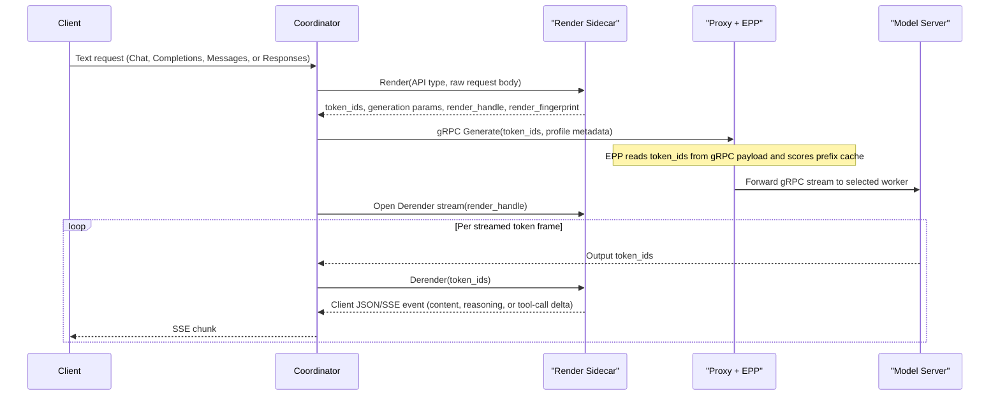

# Tokenize Once at Ingress

- **Status:** Proposal
- **Date:** 2026-11-04
- **Tracking issue:** [llm-d-router#3991](https://github.com/llm-d/llm-d-router/issues/3991)
- **Primary issues:** [llm-d-router#4111](https://github.com/llm-d/llm-d-router/issues/4111), [llm-d-router#4124](https://github.com/llm-d/llm-d-router/issues/4124), [llm-d-router#3993](https://github.com/llm-d/llm-d-router/issues/3993), [llm-d-router#3901](https://github.com/llm-d/llm-d-router/issues/3901), [llm-d-router#3617](https://github.com/llm-d/llm-d-router/issues/3617)
- **Target components:** `llm-d-router` (Coordinator, Endpoint Picker [EPP], prefill/decode [P/D] sidecar), upstream `vllm-project/vllm`, upstream `sgl-project/sglang`

---

## 1. Summary

By default today, `llm-d` renders and tokenizes every text prompt twice. On ingress, EPP's `token-producer` plugin or Coordinator's `render` step tokenizes the prompt to score prefix-cache affinity. Before inference, the GPU worker renders and tokenizes the same prompt again. Duplicate tokenization wastes CPU, adds time-to-first-token (TTFT) latency on long multi-turn contexts, and lets router and worker token IDs drift.

This proposal tokenizes every prompt **at most once, at ingress**, across **vLLM** and **SGLang** over **`Tokens -> Tokens` model servers**:

1. **Coordinator + EPP (default deployment):** In `Coord-Text-Tok` (text client, token-out worker), Coordinator renders prompts once in a local Rust sidecar over a Unix domain socket (UDS: `vllm-rs render` or `sglang-render`). Coordinator calls worker stages (`conditional-decode` on vLLM, `encode`, `prefill`, `decode`) over gRPC (`vllm.Inference` or `sglang.api.v1.SglangService`) with token IDs, and the sidecar derenders streamed output tokens. In `Coord-Tok-Tok` (token client, token-out worker), Coordinator forwards client token IDs over gRPC without sidecar calls. EPP reads token IDs from the gRPC payload and skips its tokenizer.
2. **EPP alone (`EPP-Tok-Tok`, token passthrough):** For pre-tokenized client requests on vLLM and SGLang, EPP scores prefix-cache affinity from client token IDs and forwards the request unchanged. Single tokenization for text clients in `EPP alone` mode stays out of the initial scope ([Section 3.2](#32-decision-focus-on-tokens---tokens-model-servers)).

---

## 2. Goals and Non-Goals

### 2.1 Goals

- **Single tokenization:** Ingress renders and tokenizes each text request once in `Coordinator + EPP`. Pre-tokenized client requests run zero tokenizers in `llm-d` and workers.
- **Zero router-worker skew:** Prefill, decode, and EPP cache affinity use one token-ID array. A render fingerprint and prompt-token parity metrics verify alignment.
- **Full API parity:** Support Chat (`/v1/chat/completions`), Completions (`/v1/completions`), Messages (`/v1/messages`), stateless Responses (`/v1/responses`), and token APIs (`/inference/v1/generate`, `/generate`, `vllm.Inference`, `sglang.api.v1`). Cover non-streaming and SSE (aka streaming) responses, tool calls, reasoning parsers, structured outputs, `logprobs`, vLLM LoRA adapters, and multimodal inputs. Parity means the feature set of the engine's Rust frontend. vLLM tracks the remaining gaps to its Python frontend in [vllm#44280](https://github.com/vllm-project/vllm/issues/44280) (for example beam search, [vllm#64862](https://github.com/vllm-project/vllm/pull/64862)).
- **Sub-millisecond sidecar IPC:** Keep local UDS overhead below `< 0.5 ms` per request and `< 50 us` per token chunk, with no external `/derender` round-trips.
- **No pixel tensors on gateway links:** Send token placeholders, content hashes (`mm_hashes`), grid metadata, and compressed media (or encoder-cache keys) instead of pixel tensors.

### 2.2 Non-Goals

- **Protocol translation in standalone EPP:** Without Coordinator, EPP never rewrites paths, translates HTTP to gRPC, or modifies responses.
- **`Tokens -> Text` server modes in the Northstar:** Worker-derendered text modes (`Coord-Text-Text` and `EPP-Text-Text`) stay out of the initial focus ([Section 3.2](#32-decision-focus-on-tokens---tokens-model-servers)). Tactical HTTP token forwarding ([#3656](https://github.com/llm-d/llm-d-router/issues/3656)) proceeds independently as a near-term bridge.
- **Stateful Responses or Conversations in `llm-d`:** The upstream [agentic-api](https://github.com/vllm-project/agentic-api) gateway owns conversation history and `previous_response_id` state in front of `llm-d` ([`docs/api-routing.md`](api-routing.md)). Coordinator and render sidecars stay stateless.
- **Non-LLM media endpoints:** Audio and image routes (`/v1/audio/*`, `/v1/images/*`) pass through over HTTP and use EPP's `estimate` backend for load estimates.

---

## 3. Design Space and Architectural Modes

### 3.1 Dimensions and Design Principles

Four binary dimensions define sixteen combinations (`2^4 = 16`) under six design principles:

| Dimension | Options | Principles |
| :--- | :--- | :--- |
| **Engine** | `vLLM`, `SGLang` | **P1 (Upstream first):** Use upstream vLLM and SGLang capabilities, and close engine gaps upstream. |
| **Deployment** | `Coordinator + EPP`, `EPP alone` | **P2 (Coordinator gRPC):** Coordinator calls workers over gRPC only. **P3 (Coordinator sidecars):** Coordinator can use local render/derender sidecars. **P4 (No EPP translation):** Standalone EPP mutates request fields only. **P5 (EPP advises Envoy):** EPP never proxies worker traffic, though it can call a render service. |
| **Server** | `Tokens -> Tokens`, `Tokens -> Text` | **P6 (Token client rule):** `Tokens -> Tokens` clients target `Tokens -> Tokens` servers only. |
| **Client** | `Text -> Text`, `Tokens -> Tokens` | Applies across HTTP and gRPC ingress routes (`Input -> Output`). |

### 3.2 Decision: Focus on `Tokens -> Tokens` Model Servers

As `llm-d` shifts toward `Coordinator + EPP` as its default deployment, this proposal scopes the Northstar to **`Tokens -> Tokens` model servers** on both engines. That choice defers all eight `Tokens -> Text` combinations, including worker-derendered Coordinator mode (`Coord-Text-Text`) and standalone EPP token injection (`EPP-Text-Text`). Near-term HTTP prompt-token forwarding ([#3656](https://github.com/llm-d/llm-d-router/issues/3656), PRs [#3706](https://github.com/llm-d/llm-d-router/pull/3706), [#3741](https://github.com/llm-d/llm-d-router/pull/3741)) remains an independent tactical bridge for HTTP pools.

**Pros:**

- **One architecture across vLLM and SGLang:** Both engines share one `Tokens -> Tokens` gRPC worker boundary, aligned with upstream SGLang's server boundary ([llm-d-router#3617](https://github.com/llm-d/llm-d-router/issues/3617)). GPU workers run inference only, while CPU sidecars own chat templates, tokenizers, and output parsers.
- **No response-envelope state machines in Go:** Engine Rust sidecars (`vllm.Render` and `SglangRender`) emit client JSON and SSE events for Chat, Completions, Messages, and Responses. Coordinator does not maintain four separate response schemas in Go.
- **Smaller security and feature surface:** Drops HTTP text token injection (`--enable-prompt-token-ids`), `pd-sidecar` `kv_transfer_params.prompt_token_ids` merges, multimodal injection gates, and worker `output_mode: derender` from the Northstar.

**Cons:**

- **No single tokenization in `EPP alone` text deployments:** Standalone EPP text pools continue to render prompts on the worker (unless they use the tactical HTTP path in [#3656](https://github.com/llm-d/llm-d-router/issues/3656)).
- **One local UDS hop per streamed token chunk:** In `Coord-Text-Tok`, each output token frame crosses the pod-local UDS stream (`Coordinator <-> Render Sidecar`) rather than an inline worker parser. [llm-d-router#3990](https://github.com/llm-d/llm-d-router/issues/3990) benchmarks this IPC path under high concurrency.
- **Sidecar `Derender` dependency:** All four text APIs require streamed `Derender` and client envelopes in `vllm.Render` ([vllm#67652](https://github.com/vllm-project/vllm/issues/67652)) and `SglangRender` ([sglang#48232](https://github.com/sgl-project/sglang/issues/48232)), plus Coordinator stop-string stream cancellation.

### 3.3 Pruning Remaining Combinations

Of the eight `Tokens -> Tokens` combinations, Principles **P4** and **P5** exclude two (`Text -> Text` client with `EPP alone` and `Tokens -> Tokens` server). Raw token IDs cannot satisfy an OpenAI, Messages, or Responses client without response translation, which standalone EPP never performs.

### 3.4 Valid Architectural Matrix

The remaining six combinations form three `<Router>-<Client>-<ServerOut>` modes across both engines. Here, `Coord` denotes `Coordinator + EPP`, `EPP` denotes `EPP alone`, `Text` denotes text API, and `Tok` denotes token API. Each badge links to its analysis in [Section 6](#6-detailed-gap-analysis) ( full support across formats,  partial format or stage support,  no end-to-end support).

| Mode | Deployment | Client | Server | vLLM | SGLang |
| :--- | :--- | :--- | :--- | :--- | :--- |
| [**`Coord-Text-Tok`**](#61-coord-text-tok) | [`Coordinator + EPP`](#41-coordinator--epp) | `Text -> Text` | `Tokens -> Tokens` |  |  |
| [**`Coord-Tok-Tok`**](#62-token-passthrough-coord-tok-tok-and-epp-tok-tok) *(passthrough)* | [`Coordinator + EPP`](#41-coordinator--epp) | `Tokens -> Tokens` | `Tokens -> Tokens` |  |  |
| [**`EPP-Tok-Tok`**](#62-token-passthrough-coord-tok-tok-and-epp-tok-tok) *(passthrough)* | [`EPP alone`](#42-epp-alone) | `Tokens -> Tokens` | `Tokens -> Tokens` |  |  |

- **`Coord-Text-Tok`:** Coordinator renders prompts and derenders token responses in a local sidecar while workers stay in token space.
- **`Coord-Tok-Tok` and `EPP-Tok-Tok` (passthrough):** Coordinator or EPP scores prefix-cache affinity from client token IDs and forwards requests without a tokenizer call.

Frontend policy across these six combinations:

- **`Coord-*` (`vLLM` and `SGLang`):** Rust-only end-to-end (`vllm-rs render` and `vllm.Inference` on vLLM, and the Rust render service and `sglang-server` on SGLang). Coordinator also passes Python `VllmEngine` and `SglangScheduler` token gRPC streams through.
- **`EPP-Tok-Tok` (`vLLM` and `SGLang`):** Supports Rust and Python token endpoints (`/inference/v1/generate`, `/generate`, Completions token arrays, `vllm.Inference`, `VllmEngine`, `sglang.api.v1`, and `SglangScheduler`).
- **External HTTP `/v1/*/derender`:** Never used in any mode.

---

## 4. Topology and Runtime Sequence

### 4.1 Coordinator + EPP

In `Coordinator + EPP` deployments, each Coordinator pod runs a Rust render sidecar over UDS (`/var/run/llm-d/render.sock`). Coordinator sends all worker calls through Envoy and EPP as HTTP/2 (`h2c` or TLS `h2`) gRPC streams. Each stream carries `x-llm-d-epp-profile` (`encode`, `prefill`, or `decode`) in gRPC metadata. Each sidecar loads one tokenizer and chat template, so one Coordinator deployment serves one model. Gateways that front several models run one Coordinator deployment per model.

This split matches how each component scales. EPP tracks pool-wide cache blocks and endpoint load, which bounds EPP replica count or requires state sync across replicas. Coordinator pods hold state only for active requests, so Coordinator and its render sidecar scale horizontally without cross-replica coordination.

A text request in `Coord-Text-Tok` executes three stages (`Render`, `Generate`, and `Derender`):

- **Disaggregated P/D:** Coordinator reuses the rendered `token_ids` slice across stages. On vLLM, EPP returns HTTP `412` before any worker call when `conditional-decode` (`Prefer: if-available`) misses the prefix cache. Coordinator then runs vLLM `encode -> prefill -> decode` via `GenerateRequest.kv`. SGLang decode servers require `bootstrap_*` fields today ([sglang#45416](https://github.com/sgl-project/sglang/issues/45416) proposes local prefill on decode). Coordinator therefore skips `conditional-decode` on SGLang and runs `prefill` and `decode` concurrently (`prefill` calls `--encoder-urls` in EPD once [sglang#48705](https://github.com/sgl-project/sglang/issues/48705) lands).
- **Stream cancellation:** When a client disconnects or `Derender` matches a stop string, Coordinator cancels active worker gRPC streams and closes the UDS stream.
- **Batch Completions:** Coordinator normalizes single-element `/v1/completions` prompt arrays and fans out multi-prompt batches across independent `Render -> Generate -> Derender` sub-requests (low priority, [#4088](https://github.com/llm-d/llm-d-router/issues/4088)).
- **Token passthrough (`Coord-Tok-Tok`):** Coordinator skips `Render` and `Derender` and streams `Generate(token_ids)` directly.
- **Ingress tokenizer routes (low priority):** Coordinator proxies `/tokenize`, `/detokenize`, and `/v1/messages/count_tokens` to decode pods today (`passthroughHandler`), and can serve them from the local sidecar on token-only pools.

The tables below define the stage RPC contracts for **Chat** (`/v1/chat/completions`), **Completions** (`/v1/completions`), **Messages** (`/v1/messages`), and **stateless Responses** (`/v1/responses`). `All 4` denotes all four text APIs, and subset notes mark API-specific rules.

#### 4.1.1 `Render` Stage RPC Requirements (`vllm.Render`, `SglangRender/Lower` over UDS)

| Area | APIs | RPC Service Requirements |
| :--- | :--- | :--- |
| **UDS transport & health** | All 4 | Serve unary `Render` and `grpc.health.v1` over a pod-local UDS without GPU workers or external network calls. |
| **Prompt formatting & tokenization** | All 4 *(subset rules)* | Accept `(api, raw_body)`. Apply chat templates, system instructions, and reasoning controls on Chat, Messages (`system`, `thinking`), and Responses (`instructions`). Tokenize string `prompt` directly with `add_special_tokens` on Completions. |
| **Length check & truncation** | All 4 *(subset flags)* | When prompt plus reserved output exceeds `max_model_len`, return `INVALID_ARGUMENT` with a `400` client error body. Apply `truncate_prompt_tokens` (Chat, Completions) or `truncation: "auto"` (Responses), and return pre-truncated `token_ids`. |
| **Sampling & grammar lowering** | All 4 *(tools on 3)* | Resolve `generation_config.json` defaults, token budgets (`max_tokens` or Responses `max_output_tokens`), `stop_token_ids`, and vLLM `bad_words_token_ids`. Lower tools, `tool_choice`, `strict` schemas (Chat, Messages, Responses), and structured-output formats into one grammar and reasoning gate. |
| **Multimodal metadata** | Chat, Messages, Responses | Accept Coordinator-fetched media bytes in metadata mode, plus `mm_processor_kwargs` and `media_io_kwargs` (Chat, Responses). Return `mm_hashes`, grid metadata (`image_grid_thw`, `video_grid_thw`), and expanded placeholder spans without pixel tensors. |
| **LoRA, skew & stream state** | All 4 | Resolve runtime-loaded vLLM `lora_name` from `model`, compute `render_fingerprint`, and return `render_handle` for `Derender`. As a low-priority follow-up, expose `tokenize`, `detokenize` (All 4), and `count_tokens` (Messages). |

#### 4.1.2 `Generate` Stage RPC Requirements (`vllm.Inference`, `sglang.api.v1` on Workers)

| Area | APIs | RPC Service Requirements |
| :--- | :--- | :--- |
| **Token-only streaming** | All 4 | Accept `token_ids` and stream delta `output_ids` (`output_text = false` on vLLM, `skip_detokenize = true` and `--incremental-streaming-output` on SGLang). Run zero chat templates, detokenizers, or output parsers on workers. |
| **Sampling, stops & `n > 1`** | All 4 *(`n > 1` on 2, logprobs on 3)* | Apply lowered sampling params, `stop_token_ids`, model/tokenizer EOS IDs, and vLLM `bad_words_token_ids`. Emit candidate logprob IDs (Chat, Completions, Responses) and indexed `n > 1` streams from one prefill (Chat, Completions). |
| **Grammars & reasoning gate** | All 4 *(gate on 3)* | Enforce `json_schema`, `regex`, `ebnf`, or `structural_tag` logit masks on token-only pools. Gate grammar masks behind `--reasoning-parser` until reasoning ends (Chat, Messages, Responses). |
| **Disaggregated P/D & media** | All 4 *(media on 3)* | Support KV transfer (`KVConnector`, `bootstrap_*`) across all APIs. Support EC transfer, metadata-only and mixed `raw_bytes` media, media kwargs, `mm_routing_labels` KV events, and `UNAVAILABLE` load errors (Chat, Messages, Responses). |
| **Routing, skew & cancel** | All 4 | Honor vLLM `lora_name` and DP rank metadata, and reject skewed `render_fingerprint` with `FAILED_PRECONDITION` (`RENDER_FINGERPRINT_MISMATCH`). Abort generation on stream cancel, report prompt/cached/output token counts, and serve `grpc.health.v1`. |

#### 4.1.3 `Derender` Stage RPC Requirements (`vllm.Render`, `SglangRender/Respond` over UDS)

| Area | APIs | RPC Service Requirements |
| :--- | :--- | :--- |
| **UTF-8 & stop buffering** | All 4 *(stops on 3)* | Open from `render_handle` and buffer multi-token UTF-8 sequences across chunks without replacement characters. Withhold partial prefixes of `stop` (Chat, Completions) or `stop_sequences` (Messages) and honor `include_stop_str_in_output` (Chat, Completions). When a stop string matches, signal Coordinator to cancel `Generate`. |
| **Reasoning & tool parsing** | Chat, Messages, Responses | Run incremental `--reasoning-parser`, `--tool-call-parser`, and Harmony channel parsers on `output_ids`. Emit `reasoning_content` and `tool_calls` deltas (Chat), `thinking` / `text` / `tool_use` blocks (Messages), or item delta events (Responses). |
| **Echo** | Completions | When `echo` is `true`, prepend prompt text and prompt logprobs. |
| **Logprob decoding** | Chat, Completions, Responses | Decode output and `top_logprobs` candidate token IDs into token strings and UTF-8 bytes (Messages has no `logprobs` field). |
| **Client JSON & SSE envelopes** | All 4 *(per-API wire format, `n > 1` on 2)* | Serialize unary JSON bodies and API-native SSE frames directly. Emit `data: <chunk>\n\n` frames with optional `include_usage` and `[DONE]` on Chat and Completions. Merge indexed `n > 1` sequences into one response (Chat, Completions). Emit `event: message_start`, `content_block_*`, `message_delta`, and `message_stop` on Messages. Emit sequenced `event: response.*` frames through `response.completed` or `response.incomplete` on Responses. |

### 4.2 EPP Alone

Without Coordinator, Envoy routes pre-tokenized client traffic directly to the `InferencePool` (aggregated workers or decode pods with `pd-sidecar`) and calls EPP over `ext_proc`. Under Principles P4 and P5, EPP never changes the request path or wire protocol and never proxies worker calls:

- **Token passthrough (`EPP-Tok-Tok`):** EPP extracts client token IDs and `mm_hashes`, skips `token-producer`, scores prefix-cache affinity, and forwards the body unchanged.
- **Disaggregated P/D (`pd-sidecar`):** When EPP selects a prefill endpoint, Envoy sends the token request to `pd-sidecar` with `x-llm-d-prefiller-host-port`. `pd-sidecar` then runs prefill and decode in token space.

---

## 5. Gap Summary

The tables below list every gap across **vLLM**, **SGLang**, and **llm-d** (`Coord-Tok-Tok` and `EPP-Tok-Tok` are passthrough, and `All` means all three modes). [Section 6](#6-detailed-gap-analysis) and [Section 7](#7-cross-cutting-design-and-operations) cover per-mode and operational details.

The critical path per mode, in delivery order:

1. **`EPP-Tok-Tok` and `Coord-Tok-Tok`:** [#3982](https://github.com/llm-d/llm-d-router/issues/3982) and the sidecar P/D, Helm chart, and Coordinator gRPC token routes in [#3993](https://github.com/llm-d/llm-d-router/issues/3993) and [#3901](https://github.com/llm-d/llm-d-router/issues/3901).
2. **`Coord-Text-Tok` on both engines:** [vllm#64685](https://github.com/vllm-project/vllm/pull/64685), [vllm#65503](https://github.com/vllm-project/vllm/issues/65503), [vllm#67652](https://github.com/vllm-project/vllm/issues/67652), [vllm#67653](https://github.com/vllm-project/vllm/issues/67653), [vllm#67430](https://github.com/vllm-project/vllm/issues/67430), [vllm#66093](https://github.com/vllm-project/vllm/issues/66093), [vllm#47753](https://github.com/vllm-project/vllm/issues/47753), [sglang#48232](https://github.com/sgl-project/sglang/issues/48232), [sglang#48580](https://github.com/sgl-project/sglang/issues/48580) ([sglang#49297](https://github.com/sgl-project/sglang/pull/49297)), [#4111](https://github.com/llm-d/llm-d-router/issues/4111), [#4124](https://github.com/llm-d/llm-d-router/issues/4124), and [#3985](https://github.com/llm-d/llm-d-router/issues/3985), benchmarked in [#3990](https://github.com/llm-d/llm-d-router/issues/3990).

### 5.1 vLLM Gaps

| # | Gap | Frontend | Stage | Modes | Issue / PR |
| ---: | :--- | :--- | :--- | :--- | :--- |
| 1 | Add raw JSON input, Completions, stateless Responses, and Messages to `vllm.Render`. Accept dynamic LoRA names, return lowered generation params, metadata-only media (`mm_payload = METADATA`), and [`render_fingerprint`](#74-skew-detection-parity-and-pool-topology), and serve gRPC on `--uds`. | Rust | `Render` | `Coord-Text-Tok` | [vllm#65503](https://github.com/vllm-project/vllm/issues/65503) |
| 2 | Split/merge `vllm.Render/DerenderChatStream` and add Completions, Responses, Messages, multi-choice `n>1` indexing, `logprobs` candidate decoding, and client JSON/SSE envelopes. Accept Responses output logprobs in the Rust frontend. | Rust | `Derender` | `Coord-Text-Tok` | [vllm#67652](https://github.com/vllm-project/vllm/issues/67652), [vllm#64685](https://github.com/vllm-project/vllm/pull/64685), [vllm#66395](https://github.com/vllm-project/vllm/pull/66395) |
| 3 | Implement the Rust Anthropic Messages API (`/v1/messages`, `count_tokens`, SSE envelopes). | Rust | `Render`, `Derender` | `Coord-Text-Tok` | [vllm#47753](https://github.com/vllm-project/vllm/issues/47753), [vllm#52896](https://github.com/vllm-project/vllm/pull/52896), [vllm#64998](https://github.com/vllm-project/vllm/pull/64998) |
| 4 | Retain [`mm_metadata`](#71-multimodal-requests) when HTTP render omits media tensors, and accept metadata-only `MediaItem` entries, alone or next to raw items (`marker_offset`), on `vllm.Inference`. | Both | `Render`, `Generate` | `Coord-Text-Tok` | [vllm#64997](https://github.com/vllm-project/vllm/issues/64997), [vllm#65018](https://github.com/vllm-project/vllm/pull/65018), [vllm#66093](https://github.com/vllm-project/vllm/issues/66093), [vllm#66094](https://github.com/vllm-project/vllm/pull/66094) |
| 5 | Support [`mm_processor_kwargs`](#71-multimodal-requests) and [`media_io_kwargs`](#71-multimodal-requests) across `vllm.Render` and `vllm.Inference` (beyond URL `video.fps` in [vllm#66187](https://github.com/vllm-project/vllm/pull/66187)). | Rust | `Render`, `Generate` | `All` | [vllm#66426](https://github.com/vllm-project/vllm/issues/66426), [vllm#66150](https://github.com/vllm-project/vllm/pull/66150), [vllm#66094](https://github.com/vllm-project/vllm/pull/66094) |
| 6 | Support `n>1` in `vllm.Inference`. | Rust | `Generate` | `All` | [vllm#65841](https://github.com/vllm-project/vllm/issues/65841), [vllm#66078](https://github.com/vllm-project/vllm/pull/66078) |
| 7 | Accept [`prompt_render_fingerprint`](#74-skew-detection-parity-and-pool-topology) on `vllm.Inference.GenerateRequest` and enforce `--on-fingerprint-mismatch` on gRPC. | Rust | `Generate` | `Coord-Text-Tok` | [vllm#67653](https://github.com/vllm-project/vllm/issues/67653) |
| 8 | Return retryable gRPC `UNAVAILABLE` (not `INTERNAL`) on [KV and EC connector load failures](#71-multimodal-requests) in `vllm.Inference`. | Both | `Generate` | `All` | [vllm#67430](https://github.com/vllm-project/vllm/issues/67430), [vllm#67604](https://github.com/vllm-project/vllm/pull/67604) |
| 9 | Mount gRPC services per caller (`--grpc-services`) so worker data ports omit [`vllm.Control`](#72-security-and-trust-boundaries) admin RPCs. | Rust | `Generate` | `All` | [vllm#56364](https://github.com/vllm-project/vllm/pull/56364) |
| 10 | Carry `repetition_detection` and `extra_args` on `vllm.Inference.GenerateRequest`, and report `repetition` stops. | Rust | `Generate` | `All` | [vllm#67552](https://github.com/vllm-project/vllm/issues/67552), [vllm#56776](https://github.com/vllm-project/vllm/pull/56776) |

### 5.2 SGLang Gaps

| # | Gap | Frontend | Stage | Modes | Issue / PR |
| ---: | :--- | :--- | :--- | :--- | :--- |
| 1 | Expose SGLang `Lower` and `Respond` over gRPC and UDS (standalone `sglang-render` or decoupled from `sgl-router`) with [`render_fingerprint`](#74-skew-detection-parity-and-pool-topology) and [`grpc.health.v1`](#75-sidecar-health-and-failure-modes). | Rust | `Render`, `Derender` | `Coord-Text-Tok` | [sglang#48232](https://github.com/sgl-project/sglang/issues/48232) |
| 2 | Add Completions tokenization, full Chat `tool_choice`/parser parity, Messages, Responses, [multimodal parity](#71-multimodal-requests) (hash-and-placeholder, non-Qwen-VL, video/audio, `--encoder-urls` EPD), and pixel-free decode M-RoPE metadata. | Rust | `Render`, `Generate`, `Derender` | `All` | [sglang#48232](https://github.com/sgl-project/sglang/issues/48232), [sglang#48705](https://github.com/sgl-project/sglang/issues/48705) |
| 3 | Support `DecodeStream` and stop strings on `output_ids` in the SGLang render service. | Rust | `Derender` | `Coord-Text-Tok` | [sglang#48232](https://github.com/sgl-project/sglang/issues/48232) |
| 4 | Decode `logprobs` candidate text in `DecodeStream` when worker frames omit detokenized text (`skip_detokenize` or `--skip-tokenizer-init`). | Rust | `Derender` | `Coord-Text-Tok` | [sglang#48232](https://github.com/sgl-project/sglang/issues/48232) |
| 5 | Expose [`grpc.health.v1`](#75-sidecar-health-and-failure-modes) on `sglang-server`. | Rust | `Generate` | `All` | [sglang#38075](https://github.com/sgl-project/sglang/issues/38075), [sglang#46665](https://github.com/sgl-project/sglang/pull/46665) |
| 6 | Add per-request [`skip_detokenize`](#74-skew-detection-parity-and-pool-topology) on `sglang.api.v1.GenerateRequest` so tokenizer-enabled pools emit token-only output and keep grammar constraints. | Rust | `Generate` | `All` | [sglang#48580](https://github.com/sgl-project/sglang/issues/48580), [sglang#49297](https://github.com/sgl-project/sglang/pull/49297) |
| 7 | Accept `render_fingerprint` on `sglang.api.v1.GenerateRequest` and enforce [`--on-fingerprint-mismatch`](#74-skew-detection-parity-and-pool-topology) on gRPC. | Rust | `Generate` | `Coord-Text-Tok` | [sglang#48232](https://github.com/sgl-project/sglang/issues/48232) |
| 8 | Report caller multimodal routing labels (`mm_routing_labels` / [`mm_hashes`](#71-multimodal-requests)) in SGLang KV events. | Both | `Generate` | `All` | [sglang#45737](https://github.com/sgl-project/sglang/pull/45737), [sglang#48705](https://github.com/sgl-project/sglang/issues/48705) |
| 9 | Support `n>1` parallel sampling in `sglang.api.v1` on `sglang-server`. | Rust | `Generate` | `All` | [sglang#37202](https://github.com/sgl-project/sglang/pull/37202) |

### 5.3 llm-d Gaps

| # | Gap | Engine | Stage | Modes | Issue / PR |
| ---: | :--- | :--- | :--- | :--- | :--- |
| 1 | **Coordinator:** Add UDS gRPC clients for prompt `Render` and sidecar `Derender`. | Both | `Render`, `Derender` | `Coord-Text-Tok` | [#4111](https://github.com/llm-d/llm-d-router/issues/4111), [#4124](https://github.com/llm-d/llm-d-router/issues/4124) |
| 2 | **Coordinator:** Add a `vllm.Inference` client and port `conditional-decode`, `KVConnector`, `ECConnector`, and error responses. | vLLM | `Generate` | `Coord-Text-Tok`, `Coord-Tok-Tok` | [#3993](https://github.com/llm-d/llm-d-router/issues/3993) |
| 3 | **Coordinator:** Copy lowered sampling params, structured-output constraints, explicit `stop_token_ids`, and vLLM `bad_words_token_ids` / `lora_name` from `Render` into gRPC `Generate`. | Both | `Generate` | `Coord-Text-Tok` | [#4111](https://github.com/llm-d/llm-d-router/issues/4111), [#4124](https://github.com/llm-d/llm-d-router/issues/4124) |
| 4 | **Coordinator:** When `Render` rejects prompts past `max_model_len`, return `400`. Forward pre-truncated token IDs without `truncate_prompt_tokens`. | Both | `Render`, `Generate` | `Coord-Text-Tok` | [#4111](https://github.com/llm-d/llm-d-router/issues/4111), [#4124](https://github.com/llm-d/llm-d-router/issues/4124) |
| 5 | **Coordinator:** When a stop string matches in `Derender`, cancel the worker gRPC stream. | Both | `Generate`, `Derender` | `Coord-Text-Tok` | [#4111](https://github.com/llm-d/llm-d-router/issues/4111), [#4124](https://github.com/llm-d/llm-d-router/issues/4124) |
| 6 | **Coordinator (low priority):** Map HTTP `/inference/v1/generate` and `/generate` to `vllm.Inference` and `sglang.api.v1` gRPC. | Both | `Generate` | `Coord-Tok-Tok` | [#3993](https://github.com/llm-d/llm-d-router/issues/3993), [#3901](https://github.com/llm-d/llm-d-router/issues/3901) |
| 7 | **Coordinator (low priority):** Forward Python `VllmEngine` and `SglangScheduler` gRPC streams across P/D stages. | Both | `Generate` | `Coord-Tok-Tok` | [#3981](https://github.com/llm-d/llm-d-router/issues/3981) |
| 8 | **Coordinator, Helm:** [Strip client](#72-security-and-trust-boundaries) `prompt_token_ids`, `prompt_render_fingerprint`, `render_fingerprint`, and `input_ids` on text routes, and ship a worker gRPC `NetworkPolicy`. | Both | `Render`, `Generate` | `All` | [#3979](https://github.com/llm-d/llm-d-router/issues/3979) |
| 9 | **Coordinator, EPP:** [Forward media bytes](#71-multimodal-requests) from `replace-media-urls` to `Render` and vLLM `encode` (or SGLang `prefill`), and route via `mm_hashes` gRPC metadata in EPP. | Both | `Render`, `Generate` | `Coord-Text-Tok` | [#3988](https://github.com/llm-d/llm-d-router/issues/3988) |
| 10 | **Coordinator (low priority):** Support `/v1/completions` batch `prompt` arrays (`[]string` and `[][]int`) via sub-request fan-out. | Both | `Render`, `Generate`, `Derender` | `Coord-Text-Tok`, `Coord-Tok-Tok` | [#4088](https://github.com/llm-d/llm-d-router/issues/4088) |
| 11 | **Coordinator (low priority):** Serve `/tokenize`, `/detokenize`, and `/v1/messages/count_tokens` from the local render sidecar instead of decode passthrough. | Both | `Render`, `Derender` | `Coord-Text-Tok` | [#4111](https://github.com/llm-d/llm-d-router/issues/4111), [#4124](https://github.com/llm-d/llm-d-router/issues/4124), [vllm#65503](https://github.com/vllm-project/vllm/issues/65503), [sglang#48232](https://github.com/sgl-project/sglang/issues/48232) |
| 12 | **EPP:** Decode SGLang [`mm_routing_labels`](#71-multimodal-requests) in `sglang_adapter`, and extract `mm_hashes` in `sglanghttp-parser` (HTTP `/generate` follow-up). | SGLang | `Generate` | `All` | [#3983](https://github.com/llm-d/llm-d-router/issues/3983) |
| 13 | **EPP (low priority):** Add a parser for Python `SglangScheduler` gRPC. | SGLang | `Generate` | `Coord-Tok-Tok`, `EPP-Tok-Tok` | [#3981](https://github.com/llm-d/llm-d-router/issues/3981) |
| 14 | **EPP (low priority):** Read all gRPC frames per response chunk in Python `vllmgrpc-parser`. | vLLM | `Generate` | `Coord-Tok-Tok`, `EPP-Tok-Tok` | [#3644](https://github.com/llm-d/llm-d-router/issues/3644) |
| 15 | **EPP, P/D sidecar, Coordinator:** Pass vLLM `x-data-parallel-rank` metadata behind one port, and track SGLang cross-rank `disagg_prefill_dp_rank` as a follow-up (`sglang-server` binds one gRPC port per DP rank today). | Both | `Generate` | `All` | [#3757](https://github.com/llm-d/llm-d-router/issues/3757), [#3818](https://github.com/llm-d/llm-d-router/pull/3818), [#3821](https://github.com/llm-d/llm-d-router/pull/3821), [#2598](https://github.com/llm-d/llm-d-router/issues/2598), [#3901](https://github.com/llm-d/llm-d-router/issues/3901) |
| 16 | **EPP:** Decouple `precise-prefix-cache-producer` from `backend: vllm`. | Both | `Generate` | `All` | [#3982](https://github.com/llm-d/llm-d-router/issues/3982) |
| 17 | **EPP (low priority):** [Map LoRA adapter fields](#74-skew-detection-parity-and-pool-topology) (`lora_name` on `vllmhttp-parser`) to `TargetModel`. | vLLM | `Generate` | `EPP-Tok-Tok` | [#3989](https://github.com/llm-d/llm-d-router/issues/3989) |
| 18 | **P/D sidecar:** Add gRPC P/D support for `vllm.Inference` and `sglang.api.v1`. | Both | `Generate` | `EPP-Tok-Tok` | [#3993](https://github.com/llm-d/llm-d-router/issues/3993), [#4011](https://github.com/llm-d/llm-d-router/pull/4011), [#3901](https://github.com/llm-d/llm-d-router/issues/3901), [#3908](https://github.com/llm-d/llm-d-router/pull/3908) |
| 19 | **Coordinator:** Extend [`prompt_token_mismatch_total`](#74-skew-detection-parity-and-pool-topology) to gRPC routes. | Both | `Generate` | `Coord-Text-Tok`, `Coord-Tok-Tok` | [#3984](https://github.com/llm-d/llm-d-router/issues/3984) |
| 20 | **Coordinator, EPP:** [Screen endpoints](#74-skew-detection-parity-and-pool-topology) by `render_fingerprint` per request during rollouts (sidecar fingerprint in gRPC metadata). | Both | `Generate` | `Coord-Text-Tok` | [#3984](https://github.com/llm-d/llm-d-router/issues/3984) |
| 21 | **Coordinator, Helm:** Add Coordinator chart templates (`router.coordinator.*`) with a native render sidecar (`emptyDir` UDS) and gate [`/readyz`](#75-sidecar-health-and-failure-modes) on [`grpc.health.v1`](#75-sidecar-health-and-failure-modes). | Both | `Render`, `Derender` | `Coord-Text-Tok` | [#3985](https://github.com/llm-d/llm-d-router/issues/3985) |
| 22 | **Coordinator:** [Bound in-flight renders](#75-sidecar-health-and-failure-modes) per sidecar and shed with `503` and `Retry-After`. | Both | `Render` | `Coord-Text-Tok` | [#3985](https://github.com/llm-d/llm-d-router/issues/3985) |
| 23 | **Helm:** Pass one [shared `model` values block](#76-helm-capacity-and-rollout) into worker releases and `router.coordinator.*` for matching flags and image digests. | Both | `Render`, `Generate`, `Derender` | `Coord-Text-Tok` | [#3986](https://github.com/llm-d/llm-d-router/issues/3986) |
| 24 | **Helm:** Define CPU and memory requests and [`ContainerResource` HPA targets](#76-helm-capacity-and-rollout) for Coordinator and render sidecar containers. | Both | `Render`, `Derender` | `Coord-Text-Tok` | [#3986](https://github.com/llm-d/llm-d-router/issues/3986) |
| 25 | **CI:** Run a [render-parity corpus](#76-helm-capacity-and-rollout), UDS IPC benchmarks, and gRPC P/D e2e tests from one Helm values file. | Both | `Render`, `Generate`, `Derender` | `All` | [#3990](https://github.com/llm-d/llm-d-router/issues/3990), [#4111](https://github.com/llm-d/llm-d-router/issues/4111), [#4124](https://github.com/llm-d/llm-d-router/issues/4124) |
| 26 | **Coordinator, Helm:** [Wire](#76-helm-capacity-and-rollout) `vllminference-parser`, `sglanggrpc-parser`, and GKE gRPC health checks under `router.modelServers.protocol: grpc`, and gate Coordinator gRPC behind `worker_protocol: grpc`. | Both | `Generate` | `All` | [#3993](https://github.com/llm-d/llm-d-router/issues/3993), [#4010](https://github.com/llm-d/llm-d-router/pull/4010), [#4013](https://github.com/llm-d/llm-d-router/pull/4013), [#3901](https://github.com/llm-d/llm-d-router/issues/3901), [#3907](https://github.com/llm-d/llm-d-router/pull/3907) |
| 27 | **Coordinator, EPP, Helm:** Allow only generate and health methods (`vllm.Inference/Generate`, `GenerateStream`, `sglang.api.v1.SglangService/Generate`, `HealthCheck`, and `grpc.health.v1`) on [client gRPC routes](#72-security-and-trust-boundaries). | Both | `Generate` | `All` | [#3979](https://github.com/llm-d/llm-d-router/issues/3979) |

---

## 6. Detailed Gap Analysis

This section evaluates current support and remaining gaps across **vLLM**, **SGLang**, and **llm-d**. [Section 6.1](#61-coord-text-tok) covers `Coord-Text-Tok` across `Render`, `Generate`, and `Derender`, and [Section 6.2](#62-token-passthrough-coord-tok-tok-and-epp-tok-tok) covers token passthrough on `Generate`.

### 6.1 `Coord-Text-Tok`

On both engines, `Coord-Text-Tok` keeps GPU workers in token space and runs `Render` and `Derender` in the local UDS sidecar. That boundary matches upstream SGLang's tokens-in/tokens-out server model, offloads tokenizer and output-parser CPU from GPU pods, and keeps response envelope schemas inside the engine sidecars.

#### 6.1.1 `Render`

- **vLLM**
  - *Current support:* `vllm-rs render` renders Chat (with multimodal input) and Completions over HTTP and accepts static `--lora-modules` names ([vllm#65993](https://github.com/vllm-project/vllm/pull/65993)). `vllm.Render/RenderChat` renders typed Chat on `--grpc-port` with `grpc.health.v1` ([vllm#65994](https://github.com/vllm-project/vllm/pull/65994)) and lacks `--uds`, and Coordinator never calls Python HTTP `/v1/*/render`.
  - Add raw JSON input, lowered sampling/stopping params, dynamic LoRA names, Completions, stateless Responses, `render_fingerprint`, and `--uds` gRPC ([vllm#65503](https://github.com/vllm-project/vllm/issues/65503)).
  - Implement the Rust Anthropic Messages API (`/v1/messages`, `count_tokens`) ([vllm#47753](https://github.com/vllm-project/vllm/issues/47753), [vllm#52896](https://github.com/vllm-project/vllm/pull/52896), [vllm#64998](https://github.com/vllm-project/vllm/pull/64998)). Wire it into `vllm.Render` ([vllm#65503](https://github.com/vllm-project/vllm/issues/65503)).
  - Retain `mm_metadata` when render omits tensors (`mm_payload = METADATA`) ([vllm#64997](https://github.com/vllm-project/vllm/issues/64997), [vllm#65018](https://github.com/vllm-project/vllm/pull/65018), [vllm#65503](https://github.com/vllm-project/vllm/issues/65503)). Support `mm_processor_kwargs` and `media_io_kwargs` in `vllm.Render` ([vllm#66426](https://github.com/vllm-project/vllm/issues/66426)).
  - Expose `tokenize`, `detokenize`, and `/v1/messages/count_tokens` on `vllm-rs render` as a low-priority follow-up ([vllm#65503](https://github.com/vllm-project/vllm/issues/65503)).
- **SGLang**
  - *Current support:* `sglang-processor` lowers basic Chat (plus Qwen-VL image tensors in [sglang#46291](https://github.com/sgl-project/sglang/pull/46291)) and leaves string Completions as `text`. It returns `Unsupported` on strict tools, non-`auto` `tool_choice`, and most parsers, and `sgl-router` bundles preprocessing with its own routing.
  - Expose `Lower`, `render_fingerprint`, and `grpc.health.v1` over UDS via standalone `sglang-render` or decoupled `sgl-router` ([sglang#48232](https://github.com/sgl-project/sglang/issues/48232)).
  - Add Completions string tokenization, full Chat `tool_choice`/parser parity, Messages, and Responses ([sglang#48232](https://github.com/sgl-project/sglang/issues/48232)). Add hash-and-placeholder multimodal mode across non-Qwen-VL, video, and audio ([sglang#48232](https://github.com/sgl-project/sglang/issues/48232), [sglang#48705](https://github.com/sgl-project/sglang/issues/48705)).
  - Expose `tokenize`, `detokenize`, and `/v1/messages/count_tokens` on the UDS render host as a low-priority follow-up ([sglang#48232](https://github.com/sgl-project/sglang/issues/48232)).
- **llm-d**
  - *Current support:* Coordinator calls TCP HTTP `/v1/*/render` today and has no UDS sidecar client.
  - **Coordinator:** Add UDS gRPC clients for `vllm.Render` and `SglangRender` ([llm-d-router#4111](https://github.com/llm-d/llm-d-router/issues/4111), [#4124](https://github.com/llm-d/llm-d-router/issues/4124)).
  - **Coordinator:** When `Render` rejects prompts past `max_model_len`, return `400` before EPP or worker calls ([llm-d-router#4111](https://github.com/llm-d/llm-d-router/issues/4111), [#4124](https://github.com/llm-d/llm-d-router/issues/4124)).
  - **Coordinator:** Strip client `prompt_token_ids`, `prompt_render_fingerprint`, `render_fingerprint`, and `input_ids` on text routes ([llm-d-router#3979](https://github.com/llm-d/llm-d-router/issues/3979)).
  - **Coordinator:** Pass fetched media bytes from `replace-media-urls` to UDS `Render` ([llm-d-router#3988](https://github.com/llm-d/llm-d-router/issues/3988)).
  - **Coordinator, Helm:** Add `router.coordinator.*` chart templates with a native UDS sidecar and `/readyz` health gate ([llm-d-router#3985](https://github.com/llm-d/llm-d-router/issues/3985), [#3986](https://github.com/llm-d/llm-d-router/issues/3986)). Bound in-flight renders and shed excess with `503` ([#3985](https://github.com/llm-d/llm-d-router/issues/3985)).
  - **Coordinator (low priority):** Fan out `/v1/completions` `[]string` batch prompts ([llm-d-router#4088](https://github.com/llm-d/llm-d-router/issues/4088)). Serve `/tokenize`, `/detokenize`, and `/v1/messages/count_tokens` from the local sidecar ([#4111](https://github.com/llm-d/llm-d-router/issues/4111), [#4124](https://github.com/llm-d/llm-d-router/issues/4124)).

#### 6.1.2 `Generate`

- **vLLM**
  - *Current support:* `vllm.Inference/GenerateStream` supports `token_ids` with `output_text=false`, KV/EC parameters, and URL `media_io_kwargs.video.fps` ([vllm#66187](https://github.com/vllm-project/vllm/pull/66187)) for `n=1`.
  - Accept metadata-only `MediaItem` entries, alone or next to raw items (`marker_offset`), on `vllm.Inference` ([vllm#66093](https://github.com/vllm-project/vllm/issues/66093), [vllm#66094](https://github.com/vllm-project/vllm/pull/66094)).
  - Support `mm_processor_kwargs` and non-URL `media_io_kwargs` on `vllm.Inference.GenerateRequest` ([vllm#66426](https://github.com/vllm-project/vllm/issues/66426), [vllm#66150](https://github.com/vllm-project/vllm/pull/66150), [vllm#66094](https://github.com/vllm-project/vllm/pull/66094)).
  - Support `n>1` in `vllm.Inference` ([vllm#65841](https://github.com/vllm-project/vllm/issues/65841), [vllm#66078](https://github.com/vllm-project/vllm/pull/66078)).
  - Return retryable `UNAVAILABLE` on KV and EC connector load failures in `vllm.Inference` ([vllm#67430](https://github.com/vllm-project/vllm/issues/67430), [vllm#67604](https://github.com/vllm-project/vllm/pull/67604)).
  - Accept `prompt_render_fingerprint` on `GenerateRequest` and enforce `--on-fingerprint-mismatch` on gRPC ([vllm#67653](https://github.com/vllm-project/vllm/issues/67653)).
  - Mount gRPC services per caller (`--grpc-services`) so worker data ports omit `vllm.Control` admin RPCs ([vllm#56364](https://github.com/vllm-project/vllm/pull/56364)).
  - Carry `repetition_detection` and `extra_args` on `GenerateRequest`, and report `repetition` stops ([vllm#67552](https://github.com/vllm-project/vllm/issues/67552), [vllm#56776](https://github.com/vllm-project/vllm/pull/56776)).
- **SGLang**
  - *Current support:* `sglang.api.v1` streams `input_ids -> output_ids` for `n=1` with `--incremental-streaming-output`, while standard pools still detokenize `text`. `--skip-tokenizer-init` disables grammars, `min_new_tokens`, string `stop`, and tokenizer EOS tokens.
  - Add per-request `skip_detokenize` on `sglang.api.v1.GenerateRequest` so tokenizer-enabled pools keep grammar support ([sglang#48580](https://github.com/sgl-project/sglang/issues/48580), [sglang#49297](https://github.com/sgl-project/sglang/pull/49297)).
  - Add Rust-server multimodal parity (non-Qwen-VL, video/audio, `--encoder-urls` EPD) and pixel-free decode M-RoPE metadata ([sglang#48232](https://github.com/sgl-project/sglang/issues/48232), [sglang#48705](https://github.com/sgl-project/sglang/issues/48705)).
  - Report caller multimodal routing labels (`mm_routing_labels`) in SGLang KV events ([sglang#45737](https://github.com/sgl-project/sglang/pull/45737), [sglang#48705](https://github.com/sgl-project/sglang/issues/48705)).
  - Support `n>1` parallel sampling in `sglang.api.v1` ([sglang#37202](https://github.com/sgl-project/sglang/pull/37202)).
  - Expose `grpc.health.v1` on `sglang-server` ([sglang#38075](https://github.com/sgl-project/sglang/issues/38075), [sglang#46665](https://github.com/sgl-project/sglang/pull/46665)).
  - Accept `render_fingerprint` on `sglang.api.v1.GenerateRequest` and enforce `--on-fingerprint-mismatch` on gRPC ([sglang#48232](https://github.com/sgl-project/sglang/issues/48232)).
- **llm-d**
  - *Current support:* EPP parses `vllm.Inference` ([#4008](https://github.com/llm-d/llm-d-router/pull/4008)) and `sglang.api.v1` ([#3904](https://github.com/llm-d/llm-d-router/pull/3904)). Coordinator disaggregates `sglang.api.v1` ([#3906](https://github.com/llm-d/llm-d-router/pull/3906)) and lacks a `vllm.Inference` client.
  - **Coordinator:** Add a `vllm.Inference` client and port `conditional-decode`, `KVConnector`, `ECConnector`, and error responses ([llm-d-router#3993](https://github.com/llm-d/llm-d-router/issues/3993), [#4013](https://github.com/llm-d/llm-d-router/pull/4013)).
  - **Coordinator:** Copy lowered sampling defaults, constraints, `stop_token_ids`, vLLM `bad_words_token_ids` / `lora_name`, and SGLang `skip_detokenize` into `GenerateRequest` ([llm-d-router#4111](https://github.com/llm-d/llm-d-router/issues/4111), [#4124](https://github.com/llm-d/llm-d-router/issues/4124)). Forward pre-truncated token IDs without truncation flags.
  - **Coordinator, EPP:** Forward media bytes to vLLM `encode` or SGLang `prefill` with `mm_hashes` in gRPC metadata ([llm-d-router#3988](https://github.com/llm-d/llm-d-router/issues/3988)). Read `mm_hashes` metadata in EPP so Envoy skips media-body buffering ([#3988](https://github.com/llm-d/llm-d-router/issues/3988)).
  - **Coordinator, EPP:** Extend `prompt_token_mismatch_total` to Coordinator gRPC routes ([llm-d-router#3984](https://github.com/llm-d/llm-d-router/issues/3984)). Screen endpoints per request by `render_fingerprint` ([#3984](https://github.com/llm-d/llm-d-router/issues/3984)).
  - **EPP:** Decouple `precise-prefix-cache-producer` from `backend: vllm` ([llm-d-router#3982](https://github.com/llm-d/llm-d-router/issues/3982)). Decode SGLang `mm_routing_labels` in `pkg/kvevents` `sglang_adapter` ([#3983](https://github.com/llm-d/llm-d-router/issues/3983)).
  - **EPP:** Pass vLLM `x-data-parallel-rank` metadata behind one port ([llm-d-router#3757](https://github.com/llm-d/llm-d-router/issues/3757), [#3818](https://github.com/llm-d/llm-d-router/pull/3818), [#3821](https://github.com/llm-d/llm-d-router/pull/3821)). Track SGLang cross-rank `disagg_prefill_dp_rank` as a follow-up ([#2598](https://github.com/llm-d/llm-d-router/issues/2598), [#3901](https://github.com/llm-d/llm-d-router/issues/3901)).
  - **Helm, Coordinator, CI:** Wire `vllminference-parser`, `sglanggrpc-parser`, and GKE gRPC health checks under `router.modelServers.protocol: grpc` ([#4010](https://github.com/llm-d/llm-d-router/pull/4010), [#3907](https://github.com/llm-d/llm-d-router/pull/3907)). Restrict worker gRPC ports via `NetworkPolicy` ([#3979](https://github.com/llm-d/llm-d-router/issues/3979)), share one `model` values block ([#3986](https://github.com/llm-d/llm-d-router/issues/3986)), and add gRPC P/D e2e tests ([#3990](https://github.com/llm-d/llm-d-router/issues/3990)).
  - **Coordinator, EPP, Helm:** Allow only generate and health methods (`vllm.Inference/Generate`, `GenerateStream`, `sglang.api.v1.SglangService/Generate`, `HealthCheck`, and `grpc.health.v1`) on client gRPC routes ([llm-d-router#3979](https://github.com/llm-d/llm-d-router/issues/3979)).

#### 6.1.3 `Derender`

- **vLLM**
  - *Current support:* Draft `vllm.Render` streams Chat deltas and `logprobs` (`DerenderChatStream`), and lacks Completions, Messages, Responses, and client envelopes.
  - Split and merge `DerenderChat` and `DerenderChatStream` ([vllm#64685](https://github.com/vllm-project/vllm/pull/64685)). Add Completions, stateless Responses, multi-choice `n>1` indexing, and client JSON/SSE envelopes ([vllm#67652](https://github.com/vllm-project/vllm/issues/67652)).
  - Wire Rust Anthropic Messages JSON and SSE envelopes into `vllm.Render` ([vllm#47753](https://github.com/vllm-project/vllm/issues/47753), [vllm#52896](https://github.com/vllm-project/vllm/pull/52896), [vllm#64998](https://github.com/vllm-project/vllm/pull/64998), [vllm#67652](https://github.com/vllm-project/vllm/issues/67652)).
  - Decode `logprobs` candidate tokens across Chat and non-Chat `vllm.Render` RPCs ([vllm#64685](https://github.com/vllm-project/vllm/pull/64685), [vllm#67652](https://github.com/vllm-project/vllm/issues/67652)). Accept Responses output logprobs (`top_logprobs`, `include`) in the Rust frontend ([vllm#66395](https://github.com/vllm-project/vllm/pull/66395)).
- **SGLang**
  - *Current support:* Responders in `sglang-processor` require server `text` rather than `output_ids` (except on DeepSeek-V4/V4.1), and logprob text decodes on the server detok shard only.
  - Expose `Respond` over UDS gRPC with OpenAI, Messages, and stateless Responses client envelopes ([sglang#48232](https://github.com/sgl-project/sglang/issues/48232)).
  - Support incremental `DecodeStream`, multi-choice `n>1` indexing, and stop strings on `output_ids` ([sglang#48232](https://github.com/sgl-project/sglang/issues/48232)).
  - Decode `logprobs` candidate text in `DecodeStream` when worker frames omit detokenized text ([sglang#48232](https://github.com/sgl-project/sglang/issues/48232)).
- **llm-d**
  - *Current support:* Coordinator has no `Derender` step or UDS streaming client.
  - **Coordinator:** Stream worker output token IDs through UDS `Derender` and `Respond` for client JSON and SSE responses ([llm-d-router#4111](https://github.com/llm-d/llm-d-router/issues/4111), [#4124](https://github.com/llm-d/llm-d-router/issues/4124)).
  - **Coordinator:** When a stop string matches or the sidecar crashes mid-stream, cancel the worker gRPC stream ([llm-d-router#4111](https://github.com/llm-d/llm-d-router/issues/4111), [#4124](https://github.com/llm-d/llm-d-router/issues/4124), [#3985](https://github.com/llm-d/llm-d-router/issues/3985)).
  - **CI:** Run the render/derender parity corpus and `< 50 us` per-chunk UDS IPC benchmarks ([llm-d-router#3990](https://github.com/llm-d/llm-d-router/issues/3990)).

### 6.2 Token Passthrough (`Coord-Tok-Tok` and `EPP-Tok-Tok`)

Both passthrough modes forward client token IDs to `Tokens -> Tokens` servers without `Render` or `Derender` (Principle P6). EPP scores prefix-cache affinity directly from client token IDs, so only `Generate` stage support and gaps apply.

#### 6.2.1 vLLM

- **Current support:** `vllm.Inference/GenerateStream` supports `token_ids` with `output_text=false` for `n=1`. In `EPP-Tok-Tok`, vLLM also serves HTTP `/inference/v1/generate` (`--enable-scale-out`), Completions token arrays, and Python `VllmEngine` gRPC.
- Support `n>1` in `vllm.Inference` ([vllm#65841](https://github.com/vllm-project/vllm/issues/65841), [vllm#66078](https://github.com/vllm-project/vllm/pull/66078)).
- Support `mm_processor_kwargs` and non-URL `media_io_kwargs` on `vllm.Inference.GenerateRequest` ([vllm#66426](https://github.com/vllm-project/vllm/issues/66426), [vllm#66150](https://github.com/vllm-project/vllm/pull/66150), [vllm#66094](https://github.com/vllm-project/vllm/pull/66094)).
- Return retryable `UNAVAILABLE` on KV and EC connector load failures in `vllm.Inference` ([vllm#67430](https://github.com/vllm-project/vllm/issues/67430), [vllm#67604](https://github.com/vllm-project/vllm/pull/67604)).
- Mount gRPC services per caller (`--grpc-services`) so worker data ports omit `vllm.Control` admin RPCs ([vllm#56364](https://github.com/vllm-project/vllm/pull/56364)).
- Carry `repetition_detection` and `extra_args` on `GenerateRequest`, and report `repetition` stops ([vllm#67552](https://github.com/vllm-project/vllm/issues/67552), [vllm#56776](https://github.com/vllm-project/vllm/pull/56776)).

#### 6.2.2 SGLang

- **Current support:** `sglang.api.v1.SglangService/Generate` streams `input_ids -> output_ids` for `n=1`, and `--skip-tokenizer-init` works for unconstrained passthrough pools today. In `EPP-Tok-Tok`, SGLang also serves HTTP `/generate` with `input_ids`, Completions token arrays, and Python `SglangScheduler` gRPC.
- Add per-request `skip_detokenize` on `sglang.api.v1.GenerateRequest` so tokenizer-enabled pools keep grammar support ([sglang#48580](https://github.com/sgl-project/sglang/issues/48580), [sglang#49297](https://github.com/sgl-project/sglang/pull/49297)).
- Add Rust-server multimodal parity (non-Qwen-VL, video/audio, `--encoder-urls` EPD) and pixel-free decode M-RoPE metadata ([sglang#48705](https://github.com/sgl-project/sglang/issues/48705)).
- Report caller multimodal routing labels (`mm_routing_labels`) in SGLang KV events ([sglang#45737](https://github.com/sgl-project/sglang/pull/45737), [sglang#48705](https://github.com/sgl-project/sglang/issues/48705)).
- Support `n>1` parallel sampling in `sglang.api.v1` ([sglang#37202](https://github.com/sgl-project/sglang/pull/37202)).
- Expose `grpc.health.v1` on `sglang-server` ([sglang#38075](https://github.com/sgl-project/sglang/issues/38075), [sglang#46665](https://github.com/sgl-project/sglang/pull/46665)).

#### 6.2.3 llm-d

- **Current support:** EPP parses HTTP token routes (`vllmhttp-parser`, `sglanghttp-parser`, Completions token arrays in [#3806](https://github.com/llm-d/llm-d-router/pull/3806)) and aggregated gRPC (`vllminference-parser` in [#4008](https://github.com/llm-d/llm-d-router/pull/4008), `vllmgrpc-parser`, `sglanggrpc-parser` in [#3904](https://github.com/llm-d/llm-d-router/pull/3904)). Coordinator disaggregates `sglang.api.v1` in `Coord-Tok-Tok` ([#3906](https://github.com/llm-d/llm-d-router/pull/3906)) and lacks a `vllm.Inference` client.
- **Coordinator (`Coord-Tok-Tok`):** Add `vllm.Inference` ingress and outbound P/D and EC worker calls ([llm-d-router#3993](https://github.com/llm-d/llm-d-router/issues/3993), [#4013](https://github.com/llm-d/llm-d-router/pull/4013)). Extend `prompt_token_mismatch_total` to gRPC routes ([#3984](https://github.com/llm-d/llm-d-router/issues/3984)).
- **Coordinator (`Coord-Tok-Tok`, low priority):** Map HTTP `/inference/v1/generate` and `/generate` to `vllm.Inference` and `sglang.api.v1` ([llm-d-router#3993](https://github.com/llm-d/llm-d-router/issues/3993), [#3901](https://github.com/llm-d/llm-d-router/issues/3901)). Forward Python `VllmEngine` and `SglangScheduler` streams ([#3981](https://github.com/llm-d/llm-d-router/issues/3981)), and fan out `/v1/completions` `[][]int` batches ([#4088](https://github.com/llm-d/llm-d-router/issues/4088)).
- **P/D sidecar (`EPP-Tok-Tok`):** Add gRPC P/D disaggregation for `vllm.Inference` ([llm-d-router#3993](https://github.com/llm-d/llm-d-router/issues/3993), [#4011](https://github.com/llm-d/llm-d-router/pull/4011)) and `sglang.api.v1` ([#3901](https://github.com/llm-d/llm-d-router/issues/3901), [#3908](https://github.com/llm-d/llm-d-router/pull/3908)).
- **EPP (both modes):** Decouple `precise-prefix-cache-producer` from `backend: vllm` ([llm-d-router#3982](https://github.com/llm-d/llm-d-router/issues/3982)), and decode SGLang `mm_routing_labels` in `sglang_adapter` ([#3983](https://github.com/llm-d/llm-d-router/issues/3983)). Pass vLLM `x-data-parallel-rank` metadata behind one port ([#3757](https://github.com/llm-d/llm-d-router/issues/3757), [#3818](https://github.com/llm-d/llm-d-router/pull/3818), [#3821](https://github.com/llm-d/llm-d-router/pull/3821)), with SGLang `disagg_prefill_dp_rank` as a follow-up ([#2598](https://github.com/llm-d/llm-d-router/issues/2598), [#3901](https://github.com/llm-d/llm-d-router/issues/3901)).
- **EPP (low priority):** Enable `sglanghttp-parser` with `mm_hashes` extraction for HTTP `/generate` ([#3983](https://github.com/llm-d/llm-d-router/issues/3983)), and map `lora_name` to `TargetModel` in `vllmhttp-parser` ([#3989](https://github.com/llm-d/llm-d-router/issues/3989)). Add a Python `SglangScheduler` parser ([#3981](https://github.com/llm-d/llm-d-router/issues/3981)), and read all gRPC frames per chunk in `vllmgrpc-parser` ([#3644](https://github.com/llm-d/llm-d-router/issues/3644)).
- **Helm, security, and CI (both modes):** Wire `vllminference-parser`, `sglanggrpc-parser`, and GKE gRPC health checks under `router.modelServers.protocol: grpc` ([#4010](https://github.com/llm-d/llm-d-router/pull/4010), [#3907](https://github.com/llm-d/llm-d-router/pull/3907)). Restrict worker gRPC ports via `NetworkPolicy` ([#3979](https://github.com/llm-d/llm-d-router/issues/3979)), and add gRPC P/D e2e tests ([#3990](https://github.com/llm-d/llm-d-router/issues/3990)).
- **Coordinator, EPP, Helm (both modes):** Allow only generate and health methods (`vllm.Inference/Generate`, `GenerateStream`, `sglang.api.v1.SglangService/Generate`, `HealthCheck`, and `grpc.health.v1`) on client gRPC routes ([llm-d-router#3979](https://github.com/llm-d/llm-d-router/issues/3979)).

---

## 7. Cross-Cutting Design and Operations

Sections 7.1-7.3 cover request, security, and state rules whose gaps appear per mode in [Section 6](#6-detailed-gap-analysis). Sections 7.4-7.6 cover shared operational controls and track their gaps.

### 7.1 Multimodal Requests

Multimodal requests preserve single tokenization without 2-38 MB pixel tensors (`kwargs_data`) on gateway links:

- **Coordinator + EPP (`gRPC`):** Coordinator calls the render sidecar in metadata mode (`mm_payload = METADATA` on `vllm.Render` and hash-and-placeholder mode on `SglangRender/Lower`). The sidecar computes `mm_hashes`, retains per-item grid metadata (`image_grid_thw` / `video_grid_thw`), and expands multimodal placeholders in token IDs for EPP cache affinity. On SGLang, workers report caller `mm_hashes` as `mm_routing_labels` in KV events ([sglang#45737](https://github.com/sgl-project/sglang/pull/45737)), and `sglang_adapter` indexes them in EPP ([llm-d-router#3983](https://github.com/llm-d/llm-d-router/issues/3983)).
  - *Encode and prefill inputs:* On vLLM, Coordinator sends `MediaItem.raw_bytes` per item to `encode`. When every item has an EC descriptor, `prefill` receives expanded `token_ids`, metadata-only `MediaItem` entries, and `ec_transfer_params` ([vllm#64997](https://github.com/vllm-project/vllm/issues/64997), [vllm#65503](https://github.com/vllm-project/vllm/issues/65503), [vllm#66093](https://github.com/vllm-project/vllm/issues/66093)). Without `encode` or on a partial EC miss, each item without an EC descriptor travels as `MediaItem.raw_bytes` (`uuid = mm_hash`). Coordinator collapses that item's uniform placeholder span to one marker, sets `MediaItem.marker_offset` next to metadata-only entries, and the worker expands the item in place ([vllm#66094](https://github.com/vllm-project/vllm/pull/66094)). Until that PR lands, `vllm.Inference` rejects mixed sources, so Coordinator sends every item raw with any `ec_transfer_params`. On SGLang, `prefill` receives `MediaInput` (`image_data` / `video_data` / `audio_data`), `mm_hashes`, and collapsed `input_ids`, and encodes inline until [sglang#48705](https://github.com/sgl-project/sglang/issues/48705) adds `--encoder-urls` dispatch.
  - *Decode, KV, and EC failures:* Decode workers receive KV blocks without pixel bytes. vLLM sends metadata-only `MediaItem` entries ([vllm#66093](https://github.com/vllm-project/vllm/issues/66093)), and SGLang uses metadata-only `MediaRef` or P/D bootstrap M-RoPE transfer ([sglang#48232](https://github.com/sgl-project/sglang/issues/48232)). SGLang `decode` aborts on KV-transfer errors. vLLM multimodal decode pools set `kv_load_failure_policy: fail`, and workers surface KV and EC load failures as gRPC `UNAVAILABLE` ([vllm#67430](https://github.com/vllm-project/vllm/issues/67430)). Coordinator re-runs from `encode` on `prefill` EC load failures and re-runs `prefill -> decode` on `decode` KV load failures ([llm-d-router#3993](https://github.com/llm-d/llm-d-router/issues/3993)).
  - *Processor overrides:* `sglang.api.v1` carries per-item resize and frame hints on `MediaRef`. On vLLM, `GenerateRequest` supports `media_io_kwargs.video.fps` on URLs ([vllm#66187](https://github.com/vllm-project/vllm/pull/66187)). Rust Chat/Responses, `vllm.Render`, and `GenerateRequest` still need `mm_processor_kwargs` and raw-bytes `media_io_kwargs` ([vllm#66426](https://github.com/vllm-project/vllm/issues/66426)), and the open PRs cover `GenerateRequest` only ([vllm#66150](https://github.com/vllm-project/vllm/pull/66150), [vllm#66094](https://github.com/vllm-project/vllm/pull/66094)). Once supported, `vllm.Render` applies overrides in metadata mode and Coordinator forwards them to `encode` and `prefill` without pixel tensors.
- **Media fetch policy:** Coordinator's `replace-media-urls` step fetches each media URL once under domain allowlists, private-network guards, size caps, and timeouts. Coordinator passes the fetched bytes to `Render` over UDS and to vLLM `encode` (`MediaItem.raw_bytes`) or SGLang `prefill` (`MediaInput`), without worker refetches. Coordinator also sends `mm_hashes` in gRPC metadata, so EPP routes `encode` and `prefill` requests without buffered media bodies.

### 7.2 Security and Trust Boundaries

Untrusted token IDs on Chat, Messages, or Responses let callers bypass system prompts, chat templates, and safety rules ([vllm#62307](https://github.com/vllm-project/vllm/issues/62307)):

- **Ingress sanitization (`Coord-Text-Tok`):** Coordinator drops client `kv_transfer_params` on HTTP ingress ([#3522](https://github.com/llm-d/llm-d-router/pull/3522)). On text routes (`/v1/chat/completions`, string `/v1/completions`, `/v1/messages`, `/v1/responses`), Coordinator also strips client `prompt_token_ids`, `prompt_render_fingerprint`, `render_fingerprint`, and `input_ids` before `Render` ([llm-d-router#3979](https://github.com/llm-d/llm-d-router/issues/3979)). Dedicated token routes (`/inference/v1/generate`, `/generate`, token-array `/v1/completions`, and token gRPC services) accept client token IDs.
- **Cluster-internal worker gRPC:** Kubernetes `NetworkPolicy` or service-mesh mTLS restricts worker gRPC ports (`vllm.Inference` and `sglang.api.v1`) to Envoy, Coordinator, and `pd-sidecar` ([llm-d-router#3979](https://github.com/llm-d/llm-d-router/issues/3979)). Because `sglang-server` refuses native TLS flags and `--api-key` on `--grpc-port`, network isolation blocks direct external access and unauthenticated `Abort` calls.
- **Client gRPC routes:** Worker gRPC ports check no API key and serve admin RPCs next to generation. vLLM serves `vllm.Control` (`Shutdown`, `PauseGeneration`, `LoadLora`, `UnloadLora`) on the `vllm.Inference` port. `sglang.api.v1.SglangService` includes `Abort` (with `abort_all`) and `ClearHiCacheStorage`. Gateway routes, EPP, and Coordinator passthrough therefore allow only generate and health methods (`vllm.Inference/Generate`, `GenerateStream`, `sglang.api.v1.SglangService/Generate`, `HealthCheck`, and `grpc.health.v1`) ([llm-d-router#3979](https://github.com/llm-d/llm-d-router/issues/3979)). Deployments that need discovery add read-only RPCs such as `GetServerInfo` and `GetModelInfo` by name. Proposed `--grpc-services` ([vllm#56364](https://github.com/vllm-project/vllm/pull/56364)) lets vLLM data ports omit `vllm.Control`.
- **Media URLs on token routes:** `replace-media-urls` does not apply in `Coord-Tok-Tok` and `EPP-Tok-Tok`, so workers fetch client media URLs themselves. The vLLM Rust frontend refuses non-public addresses by default, and a domain allowlist needs [vllm#66929](https://github.com/vllm-project/vllm/pull/66929).

### 7.3 Stateful Responses and Conversations

Coordinator and engine render sidecars hold no cross-request or persisted state:

- When [vllm-project/agentic-api](https://github.com/vllm-project/agentic-api) sits in front of `llm-d`, it terminates `/v1/conversations` and stateful `/v1/responses` (`previous_response_id`, `store: true`, `background: true`). It expands prior turns into a stateless `/v1/responses` input, forwards that request to `llm-d`, and stores the output ([`docs/api-routing.md`](api-routing.md)).
- Without `agentic-api`, Coordinator and `pd-sidecar` reject `previous_response_id`, `conversation`, `background`, and `file_id` with `400 Bad Request` (`RejectStatefulResponsesFields`). They allow `store: true` without persistence (as vLLM does when response storage is disabled) and avoid router database state.

Within one streamed response in `Coord-Text-Tok`, the sidecar holds detokenizer and output-parser state in memory for its open `vllm.Render` or `SglangRender` stream. Coordinator holds only the client connection, and GPU workers hold no output-parser state.

### 7.4 Skew Detection, Parity, and Pool Topology

`vllm.Render` and `SglangRender` compute `render_fingerprint`, a SHA-256 digest over the render inputs. The digest covers tokenizer files (`tokenizer.json`, `tokenizer_config.json`, `special_tokens_map.json`, `*.tiktoken`), chat templates, and `--default-chat-template-kwargs`. It also covers `--tokenizer-mode`, `--reasoning-parser`, model `config.json` multimodal tokens, and the engine render schema version. For multimodal models, the vLLM digest also covers the processor configs (`preprocessor_config.json`, `video_preprocessor_config.json`, `processor_config.json`), `--max-model-len`, and `--hf-overrides`, because they set placeholder token counts. Workers use `--reasoning-parser` to gate structured-output grammars until reasoning ends, whereas `--tool-call-parser` runs only in the sidecar. Coordinator attaches `render_fingerprint` on `vllm.Inference` and `sglang.api.v1` requests and in gRPC metadata.

On mismatch, workers return gRPC `FAILED_PRECONDITION` with `google.rpc.ErrorInfo` (`reason = "RENDER_FINGERPRINT_MISMATCH"`) under `--on-fingerprint-mismatch=reject`. Coordinator maps that reason to `409 Conflict` and never treats worker `FAILED_PRECONDITION` trailers as `conditional-decode` cache misses. During a worker rolling update, one pool holds two fingerprints. EPP screens endpoints per request against the sidecar fingerprint in gRPC metadata, in the pattern of `disaggregatedset-rollout-screener`. Both versions keep serving while Coordinators roll to the matching sidecar image.

Workers select token-only output per request via `ResponseOptions.output_text = false` on vLLM and `GenerateRequest.skip_detokenize = true` on SGLang ([sglang#48580](https://github.com/sgl-project/sglang/issues/48580), [sglang#49297](https://github.com/sgl-project/sglang/pull/49297)). A loaded worker tokenizer on SGLang preserves scheduler grammar constraints, `min_new_tokens`, and EOS tokens, whereas `--skip-tokenizer-init` fits unconstrained passthrough pools only. SGLang workers also enable `--incremental-streaming-output` so `sglang.api.v1` emits delta token frames rather than cumulative arrays ([#3986](https://github.com/llm-d/llm-d-router/issues/3986)).

On vLLM, EPP namespaces LoRA KV-cache blocks by `TargetModel` ([#3826](https://github.com/llm-d/llm-d-router/pull/3826)), and `vllminference-parser` maps `lora_name` to `TargetModel` ([#4008](https://github.com/llm-d/llm-d-router/pull/4008)). `vllmhttp-parser` does not map `lora_name` to `TargetModel` yet, so HTTP `/inference/v1/generate` LoRA requests miss precise affinity ([#3989](https://github.com/llm-d/llm-d-router/issues/3989)). In `Coord-Text-Tok`, `vllm.Render` accepts runtime-loaded adapter names without sidecar restarts. Coordinator sets `GenerateRequest.lora_name` and keeps the base model on `GenerateRequest.model`. SGLang LoRA stays out of initial scope because `sglang-server` refuses `--enable-lora` and `--lora-paths` in Rust mode.

- **Status:** 
- **Current support**
  - Coordinator tracks `prompt_token_mismatch_total` (render token count vs decode worker `prompt_tokens`) on HTTP and `conditional-decode` routes ([llm-d-router#3751](https://github.com/llm-d/llm-d-router/pull/3751), [#3889](https://github.com/llm-d/llm-d-router/pull/3889)).
  - `precise-prefix-cache-producer` folds `cache_salt` and `mm_hashes`, and `vllminference-parser` maps `lora_name` to `TargetModel` ([#4008](https://github.com/llm-d/llm-d-router/pull/4008)).
  - gRPC pipelines and rolling updates lack parity and fingerprint checks.
- **Engine gaps**
  - Accept `render_fingerprint` on gRPC `GenerateRequest` and enforce `--on-fingerprint-mismatch` on gRPC routes ([vllm#67653](https://github.com/vllm-project/vllm/issues/67653), [sglang#48232](https://github.com/sgl-project/sglang/issues/48232)).
- **llm-d gaps**
  - Extend `prompt_token_mismatch_total` to Coordinator gRPC routes ([llm-d-router#3984](https://github.com/llm-d/llm-d-router/issues/3984)).
  - Screen endpoints by `render_fingerprint` per request during rollouts, with the sidecar fingerprint in gRPC metadata ([llm-d-router#3984](https://github.com/llm-d/llm-d-router/issues/3984)).
  - Map `lora_name` to `TargetModel` in `vllmhttp-parser` ([llm-d-router#3989](https://github.com/llm-d/llm-d-router/issues/3989)).

### 7.5 Sidecar Health and Failure Modes

In `Coord-Text-Tok`, worker calls use token-only gRPC, so the local sidecar handles both `Render` and `Derender`. When the UDS sidecar returns `INVALID_ARGUMENT`, Coordinator returns `400 Bad Request`. When the sidecar crashes mid-stream, Coordinator aborts open `Coord-Text-Tok` streams, cancels their upstream gRPC generation, and fails `/readyz` until kubelet restarts the sidecar. Coordinator bounds in-flight renders per sidecar and sheds excess with `503` and `Retry-After`. One long-context burst then adds no TTFT tail latency to other requests.

- **Status:** 
- **Current support**
  - Coordinator has no UDS render sidecar, sidecar health gate on `/readyz`, or render admission control.
- **Engine gaps**
  - Expose `grpc.health.v1` on `sglang-render` ([sglang#48232](https://github.com/sgl-project/sglang/issues/48232)).
- **llm-d gaps**
  - Add Coordinator chart templates (`router.coordinator.*`) that run the render container as a native sidecar on an `emptyDir` UDS ([llm-d-router#3985](https://github.com/llm-d/llm-d-router/issues/3985)).
  - Gate Coordinator `/readyz` on `grpc.health.v1` status from the local sidecar ([llm-d-router#3985](https://github.com/llm-d/llm-d-router/issues/3985)).
  - Bound in-flight renders per sidecar, shed with `503` and `Retry-After`, and export `render_inflight` and `render_queue_depth` ([llm-d-router#3985](https://github.com/llm-d/llm-d-router/issues/3985)).

### 7.6 Helm, Capacity, and Rollout

Go Coordinator is network I/O bound (~1-2 vCPU per replica). The Rust render sidecar runs Jinja, BPE, multimodal preprocessing, UTF-8 decode, and output parsers in `Coord-Text-Tok` (~2-8 vCPU). It also needs memory for tokenizer files, templates, and multimodal processors (hundreds of MiB to a few GiB). A shared pod lets one HorizontalPodAutoscaler scale Coordinator and render capacity together without cross-pod session affinity. The HPA targets the `render` container through a `ContainerResource` metric, because pod-average CPU hides sidecar saturation.

- **Status:** 
- **Current support**
  - `config/charts/` deploys EPP and `InferencePool` only (Coordinator uses Kustomize in `llm-d/llm-d`), `router.modelServers.protocol: grpc` wires legacy `vllmgrpc-parser` only, and worker and sidecar releases share no `model` values block.
  - No CI job compares sidecar and worker render output, and no benchmark covers the UDS IPC targets in [Section 2.1](#21-goals).
- **Engine gaps**
  - None.
- **llm-d gaps**
  - Pass one shared `model` values block into worker releases (`llm-d/llm-d`, `llm-d-model-service`) and `router.coordinator.*` for matching CLI flags and image digests ([llm-d-router#3986](https://github.com/llm-d/llm-d-router/issues/3986)).
  - Define CPU and memory requests and `ContainerResource` HPA targets for Coordinator and render sidecar containers in Helm ([llm-d-router#3986](https://github.com/llm-d/llm-d-router/issues/3986)).
  - Run a CI render-parity corpus, UDS IPC benchmarks, and gRPC P/D e2e tests against sidecar and worker images from one Helm values file ([llm-d-router#3990](https://github.com/llm-d/llm-d-router/issues/3990), [#4111](https://github.com/llm-d/llm-d-router/issues/4111), [#4124](https://github.com/llm-d/llm-d-router/issues/4124)).
  - Wire `vllminference-parser`, `sglanggrpc-parser`, and GKE gRPC health checks under `router.modelServers.protocol: grpc` ([#4010](https://github.com/llm-d/llm-d-router/pull/4010), [#3907](https://github.com/llm-d/llm-d-router/pull/3907)). Gate Coordinator gRPC routes behind `worker_protocol: grpc`, with `http` as the default ([llm-d-router#3993](https://github.com/llm-d/llm-d-router/issues/3993), [#4013](https://github.com/llm-d/llm-d-router/pull/4013), [#3901](https://github.com/llm-d/llm-d-router/issues/3901)).
