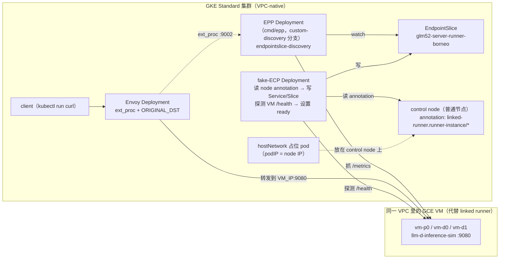

# 在真实 GKE 上验证 EndpointSlice discovery：可行性和计划

目标：在真实的 GKE 集群上验证，EPP 用 `endpointslice-discovery` 插件读取“外部地址”的 EndpointSlice，并通过 Envoy 把请求真的转发到集群外的模型服务器。具体做法：
- 用 GCE VM 代替 Borneo linked runner；
- 自己写一个小 controller 代替 ECP（下文称 fake-ECP）。

本地 envtest 版本的验证见 [../poc](../poc)，插件见 [pkg/epp/framework/plugins/datalayer/discovery/endpointslice](../../pkg/epp/framework/plugins/datalayer/discovery/endpointslice/README.md)。

> 状态：计划阶段，下面的产物和脚本尚未实现。

## 结论：可行

我们要验证的那几个关键行为，GCE VM 都能复现：
1. 模型服务器的地址在集群外，不是 Pod IP，NEG 也管不了；
2. K8s 里的 model pod 用 hostNetwork，`podIP` 是 control node 的 IP；
3. 由一个 controller 把真实地址写成 selector-less Service 的 EndpointSlice；
4. EPP 读取这些 slice 来做路由，Envoy 把请求直接转发到外部地址。

GCE VM 和 GKE 在同一个 VPC 里，Pod 可以直接访问 VM 的内部 IP。这一点对应 Exos 里 GKE Pod 能直连 Borneo IPv6 的情况。

## 架构

| Exos 组件 | 在这里用什么代替 |
|---|---|
| Borneo Ti-VM 上的 linked runner 和 sglang | **GCE VM** 上跑 **llm-d-inference-sim**（CPU 就够，模拟 OpenAI API 和 `/metrics`，不需要 GPU） |
| linked-runner controller 写 node annotation | **脚本或 fake-ECP** 直接用 `kubectl annotate node`，写同样格式的 `linked-runner.runner-instance/<runner>` JSON（STATUS、IP_ADDRESS、PROVIDER_ID） |
| control node 上的 hostNetwork model pod | 在一个普通节点上放 **hostNetwork 的 pause pod**，带 `app=glm52`、`llm-d.ai/role`。只用来展示 podIP 的问题，不承担流量 |
| ECP（node_annotations.go 和 server_main.go） | **fake-ECP**：一个小的 Go controller（`exos/fakeecp`），复用 `simecp` 的逻辑： - watch node annotation，写 headless Service 和 EndpointSlice； - **探测 VM 的 `/health`，据此设置 `ready`**（这是真实 ECP 将来需要做的改进）； - 写入 `llm-d.ai/role` |
| sglang-router | **EPP**（用 custom-discovery 分支的 `cmd/epp` 构建镜像）加上**独立部署的 Envoy** |

## 和真实 Exos 相比：哪些覆盖了，哪些没有

| 项 | 覆盖 | 说明 |
|---|---|---|
| 外部地址通过 EndpointSlice 被 EPP 发现 | ✅ | 核心目标 |
| hostNetwork 导致 podIP 塌缩成一个地址 | ✅ | 占位 pod 可以展示 |
| EPP 用真实的 informer 和 in-cluster RBAC 读 slice | ✅ | 在 envtest 里没有验证过 |
| EPP 抓真实的 `/metrics`，用 queue/kv-cache 打分 | ✅ | 需要确认 sim 输出的指标名；如果只有 vLLM 的指标名，就先用默认的 vllm engine |
| Envoy 用 ORIGINAL_DST 真的转发到外部 IP | ✅ | |
| readiness 变化（VM 宕机或恢复） | ✅ | 停掉 VM 上的服务，fake-ECP 把 slice 改成 ready=false，EPP 就不再路由过去 |
| runner 换 IP（模拟重新调度） | ✅ | 换一台 VM，更新 annotation |
| IPv6 地址（Borneo 是 IPv6） | ⚠️ 第二阶段 | 需要双栈 subnet、双栈 GKE 集群、给 VM 分配 IPv6 |
| 真实的 linked-runner 机制（criproxy、pod 真的跑在 VM 上） | ❌ | pod 只是占位，模型服务器是直接在 VM 上跑的进程或容器 |
| mTLS（egress 和 ingress Envoy）、Access Sidecar、Borneo 的 ACL | ❌（可选第四阶段） | 可以在 VM 上起 ingress Envoy，在 Envoy 侧做 mTLS，但这会让工作量变大 |
| sglang PD（bootstrap 握手、Mooncake 传 KV） | ❌ | sim 不实现 sglang 的 bootstrap 协议，PD 留到之后在 exos-dev 上用真实的 sglang 验证 |

## 分阶段计划和检查点

### 阶段 0：准备
- GCP 项目（用你自己的 dev 项目，还是 exos-dev-N？）、region/zone，以及创建 GKE、GCE、防火墙、Artifact Registry 的权限。
- **EPP 镜像**：用 `capri-xiyue/custom-discovery` 分支构建（仓库里有 `Dockerfile.epp` 和 `make image-build`）。在本地构建并推送，或者用 Cloud Build。
- 公开镜像：`ghcr.io/llm-d/llm-d-inference-sim`（**需要确认**具体的 tag 和参数，比如 `--port`、`--model`，以及 metrics 的格式）和 `envoyproxy/envoy`。

### 阶段 1：基础设施（IPv4）
1. 创建 GKE **Standard** 集群（VPC-native，1 个节点池，2 个 e2-standard-4）。Autopilot 会限制 hostNetwork 和修改节点，不适合这个测试。
2. 在同一个 VPC 和 subnet 里创建 3 台 GCE VM（e2-small），用 startup-script 跑 inference-sim，监听 9080。
3. 防火墙：允许 GKE 的 **Pod CIDR 和节点 CIDR** 访问这些 VM 的 tcp:9080。
- ✅ 检查点：在集群里起一个临时 pod，`curl http://<VM_IP>:9080/v1/models` 和 `/metrics` 都能通。

### 阶段 2：复刻 Exos 在 K8s 里的对象
4. 选一个节点作为 control node，给它打上 3 个 `linked-runner.runner-instance/*` annotation（IP_ADDRESS 填各台 VM 的 IP）。
5. 在这个节点上部署 3 个 hostNetwork 的 pause pod（带 role label）。
6. 部署 fake-ECP（需要新写约 200 行 Go，加上 Dockerfile 和 RBAC）。
- ✅ 检查点：
  - `kubectl get pods -o wide`：3 个 pod 的 IP 都等于节点 IP；
  - `kubectl get endpointslice -l kubernetes.io/service-name=glm52-server -o yaml`：3 个 slice，地址是 VM 的 IP，带 `llm-d.ai/role`，`ready` 和 VM 健康状态一致。

### 阶段 3：EPP 加 Envoy
7. 部署 EPP：Deployment、ServiceAccount、Role（允许 get/list/watch endpointslices）、ConfigMap（`endpointslice-discovery`，decode profile 用 queue/kv-cache 打分）。启动参数加 `--allow-experimental-plugins --secure-serving=false`。
8. 部署 Envoy：用 llm-d standalone 的 Envoy 配置（ext_proc 加 ORIGINAL_DST）。可以参考 llm-d chart 的 `proxy.mode: service`，或者 `docs/discovery.md` 里的示例。
- ✅ 检查点：
  - EPP 日志里有 `initial EndpointSlice sync complete endpoints=3`；`/debug/plugins/state` 里有 3 个 endpoint ID；
  - `curl envoy:8080/v1/chat/completions` 返回 200；sim 的日志能看到请求，响应头里的目标 endpoint 是 decode VM 的 IP；
  - 停掉 vm-d1 上的 sim：slice 变成 ready=false，之后的请求只会到 vm-d0；
  - 恢复 vm-d1：它重新加入路由。

### 阶段 4（可选）：贴近 Exos
- **IPv6**：重建一个双栈集群（`--stack-type=ipv4-ipv6`）和双栈 subnet，VM 用 IPv6，再验证 `[v6]:port` 的格式、Envoy 的转发和抓 metrics。
- **mTLS**：在 VM 上加一个 ingress Envoy（8506 端口，校验客户端证书），在 GKE 的 Envoy 上加 upstream TLS。可以复用 Exos 的 mtls_ingress 和 mtls_egress 配置。
- **FQDN 地址**（设计文档里的 V1）：slice 用 hostname，验证 EPP 和 header 的行为。

## 需要实现的产物

| 产物 | 位置 |
|---|---|
| fake-ECP controller，加 Dockerfile 和 RBAC | `exos/fakeecp/`（复用 `exos/poc/simecp`） |
| GKE 和 VM 的创建与清理脚本（gcloud） | `exos/gke-poc/infra.sh` |
| K8s 清单：占位 pod、fake-ECP、EPP、Envoy | `exos/gke-poc/manifests/` |
| 验证脚本：检查点用到的 curl 和 kubectl | `exos/gke-poc/verify.sh` |

镜像的构建和推送在本地完成（需要 Docker），或者用 Cloud Build。

## 成本和清理

- 大约是 2 个 e2-standard-4 的 GKE 节点、3 台 e2-small VM，再加 GKE 管理费，**每天几美元**。
- `infra.sh down` 会删除集群、VM、防火墙规则和镜像。

## 待确认

1. **GCP 项目、region/zone**，以及是否可以在这个项目里创建防火墙规则？
2. **先用 IPv4**（阶段 1–3），IPv6 放到阶段 4，可以吗？
3. **EPP 镜像**由你在本地构建推送，还是用 Cloud Build？推送到哪个 Artifact Registry？
4. 这次是否需要 **mTLS**，还是先只验证 discovery 和转发？
5. fake-ECP 跑在集群里（Deployment），还是先用一个本地脚本一次性写入 slice？后者更快，但验证不了 readiness 的动态变化。
